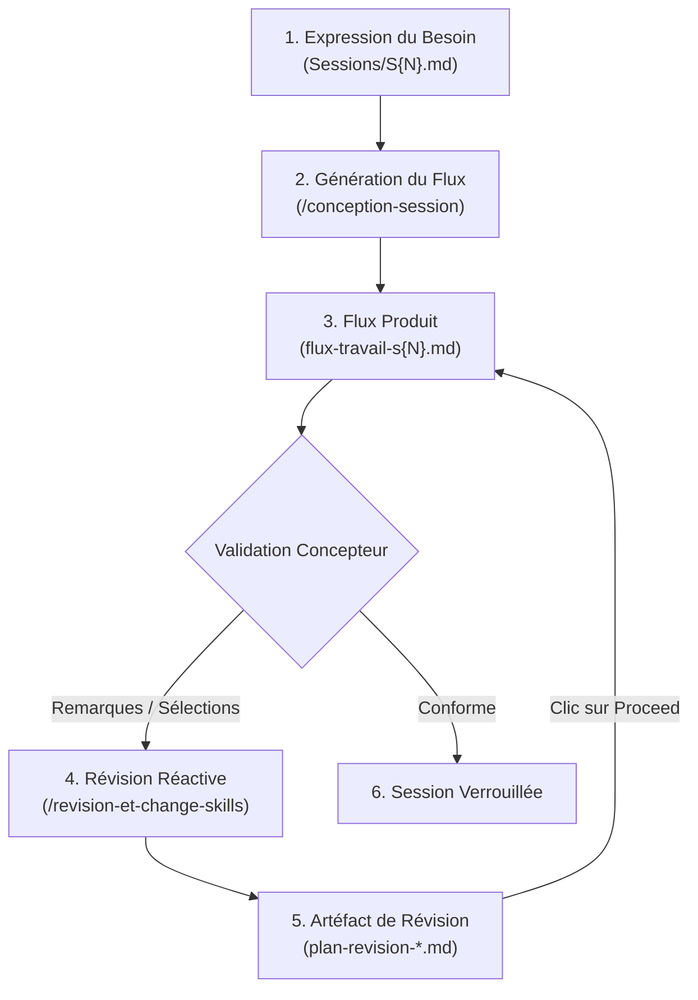
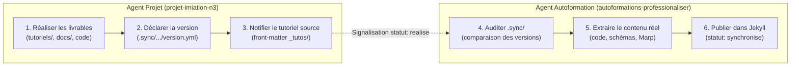

# Système Agentique du Workspace (`.agents/`)

Ce dossier rassemble l'infrastructure d'assistance intelligente et d'ingénierie méthodologique du projet.
Il structure les **règles permanentes** et les **compétences spécialisées (skills)** mobilisées par l'Agent IA pour accompagner le concepteur dans la planification des sessions de formation, la réalisation des livrables et la synchronisation avec l'**Agent Autoformation**.

---

## 1. Vue d'Ensemble de l'Architecture Agentique

Le dossier `.agents/` repose sur une séparation claire entre règles transversales, références normatives et compétences opérationnelles :

- **Règles Permanentes (`.agents/rules/`) :**
  - [regles-generales.md](./rules/regles-generales.md) : Consignes d'écriture universelles (français niveau A1 direct, phrases courtes Sujet + Verbe + Complément, interdiction absolue des tableaux Markdown, liens relatifs obligatoires, interdiction stricte de commit et push par l'IA).
  - [affichage-skills.md](./rules/affichage-skills.md) : Règle d'affichage systématique et normalisé des compétences (skills) mobilisées en fin de chaque message ou interaction.
  - [regles-flux-sessions.md](./rules/regles-flux-sessions.md) : Normes de gouvernance des sessions de formation (découpage en phases typées `UA-Lab` vs `UA-Tâche`, règle des 3 UA-Tâches maximum par session, double livrable obligatoire par tutoriel-lab, durées indicatives non contraignantes).
  - [contexte-projet.md](./rules/contexte-projet.md) : Référentiel technique intangible du projet (Laravel 13, MySQL, Tailwind CSS avec Preline UI, Alpine.js, Spatie Laravel-Permission).
- **Références Normatives (`.agents/references/`) :**
  - [domaines-competences.md](./references/domaines-competences.md) : Référentiel officiel et SSOT des 8 domaines, slugs canoniques et exclusion formelle de l'IA apprenant.
  - [organisation-livrables.md](./references/organisation-livrables.md) : Norme universelle d'arborescence et de nommage des livrables multi-niveaux.
  - [maturation-et-typologie-ua-tuto.md](./references/maturation-et-typologie-ua-tuto.md) : Référentiel normatif de maturation des UAs (ua-lab vs projet) et typologie des tutoriels (tuto-atelier, tuto-atelier-notions, tuto-tache).
  - [gitflow.md](./references/gitflow.md) : Conventions de branches par sprint et commits atomiques.
- **Compétences Spécialisées (`.agents/skills/`) :**
  - Modules autonomes encapsulant une expertise ciblée.
  - Chaque skill respecte une structure canonique compacte (`SKILL.md` $\le 75$ lignes) et délègue ses actions à des missions opérationnelles logées dans son sous-dossier `missions/`.

---

## 2. Catalogue des 17 Skills de l'Écosystème

L'écosystème comprend **17 skills complémentaires**, organisés en 5 familles d'activités :

### A. Gouvernance & Ingénierie des Sessions

- **[flux-travail](./skills/flux-travail/SKILL.md) (`/flux-travail`) :**
  - Rôle : Gouverne le [Flux de Travail Générique d'Ingénierie Logicielle](../flux-travail/flux-travail-generique.md) (25 étapes universelles réparties en 3 macro-phases).
  - Déclenchement : Évolution, ajout ou audit d'une étape générique universelle, arbitrage méthodologique entre Design Thinking, Gestion de Projet, Processus OO et Scrum Dual-Track.
  - Livrable gouverné : `flux-travail/flux-travail-generique.md`.

- **[conception-session](./skills/conception-session/SKILL.md) (`/conception-session`) :**
  - Rôle : Conçoit, découpe et génère les flux opérationnels génériques de formation pour chaque sprint de 80h ([flux-travail/sessions/](../flux-travail/sessions/)).
  - Déclenchement : Création d'une nouvelle session (`flux-travail-s{N}.md`), restructuration en phases typées (`UA-Lab` vs `UA-Tâche`), audit de conformité structurelle.
  - Missions associées : `missions/generer-session.md`, `missions/auditer-session.md`.

- **[conception-ua-lab](./skills/conception-ua-lab/SKILL.md) (`/conception-ua-lab`) :**
  - Rôle : Conçoit l'architecture didactique d'une Unité d'Apprentissage (UA-Lab) en découpant le domaine en séquences atomiques de tutoriels progressifs et en justifiant le choix des cas d'application supports (ex : Todo List pour Design Thinking).
  - Déclenchement : Découpage didactique d'un domaine en plusieurs tutoriels unitaires, choix d'applications supports épurées, spécification des livrables attendus pour l'agent de réalisation.
  - Missions associées : `missions/decouper-ua-lab.md`, `missions/specifier-livrables-lab.md`.

- **[revision-et-change-skills](./skills/revision-et-change-skills/SKILL.md) (`/revision-et-change-skills`) :**
  - Rôle : Orchestre la boucle interactive de co-conception avec le concepteur. Analyse les sélections de lignes et remarques critiques, produit un artéfact interactif de révision avec demande de confirmation, puis applique les corrections sur les documents et synchronise les skills associés.
  - Déclenchement : Remarques du concepteur sur une session ou un document de cadrage, commande `/revision-et-change-skills` ou consigne "fixe le plan et les skills".
  - Missions associées : `missions/analyser-remarques.md`, `missions/generer-artefact-revision.md`, `missions/synchroniser-skills.md`.

- **[skills-planer](./skills/skills-planer/SKILL.md) (`/skills-planer`) :**
  - Rôle : Planifie l'écosystème de compétences (Skills et missions). S'assure de la couverture de chaque étape de sprint avant sa réalisation en arbitrant entre nouveau skill, ajout de mission (une mission pouvant couvrir plusieurs étapes), ou reconception. Produit également le plan préliminaire guide dans `docs/plan-preliminaire-skills.md`.
  - Déclenchement : Avant de réaliser une étape de sprint (`/skills-planer`), ou cadrage préliminaire initial (`/skills-planer preliminaire`).
  - Missions associées : `missions/couvrir-etape-sprint.md`, `missions/planifier-plan-preliminaire.md`, `missions/creer-skill.md`.

- **[skills-dev](./skills/skills-dev/SKILL.md) (`/skills-dev`) :**
  - Rôle : Méta-gouvernance du système de compétences. Conçoit, audite et fait évoluer l'ensemble des skills, des missions et des règles permanentes du workspace.
  - Déclenchement : Audit des remarques non encore prises en charge (sans argument), création d'un nouveau skill ou d'une nouvelle mission.
  - Norme garantie : Fichiers `SKILL.md` $\le 75$ lignes et modularité stricte.

### B. Réalisation des Livrables Pédagogiques

- **[realisation-ua-lab](./skills/realisation-ua-lab/SKILL.md) (`/realisation-ua-lab`) :**
  - Rôle : Prend en charge la production technique complète des tutoriels d'un **UA-Lab** déjà spécifié et génère l'arborescence standardisée de livrables dans `tutoriels/[slug-domaine]/[slug-ua-lab]/`.
  - Règle fondamentale : Chaque tutoriel-atelier produit son binôme de livrables :
    - La fiche technique explicative : `[slug-tuto].md`.
    - Le support de présentation orale au format Marp Markdown : `presentation-[slug-tuto].md`.
    - Le journal des commandes terminal : `[slug-tuto].command.md` (si manipulation CLI).
  - Déclenchement : Réalisation d'une unité d'apprentissage spécifiée dans une session.

- **[marp](./skills/marp/SKILL.md) (`/marp`) :**
  - Rôle : Conçoit des présentations de diapositives au format Marp Markdown (`*.md`) respectant les standards de restitution orale.
  - Normes imposées : En-tête YAML obligatoire (thème default, paginate true), page de garde normalisée (Apprenant, Encadrant ESSARRAJ Fouad, Établissement Solicode Tanger, Domaine, Compétence), zéro tableau Markdown, une idée majeure par diapositive.
  - Déclenchement : Création, refonte ou contrôle de diaporamas de formation.

### C. Mentors Méthodologiques de Domaine

- **[domaine-scrum](./skills/domaine-scrum/SKILL.md) (`/domaine-scrum`) :**
  - Rôle : Agit comme un mentor pédagogique pour guider l'apprenant à travers 5 étapes simples afin d'assimiler l'Agilité et d'appliquer le cadre Scrum à son projet web.
  - Déclenchement : Cadrage de vision produit, rédaction de User Stories, organisation du backlog et tenue des cérémonies agiles.

### D. Réalisation de Sprint & Gestion du Dépôt

- **[realisation-sprint](./skills/realisation-sprint/SKILL.md) (`/realisation-sprint`) :**
  - Rôle : Pilote l'exécution opérationnelle d'un sprint étape par étape, structurée en jalons d'ingénierie. Produit un artéfact interactif par jalon, attend la validation formelle du concepteur, puis exécute rigoureusement chaque étape avec production des livrables associés.
  - Déclenchement : Lancement, exécution ou validation d'un jalon de sprint (`flux-travail/sessions/flux-travail-s{N}.md`).
  - Missions associées : `missions/planifier-jalon.md`, `missions/executer-etape.md`, `missions/valider-jalon.md`.

- **[init-depot](./skills/init-depot/SKILL.md) (`/init-depot`) :**
  - Rôle : Initialise l'infrastructure physique du dépôt Git (local/distant), configure le `.gitignore` adapté à Laravel 13, vérifie l'arborescence des dossiers et rédige le `README.md` d'accueil vitrine.
  - Déclenchement : Initialisation du dépôt, audit de l'infrastructure physique et rédaction du README vitrine.
  - Missions associées : `missions/initialiser-depot-git.md`, `missions/rediger-readme-accueil.md`.

- **[cadrage-produit](./skills/cadrage-produit/SKILL.md) (`/cadrage-produit`) :**
  - Rôle : Gouverne le cadrage fonctionnel du produit (objectifs SMART, périmètre In/Out du MVP) et la justification rationnelle de la stack technique (Laravel 13, MySQL, Preline UI, Alpine.js).
  - Déclenchement : Cadrage initial de produit, matrice In/Out, dossier de faisabilité technique de la stack.
  - Missions associées : `missions/cadrer-perimetre.md`, `missions/justifier-stack.md`.

- **[design-thinking-definition](./skills/design-thinking-definition/SKILL.md) (`/design-thinking-definition`) :**
  - Rôle : Gouverne la phase Définition du Design Thinking : cadrage de la Vision Produit (Product Goal), énoncé du Point of View (POV) et de la proposition de valeur.
  - Déclenchement : Formulation ou actualisation de la vision produit et du Product Goal.
  - Missions associées : `missions/definir-vision-produit.md`.

- **[design-thinking-empathie](./skills/design-thinking-empathie/SKILL.md) (`/design-thinking-empathie`) :**
  - Rôle : Gouverne la phase Empathie du Design Thinking : immersion usagers, formalisation de la Carte d'Empathie (4 quadrants) et modélisation des fiches Personas.
  - Déclenchement : Immersion terrain, recueil des besoins utilisateurs, modélisation de personas.
  - Missions associées : `missions/formaliser-empathie.md`, `missions/modeliser-personas.md`.

- **[scrum-product-backlog](./skills/scrum-product-backlog/SKILL.md) (`/scrum-product-backlog`) :**
  - Rôle : Gouverne la conception, le découpage INVEST, la formulation des critères d'acceptation et l'ordonnancement MoSCoW du Product Backlog Scrum.
  - Déclenchement : Initialisation du carnet de produit, découpage en User Stories, priorisation MoSCoW.
  - Missions associées : `missions/ordonner-backlog.md`.

- **[scrum-sprint-planning](./skills/scrum-sprint-planning/SKILL.md) (`/scrum-sprint-planning`) :**
  - Rôle : Gouverne la planification de sprint Scrum, la formulation du Sprint Goal, la sélection des User Stories du backlog et le découpage en tâches techniques.
  - Déclenchement : Sprint Planning, engagement d'équipe, timeboxing et estimation des tâches.
  - Missions associées : `missions/planifier-sprint.md`.

- **[design-thinking-prototypage](./skills/design-thinking-prototypage/SKILL.md) (`/design-thinking-prototypage`) :**
  - Rôle : Gouverne la phase Prototypage du Design Thinking : User Flow textuel, spécification d'UI Kit (Tailwind / Preline) et maquettes interactives responsives.
  - Déclenchement : Modélisation des parcours utilisateurs, conception d'UI Kit, maquettage d'écrans.
  - Missions associées : `missions/modeliser-user-flow.md`, `missions/concevoir-ui-kit.md`, `missions/prototyper-maquette.md`.

### E. Communication Inter-Agents

- **[agent-communication](./skills/agent-communication/SKILL.md) (`/agent-communication`) :**
  - Rôle : Pilote la communication formelle inter-agents (`redacteur-autoformation` et `realisation-sprint`) via des canaux physiques d'échange symlinkés et des gabarits standardisés.
  - Déclenchement : Réception et émission de directives de cadrage didactique, transmission de flux opérationnels, accusés de réception et synchronisation bidirectionnelle.

---

## 3. Guide du Concepteur : Planification des Sessions de Formation

Le concepteur dispose d'un flux outillé simple pour construire ou ajuster une session de formation :



### Démarche Pas-à-Pas :

1. **Formaliser les Intentions Pédagogiques :**
   - Renseigner la fiche source de la session dans `Sessions/S{N}.md` (objectifs d'apprentissage, compétences visées, User Stories du sprint).
2. **Générer le Flux de Travail Opérationnel :**
   - Lancer la commande `/conception-session` en ciblant le sprint souhaité.
   - Le skill applique automatiquement les règles de structure génériques :
     - Titrage officiel centré sur l'incrément de produit.
     - Respect du format en **phases typées** (`UA-Lab` théorique vs `UA-Tâche` opérationnelle).
     - Découpage atomique des labs délégué au skill `/conception-ua-lab`.
     - Rattachement systématique de toutes les UA-Tâches au domaine `D.351.2-realisation-projet`.
     - Mention explicite du statut de réalisation pour chaque tutoriel (`Réalisé` vs `À réaliser`).
     - Durée indicative non contraignante (80h / 10 jours ouvrés).
3. **Réviser et Ajuster Réactivement :**
   - Pour modifier une étape, supprimer un lab redondant ou ajuster un intitulé, le concepteur sélectionne le passage concerné et formule sa remarque.
   - Lancer `/revision-et-change-skills`.
   - L'agent génère un artéfact interactif (`plan-revision-*.md`) avec le bouton **Proceed**.
   - Après relecture, un clic sur Proceed applique instantanément les modifications sur le fichier de session et aligne automatiquement les règles et compétences impactées.

---

## 4. Guide du Concepteur : Réalisation des Livrables

La réalisation des livrables s'organise selon la nature du travail à produire :

### A. Réalisation des Livrables d'Apprentissage (`tutoriels/`)
- **Compétence mobilisée :** `/realisation-ua-lab` appuyé par les mentors de domaine (`/domaine-scrum`).
- **Règle absolue des 2 livrables par atelier :**
  Tout sous-dossier de tutoriel-atelier `tutoriels/[slug-domaine]/[slug-ua]/[slug-tuto]/` doit obligatoirement comporter :
  - Le document technique complet : `[slug-tuto].md`.
  - Le support de présentation orale au format Marp Markdown : `presentation-[slug-tuto].md` (conçu selon `/marp`).
  - Le journal des commandes terminal : `[slug-tuto].command.md` (si manipulation CLI).
  - Aucun fichier `README.md` ne doit être créé à l'intérieur des sous-dossiers unitaires de tutoriels.
- **Indexation :** Le fichier `README.md` unique à la racine de `tutoriels/` récapitule l'ensemble des domaines disponibles.

### B. Réalisation des Livrables Opérationnels de Projet
- Les livrables applicatifs du projet d'imitation (*Blog des Lauréats*) sont rédigés directement dans leurs répertoires d'ingénierie officiels :
  - Cadrage et architecture : `docs/cadrage/`, `docs/architecture/`.
  - Analyse fonctionnelle et prototypage : `docs/analyse/`, `docs/conception/`.
  - Feuilles d'engagement de sprint : `sprints/sprint-[N].md`.
  - Carnet de produit et découpage des exigences : `scrum/product-backlog.md`.
  - Code source applicatif : `src/` (Contrôleurs, Services, Modèles Eloquent, Vues Blade).

### C. Réalisation des Livrables de Sprint et Clôture
- **Compétence mobilisée :** `/realisation-sprint`.
- En fin de sprint, l'agent produit les artéfacts formels de validation :
  - Le procès-verbal contradictoire et audit DoD : `sprints/pv-review-[N].md`.
  - Le bilan rétrospectif et plan d'action d'amélioration : `sprints/retrospective-[N].md`.
  - Le réordonnancement du backlog produit : `scrum/product-backlog.md`.

---

## 5. Protocole de Synchronisation avec l'Agent "Autoformation"

Le workspace collabore en continu avec un agent partenaire extérieur : l'**Agent Autoformation** (`autoformations-professionaliser`).
Cette synchronisation repose sur l'espace pivot [.sync/](../.sync/README.md) et garantit la traçabilité sans polluer les répertoires de code.



### Principes Clés de la Synchronisation Inter-Agents :

1. **Le Dossier Pivot `.sync/` comme Point Unique de Vérité :**
   - Le dossier `.sync/` reproduit en miroir l'arborescence des dossiers de livrables et de code.
   - Il contient **exclusivement des fichiers `version.yml`**.
   - **Interdiction stricte :** Aucun fichier `version.yml` ne doit exister dans `tutoriels/`, `docs/` ou `src/`.
2. **Format Sémantique Minimaliste de `version.yml` :**
   ```yaml
   nom-du-tutoriel.md: "1.0.0"
   presentation-nom-du-tutoriel.md: "1.0.0"
   ```
   Chaque mise à jour d'un livrable entraîne l'incrémentation de sa version sémantique (`1.0.0` $\to$ `1.0.1` pour un correctif, `1.1.0` pour un enrichissement).
3. **Notification dans le Front-Matter du Tutoriel Source :**
   Lorsque l'Agent Projet achève un tutoriel, il met à jour le front-matter du fichier source dans `_tutos/` côté autoformation :
   ```yaml
   sprint: "sprint0"
   statut_realisation: "realise"
   livrables:
     - chemin: "tutoriels/scrum/initiation-scrum/comprendre-scrum/comprendre-scrum.md"
       version: "1.0.0"
     - chemin: "tutoriels/scrum/initiation-scrum/comprendre-scrum/presentation-comprendre-scrum.md"
       version: "1.0.0"
   ```
4. **Cycle de Vie du Statut de Réalisation :**
   - `non_debute` : Tutoriel planifié dans le sprint, aucun fichier produit.
   - `en_cours` : Réalisation en cours de rédaction ou de codage.
   - `realise` : Livrables créés, vérifiés et enregistrés dans `.sync/.../version.yml`.
   - `a_adapter` : Évolution technique constatée sur le projet nécessitant une mise à jour pédagogique.
   - `synchronise` : L'Agent Autoformation a extrait les contenus réels dans le site Jekyll et validé la conformité des versions.

---

## 6. Cheatsheet des Commandes Slash pour le Concepteur

Pour mobiliser directement les compétences depuis le chat, le concepteur peut utiliser ces raccourcis :

- `/flux-travail` : Consulter, auditer ou adapter le flux universel d'ingénierie logicielle (25 étapes).
- `/conception-session` : Découper et générer une session de formation en phases typées.
- `/conception-ua-lab` : Concevoir l'architecture didactique et découper un UA-Lab en tutoriels unitaires progressifs.
- `/revision-et-change-skills` : Lancer la révision interactive d'un flux selon des remarques ou sélections et synchroniser les skills.
- `/realisation-ua-lab` : Produire l'arborescence complète d'un lab (fiche technique + présentation Marp + journal CLI).
- `/marp` : Rédiger ou formater une présentation de diapositives conforme aux normes Solicode.
- `/domaine-scrum` : Solliciter le mentor agile pour les rôles, User Stories, backlog et cérémonies.
- `/realisation-sprint` : Piloter la réalisation opérationnelle d'un sprint étape par étape par jalon.
- `/skills-planer` : Planifier l'écosystème préliminaire des compétences ou proposer un skill adapté au fil de l'eau.
- `/init-depot` : Initialiser l'infrastructure Git et le README d'accueil vitrine.
- `/cadrage-produit` : Cadrer le périmètre In/Out et justifier la stack technique.
- `/design-thinking-definition` : Cadrer la vision produit et le Product Goal.
- `/design-thinking-empathie` : Conduire l'immersion usagers, formaliser la carte d'empathie et les personas.
- `/scrum-product-backlog` : Bâtir, découper en US INVEST et ordonner le carnet de produit selon MoSCoW.
- `/scrum-sprint-planning` : Planifier le sprint, formaliser le Sprint Goal et l'engagement d'équipe.
- `/design-thinking-prototypage` : Modéliser le User Flow, concevoir l'UI Kit et prototyper les maquettes d'accueil.
- `/skills-dev` : Auditer l'écosystème de compétences ou concevoir un nouveau skill.
