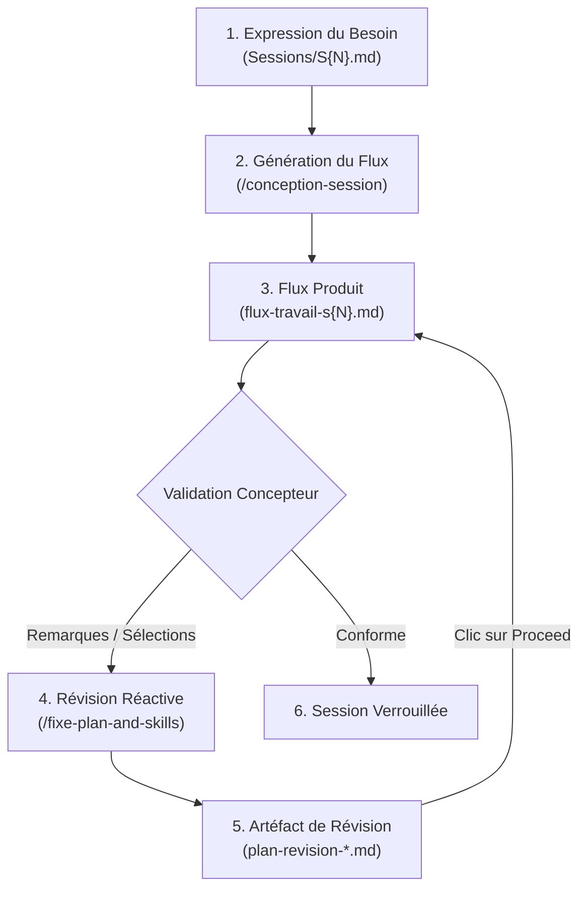
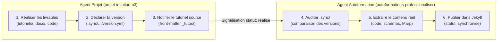

# Système Agentique du Workspace (`.agents/`)

Ce dossier rassemble l'infrastructure d'assistance intelligente et d'ingénierie méthodologique du projet.
Il structure les **règles permanentes** et les **compétences spécialisées (skills)** mobilisées par l'Agent IA pour accompagner le concepteur dans la planification des sessions de formation, la réalisation des livrables et la synchronisation avec l'**Agent Autoformation**.

---

## 1. Vue d'Ensemble de l'Architecture Agentique

Le dossier `.agents/` repose sur une séparation claire entre règles transversales et compétences opérationnelles :

- **Règles Permanentes (`.agents/rules/`) :**
  - [regles-generales.md](./rules/regles-generales.md) : Consignes d'écriture universelles (français niveau A1 direct, phrases courtes Sujet + Verbe + Complément, interdiction absolue des tableaux Markdown, liens relatifs obligatoires, interdiction stricte de commit et push par l'IA).
  - [regles-flux-sessions.md](./rules/regles-flux-sessions.md) : Normes de gouvernance des sessions de formation (découpage en phases typées `UA-Lab` vs `UA-Tâche`, règle des 3 UA-Tâches maximum par session, double livrable obligatoire par tutoriel-lab, durées indicatives non contraignantes).
  - [contexte-projet.md](./rules/contexte-projet.md) : Référentiel technique intangible du projet (Laravel 13, MySQL, Tailwind CSS avec Preline UI, Alpine.js, Spatie Laravel-Permission).
- **Compétences Spécialisées (`.agents/skills/`) :**
  - Modules autonomes encapsulant une expertise ciblée.
  - Chaque skill respecte une structure canonique compacte (`SKILL.md` $\le 75$ lignes) et délègue ses actions à des missions opérationnelles logées dans son sous-dossier `missions/`.

---

## 2. Catalogue des 10 Skills de l'Écosystème

L'écosystème comprend **10 skills complémentaires**, organisés en 4 familles d'activités :

### A. Gouvernance & Ingénierie des Sessions

- **[flux-travail](./skills/flux-travail/SKILL.md) (`/flux-travail`) :**
  - Rôle : Gouverne le [Flux de Travail Générique d'Ingénierie Logicielle](../flux-travail/flux-travail-generique.md) (25 étapes universelles réparties en 3 macro-phases).
  - Déclenchement : Évolution, ajout ou audit d'une étape générique universelle, arbitrage méthodologique entre Design Thinking, Gestion de Projet, Processus OO et Scrum Dual-Track.
  - Livrable gouverné : `flux-travail/flux-travail-generique.md`.

- **[conception-session](./skills/conception-session/SKILL.md) (`/conception-session`) :**
  - Rôle : Conçoit, découpe et génère les flux opérationnels de formation pour chaque sprint de 80h ([flux-travail/sessions/](../flux-travail/sessions/)).
  - Déclenchement : Création d'une nouvelle session (`flux-travail-s{N}.md`), restructuration en phases typées (`UA-Lab` vs `UA-Tâche`), audit de conformité pédagogique.
  - Missions associées : `missions/generer-session.md`, `missions/auditer-session.md`.

- **[fixe-plan-and-skills](./skills/fixe-plan-and-skills/SKILL.md) (`/fixe-plan-and-skills`) :**
  - Rôle : Orchestre la boucle interactive de co-conception avec le concepteur. Analyse les sélections de lignes et remarques critiques, produit un artéfact interactif de révision avec demande de confirmation, puis applique les corrections sur les documents et synchronise les skills associés.
  - Déclenchement : Remarques du concepteur sur une session ou un document de cadrage, commande `/fixe-plan-and-skills` ou consigne "fixe le plan et les skills".
  - Missions associées : `missions/analyser-remarques.md`, `missions/generer-artefact-revision.md`, `missions/synchroniser-skills.md`.

- **[skills-dev](./skills/skills-dev/SKILL.md) (`/skills-dev`) :**
  - Rôle : Méta-gouvernance du système de compétences. Conçoit, audite et fait évoluer l'ensemble des skills, des missions et des règles permanentes du workspace.
  - Déclenchement : Audit des remarques non encore prises en charge (sans argument), création d'un nouveau skill ou d'une nouvelle mission.
  - Norme garantie : Fichiers `SKILL.md` $\le 75$ lignes et modularité stricte.

### B. Réalisation des Livrables Pédagogiques

- **[realisation-ua-lab](./skills/realisation-ua-lab/SKILL.md) (`/realisation-ua-lab`) :**
  - Rôle : Prend en charge la réalisation complète d'un **UA-Lab** et produit l'arborescence standardisée de livrables dans `tutoriels/[slug-domaine]/[slug-ua-lab]/`.
  - Règle fondamentale : Chaque tutoriel-lab produit obligatoirement son **binôme de livrables** :
    - La fiche technique explicative : `[slug-tuto].md`.
    - Le support de présentation orale au format Marp Markdown : `presentation-[slug-tuto].md`.
  - Déclenchement : Réalisation d'une unité d'apprentissage demandée par le concepteur ou spécifiée dans une session.

- **[marp](./skills/marp/SKILL.md) (`/marp`) :**
  - Rôle : Conçoit des présentations de diapositives au format Marp Markdown (`*.md`) respectant les standards de restitution orale.
  - Normes imposées : En-tête YAML obligatoire (thème default, paginate true), page de garde normalisée (Apprenant, Encadrant ESSARRAJ Fouad, Établissement Solicode Tanger, Domaine, Compétence), zéro tableau Markdown, une idée majeure par diapositive.
  - Déclenchement : Création, refonte ou contrôle de diaporamas de formation.

### C. Mentors Méthodologiques de Domaine

- **[domaine-scrum](./skills/domaine-scrum/SKILL.md) (`/domaine-scrum`) :**
  - Rôle : Agit comme un mentor pédagogique pour guider l'apprenant à travers 5 étapes simples afin d'assimiler l'Agilité et d'appliquer le cadre Scrum à son projet web.
  - Déclenchement : Animation des labs préparatoires bloquants de lancement (`lab-product-owner` pour le Groupe 1 et `lab-scrum-master`), cadrage de vision produit, rédaction de User Stories, organisation du backlog et des cérémonies.

- **[domaine-ia](./skills/domaine-ia/SKILL.md) (`/domaine-ia`) :**
  - Rôle : Agit comme un mentor pour guider l'apprenant à travers 5 étapes progressives pour concevoir, outiller et tester son propre Agent IA de développement web.
  - Déclenchement : Méthode RIO (Rôle, Instructions, Objectif), Context Engineering, création de Rules et de Skills, configuration et tests d'agents de code.

### D. Clôture Agile & Gestion du Dépôt

- **[cloture-sprint](./skills/cloture-sprint/SKILL.md) (`/cloture-sprint`) :**
  - Rôle : Orchestre l'ensemble des rituels et documents de fin de sprint Scrum en déléguant à ses 4 missions spécialisées :
    - `/cloture-sprint review` : Audit des 7 critères formels de la Definition of Done (DoD) et rédaction du procès-verbal de démonstration (`scrum/revue-s[X].md`).
    - `/cloture-sprint retrospective` : Animation de la rétrospective réflexive et détection des dettes méthodologiques (`scrum/retrospective-s[X].md`).
    - `/cloture-sprint refinement` : Clôture des tâches terminées, archivage des issues résolues et réordonnancement du backlog produit (`scrum/product-backlog.md`).
    - `/cloture-sprint debriefing` : Évaluation réflexive des compétences mobilisées et debriefing du Live Coding (`scrum/bilan-s[X].md`).
  - Déclenchement : Cérémonies de clôture de sprint ou fin de session de formation.

- **[gestion-depot](./skills/gestion-depot/SKILL.md) (`/gestion-depot`) :**
  - Rôle : Gère les opérations d'infrastructure Git/GitHub et le cycle de vie documentaire du projet.
  - Déclenchement : Initialisation du dépôt local et distant, bascule sur la branche active du sprint (`sprint-N`), actualisation de la documentation d'accueil racine (`README.md`).
  - Missions associées : `missions/init-depot.md`, `missions/init-projet.md`.

---

## 3. Guide du Concepteur : Planification des Sessions de Formation

Le concepteur dispose d'un flux outillé simple pour construire ou ajuster une session de formation :



### Démarche Pas-à-Pas :

1. **Formaliser les Intentions Pédagogiques :**
   - Renseigner la fiche source de la session dans `Sessions/S{N}.md` (objectifs d'apprentissage, compétences visées, User Stories du sprint).
2. **Générer le Flux de Travail Opérationnel :**
   - Lancer la commande `/conception-session` en ciblant le sprint souhaité.
   - Le skill applique automatiquement les règles de structure :
     - Respect du format en **phases typées** (`UA-Lab` avec alternance théorique/pratique vs `UA-Tâche` opérationnelle).
     - Regroupement des tâches opérationnelles en **au maximum 3 blocs d'UA-Tâches** par session (`UA-Tâche Début`, `UA-Tâche Milieu`, `UA-Tâche Fin`).
     - Titrage épuré des étapes : `Étape X : Tutoriel-lab : [Nom]`, `Étape X+1 : Tutoriel-application : [Nom]`, `Étape X : [Titre opérationnel]`.
     - Intégration des correspondances avec le flux universel à 25 étapes dans le corps de texte.
     - Durée indicative non contraignante (80h / 10 jours ouvrés).
3. **Réviser et Ajuster Réactivement :**
   - Pour modifier une étape, supprimer un lab redondant ou ajuster un intitulé, le concepteur sélectionne le passage concerné et formule sa remarque.
   - Lancer `/fixe-plan-and-skills`.
   - L'agent génère un artéfact interactif (`plan-revision-*.md`) avec le bouton **Proceed**.
   - Après relecture, un clic sur Proceed applique instantanément les modifications sur le fichier de session et aligne automatiquement les règles et compétences impactées.

---

## 4. Guide du Concepteur : Réalisation des Livrables

La réalisation des livrables s'organise selon la nature du travail à produire :

### A. Réalisation des Livrables d'Apprentissage (`tutoriels/`)
- **Compétence mobilisée :** `/realisation-ua-lab` appuyé par les mentors de domaine (`/domaine-scrum`, `/domaine-ia`).
- **Règle absolue des 2 livrables par atelier :**
  Tout sous-dossier de tutoriel `tutoriels/[slug-domaine]/[slug-ua]/[slug-tuto]/` doit obligatoirement comporter :
  - Le document technique complet : `[slug-tuto].md`.
  - Le diaporama Marp de présentation orale : `presentation-[slug-tuto].md` (conçu selon `/marp`).
  - Aucun fichier `README.md` ne doit être créé à l'intérieur des sous-dossiers unitaires de tutoriels.
- **Indexation :** Le fichier `README.md` racine de l'UA-Lab récapitule l'ensemble des tutoriels produits.

### B. Réalisation des Livrables Opérationnels de Projet
- Les livrables applicatifs du projet d'imitation (*Blog des Lauréats*) sont rédigés directement dans leurs répertoires d'ingénierie officiels :
  - Cadrage et architecture : `docs/cadrage/`, `docs/architecture/`.
  - Analyse fonctionnelle et modélisation Mermaid : `docs/analyse/`, `docs/design/`.
  - Feuilles d'engagement de sprint : `sprints/sprint-{N}.md`.
  - Carnet de produit et découpage des exigences : `scrum/product-backlog.md`.
  - Code source Laravel 13 : `app/`, `resources/views/`, `database/migrations/`.

### C. Réalisation des Livrables de Clôture de Sprint
- **Compétence mobilisée :** `/cloture-sprint`.
- En fin de sprint, l'agent produit les artéfacts formels de validation :
  - Le procès-verbal de démonstration et audit DoD : `scrum/revue-s{N}.md`.
  - Le bilan rétrospectif et plan d'action d'amélioration : `scrum/retrospective-s{N}.md`.
  - L'archivage des tâches et réordonnancement du backlog : `issues/issues-sprint-{N}.md` et `scrum/product-backlog.md`.
  - Le bilan d'acquisition des compétences : `scrum/bilan-s{N}.md`.

---

## 5. Protocole de Synchronisation avec l'Agent "Autoformation"

Le workspace collabore en continu avec un agent partenaire extérieur : l'**Agent Autoformation** (`autoformations-professionaliser`).
Cette synchronisation repose sur l'espace pivot [.sync/](../.sync/README.md) et garantit la traçabilité sans polluer les répertoires de code.



### Principes Clés de la Synchronisation Inter-Agents :

1. **Le Dossier Pivot `.sync/` comme Point Unique de Vérité :**
   - Le dossier `.sync/` reproduit en miroir l'arborescence des dossiers de livrables et de code.
   - Il contient **exclusivement des fichiers `version.yml`**.
   - **Interdiction stricte :** Aucun fichier `version.yml` ne doit exister dans `tutoriels/`, `docs/` ou `app/`.
2. **Format Sémantique Minimaliste de `version.yml` :**
   ```yaml
   nom-du-tutoriel.md: "1.0.0"
   presentation-nom-du-tutoriel.md: "1.0.0"
   ```
   Chaque mise à jour d'un livrable entraîne l'incrémentation de sa version sémantique (`1.0.0` $\to$ `1.0.1` pour un correctif, `1.1.0` pour un enrichissement).
3. **Notification dans le Front-Matter du Tutoriel Source :**
   Lorsque l'Agent Projet achève un tutoriel, il met à jour le front-matter du fichier source dans `_tutos/` côté autoformation :
   ```yaml
   sprint: "sprint1"
   statut_realisation: "realise"
   livrables:
     - chemin: "tutoriels/ia/guide-prompting-rio/guide-prompting-rio.md"
       version: "1.0.0"
     - chemin: "tutoriels/ia/guide-prompting-rio/presentation-prompting-rio.md"
       version: "1.0.0"
   ```
4. **Cycle de Vie du Statut de Réalisation :**
   - `non_debute` : Tutoriel planifié dans le sprint, aucun fichier produit.
   - `en_cours` : Réalisation en cours de rédaction ou de codage.
   - `realise` : Livrables créés, vérifiés et enregistrés dans `.sync/.../version.yml`.
   - `a_adapter` : Évolution technique constatée sur le projet nécessitant une mise à jour pédagogique.
   - `synchronise` : L'Agent Autoformation a extrait les contenus réels dans le site Jekyll et validé la conformité des versions.
5. **Primauté Normative et Adaptation Mutuelle :**
   - L'Agent Autoformation est l'autorité normative définissant la structure et la nomenclature canonique de tous les livrables.
   - Si le projet réel valide une solution technique plus performante (ex : Laravel 13, MySQL, Preline UI), l'Agent Autoformation répercute cette évolution dans ses fiches de cours pour assurer l'alignement pédagogique permanent.

---

## 6. Cheatsheet des Commandes Slash pour le Concepteur

Pour mobiliser directement les compétences depuis le chat, le concepteur peut utiliser ces raccourcis :

- `/flux-travail` : Consulter, auditer ou adapter le flux universel d'ingénierie logicielle (25 étapes).
- `/conception-session` : Découper et générer une session de formation en phases typées.
- `/fixe-plan-and-skills` : Lancer la révision interactive d'un flux selon des remarques ou sélections.
- `/realisation-ua-lab` : Produire l'arborescence complète d'un lab (fiche technique + présentation Marp).
- `/marp` : Rédiger ou formater une présentation de diapositives conforme aux normes Solicode.
- `/domaine-scrum` : Solliciter le mentor agile pour les rôles, User Stories, backlog et cérémonies.
- `/domaine-ia` : Solliciter le mentor IA pour les prompts RIO, context engineering, rules et skills.
- `/cloture-sprint` : Déclencher les rituels de fin de sprint (revue DoD, rétrospective, backlog, bilan).
- `/gestion-depot` : Préparer une nouvelle branche de sprint Git ou actualiser la documentation racine.
- `/skills-dev` : Auditer l'écosystème de compétences ou concevoir un nouveau skill.
