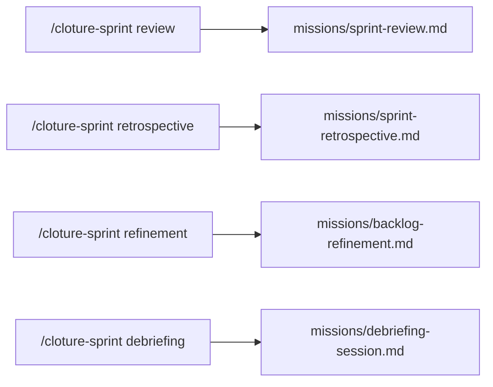

# Skill Clôture de Sprint : /cloture-sprint

## 1. Mission
Automatiser et structurer la production des livrables de clôture de sprint Scrum sur le projet d'imitation et les projets fil rouge, en orchestrant les 4 missions dédiées de fin de sprint.

## 2. Déclenchement
- **Quand l'activer :**
  - En fin de sprint pour conduire les cérémonies de clôture (`/cloture-sprint`).
  - Production du procès-verbal de démonstration et audit de la DoD (`/cloture-sprint review`).
  - Animation de la rétrospective réflexive et détection de dettes méthodologiques (`/cloture-sprint retrospective`).
  - Archivage des tâches et réordonnancement du carnet produit (`/cloture-sprint refinement`).
  - Débriefing individuel de session et bilan des compétences (`/cloture-sprint debriefing`).
- **Quand NE PAS l'activer :**
  - Tâches de développement courant de code durant le sprint.
  - Planification initiale de sprint (utiliser le rituel de Sprint Planning).
  - Tâches d'infrastructure Git pure (utiliser `gestion-depot`).

## 3. Workflow & Missions Disponibles
Le skill orchestre 4 missions spécialisées accessibles sous `missions/` :

1. **`missions/sprint-review.md` :** Démonstration live face à la DoD (7 critères bloquants). Produit `scrum/revue-s[X].md`.
2. **`missions/sprint-retrospective.md` :** Collecte forces/freins et dette d'empathie utilisateur vers S[X+1]. Produit `scrum/retrospective-s[X].md`.
3. **`missions/backlog-refinement.md` :** Clôture US, archivage `issues/issues-closes.md` et mise à jour `scrum/product-backlog.md`.
4. **`missions/debriefing-session.md` :** Évaluation réflexive des 5 compétences et analyse du Live Coding. Produit `scrum/bilan-s[X].md`.

## 4. Règles de Restitution
- Format Markdown pur sans tableau (utiliser des listes à puces directes et des blocs structurés).
- Respect rigoureux des emplacements canoniques du projet (`scrum/` et `issues/`).
- Zéro bavardage conversationnel hors livrables.
