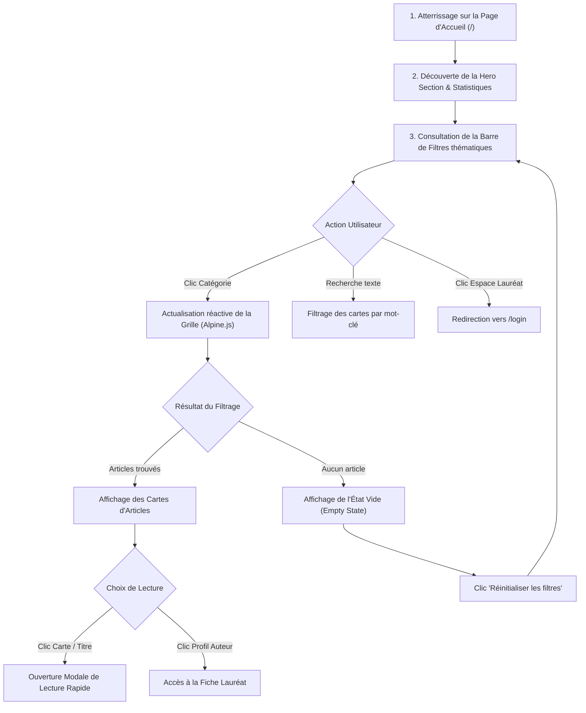

# User Flow : Page d'Accueil du Blog des Lauréats

> Livrable d'ingénierie logicielle — Étape 12 du flux de développement (Design Thinking : Parcours Utilisateur & User Flow).

---

## 1. Objectifs & Acteurs du Flux

### Acteurs Cibles
- **Youssef (L'Apprenant Lecteur) :** Vient chercher des retours d'expérience concrets, des conseils d'entretien et des tutoriels techniques.
- **Sara (La Lauréate Auteure) :** Souhaite accéder rapidement à son espace pour rédiger un nouvel article ou consulter ses parutions.
- **Visiteur Extérieur / Recruteur :** Découvre l'écosystème de formation et évalue le dynamisme technique des diplômés.

### Objectifs Majeurs du Parcours
1. Découvrir instantanément la vocation du blog dès l'atterrissage sur la Hero Section.
2. Filtrer intuitivement les articles par catégorie sans friction ni temps d'attente.
3. Lire un résumé d'article et accéder à son contenu complet ou à la modale de lecture rapide.
4. Identifier le profil professionnel de l'auteur lauréat et consulter ses réseaux (LinkedIn/GitHub).
5. Accéder à l'espace d'authentification pour les lauréats et modérateurs.

---

## 2. Modélisation Arborescente du Parcours Utilisateur

Le flux de navigation de la page d'accueil s'articule en 5 étapes séquentielles :

---

## 3. Description Étape par Étape des Actions & Réponses Système

### Étape 1 : Atterrissage & En-tête de Navigation (Navbar)
- **Point d'entrée :** URL racine du site `/`.
- **Composants visibles :** Logo du Blog des Lauréats, champ de recherche globale, lien "Articles", bouton "Espace Lauréat".
- **Comportement Mobile :** Les liens sont regroupés dans un menu tiroir rétractable activé par le bouton hamburger Alpine.js.

### Étape 2 : Hero Section & Proposition de Valeur
- **Éléments visuels :** Titre fort valorisant l'expérience terrain des anciens, sous-titre explicatif, badge communautaire Solicode Tanger et indicateurs d'impact (30+ Lauréats, 50+ Articles, 100% Retours réels).
- **Bouton d'action principal (CTA) :** "Explorer les articles" provoquant un défilement fluide vers la grille de lecture.

### Étape 3 : Sélection & Filtrage Dynamique par Catégorie
- **Composants :** Barre horizontale de filtres sous forme de badges cliquables :
  - *Tous* (sélectionné par défaut).
  - *Conseils Carrière*.
  - *Tutoriels Laravel*.
  - *Insertion Professionnelle*.
  - *Architecture & Bonnes Pratiques*.
- **Réaction Système :** Le clic sur un filtre modifie l'état réactif Alpine.js (`activeCategory`). Les cartes d'articles ne correspondant pas au filtre sont masquées instantanément sans rechargement de page.

### Étape 4 : Exploration des Cartes d'Articles & Déclencheurs
- **Chaque carte présente :**
  - Badge de catégorie avec code couleur dédié.
  - Titre percutant et extrait introductif du sujet.
  - Métadonnées : avatar de l'auteur, nom du lauréat, date de parution et temps de lecture estimé.
- **Actions possibles :**
  - Clic sur la carte : déclenche l'ouverture de la modale interactive de lecture rapide.
  - Clic sur l'auteur : prévisualisation du profil avec liens LinkedIn et GitHub.

### Étape 5 : Navigation & Pagination
- **Comportement :** Au bas de la grille, une barre de pagination permet de naviguer entre les pages d'articles lorsque le volume dépasse la limite par page (9 articles).

---

## 4. Gestion des États Limites (Edge Cases)

- **État Vide (Empty State) :**
  - Si un filtre ou une recherche ne renvoie aucun résultat, la grille affiche une illustration sobre, un message bienveillant ("Aucun article trouvé dans cette catégorie pour le moment") et un bouton "Réinitialiser les filtres".
- **État Écran Étroit (Mobile State) :**
  - Sur mobile, la grille passe en colonne unique (1 carte par ligne), les filtres deviennent défilables horizontalement avec le doigt, et la barre de navigation se replie dans un menu accessible.
- **État d'Erreur (Error State) :**
  - Si une ressource est indisponible, l'application propose un bouton de retour à l'accueil clair.
