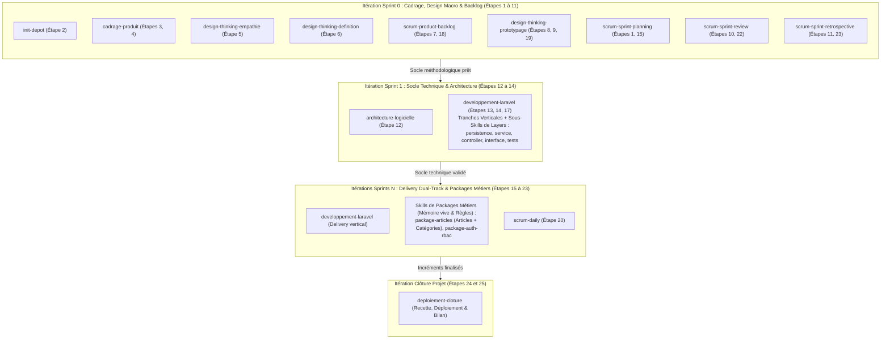

# Plan Préliminaire Global de l'Écosystème de Compétences : Trajectoire Itérative par Sprint

Ce document formalise la cartographie préliminaire de l'écosystème de compétences (Skills et missions) projetée sur les **25 étapes du Flux Générique d'Ingénierie Logicielle Web** ([flux-travail-generique.md](../flux-travail/flux-travail-generique.md)).
Il applique une démarche **strictement itérative par sprint**, s'aligne sur la **terminologie théorique canonique**, et privilégie le développement applicatif par **tranches verticales** avec sous-skills par couche et regroupement par **packages métiers**.

---

> [!IMPORTANT]
> **Statut Méthodologique : Cadre Guide Évolutif & Critique Permanente**
> Ce document constitue une **hypothèse de travail initiale** et une boussole d'orientation.
> Conformément aux règles de [`skills-planer`](../.agents/skills/skills-planer/SKILL.md), **ce plan ne doit jamais être appliqué de manière aveugle ou mécanique**.
> Lors de la réalisation effective de chaque sprint, à chaque étape du flux de travail, `skills-planer` procède obligatoirement à un **examen critique** de cette projection pour proposer une organisation supérieure, plus compacte et plus adaptée au contexte réel.

---

## 1. Principes Directeurs d'Ingénierie des Compétences

Les retours critiques du concepteur consacrent quatre principes d'architecture fondamentaux :

1. **Abandon des « Niveaux » — Approche 100% Itérative par Sprint :**
   - Les compétences ne sont pas figées dans des strates abstraites (« Niveau 1, 2, 3 »).
   - **À chaque sprint, on conçoit et réalise uniquement les skills demandés par les étapes du sprint actif.**
   - L'écosystème émerge et s'enrichit organiquement au rythme naturel des livrables.

2. **Terminologie Théorique Canonique Obligatoire :**
   - Bannir les termes vagues ou inventés (ex : « immersion »).
   - Utiliser exclusivement les termes canoniques de la théorie :
     - Les 5 phases officielles du **Design Thinking** : *Empathie, Définition, Idéation, Prototypage, Test*.
     - Les événements et artéfacts officiels de **Scrum** : *Sprint Planning, Daily Scrum, Sprint Review, Sprint Retrospective, Product Backlog, Backlog Refinement*.

3. **Développement par Tranche Verticale & Sous-Skills par Couche (Layers) :**
   - Développer une fonctionnalité (User Story) nécessite de traverser la quasi-totalité des couches (Migration -> Modèle -> Service -> Contrôleur -> Vue Blade / Alpine.js -> Test PHPUnit).
   - Séparer le développement en 5 skills racines indépendants fragmente l'attention de l'agent.
   - **Architecture retenue :** Le skill unifié `developpement-laravel` pilote la tranche verticale complète. À l'intérieur de ce skill, des **sous-dossiers par layer** (`layers/persistence/`, `layers/service/`, `layers/controller/`, `layers/interface/`, `layers/tests/`) jouent le rôle de **sous-skills spécialisés**, chargés dynamiquement par l'agent selon le besoin de traitement de chaque étape de la tranche.

4. **Regroupement Métier en Packages Autonomes (Articles & Catégories unifiés) :**
   - Les domaines fonctionnels fortement couplés sont regroupés au sein d'un même package (ex : *Articles et Catégories* forment un seul et même domaine de publication).
   - Chaque package dispose de son skill de mémoire vive (règles de gestion, cartographie, REX) évitant toute relecture de code inutile.

---

## 2. Déploiement Itératif des Compétences par Sprint

---

## 3. Cartographie Détaillée des Compétences par Sprint

### A. Compétences Réalisées au Sprint 0 (Cadrage, Design Macro & Backlog)

- **`init-depot` (Configuration Initiale du Workspace)** :
  - Rôle : Initialisation Git, configuration `.gitignore` Laravel, arborescence standardisée (`docs/`, `sprints/`, `scrum/`, `src/`), rédaction du README vitrine initial.
  - Étape générique couverte : Étape 2.
- **`cadrage-produit` (Cadrage, Périmètre & Faisabilité Technique)** :
  - Mission 1 : Objectifs SMART, matrice In-Scope vs Out-of-Scope, contraintes de réalisation (`docs/cadrage/note-cadrage.md`).
  - Mission 2 : Justification technique rigoureuse de la stack : Laravel 13, MySQL, Tailwind CSS, Preline UI, Alpine.js (`docs/cadrage/stack-technique.md`).
  - Étapes génériques couvertes : Étapes 3 et 4.
- **`design-thinking-empathie` (Phase 1 Théorique : Immersion & Écoute Utilisateur)** :
  - Rôle : Entretiens semi-directifs, observation active, Cartes d'Empathie à 4 quadrants (Dit, Fait, Pense, Ressent), recueil des fiches Personas cibles (`docs/analyse/personas.md`).
  - Étape générique couverte : Étape 5.
- **`design-thinking-definition` (Phase 2 Théorique : Cadrage du Problème & Vision)** :
  - Rôle : Formulation Point of View (POV), synthèse des besoins et formalisation de la Vision Produit / Product Goal partagée (`docs/produit/vision-produit.md`).
  - Étape générique couverte : Étape 6.
- **`scrum-product-backlog` (Phase 3 Théorique : Idéation & Ingénierie des Exigences)** :
  - Mission 1 : Idéation fonctionnelle, découpage en User Stories INVEST, critères d'acceptation opérationnels, priorisation MoSCoW (`scrum/product-backlog.md`).
  - Mission 2 : Cérémonie d'affinement du carnet de produit (Backlog Refinement) pour le sprint suivant (`scrum/backlog-refinement-s{N+1}.md`).
  - Étapes génériques couvertes : Étapes 7 et 18.
- **`design-thinking-prototypage` (Phase 4 Théorique : Prototypage d'Interface)** :
  - Mission 1 : UI Kit et Design System avec composants Preline UI sous Tailwind CSS (`docs/conception/ui-kit.md`).
  - Mission 2 : Cartographie déclarative du User Flow en Mermaid (`flowchart`) et conception des maquettes interactives du sprint courant et des sprints suivants (`docs/conception/maquettes-sprint-*.md`).
  - Étapes génériques couvertes : Étapes 8, 9 et 19.
- **`scrum-sprint-planning` (Planification et Engagement Agile)** :
  - Mission 1 : Cadrage timebox, engagement des rôles PO/SM/Dev et feuille d'équipe du Sprint 0 (`sprints/sprint-0.md`).
  - Mission 2 : Planification itérative de Sprint N (Sprint Goal, sélection des US, découpage technique des tâches `sprints/sprint-[N].md`).
  - Étapes génériques couvertes : Étapes 1 et 15.
- **`scrum-sprint-review` (Démonstration, Phase 5 Test & Décision Go/No-Go)** :
  - Rôle : Démonstration contradictoire de l'incrément, tests utilisateurs ergonomiques sur les maquettes (Phase 5 Test du Design Thinking), arbitrage formel Go/No-Go au Sprint 0, rédaction du procès-verbal contradictoire (`sprints/pv-review-[N].md`).
  - Étapes génériques couvertes : Étapes 10 et 22.
- **`scrum-sprint-retrospective` (Amélioration Continue d'Équipe)** :
  - Rôle : Analyse réflexive des pratiques d'équipe, identification des réussites et freins, contractualisation de 2 actions d'amélioration continue (`sprints/retrospective-[N].md`).
  - Étapes génériques couvertes : Étapes 11 et 23.

---

### B. Compétences Réalisées au Sprint 1 (Architecture & Socle Applicatif)

- **`architecture-logicielle` (Conception Découplée & Décisions Architecturales)** :
  - Rôle : Schéma relationnel conceptuel en syntaxe déclarative Mermaid (`erDiagram`), architecture en 2 couches (Contrôleurs minces -> Classes Service), formalisation des choix sous forme d'Architectural Decision Records (`docs/architecture/architecture-initiale.md`).
  - Étape générique couverte : Étape 12.
- **`developpement-laravel` (Tranches Verticales & Sous-Skills par Layer)** :
  - Rôle : Prise en charge unifiée du cycle de développement de bout en bout pour chaque fonctionnalité (TDD Red-Green-Refactor).
  - **Organisation interne en sous-skills par layer :**
    - `layers/persistence/` (Sous-skill Persistance) : Migrations MySQL, Modèles Eloquent, Seeders.
    - `layers/service/` (Sous-skill Logique Métier) : Classes de Service dans `src/app/Services/`.
    - `layers/controller/` (Sous-skill HTTP) : Contrôleurs minces et `FormRequest` de validation.
    - `layers/interface/` (Sous-skill UI) : Gabarits Blade, composants Preline UI, Alpine.js.
    - `layers/tests/` (Sous-skill Qualité) : Tests PHPUnit et audit des 7 critères de la DoD (`docs/qualite/rapport-dod-sprint-N.md`).
  - L'agent charge dynamiquement ces sous-dossiers selon l'étape de traitement sans multiplier les skills racines.
  - Étapes génériques couvertes : Étapes 13 (Socle), 14 (Composant persistant MySQL), 17 (Tranche verticale delivery) et 21 (Tests & Qualité).

---

### C. Compétences Réalisées aux Sprints N (Packages Métiers & Mémoire Vive)

Lors de la montée en maturité du Blog des Lauréats, l'application est organisée en **domaines fonctionnels autonomes (packages métiers)**.  
Pour chaque package, un skill contextuel dédié est généré.

- **`scrum-daily` (Synchronisation Quotidienne)** :
  - Rôle : Animation de la réunion debout de 15 minutes, identification des blocages et mise à jour du tableau visuel (`sprints/sprint-[N].md`).
  - Étape générique couverte : Étape 20.
- **Skills de Packages Métiers (`package-[domaine]`) — Mémoire Vive & Zéro Relecture :**
  - **Problème résolu :** Éviter à l'Agent IA de rescanner et relire en boucle des dizaines de fichiers sources PHP pour retrouver les spécificités d'un domaine.
  - **Structure type de chaque skill de package :**
    - `regles-gestion.md` : Règles d'affaires intangibles du package (ex: statuts d'article, quotas de publication).
    - `cartographie-composants.md` : Inventaire exact des classes, tables et vues appartenant au package.
    - `solutions-et-rex.md` : Mémoire des patterns adoptés, pièges contournés et décisions d'implémentation antérieures.
  - **Instanciation validée pour le Blog des Lauréats :**
    - **`package-articles` (Articles et Catégories unifiés) :** Cycle de vie des articles (Brouillon, Publié), taxonomie et arborescence des catégories, slugs uniques, filtres dynamiques, pagination.
    - **`package-auth-rbac` :** Authentification, rôles Spatie (Apprenant, Lauréat, Formateur), Policies et contrôle d'accès.
    - **`package-commentaires` :** Gestion des retours lecteurs, modération et notifications.

---

### D. Compétences Réalisées en Clôture de Projet (Phase 3)

- **`deploiement-cloture` (Mise en Production & Bilan Final)** :
  - Mission 1 : Déploiement en ligne, optimisation des caches Artisan, migration MySQL distante, configuration SSL, tests de recette (*smoke tests*) (`docs/deploiement/pv-recette-production.md`).
  - Mission 2 : Bilan global du projet, capitalisation des leçons apprises, procès-verbal officiel de délibération (`docs/certification/pv-deliberation-n3.md`).
  - Étapes génériques couvertes : Étapes 24 et 25.

---

## 4. Synthèse de la Couverture des 25 Étapes Génériques

- Étape 1 (Planifier Sprint 0) : `scrum-sprint-planning`
- Étape 2 (Initialiser Dépôt Git & README) : `init-depot`
- Étape 3 (Cadrer le projet In/Out) : `cadrage-produit`
- Étape 4 (Valider stack technique) : `cadrage-produit`
- Étape 5 (Empathie & Personas) : `design-thinking-empathie`
- Étape 6 (Vision Produit / Product Goal) : `design-thinking-definition`
- Étape 7 (Product Backlog initial INVEST) : `scrum-product-backlog`
- Étape 8 (Charte graphique Preline UI) : `design-thinking-prototypage`
- Étape 9 (User Flow & Maquettes Sprint 1) : `design-thinking-prototypage`
- Étape 10 (Sprint Review 0 Go/No-Go) : `scrum-sprint-review`
- Étape 11 (Sprint Retrospective 0) : `scrum-sprint-retrospective`
- Étape 12 (Architecture logicielle découplée) : `architecture-logicielle`
- Étape 13 (Socle technique Laravel) : `developpement-laravel`
- Étape 14 (Composant persistant MySQL TodoList) : `developpement-laravel`
- Étape 15 (Sprint Planning N) : `scrum-sprint-planning`
- Étape 16 (Branche Git & README de sprint) : `init-depot` / `realisation-sprint`
- Étape 17 (Conception & Dév Tranche Verticale) : `developpement-laravel` (+ `package-articles` / `package-auth-rbac`)
- Étape 18 (Backlog Refinement N+1) : `scrum-product-backlog`
- Étape 19 (User Flow & Maquettes N+1 Discovery) : `design-thinking-prototypage`
- Étape 20 (Daily Scrum) : `scrum-daily`
- Étape 21 (Tests automatisés & Audit DoD) : `developpement-laravel`
- Étape 22 (Sprint Review N — Double Validation) : `scrum-sprint-review`
- Étape 23 (Sprint Retrospective N) : `scrum-sprint-retrospective`
- Étape 24 (Recette & Déploiement en production) : `deploiement-cloture`
- Étape 25 (Bilan officiel & Délibération) : `deploiement-cloture`

---

## 5. Modalités de Dépôt et Déclenchement Opérationnel

1. **Consignation Documentaire Validée :**  
   Ce document constitue la référence officielle du projet et réside dans [`docs/plan-preliminaire-skills.md`](./plan-preliminaire-skills.md).
2. **Application Itérative en Sprint :**  
   Pour chaque étape du Sprint 0, [`skills-planer`](../.agents/skills/skills-planer/SKILL.md) consulte ce document, critique la prévision correspondante, et propose la création effective du skill validé avant exécution par [`realisation-sprint`](../.agents/skills/realisation-sprint/SKILL.md).
