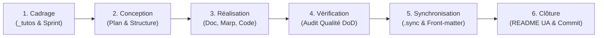

# Guide du Workflow des Tutoriels

Ce document définit le workflow standard pour concevoir, réaliser, vérifier, adapter et synchroniser les tutoriels d'apprentissage avec le projet.

---

## 1. Vue d'ensemble du Cycle de Vie

Chaque tutoriel suit un cycle rigoureux en 6 étapes :



- **Étape 1 : Cadrage & Veille** : Localisation du tutoriel source dans `_tutos/` et vérification de la planification dans le sprint actif (`sprints/sprints.md`).
- **Étape 2 : Conception** : Planification de la fiche technique, structure des diapositives Marp et spécification des artefacts techniques avant toute rédaction.
- **Étape 3 : Réalisation** : Production effective dans `tutoriels/[slug-domaine]/[slug-ua]/[slug-tutoriel]/` de la fiche technique, du diaporama Marp et du code source.
- **Étape 4 : Vérification** : Audit binaire de la Definition of Done (zéro tableau, liens relatifs, page de garde Marp normalisée).
- **Étape 5 : Synchronisation & Versioning** : Mise à jour du fichier `version.yml` sous l'espace `.sync/`, mise à jour du front-matter du tutoriel source et adaptation mutuelle en cas d'écart.
- **Étape 6 : Clôture & Indexation** : Indexation du livrable dans le fichier `README.md` parent de l'unité d'apprentissage et invitation du concepteur au commit.

---

## 2. Le Dossier Miroir `.sync/` et la Gestion des Versions

Le dossier racine `.sync/` centralise la gestion des versions et les règles de synchronisation entre l'Agent Projet et l'Agent Autoformation.

### Structure du dossier `.sync/`
- `.sync/rules.md` : Contrat des règles partagées entre les deux agents.
- Arborescence miroir des sous-dossiers modifiés :
  - Un fichier `version.yml` est créé uniquement pour les sous-dossiers contenant des fichiers modifiés pendant la réalisation du sprint.
  - Les sous-dossiers non modifiés ne possèdent pas de fichier `version.yml`.

### Format minimaliste de `version.yml`
Chaque fichier `version.yml` contient exclusivement la correspondance entre le nom du fichier et son numéro de version :

```yaml
modelisation-systeme.md: "1.0.0"
presentation-modelisation-systeme.md: "1.0.0"
diagramme-contexte.mmd: "1.0.0"
```

### Règle d'incrémentation
- À chaque modification apportée à un fichier par l'Agent IA, la version de ce fichier est automatiquement incrémentée (`1.0.0` -> `1.0.1` pour un correctif, ou `1.1.0` pour un enrichissement).

---

## 3. Traçabilité dans le Front-Matter du Tutoriel Source

Chaque tutoriel source situé dans `_tutos/` dispose d'un bloc front-matter YAML. Lors de la synchronisation, l'état de réalisation dans le sprint y est consigné :

```yaml
realise_dans_sprint: true
sprint: "sprint1"
statut_realisation: "realise"
etape_workflow: "valide"
date_realisation: "2026-11-19"
```

- `realise_dans_sprint` : Booléen (`true` ou `false`).
- `sprint` : Identifiant du sprint cible (ex: `sprint1`).
- `statut_realisation` : Statut courant (`non_debute`, `en_conception`, `realise`, `a_adapter`, `synchronise`).
- `etape_workflow` : Étape actuelle (`cadrage`, `conception`, `realisation`, `verification`, `synchronisation`, `valide`).
- `date_realisation` : Date de réalisation effective.

---

## 4. Utilisation du Skill `/realisation-tuto`

Le concepteur pilote le cycle de vie d'un tutoriel via le skill agentique :

- **Conception préalable :**
  Demander à l'agent de concevoir un tutoriel à partir de son slug ou identifiant :
  `Concevoir le tutoriel T.311.211 (modelisation-systeme)`
- **Réalisation complète :**
  Lancer la production des livrables :
  `Réaliser le tutoriel T.311.211`
- **Vérification qualité :**
  Auditer les livrables d'un tutoriel :
  `Vérifier la réalisation du tutoriel modelisation-systeme`
- **Synchronisation et adaptation :**
  Synchroniser le tutoriel source et les livrables, incrémenter les versions et adapter si nécessaire :
  `Synchroniser le tutoriel modelisation-systeme avec les tutoriels d'autoformation`
