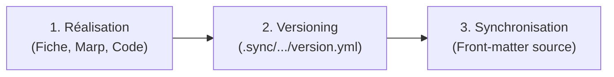

# Guide du Workflow des Tutoriels

Ce document définit le workflow standard pour concevoir, réaliser, versionner et synchroniser les tutoriels d'apprentissage avec le projet.

---

## 1. Cycle Compact en 3 Étapes

Le cycle de réalisation d'un tutoriel est synthétisé en 3 étapes directes :



- **Étape 1 : Réalisation** : Production effective des livrables dans `tutoriels/[slug-domaine]/[slug-ua]/[slug-tutoriel]/` selon le contexte du tutoriel (fiche Markdown, diaporama Marp, scripts ou code source).
- **Étape 2 : Versioning (`.sync/`)** : Déclaration ou incrémentation systématique de la version de chaque fichier dans son fichier miroir `.sync/.../version.yml`. Les fichiers `version.yml` sont stockés **exclusivement dans `.sync/`**.
- **Étape 3 : Synchronisation** : Notification dans le front-matter du tutoriel source (`_tutos/...`) avec le sprint, le statut et la liste des livrables associant chemin et version.

---

## 2. Format de `version.yml` dans `.sync/`

Chaque sous-dossier de livrable ou de code possède obligatoirement son fichier `version.yml` miroir sous `.sync/` :

```yaml
comprendre-scrum.md: "1.0.0"
presentation-comprendre-scrum.md: "1.0.0"
```

À chaque modification d'un fichier par l'Agent IA, la version sémantique correspondante est incrémentée.

---

## 3. Format de Synchronisation dans le Front-Matter Source

Le front-matter du tutoriel source dans `_tutos/` est mis à jour avec un bloc compact :

```yaml
sprint: "sprint1"
statut_realisation: "realise"
livrables:
  - chemin: "tutoriels/scrum/initiation-scrum/comprendre-scrum/comprendre-scrum.md"
    version: "1.0.0"
  - chemin: "tutoriels/scrum/initiation-scrum/comprendre-scrum/presentation-comprendre-scrum.md"
    version: "1.0.0"
```

### Valeurs du champ `statut_realisation` :
- `non_debute` : Le tutoriel est planifié dans le sprint, mais aucun livrable n'a encore été produit.
- `en_cours` : La réalisation des livrables (fiche technique, diaporama Marp, code) est en cours de développement.
- `realise` : Tous les livrables attendus ont été créés, validés et enregistrés avec leur version initiale dans `.sync/.../version.yml`.
- `a_adapter` : Une modification technique du projet réel ou une incrémentation de version dans `.sync/` nécessite une mise à jour du tutoriel de référence ou du support Jekyll.
- `synchronise` : L'Agent Autoformation a consommé les livrables à jour, extrait le code et les diagrammes réels dans le site Jekyll, et aligné les numéros de version dans le front-matter.

- **Détection des mises à jour** : L'Agent Autoformation compare le champ `version` de chaque livrable avec le fichier `version.yml` correspondant dans `.sync/`. Tout écart déclenche la synchronisation dans Jekyll et le passage du statut à `synchronise`.
