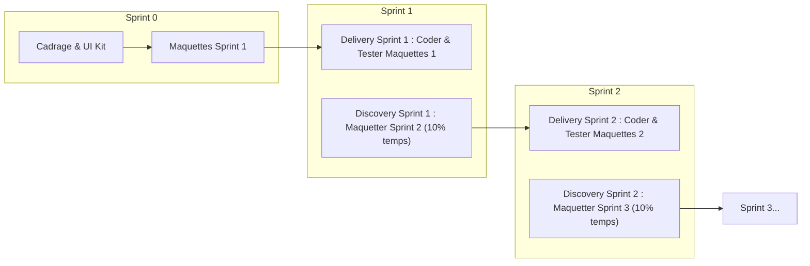

# Guide Opérationnel du Cycle Dual-Track Agile (Discovery & Delivery)

Ce document décrit le fonctionnement pratique du cadre d'orchestration **Dual-Track Agile** pour synchroniser la conception UX et le développement de code.

---

## 1. Principe Fondamental du Dual-Track

Dans un projet web, programmer des fonctionnalités sans maquettes validées engendre des reprises de code coûteuses. De même, maquetter toute l'application en une seule fois au début du projet recrée un effet tunnel classique.

Le modèle Dual-Track Agile résout ce problème en séparant le travail en **deux pistes parallèles** :

- **Piste Delivery (Production de code)** :
  - L'équipe code, teste et livre les User Stories du Sprint $N$.
  - Ces User Stories sont déjà prêtes (*Ready*) car leurs maquettes ont été validées lors du sprint précédent.
- **Piste Discovery (Conception UX et affinement)** :
  - L'équipe consacre environ 10% de son temps de sprint à préparer les User Stories du futur Sprint $N+1$.
  - Elle conçoit le User Flow local et dessine les maquettes de ces fonctionnalités futures.

---

## 2. Le Rôle Pivot de la Sprint Review

La Sprint Review réunit les utilisateurs, le client et l'équipe. Elle assure une **double validation synchronisée** :

- **Volet 1 : Validation du code livré (Delivery du Sprint $N$)** :
  - Démonstration de l'application en fonctionnement réel sur l'environnement de test.
  - Validation des critères d'acceptation et clôture formelle des User Stories du sprint.
- **Volet 2 : Test utilisateur des maquettes futures (Discovery pour le Sprint $N+1$)** :
  - Présentation interactive des maquettes préparées pendant le sprint pour la prochaine itération.
  - Recueil des retours ergonomiques en direct avec les utilisateurs.
  - Qualification officielle des prochaines User Stories en statut *Ready*.

---

## 3. Rythme Hebdomadaire d'une Équipe en Dual-Track

Pour une itération type, la répartition de l'effort s'organise ainsi :

- **90% du temps (Delivery)** :
  - Conception technique détaillée (classes, services, routes).
  - Écriture du code sous Laravel 13, Alpine.js et Tailwind CSS avec Preline UI.
  - Tests unitaires et fonctionnels, traitement de la résilience (erreurs 404).
  - Validation de la Definition of Done.
- **10% du temps (Discovery)** :
  - Échanges avec le Product Owner sur les règles métier des 2 ou 3 User Stories suivantes.
  - Rédaction du User Flow local.
  - Création des maquettes sous Figma ou support visuel équivalent.
- **Fin de sprint (Synchronisation)** :
  - Présentation conjointe du code livré et des maquettes lors de la Sprint Review.
