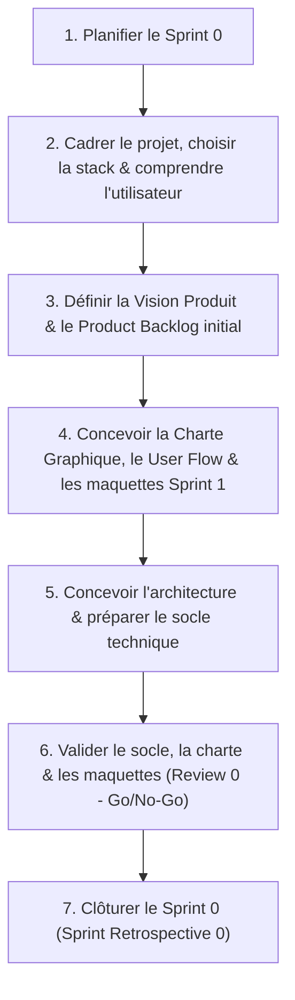

# Guide de Réalisation du Sprint 0 (Cadrage, Design Macro et Socle Technique)

Ce guide décrit la mise en œuvre pratique du **Sprint 0**, le sprint d'initialisation indispensable avant de démarrer les itérations de développement.

---

## 1. Objectif et Caractéristiques du Sprint 0

- **Objectif** : Construire un socle validé (périmètre, stack technique, charte graphique, maquettes initiales et environnement prêt à coder) sans maquetter l'intégralité du projet.
- **Durée (Timebox)** : Durée courte et fixe, généralement comprise entre 3 et 10 jours ouvrés selon l'envergure du projet.
- **Principe clé** : Ne jamais développer de fonctionnalités métier complexes pendant le Sprint 0. Tout le travail vise à préparer les conditions optimales pour le Sprint 1.

---

## 2. Déroulement Chronologique du Sprint 0

Le Sprint 0 suit 7 étapes rigoureuses :

### Étape 1 : Planification du Sprint 0
- Fixer la durée exacte du sprint.
- Définir les objectifs de cadrage et la liste précise des livrables de sortie.
- Créer le fichier d'engagement : `sprints/sprint-0.md`.

### Étape 2 : Cadrage, Choix de la Stack et Empathie Utilisateur
- Formaliser la note de cadrage avec les limites strictes du périmètre (In-Scope et Out-of-Scope).
- **Choisir la stack technique officielle** : Laravel 12, Alpine.js, Tailwind CSS et MySQL.
- Réaliser les fiches Personas à partir de l'observation des utilisateurs cibles.
- Livrables créés : `docs/cadrage/note-cadrage.md` et `docs/cadrage/personas.md`.

### Étape 3 : Vision Produit et Product Backlog Initial
- Rédiger la Vision Produit claire et concise.
- Mener les ateliers d'idéation pour identifier les grandes solutions fonctionnelles.
- Rédiger les premières User Stories INVEST ordonnées par priorité métier.
- Livrables créés : `docs/produit/vision-produit.md` et `docs/produit/product-backlog.md`.

### Étape 4 : Charte Graphique, User Flow et Maquettes du Sprint 1
- Construire le mini UI Kit (couleurs primaires et secondaires, typographies, boutons et composants Tailwind).
- Modéliser le **User Flow macro** : dessiner l'enchaînement logique des écrans pour accomplir les fonctionnalités prioritaires.
- Dessiner les maquettes détaillées des seuls écrans requis pour le Sprint 1.
- Livrables créés : `docs/design/ui-kit.md`, `docs/design/user-flow-sprint-1.md` et `docs/design/maquettes-sprint-1/`.

### Étape 5 : Architecture Logicielle et Préparation du Socle
- Concevoir l'architecture logicielle en 2 couches (Contrôleur mince -> Classe Service).
- Modéliser le schéma de données initial sous forme de diagramme Mermaid.
- Initialiser le dépôt Git distant via GitHub CLI (`gh repo create`).
- Installer le skeleton Laravel 12, intégrer Tailwind CSS et vérifier le bon affichage de la page d'accueil.
- Livrables créés : `docs/architecture/architecture-2-couches.md`, `docs/architecture/modele-donnees.md`, dossier `src/` opérationnel et `README.md` racine.

### Étape 6 : Sprint Review 0 et Jalon Go/No-Go
- Réunir les parties prenantes, le client et les utilisateurs.
- Réaliser les tests utilisateurs sur les maquettes interactives et le User Flow.
- Faire valider la Charte Graphique, le Backlog initial et le socle technique opérationnel.
- Obtenir la décision officielle Go/No-Go pour démarrer le développement.
- Livrable créé : `sprints/pv-review-0.md`.

### Étape 7 : Sprint Retrospective 0
- Faire le bilan de l'efficacité de l'équipe et des outils utilisés durant le cadrage.
- Définir les ajustements d'organisation pour aborder sereinement le Sprint 1.
- Livrable créé : `sprints/retrospective-0.md`.
