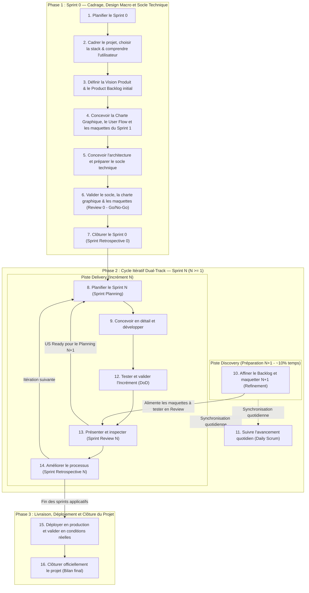

# Flux de Travail Générique d'Ingénierie Logicielle Web

Ce document formalise le processus complet d'ingénierie logicielle pour concevoir, développer, tester et déployer une application web.

Il est universel et s'applique à tout projet de développement web basé sur la démarche méthodologique unifiée (Design Thinking, Gestion de Projet PMI, Processus Orienté Objet et Scrum Dual-Track) et la stack technique de référence : **Laravel 12, Alpine.js, Tailwind CSS, MySQL et Git/GitHub**.

---

## 1. Vue d'Ensemble du Cycle de Développement

Le cycle de vie du projet se compose de 3 macro-phases et 16 étapes séquentielles et itératives :

---

## 2. Phase 1 : Sprint 0 — Cadrage, Design Macro et Socle Technique

Le Sprint 0 est un sprint d'initialisation court (timebox de 3 à 10 jours). Il construit un socle validé et prépare les conditions optimales pour démarrer les itérations de développement sans maquetter toute l'application.

### Étape 1 : Planifier le Sprint 0
- **Phases de référence** : Scrum (Sprint Planning 0) et Gestion de Projet (Initialisation).
- **Entrées** : Idée initiale, expression des besoins ou demande client.
- **Activités d'ingénierie** :
  - Définir la durée fixe du Sprint 0 (timebox).
  - Identifier les parties prenantes et composer l'équipe de travail.
  - Définir les objectifs de cadrage et recenser les livrables attendus pour la Review 0.
- **Sorties détaillées** :
  - `sprints/sprint-0.md` : Document d'engagement du Sprint 0 fixant la durée, les objectifs et les rôles.
  - `issues/issues-sprint-0.md` : Liste des tâches de cadrage initiales à réaliser.

### Étape 2 : Cadrer le projet, choisir la stack et comprendre l'utilisateur
- **Phases de référence** : Gestion de Projet (Initialisation) et Design Thinking (Empathie).
- **Entrées** : Demande client, étude d'opportunité et contexte métier.
- **Activités d'ingénierie** :
  - Définir le périmètre du projet : ce qui est strictement inclus (In-Scope) et ce qui est exclu (Out-of-Scope).
  - Identifier les contraintes de délai, de budget et de conformité.
  - **Arrêter la stack technique de référence** : Framework Laravel 12 (PHP), Alpine.js, Tailwind CSS et MySQL.
  - Mener l'immersion terrain : entretiens avec les utilisateurs, observation et élaboration des Personas cibles.
- **Sorties détaillées** :
  - `docs/cadrage/note-cadrage.md` : Fiche de cadrage synthétisant objectifs, périmètre in/out, contraintes et justification de la stack technique.
  - `docs/cadrage/personas.md` : Fiches Personas détaillant profils, attentes et irritants des utilisateurs types.

### Étape 3 : Définir la Vision Produit et le Product Backlog initial
- **Phases de référence** : Design Thinking (Définition & Idéation), Scrum (Product Backlog) et Dev OO (Analyse).
- **Entrées** : Note de cadrage et fiches Personas.
- **Activités d'ingénierie** :
  - Formuler la Vision Produit (problème central, promesse et proposition de valeur).
  - Animer des ateliers d'idéation pour identifier les solutions fonctionnelles et découper le système en Epics.
  - Rédiger les premières User Stories (format : *En tant que... je veux... afin de...*) avec leurs critères d'acceptation.
  - Établir l'ordre de priorité initiale du Product Backlog selon la valeur métier.
- **Sorties détaillées** :
  - `docs/produit/vision-produit.md` : Document formalisant la vision, le public cible et la valeur du produit.
  - `docs/produit/product-backlog.md` : Registre ordonné des User Stories initiales avec critères d'acceptation.

### Étape 4 : Concevoir la Charte Graphique, le User Flow et les maquettes du Sprint 1
- **Phases de référence** : Design Thinking (Prototypage) et Dev OO (Conception UI).
- **Entrées** : Vision Produit et User Stories hautement prioritaires du Product Backlog (destinées au Sprint 1).
- **Activités d'ingénierie** :
  - Construire un mini UI Kit basé sur Tailwind CSS (palette de couleurs, typographie, boutons, cartes d'articles, formulaires).
  - Modéliser le **User Flow macro** : tracer le cheminement logique complet de l'utilisateur, écran par écran et décision par décision, pour les fonctionnalités du Sprint 1.
  - Prototyper les maquettes interactives ciblées (wireframes puis mockups) pour chaque écran identifié dans le User Flow.
- **Sorties détaillées** :
  - `docs/design/ui-kit.md` : Charte graphique et composants d'interface réutilisables basés sur Tailwind CSS.
  - `docs/design/user-flow-sprint-1.md` : Diagramme et description du parcours de navigation utilisateur pour le Sprint 1.
  - `docs/design/maquettes-sprint-1/` : Dossier contenant les maquettes interactives des écrans prioritaires.

### Étape 5 : Concevoir l'architecture et préparer le socle technique
- **Phases de référence** : Dev OO (Conception & Implémentation) et Gestion de Projet (Planification technique).
- **Entrées** : Maquettes du Sprint 1, User Flow et stack technique arrêtée.
- **Activités d'ingénierie** :
  - Concevoir l'architecture logicielle en 2 couches : Contrôleur mince HTTP -> Classe Service métier.
  - Modéliser le schéma de données initial sous forme de diagramme Mermaid (MCD ou diagramme de classes).
  - Initialiser le dépôt Git et la forge distante avec GitHub CLI (`gh repo create`).
  - Déployer le skeleton Laravel 12, configurer Tailwind CSS et Alpine.js, et vérifier la page d'accueil.
- **Sorties détaillées** :
  - `docs/architecture/architecture-2-couches.md` : Spécification du pattern d'architecture logicielle et règles de découplage.
  - `docs/architecture/modele-donnees.md` : Modèle conceptuel de données Mermaid et dictionnaire des attributs.
  - `src/` : Application Laravel 12 opérationnelle, prête pour le développement, avec Tailwind et Alpine intégrés.
  - `.gitignore` et `README.md` racine : Fichiers de configuration du dépôt et guide de démarrage.

### Étape 6 : Valider le socle, la charte graphique et les maquettes (Sprint Review 0 — Jalon Go/No-Go)
- **Phases de référence** : Scrum (Sprint Review 0), Design Thinking (Test UX) et Gestion de Projet (Validation).
- **Entrées** : Charte graphique, User Flow, maquettes Sprint 1, Product Backlog et socle technique opérationnel.
- **Activités d'ingénierie** :
  - Réunir les parties prenantes, le commanditaire et des utilisateurs représentatifs.
  - Mener la phase de **Test utilisateur (Design Thinking - Test)** : faire manipuler les maquettes interactives et le User Flow pour tester l'ergonomie.
  - Présenter la Charte Graphique, le Product Backlog et le socle technique pour validation formelle.
  - Prononcer le jalon Go/No-Go pour autoriser le lancement des développements.
- **Sorties détaillées** :
  - `sprints/pv-review-0.md` : Procès-verbal de la Review 0 actant la validation de la charte graphique, les résultats des tests utilisateurs et le feu vert (Go).
  - `docs/produit/product-backlog.md` : Backlog mis à jour avec les User Stories du Sprint 1 officiellement qualifiées *Ready*.

### Étape 7 : Clôturer le Sprint 0 (Sprint Retrospective 0)
- **Phases de référence** : Scrum (Sprint Retrospective) et Gestion de Projet (Amélioration continue).
- **Entrées** : Déroulement et retours de la Review 0.
- **Activités d'ingénierie** :
  - Analyser l'efficacité de la collaboration durant la phase de cadrage.
  - Identifier les points d'amélioration et arrêter les règles d'équipe pour le premier sprint de delivery.
- **Sorties détaillées** :
  - `sprints/retrospective-0.md` : Bilan rétrospectif du Sprint 0 et plan d'organisation pour le Sprint 1.

---

## 3. Phase 2 : Cycle Itératif Dual-Track — Sprint $N$ ($N \ge 1$, répétable)

Chaque sprint $N$ combine deux pistes synchronisées : la piste **Delivery** (qui développe et livre l'Incrément $N$) et la piste **Discovery** (qui prépare en temps masqué les maquettes du Sprint $N+1$).

### Étape 8 : Planifier le Sprint $N$ (Sprint Planning — Piste Delivery)
- **Phases de référence** : Scrum (Sprint Planning) et Gestion de Projet (Planification opérationnelle).
- **Entrées** : User Stories qualifiées *Ready* (déjà maquettées) en haut du Product Backlog et actions de la Rétrospective précédente.
- **Activités d'ingénierie** :
  - Définir le Sprint Goal $N$.
  - Sélectionner les User Stories à embarquer dans l'itération.
  - Décomposer chaque User Story en tâches techniques concrètes.
- **Sorties détaillées** :
  - `sprints/sprint-[N].md` : Fiche du Sprint $N$ fixant le Sprint Goal, les User Stories engagées et l'équipe.
  - `issues/issues-sprint-[N].md` : Décomposition des tâches techniques du Sprint Backlog prêtes à être traitées.

### Étape 9 : Concevoir en détail et développer (Piste Delivery)
- **Phases de référence** : Dev OO (Conception détaillée & Implémentation) et Gestion de Projet (Exécution).
- **Entrées** : Sprint Backlog $N$, maquettes validées et socle architectural.
- **Activités d'ingénierie** :
  - Modéliser les flux locaux (diagrammes de séquence ou d'interaction).
  - Implémenter les routes HTTP dans `src/routes/web.php`.
  - Écrire les contrôleurs minces dans `src/app/Http/Controllers/`.
  - Développer les classes Services métier dans `src/app/Services/`.
  - Concevoir les vues Blade responsives et composants Alpine.js sous Tailwind CSS dans `src/resources/views/`.
- **Sorties détaillées** :
  - `src/app/Http/Controllers/` : Contrôleurs minces HTTP du Sprint $N$.
  - `src/app/Services/` : Classes Services contenant la logique métier.
  - `src/resources/views/` : Vues Blade responsives et composants Alpine.js.
  - `src/routes/web.php` : Déclaration des routes associées.

### Étape 10 : Affiner le Backlog et maquetter pour le Sprint suivant (Piste Discovery — ~10% du temps)
- **Phases de référence** : Design Thinking (Idéation & Prototypage) et Scrum (Backlog Refinement).
- **Entrées** : User Stories candidates pour le futur Sprint $N+1$ et UI Kit.
- **Activités d'ingénierie** :
  - Clarifier les règles de gestion métier avec le Product Owner.
  - Concevoir le User Flow local des fonctionnalités de $N+1$.
  - Réaliser les maquettes détaillées de ces fonctionnalités futures en temps masqué.
- **Sorties détaillées** :
  - `docs/design/maquettes-sprint-[N+1]/` : Dossier contenant les maquettes prêtes à être testées à la prochaine Review.
  - `docs/produit/product-backlog.md` : User Stories pour $N+1$ clarifiées et enrichies de leurs maquettes.

### Étape 11 : Suivre l'avancement quotidien (Daily Scrum — Delivery & Discovery)
- **Phases de référence** : Scrum (Daily Scrum) et Gestion de Projet (Suivi & Maîtrise).
- **Entrées** : Avancement du Sprint Backlog $N$ et de la piste Discovery.
- **Activités d'ingénierie** :
  - Réaliser un point quotidien de 15 minutes debout.
  - Partager le travail accompli et synchroniser le code et les maquettes.
  - Identifier et traiter immédiatement les obstacles techniques ou méthodologiques.
- **Sorties détaillées** :
  - `issues/issues-sprint-[N].md` : Mise à jour quotidienne du statut des tâches et levée des blocages.

### Étape 12 : Tester et valider l'Incrément (Piste Delivery — DoD)
- **Phases de référence** : Dev OO (Tests & Validation) et Scrum (Definition of Done).
- **Entrées** : Code source du Sprint $N$ et critères d'acceptation des User Stories.
- **Activités d'ingénierie** :
  - Exécuter les tests unitaires et d'intégration.
  - Tester la conformité aux critères d'acceptation et l'affichage responsive.
  - Tester la gestion résiliente des erreurs (code HTTP 404 en cas de ressource introuvable).
  - Valider l'ensemble des critères de la Definition of Done.
- **Sorties détaillées** :
  - `tests/` : Fichiers de tests automatisés validés.
  - `docs/qualite/rapport-tests-sprint-[N].md` : Rapport de conformité DoD et validation de l'Incrément logiciel $N$.

### Étape 13 : Présenter et inspecter (Sprint Review $N$ — Double Validation Delivery & Discovery)
- **Phases de référence** : Scrum (Sprint Review), Design Thinking (Test UX) et Gestion de Projet (Recette intermédiaire).
- **Entrées** : Incrément logiciel $N$ déployé sur environnement de test, et maquettes du Sprint $N+1$.
- **Activités d'ingénierie** :
  - **Volet Delivery** : Démontrer l'Incrément logiciel $N$ fonctionnel aux utilisateurs et au commanditaire, et valider les User Stories terminées.
  - **Volet Discovery (Test UX)** : Présenter et tester avec les utilisateurs les maquettes préparées pour le futur Sprint $N+1$ afin de recueillir leurs retours avant le Planning.
- **Sorties détaillées** :
  - `sprints/pv-review-[N].md` : Procès-verbal de la Review $N$ actant la validation de l'Incrément $N$ et les retours sur les maquettes de $N+1$.
  - `docs/produit/product-backlog.md` : Backlog actualisé (US de $N$ validées closes, US de $N+1$ officiellement qualifiées *Ready*).

### Étape 14 : Améliorer le processus (Sprint Retrospective $N$ — Amélioration continue)
- **Phases de référence** : Scrum (Sprint Retrospective) et Gestion de Projet (Amélioration continue).
- **Entrées** : Indicateurs du Sprint $N$ et vécu de l'équipe.
- **Activités d'ingénierie** :
  - Analyser ce qui a bien fonctionné et ce qui a ralenti la cadence.
  - Définir 1 ou 2 actions concrètes d'amélioration pour le sprint suivant.
- **Sorties détaillées** :
  - `sprints/retrospective-[N].md` : Bilan rétrospectif du Sprint $N$ et plan d'actions d'amélioration pour le Sprint $N+1$.

---

## 4. Phase 3 : Livraison, Déploiement et Clôture du Projet

Cette phase intervient à l'issue de l'ensemble des sprints de développement pour mettre en service l'application complète et clôturer formellement le projet.

### Étape 15 : Déployer en production et valider en conditions réelles
- **Phases de référence** : Dev OO (Déploiement & Maintenance) et Gestion de Projet (Exécution finale).
- **Entrées** : Dernier Incrément validé et configuration du serveur de production.
- **Activités d'ingénierie** :
  - Déployer l'application sur le serveur cible définitif (Internet).
  - Exécuter les migrations de base de données en production et configurer les variables d'environnement.
  - Réaliser les tests de bon fonctionnement en conditions réelles (smoke tests).
  - Rédiger la documentation technique d'exploitation.
- **Sorties détaillées** :
  - Application en ligne opérationnelle et accessible publiquement.
  - `docs/deploiement/guide-deploiement.md` : Guide technique de déploiement et d'exploitation.
  - `docs/qualite/pv-recette-production.md` : Fiche de recette technique en environnement de production.

### Étape 16 : Clôturer officiellement le projet
- **Phases de référence** : Gestion de Projet (Clôture).
- **Entrées** : Application en production, retours d'utilisation et bilans des Sprints.
- **Activités d'ingénierie** :
  - Réaliser la séance de recette définitive avec le client/commanditaire et signer le procès-verbal.
  - Archiver l'ensemble des livrables et du code source sur le dépôt GitHub.
  - Rédiger le bilan final de projet et capitaliser sur les leçons apprises.
- **Sorties détaillées** :
  - `docs/cloture/pv-recette-definitive.md` : Procès-verbal officiel de réception définitive signé par les parties prenantes.
  - `docs/cloture/bilan-final-projet.md` : Bilan de clôture de projet (analyse des écarts et capitalisation des acquis).
