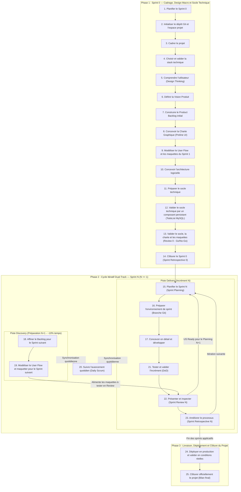
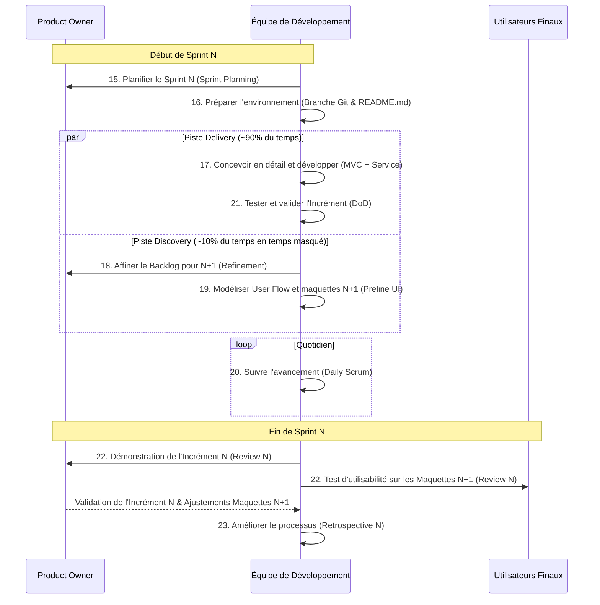

# Flux de Travail Générique d'Ingénierie Logicielle Web

Ce document formalise le processus complet d'ingénierie logicielle pour concevoir, développer, tester et déployer une application web.

Il est universel et s'applique à tout projet de développement web basé sur la démarche méthodologique unifiée (Design Thinking, Gestion de Projet PMI, Processus Orienté Objet et Scrum Dual-Track) et la stack technique de référence : **Laravel 13, MySQL, Tailwind CSS avec Preline UI, Alpine.js, Agent Antigravity & GitHub Copilot, et Spatie Laravel-Permission (RBAC)**.

---

## 1. Vue d'Ensemble du Cycle de Développement

Le cycle de vie du projet se compose de 3 macro-phases et 25 étapes séquentielles et itératives :

---

## 2. Principes Directeurs d'Ingénierie Logicielle

- **Règle d'Unicité :** Chaque étape correspond à une action claire et produit **un seul livrable principal unique**.
- **Gestion de Version Rigoureuse :** Chaque itération commence par la préparation de la branche de sprint et l'actualisation du fichier `README.md`.
- **Dual-Track Agile :** Les sprints itératifs combinent en continu le Delivery (90% du temps sur l'incrément courant) et le Discovery (10% du temps pour préparer et maquetter le sprint suivant).
- **Zéro Tableau Markdown :** Toutes les listes et spécifications utilisent exclusivement des listes à puces directes (`- `).

---

## 3. Phase 1 : Sprint 0 — Cadrage, Design Macro et Socle Technique

Le Sprint 0 construit le socle technique et méthodologique du projet. Il valide l'engagement d'équipe, le périmètre, la charte graphique, les maquettes initiales et le fonctionnement réel de la base de données.

### Étape 1 : Planifier le Sprint 0
- **Phases de référence :** Scrum (Sprint Planning 0) et Gestion de Projet (Initialisation).
- **Entrées :** Expression des besoins, lettre de mission ou demande client.
- **Activités d'ingénierie :**
  - Fixer la timebox du Sprint 0 (durée ferme).
  - Définir l'objectif du sprint et clarifier les rôles (Product Owner, Scrum Master, Développeurs).
  - Établir la Definition of Done (DoD) du cadrage.
  - Recenser les risques initiaux et formaliser les règles d'équipe.
- **Sortie principale :** Fiche d'engagement d'équipe (`sprints/sprint-0.md`).

### Étape 2 : Initialiser le dépôt Git et l'espace projet
- **Phases de référence :** Gestion de Projet (Outillage) et Dev OO (Infrastructure logicielle).
- **Entrées :** Fiche d'engagement `sprints/sprint-0.md`.
- **Activités d'ingénierie :**
  - Initialiser le dépôt Git local et configurer le dépôt distant GitHub.
  - Mettre en place le fichier `.gitignore` adapté à Laravel et aux outils IDE.
  - Créer l'arborescence standardisée des dossiers du projet (`docs/`, `sprints/`, `scrum/`, `resources/`).
  - Rédiger la documentation d'accueil initiale du dépôt.
- **Sortie principale :** Fichier d'accueil et de configuration du dépôt (`README.md`).

### Étape 3 : Cadrer le projet
- **Phases de référence :** Gestion de Projet (Cadrage et Périmètre).
- **Entrées :** Fiche d'engagement `sprints/sprint-0.md`.
- **Activités d'ingénierie :**
  - Définir les objectifs métiers et les critères de succès mesurables.
  - Établir la matrice de périmètre : fonctionnalités In-Scope (dans le périmètre) et Out-of-Scope (hors périmètre).
  - Identifier les contraintes techniques, réglementaires et temporelles.
- **Sortie principale :** Note de cadrage du projet (`docs/cadrage/note-cadrage.md`).

### Étape 4 : Choisir et valider la stack technique
- **Phases de référence :** Dev OO (Architecture technique) et Gestion de Projet (Faisabilité).
- **Entrées :** Note de cadrage `docs/cadrage/note-cadrage.md`.
- **Activités d'ingénierie :**
  - Justifier le choix du framework backend (**Laravel 13**).
  - Justifier le choix du système de gestion de base de données (**MySQL exclusivement**).
  - Valider la solution d'interface utilisateur (**Tailwind CSS avec la bibliothèque de composants Preline UI**).
  - Valider la bibliothèque de réactivité frontend (**Alpine.js**).
  - Valider l'environnement d'assistance IA (**Agent Antigravity & GitHub Copilot**).
  - Valider les composants de sécurité (**Policies/Gates et Spatie Laravel-Permission**).
- **Sortie principale :** Dossier de justification technique de la stack (`docs/cadrage/stack-technique.md`).

### Étape 5 : Comprendre l'utilisateur (Design Thinking — Empathie & Personas)
- **Phases de référence :** Design Thinking (Phase 1 Empathie).
- **Entrées :** Note de cadrage validée.
- **Activités d'ingénierie :**
  - Mener des entretiens ou observer les utilisateurs cibles sur le terrain.
  - Construire la carte d'empathie (ce que l'utilisateur dit, fait, pense et ressent).
  - Identifier les besoins profonds, les motivations et les points de douleur (*pain points*).
  - Rédiger les fiches Personas représentatives des utilisateurs types du système.
- **Sortie principale :** Recueil des fiches Personas (`docs/analyse/personas.md`).

### Étape 6 : Définir la Vision Produit
- **Phases de référence :** Design Thinking (Phase 2 Définition) et Scrum (Vision Produit).
- **Entrées :** Note de cadrage et fiches Personas.
- **Activités d'ingénierie :**
  - Synthétiser les besoins identifiés lors de la phase d'empathie.
  - Formuler le problème sous la forme Point of View (POV).
  - Énoncer la promesse de valeur partagée selon le canevas de vision produit standard.
- **Sortie principale :** Document de Vision Produit (`docs/produit/vision-produit.md`).

### Étape 7 : Construire le Product Backlog initial
- **Phases de référence :** Design Thinking (Phase 3 Idéation) et Scrum (Product Backlog).
- **Entrées :** Vision Produit et fiches Personas.
- **Activités d'ingénierie :**
  - Animer un atelier d'idéation pour identifier les fonctionnalités nécessaires.
  - Découper les exigences en User Stories respectant les critères INVEST.
  - Rédiger les critères d'acceptation opérationnels pour chaque User Story.
  - Prioriser les User Stories selon la méthode MoSCoW (Must, Should, Could, Won't).
- **Sortie principale :** Product Backlog initial ordonné (`scrum/product-backlog.md`).

### Étape 8 : Concevoir la Charte Graphique (UI Kit Tailwind CSS)
- **Phases de référence :** Design Thinking (Phase 4 Prototypage — Volet Design System).
- **Entrées :** Fiches Personas et identité visuelle du produit.
- **Activités d'ingénierie :**
  - Définir la palette de couleurs sémantiques sous Tailwind CSS.
  - Choisir la typographie et l'échelle modulaire.
  - Sélectionner et personnaliser les composants d'interface **Preline UI** (boutons, formulaires, cartes, badges, navigation).
  - Documenter les règles d'accessibilité et de contraste visuel.
- **Sortie principale :** Spécification de l'UI Kit Tailwind CSS et Preline UI (`docs/design/ui-kit.md`).

### Étape 9 : Modéliser le User Flow et les maquettes du Sprint 1
- **Phases de référence :** Design Thinking (Phase 4 Prototypage — Volet Parcours & Écrans).
- **Entrées :** User Stories prioritaires du Sprint 1 et UI Kit.
- **Activités d'ingénierie :**
  - Modéliser le parcours utilisateur écran par écran en syntaxe déclarative Mermaid (`flowchart TD / LR`).
  - Définir les points d'entrée, les étapes clés, les décisions et les écrans cibles.
  - Prototyper les maquettes interactives ciblées pour les fonctionnalités du Sprint 1 avec Preline UI.
- **Sortie principale :** Document intégrant le User Flow Mermaid et les maquettes interactives (`docs/design/maquettes-sprint-1.md`).

### Étape 10 : Concevoir l'architecture logicielle
- **Phases de référence :** Dev OO (Architecture & Conception générale).
- **Entrées :** Maquettes du Sprint 1, User Flow et stack technique validée.
- **Activités d'ingénierie :**
  - Modéliser le schéma de données conceptuel en syntaxe déclarative Mermaid (`erDiagram`).
  - Définir l'architecture applicative : patron **MVC avec couche Service** (contrôleur mince HTTP vers service métier).
  - Rédiger la décision d'architecture sous format standard ADR (Architectural Decision Record).
- **Sortie principale :** Dossier d'architecture initiale incluant le modèle relationnel et l'ADR (`docs/architecture/architecture-initiale.md`).

### Étape 11 : Préparer le socle technique
- **Phases de référence :** Dev OO (Implémentation du socle technique).
- **Entrées :** Dossier d'architecture et stack technique validée.
- **Activités d'ingénierie :**
  - Déployer le squelette applicatif **Laravel 13**.
  - Configurer l'environnement dans le fichier `.env` (connexion MySQL, variables d'application).
  - Installer Tailwind CSS et la bibliothèque de composants **Preline UI**.
  - Créer la route racine `/` et la vue d'accueil Blade responsive.
- **Sortie principale :** Vue d'accueil Blade responsive opérationnelle (`resources/views/welcome.blade.php`).

### Étape 12 : Valider le socle technique par un composant persistant (TodoList MySQL)
- **Phases de référence :** Dev OO (Vérification de la persistance des données).
- **Entrées :** Squelette Laravel 13 et base de données MySQL opérationnelle.
- **Activités d'ingénierie :**
  - Créer la migration de schéma de base de données pour une entité simple (ex: `todos`).
  - Exécuter la migration avec `php artisan migrate` sur la base MySQL.
  - Créer un seeder pour insérer des données de test réalistes.
  - Implémenter le contrôleur et la vue Blade avec Preline UI affichant les données depuis MySQL pour prouver la persistance réelle.
- **Sortie principale :** Contrôleur validant la persistance MySQL et l'affichage de données réelles (`app/Http/Controllers/TodoController.php`).

### Étape 13 : Valider le socle, la charte graphique et les maquettes (Sprint Review 0 — Jalon Go/No-Go)
- **Phases de référence :** Scrum (Sprint Review 0) et Gestion de Projet (Jalon de validation).
- **Entrées :** Socle technique connecté à MySQL (TodoList fonctionnelle), charte graphique Preline UI, User Flow et maquettes du Sprint 1.
- **Activités d'ingénierie :**
  - Animer la séance de revue devant le Product Owner.
  - Démontrer le fonctionnement effectif de la pile technique sur la base de données MySQL.
  - Faire tester les maquettes interactives du Sprint 1 par des utilisateurs réels pour recueillir leurs retours ergonomiques.
  - Valider formellement la charte graphique.
  - Prononcer la décision collégiale Go/No-Go pour autoriser le lancement des sprints de delivery.
- **Sortie principale :** Procès-verbal de la Review 0 actant la décision Go/No-Go et les retours utilisateurs (`sprints/pv-review-0.md`).

### Étape 14 : Clôturer le Sprint 0 (Sprint Retrospective 0)
- **Phases de référence :** Scrum (Sprint Retrospective 0) et Gestion de Projet (Clôture de phase).
- **Entrées :** Déroulement et retours de la Sprint Review 0.
- **Activités d'ingénierie :**
  - Analyser le fonctionnement de l'équipe durant la phase de cadrage.
  - Identifier ce qui a bien fonctionné et les points de friction.
  - Définir 2 à 3 actions d'amélioration concrètes pour le premier sprint de delivery.
  - Consigner les règles de fonctionnement d'équipe.
- **Sortie principale :** Bilan rétrospectif du Sprint 0 et plan d'amélioration continue (`sprints/retrospective-0.md`).

---

## 4. Phase 2 : Cycle Itératif Dual-Track — Sprint N (N >= 1)

Chaque sprint applicatif applique le modèle **Scrum Dual-Track**. L'équipe mène en parallèle la piste Delivery (production de l'incrément courant) et la piste Discovery (préparation et maquettage du sprint suivant).

### Étape 15 : Planifier le Sprint N (Sprint Planning — Piste Delivery)
- **Phases de référence :** Scrum (Sprint Planning) et Gestion de Projet (Planification d'itération).
- **Entrées :** Product Backlog priorisé, User Stories prêtes (*Ready*), vélocité et capacité d'équipe.
- **Activités d'ingénierie :**
  - Définir l'Objectif de Sprint partagé (*Sprint Goal*).
  - Sélectionner les User Stories répondant à cet objectif.
  - Décomposer chaque User Story en tâches techniques de 1 à 4 heures.
  - Valider l'engagement d'équipe sur le Sprint Backlog.
- **Sortie principale :** Document du Sprint Backlog ordonné avec les critères DoD (`scrum/sprint-backlog-sN.md`).

### Étape 16 : Préparer l'environnement de sprint (Branche Git et README.md)
- **Phases de référence :** Gestion de Projet (Suivi d'itération) et Dev OO (Gestion de configuration Git).
- **Entrées :** Sprint Backlog validé et branche principale du projet.
- **Activités d'ingénierie :**
  - Créer et basculer sur la branche Git du sprint (ex: `sprint-N`).
  - Actualiser le fichier `README.md` avec le Sprint Goal, les jalons temporels et la composition de l'équipe.
  - Vérifier l'état de l'environnement de développement et les dépendances logicielles.
- **Sortie principale :** Fichier `README.md` actualisé avec les informations du sprint actif.

### Étape 17 : Concevoir en détail et développer (Piste Delivery)
- **Phases de référence :** Dev OO (Conception détaillée & Implémentation).
- **Entrées :** Spécifications de la User Story, maquettes validées et architecture logicielle.
- **Activités d'ingénierie :**
  - Concevoir en détail la tranche verticale : contrôleur mince HTTP, classe de service métier, modèle Eloquent et migration MySQL.
  - Développer la logique métier dans la couche Service pour garantir l'indépendance du code.
  - Intégrer l'interface responsive Blade avec les composants **Preline UI**.
  - Implémenter les autorisations déclaratives avec **Policies/Gates** ou les rôles **Spatie**.
  - Respecter les normes de codage professionnelles (PSR-12).
- **Sortie principale :** Composant de code source opérationnel (ex: classe Service métier dans `app/Services/`).

### Étape 18 : Affiner le Backlog pour le Sprint suivant (Piste Discovery — ~10% temps)
- **Phases de référence :** Scrum (Backlog Refinement) et Design Thinking (Définition N+1).
- **Entrées :** Product Backlog et retours d'usage de l'incrément en cours.
- **Activités d'ingénierie :**
  - Clarifier le besoin fonctionnel des User Stories candidates pour le Sprint N+1 avec le Product Owner.
  - Établir les critères d'acceptation précis et vérifiables.
  - Estimer la complexité relative des User Stories.
  - Vérifier la conformité à la Definition of Ready (DoR).
- **Sortie principale :** Fiche d'affinement du backlog pour le sprint suivant (`scrum/backlog-refinement-s{N+1}.md`).

### Étape 19 : Modéliser le User Flow et maquetter pour le Sprint suivant (Piste Discovery — ~10% temps)
- **Phases de référence :** Design Thinking (Phase 4 Prototypage N+1).
- **Entrées :** User Stories raffinées pour le Sprint N+1 et UI Kit Preline UI.
- **Activités d'ingénierie :**
  - Modéliser le parcours utilisateur en syntaxe Mermaid (`flowchart TD / LR`) pour les fonctionnalités du Sprint N+1.
  - Concevoir les maquettes interactives correspondantes avec les composants Preline UI.
  - Préparer le protocole de test utilisateur pour la future Sprint Review.
- **Sortie principale :** Document intégrant le User Flow et les maquettes interactives N+1 (`docs/design/maquettes-sprint-{N+1}.md`).

### Étape 20 : Suivre l'avancement quotidien (Daily Scrum — Delivery & Discovery)
- **Phases de référence :** Scrum (Daily Scrum) et Gestion de Projet (Suivi d'avancement).
- **Entrées :** Tableau Kanban et tâches en cours.
- **Activités d'ingénierie :**
  - Animer la réunion quotidienne debout de 15 minutes.
  - Partager le travail réalisé la veille et le travail prévu le jour même.
  - Identifier et lever immédiatement les points de blocage techniques ou méthodologiques.
  - Mettre à jour l'état d'avancement des tâches sur le tableau visuel.
- **Sortie principale :** Journal de suivi des tâches et des résolutions d'incidents (`issues/issues-sprint-N.md`).

### Étape 21 : Tester et valider l'Incrément (Piste Delivery — DoD & Tests automatisés)
- **Phases de référence :** Dev OO (Tests & Qualité) et Scrum (Definition of Done).
- **Entrées :** Code source développé et critères de la Definition of Done.
- **Activités d'ingénierie :**
  - Exécuter la suite de tests automatisés (tests unitaires et fonctionnels avec PHPUnit).
  - Contrôler le respect des 7 critères formels de la Definition of Done.
  - Vérifier l'absence de régressions sur les fonctionnalités existantes.
  - Valider l'affichage responsive sur mobile, tablette et poste de travail.
- **Sortie principale :** Rapport formel de conformité à la Definition of Done (`docs/qualite/rapport-dod-sprint-N.md`).

### Étape 22 : Présenter et inspecter (Sprint Review N — Double Validation Delivery & Discovery)
- **Phases de référence :** Scrum (Sprint Review) et Design Thinking (Phase 5 Test).
- **Entrées :** Incrément logiciel opérationnel (Delivery) et maquettes interactives N+1 (Discovery).
- **Activités d'ingénierie :**
  - Démontrer l'incrément déployable en conditions réelles devant le Product Owner et les parties prenantes.
  - Obtenir la validation formelle des User Stories terminées par le Product Owner.
  - Faire tester les maquettes interactives du Sprint N+1 aux utilisateurs cibles pour recueillir leurs retours avant le prochain Sprint Planning.
  - Ajuster le Product Backlog en fonction des retours recueillis.
- **Sortie principale :** Procès-verbal de la Sprint Review actant la validation de l'incrément et les retours sur les maquettes (`sprints/pv-review-N.md`).

### Étape 23 : Améliorer le processus (Sprint Retrospective N — Amélioration continue)
- **Phases de référence :** Scrum (Sprint Retrospective) et Gestion de Projet (Leçons apprises).
- **Entrées :** Retours de la Sprint Review et vécu de l'équipe durant l'itération.
- **Activités d'ingénierie :**
  - Analyser les pratiques de travail, la communication et les outils de l'équipe.
  - Identifier les réussites et les axes de progrès.
  - Définir 1 à 2 actions correctives immédiatement applicables au sprint suivant.
  - Mettre à jour les règles d'équipe et la Definition of Done si nécessaire.
- **Sortie principale :** Bilan rétrospectif du sprint et plan d'action d'amélioration continue (`scrum/retrospective-sN.md`).

---

## 5. Phase 3 : Livraison, Déploiement et Clôture du Projet

La phase finale valide l'ensemble de la solution en conditions réelles de production, transfère l'application aux exploitants et clôture officiellement le projet.

### Étape 24 : Déployer en production et valider en conditions réelles
- **Phases de référence :** Dev OO (Déploiement & Maintenance) et Gestion de Projet (Exécution finale).
- **Entrées :** Dernier incrément validé et configuration du serveur de production.
- **Activités d'ingénierie :**
  - Préparer les variables d'environnement de production sécurisées (`.env`).
  - Optimiser les caches du framework (routes, vues, configurations) avec les commandes Artisan.
  - Exécuter les migrations de base de données sur le serveur MySQL distant.
  - Configurer les certificats SSL et sécuriser les accès HTTP/HTTPS.
  - Réaliser la recette finale de bout en bout et les tests de bon fonctionnement en ligne (*smoke tests*).
- **Sortie principale :** Procès-verbal de recette et de validation du déploiement en production (`docs/deploiement/pv-recette-production.md`).

### Étape 25 : Clôturer officiellement le projet
- **Phases de référence :** Gestion de Projet (Clôture) et Scrum (Rétrospective globale).
- **Entrées :** Application déployée en production et ensemble des livrables du projet.
- **Activités d'ingénierie :**
  - Rédiger le bilan global du projet (respect des objectifs, délais et qualité logicielle).
  - Capitaliser sur les retours d'expérience et documenter les bonnes pratiques pour les futurs projets.
  - Archiver le référentiel de code et documenter les procédures de maintenance corrective et évolutive.
  - Présenter le bilan officiel devant les commanditaires ou le jury.
- **Sortie principale :** Rapport de bilan final et procès-verbal de clôture du projet (`docs/certification/pv-deliberation-n3.md`).
