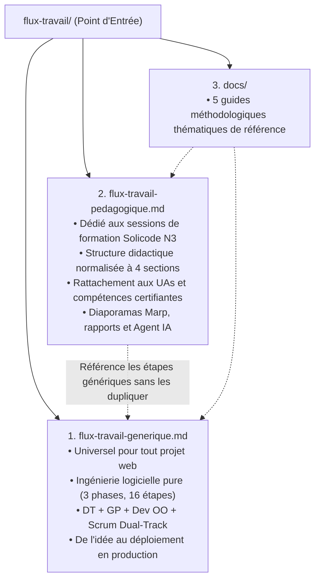

# Hub du Flux de Travail (`flux-travail/`)

Ce dossier centralise l'ensemble des référentiels méthodologiques et opérationnels du projet.

Il sépare rigoureusement la **démarche d'ingénierie logicielle universelle** et la **démarche didactique d'apprentissage**.

---

## 1. Organisation des Flux de Travail

Le dossier s'articule autour de deux documents complémentaires conçus selon le principe de responsabilité unique (zéro redondance) :

---

## 2. Guide d'Utilisation selon votre Contexte

- **Vous développez une application logicielle (Projet réel, MVP, Projet d'examen)** :
  - Consultez et appliquez le **[Flux de Travail Générique](./flux-travail-generique.md)**.
  - Il décrit les 16 étapes d'ingénierie de la Phase 1 (Sprint 0 Cadrage & Socle), Phase 2 (Cycle Dual-Track avec pistes Delivery et Discovery en parallèle) jusqu'à la Phase 3 (Livraison et Déploiement en production).
  - Il détaille les entrées, les activités techniques et les fichiers de sortie à produire pour chaque étape.
- **Vous réalisez une session de formation ou un sprint pédagogique** :
  - Consultez et appliquez le **[Flux de Travail Pédagogique](./flux-travail-pedagogique.md)**.
  - Il découpe la session de formation en étapes d'apprentissage structurées selon la norme à 4 sections (*Base théorique et pratique*, *Prérequis*, *Travail à faire*, *Livrables*).
  - Il garantit l'alignement avec les Unités d'Apprentissage (`UA.*`), le principe de Pareto 20/80 et les soutenances orales Marp.
- **Vous souhaitez approfondir les concepts et méthodes** :
  - Consultez les guides de référence dans le dossier **[docs/](./docs/)** :
    - [01-referentiel-methodes.md](./docs/01-referentiel-methodes.md) : Les 4 méthodes de référence, le cadre Dual-Track et la définition détaillée du **User Flow**.
    - [02-cycle-dual-track.md](./docs/02-cycle-dual-track.md) : Fonctionnement pratique des pistes Discovery (~10% temps) et Delivery.
    - [03-sprint-0-cadrage.md](./docs/03-sprint-0-cadrage.md) : Guide d'exécution du Sprint 0 (cadrage, stack en amont, UI Kit, socle et Review 0).
    - [04-norme-etapes-pedagogiques.md](./docs/04-norme-etapes-pedagogiques.md) : Spécification du format standardisé à 4 sections des sessions.
    - [05-outillage-agent-ia.md](./docs/05-outillage-agent-ia.md) : Guide d'accompagnement de l'Agent IA à chaque étape du flux.

---

## 3. Règle Qualité du Dossier

- **Zéro tableau Markdown** : Tous les documents de ce dossier utilisent exclusivement des listes à puces directes (`- `).
- **Liens 100% relatifs** : Tous les liens entre documents sont relatifs et portables sur GitHub.
- **Français niveau A1** : Phrases courtes, claires et rédigées à la voix active avec le vocabulaire technique des développeurs professionnels.
