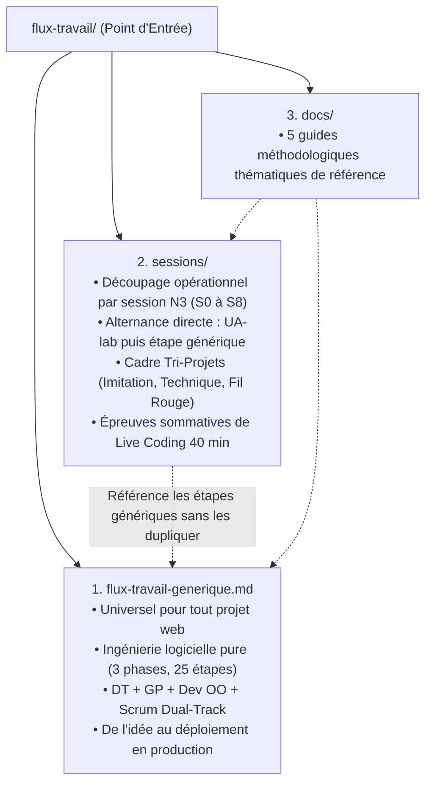

# Hub du Flux de Travail (`flux-travail/`)

Ce dossier centralise l'ensemble des référentiels méthodologiques et opérationnels du projet.

Il sépare rigoureusement la **démarche d'ingénierie logicielle universelle** et la **démarche didactique de formation par session**.

---

## 1. Organisation des Flux de Travail

Le dossier s'articule autour de deux espaces complémentaires conçus selon le principe de responsabilité unique (zéro redondance) :

---

## 2. Guide d'Utilisation selon votre Contexte

- **Vous développez une application logicielle (Projet réel, MVP, Projet d'examen)** :
  - Consultez et appliquez le **[Flux de Travail Générique](./flux-travail-generique.md)**.
  - Il décrit les 25 étapes d'ingénierie de la Phase 1 (Sprint 0 Cadrage, Socle & Dépôt Git), Phase 2 (Cycle Dual-Track avec pistes Delivery et Discovery en continu) jusqu'à la Phase 3 (Livraison et Déploiement en production).
  - Il détaille les entrées, les activités d'ingénierie et le livrable unique à produire pour chaque étape.
- **Vous réalisez une session de formation ou un sprint pédagogique N3** :
  - Consultez l'index des sessions dans **[sessions/README.md](./sessions/README.md)**.
  - Accédez au flux de travail de la session active :
    - **[Sprint 0 : Cadrage, Design Macro et Socle Technique](./sessions/flux-travail-s0.md)** (19 étapes chronologiques alternant UA-labs et réalisation concrète).
    - **[Sprint 1 : Consultation Publique d'un Article](./sessions/flux-travail-s1.md)** (13 étapes chronologiques alternant UA-labs et réalisation concrète, Live Coding 40 min).
  - Chaque session applique le cadre Tri-Projets : Projet d'Imitation (J1-7), Projet Technique en codage pur (J8), et Projet Fil Rouge avec création de Skills agentiques (J9-10).
- **Vous souhaitez approfondir les concepts et méthodes** :
  - Consultez les guides de référence dans le dossier **[docs/](./docs/)** :
    - [01-referentiel-methodes.md](./docs/01-referentiel-methodes.md) : Les 4 méthodes de référence, le cadre Dual-Track et la définition formelle du **User Flow**.
    - [02-cycle-dual-track.md](./docs/02-cycle-dual-track.md) : Fonctionnement pratique des pistes Discovery (~10% temps) et Delivery.
    - [03-sprint-0-cadrage.md](./docs/03-sprint-0-cadrage.md) : Guide d'exécution du Sprint 0 (cadrage, stack en amont, UI Kit Preline UI, socle et Review 0).
    - [04-norme-etapes-pedagogiques.md](./docs/04-norme-etapes-pedagogiques.md) : Spécification de l'intercalage pédagogique des UA-labs avec les étapes de réalisation.
    - [05-outillage-agent-ia.md](./docs/05-outillage-agent-ia.md) : Guide d'accompagnement de l'Agent IA à chaque étape du flux.

---

## 3. Règle Qualité du Dossier

- **Zéro tableau Markdown** : Tous les documents de ce dossier utilisent exclusivement des listes à puces directes (`- `).
- **Liens 100% relatifs** : Tous les liens entre documents sont relatifs et portables sur GitHub.
- **Français niveau A1** : Phrases courtes, claires et rédigées à la voix active avec le vocabulaire technique des développeurs professionnels.
