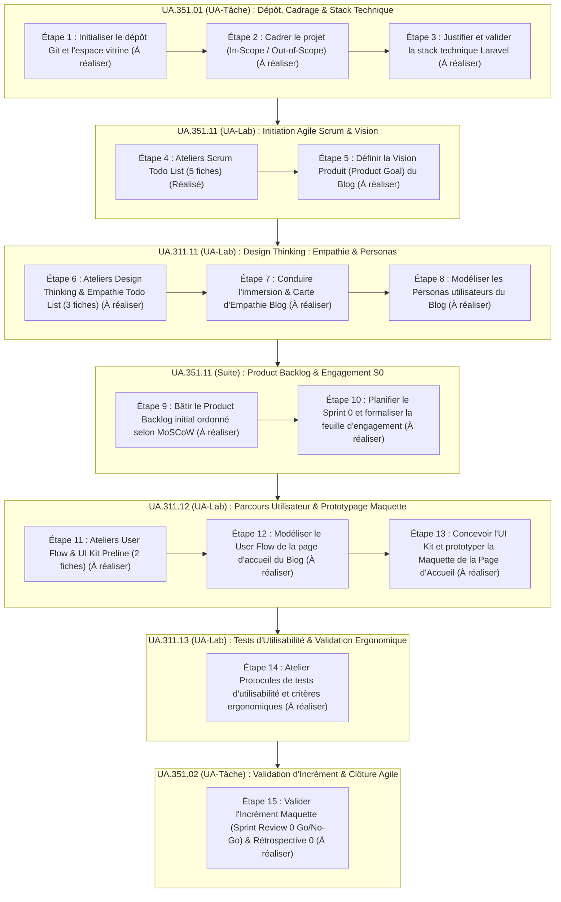

# Flux de Travail Opérationnel — Session S0 : Maquette de la Page d'Accueil

Ce document définit le flux de travail opérationnel du **Sprint 0**.
Il est centré sur la production de son incrément majeur : la **Maquette de la Page d'Accueil** du Blog des Lauréats.

Le flux articule de manière cohérente les Unités d'Apprentissage d'ateliers pratiques (**UA-Lab**) et les Unités d'Apprentissage d'application opérationnelle sur le projet (**UA-Tâche**), totalisant **6 UAs** et **15 étapes de travail**.

Les durées temporelles (80 heures / 10 jours) sont fournies à titre purement indicatif pour les formateurs et le concepteur.

---

## 1. Fiche d'Identification de la Session S0

- **Identifiant :** Session S0 (Sprint 0)
- **Titre centré sur l'incrément :** Maquette de la Page d'Accueil
- **Incrément produit :** Maquette interactive de la page d'accueil avec son User Flow textuel, son UI Kit de composants validé, et le cadrage initial du produit (Product Backlog ordonné)
- **Durée indicative :** 80 heures (10 jours ouvrés)
- **Référentiel des compétences :** Conforme au document de référence [.agents/references/domaines-competences.md](../../.agents/references/domaines-competences.md)
- **Domaines de compétences et Unités d'Apprentissage mobilisés :**
  - Domaine Réalisation et Conduite de Projet (`D.351.2-realisation-projet`) :
    - Unité d'apprentissage `UA.351.01` (UA-Tâche) : *Application Projet : Dépôt, Cadrage et Stack Technique* (Statut : **À réaliser**)
  - Domaine Scrum & Gouvernance Agile (`D.351.1-scrum`) :
    - Unité d'apprentissage `UA.351.11` (UA-Lab) : *Initiation à la Démarche Agile et Cadre Scrum* (Statut : **Réalisée**)
  - Domaine Conception & Design Thinking (`D.311.1-design`) :
    - Unité d'apprentissage `UA.311.11` (UA-Lab) : *Design Thinking : Démarche Globale et Immersion Empathique* (Statut : **À réaliser**)
    - Unité d'apprentissage `UA.311.12` (UA-Lab) : *Design Thinking : Parcours Utilisateur et Prototypage d'Interface* (Statut : **À réaliser**)
    - Unité d'apprentissage `UA.311.13` (UA-Lab) : *Design Thinking : Tests d'Utilisabilité et Validation Ergonomique* (Statut : **À réaliser**)
  - Domaine Réalisation et Conduite de Projet (`D.351.2-realisation-projet`) :
    - Unité d'apprentissage `UA.351.02` (UA-Tâche) : *Application Projet : Validation d'Incrément et Clôture Agile* (Statut : **À réaliser**)
- **Objectif global d'apprentissage :**
  - Cadrer le projet initial et configurer l'espace de développement Git officiel.
  - Découvrir la méthode agile Scrum et organiser la gouvernance de promotion avec le Groupe 1 en Product Owner.
  - Maîtriser les étapes amont du Design Thinking (Empathie, Définition) sur le cas Todo List, puis conduire l'immersion usagers et formaliser les Personas du Blog.
  - Bâtir le Product Backlog initial ordonné selon MoSCoW et signer la feuille d'engagement d'équipe du Sprint 0.
  - Maîtriser les étapes aval du Design Thinking (Idéation, Prototypage) pour modéliser le User Flow et prototyper la maquette d'accueil avec Tailwind CSS et Preline UI.
  - Découvrir les protocoles de tests d'utilisabilité et valider formellement la maquette lors de la Sprint Review 0 (Jalon Go/No-Go).

---

## 2. Organisation de la Promotion et Rôles

Pour lancer la dynamique collective du Sprint 0, l'organisation de la promotion repose sur un découpage en 5 groupes d'accompagnement :
- **Groupe 1 (Product Owner / Vision & Backlog) :** Porte la vision métier du *Blog des Lauréats*, arbitre les exigences du Product Backlog et statue lors de la Sprint Review 0.
- **Groupe 2 (Design Thinking & Prototypage) :** Guide et débloque les pairs sur l'immersion terrain, les Cartes d'Empathie, les Personas, le User Flow et les maquettes.
- **Groupe 3 (Cadre Scrum & Organisation Agile) :** Veille à la bonne appropriation du cadre Scrum et guide la feuille d'engagement d'équipe.
- **Groupe 4 (Cadrage Transverse, Rapport & Soutenance) :** Prépare les formats de capitalisation transverses.
- **Groupe 5 (Prérequis Fondamentaux & Sas de Rattrapage) :** Finalise les prérequis indispensables.

---

## 3. Cadre Tri-Projets
- **Projet d'Imitation (*Blog des Lauréats*) :** Réalisation pas-à-pas des étapes de cadrage, d'empathie, de backlog, d'UI Kit et de maquette.
- **Projet Technique (*Portfolio Développeur*) :** En fin de sprint, chaque apprenant reproduit la réalisation concrète sur son portfolio personnel.
- **Projet Fil Rouge (*Application Métier*) :** Cadrage fonctionnel, fiches Personas et initialisation du Product Backlog sans développement applicatif Laravel.

---

## 4. Déroulement Opérationnel des 6 Unités d'Apprentissage (15 Étapes)

---

### Unité d'Apprentissage UA.351.01 (UA-Tâche) : Application Projet : Dépôt, Cadrage et Stack Technique
- **Étape 1 : Initialiser le dépôt Git et l'espace projet vitrine** (`T.351.012`, `etape: 1`)
  - Sortie : `README.md`.
- **Étape 2 : Cadrer le projet et définir le périmètre (In-Scope / Out-of-Scope)** (`T.351.013`, `etape: 2`)
  - Sortie : `docs/cadrage/note-cadrage.md`.
- **Étape 3 : Justifier et valider le choix de la stack technique (Laravel)** (`T.351.014`, `etape: 3`)
  - Sortie : `docs/cadrage/stack-technique.md`.

---

### Unité d'Apprentissage UA.351.11 (UA-Lab) : Initiation à la Démarche Agile et Cadre Scrum
- **Étape 4 : Ateliers Scrum sur Todo List** (`T.351.111` à `T.351.115`, `etape: 4`, `nav_order: 1..5`)
  - Livrables de référence sous `ua-lab/scrum/initiation-scrum/`.
- **Étape 5 : Définir la Vision Produit (Product Goal) du Blog** (`T.351.015`, `etape: 5`)
  - Sortie : `docs/produit/vision-produit.md`.
- **Étape 9 : Bâtir le Product Backlog initial du Blog ordonné selon MoSCoW** (`T.351.016`, `etape: 9`)
  - Sortie : `scrum/product-backlog.md`.
- **Étape 10 : Planifier le Sprint 0 et formaliser la feuille d'engagement d'équipe** (`T.351.011`, `etape: 10`)
  - Sortie : `sprints/sprint-0.md`.

---

### Unité d'Apprentissage UA.311.11 (UA-Lab) : Design Thinking : Démarche Globale et Immersion Empathique
- **Étape 6 : Ateliers Design Thinking & Empathie sur Todo List** (`T.311.111` à `T.311.113`, `etape: 6`, `nav_order: 1..3`)
- **Étape 7 : Conduire l'immersion usagers et formaliser la Carte d'Empathie du Blog** (`T.311.114`, `etape: 7`)
  - Sortie : `docs/analyse/empathie.md`.
- **Étape 8 : Modéliser les Personas utilisateurs du Blog des Lauréats** (`T.311.115`, `etape: 8`)
  - Sortie : `docs/analyse/personas.md`.

---

### Unité d'Apprentissage UA.311.12 (UA-Lab) : Design Thinking : Parcours Utilisateur et Prototypage d'Interface
- **Étape 11 : Ateliers User Flow & Prototypage UI Kit Preline** (`T.311.121`, `T.311.122`, `etape: 11`, `nav_order: 1..2`)
- **Étape 12 : Modéliser le User Flow de la page d'accueil du Blog** (`T.311.123`, `etape: 12`)
  - Sortie : `docs/conception/user-flow.md`.
- **Étape 13 : Concevoir l'UI Kit et prototyper la Maquette de la Page d'Accueil** (`T.351.021`, `etape: 13`)
  - Sorties : `docs/conception/ui-kit.md` et `docs/conception/maquettes-sprint-1.md`.

---

### Unité d'Apprentissage UA.311.13 (UA-Lab) : Design Thinking : Tests d'Utilisabilité et Validation Ergonomique
- **Étape 14 : Atelier Protocoles de tests d'utilisabilité et critères ergonomiques** (`T.311.131`, `etape: 14`)
  - Livrables d'atelier méthodologique sous `tutoriels/design/tests-utilisabilite/`.

---

### Unité d'Apprentissage UA.351.02 (UA-Tâche) : Application Projet : Validation d'Incrément et Clôture Agile
- **Étape 15 : Valider l'Incrément Maquette (Sprint Review 0 Go/No-Go) et Rétrospective 0** (`T.351.022`, `etape: 15`)
  - Sorties : `sprints/pv-review-0.md` et `sprints/retrospective-0.md`.
