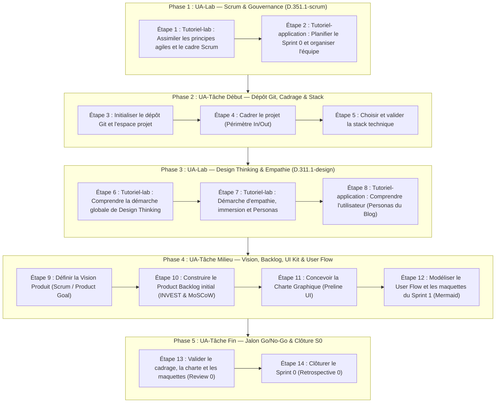

# Flux de Travail Opérationnel — Session S0 : Cadrage, Design Macro et Backlog Initial

Ce document définit le flux de travail opérationnel du **Sprint 0**.
Il est structuré en **5 phases équilibrées** (2 unités d'apprentissage **UA-Lab** et 3 blocs d'ingénierie opérationnelle **UA-Tâche**), totalisant **14 étapes de travail**.

Les durées temporelles (80 heures / 10 jours) sont fournies à titre purement indicatif pour les formateurs et le concepteur.

---

## 1. Fiche d'Identification de la Session S0

- **Identifiant :** Session S0 (Sprint 0)
- **Titre :** Cadrage, Design Macro et Product Backlog Initial
- **Durée indicative :** 80 heures (10 jours ouvrés)
- **Positionnement :** Sprint initial d'alignement méthodologique, d'empathie utilisateur et de cadrage fonctionnel avant les cycles de développement applicatif
- **Domaines de compétences mobilisés :**
  - Initiation Scrum & Gouvernance Agile (`D.351.1-scrum`)
  - Design Thinking, Immersion et Personas (`D.311.1-design`)
  - Modélisation déclarative en syntaxe Mermaid et Prototypage Preline UI (`D.311.2-uml`)
- **Objectif global d'apprentissage :**
  - Assimiler les principes agiles et le cadre Scrum pour organiser la gouvernance d'équipe avec le Groupe 1 assurant le rôle de Product Owner.
  - Initialiser le dépôt Git et la structure documentaire du projet.
  - Cadrer le projet et justifier formellement le choix de la stack technique.
  - Assimiler la démarche globale du Design Thinking, conduire l'immersion usagers et formaliser les fiches Personas.
  - Définir la Vision Produit (Product Goal) et découper les exigences en User Stories INVEST pour bâtir le Product Backlog initial.
  - Concevoir l'UI Kit Tailwind CSS avec les composants Preline UI, modéliser le User Flow en syntaxe déclarative Mermaid et prototyper les maquettes interactives du Sprint 1.
  - Valider formellement le cadrage, la charte et les maquettes lors du jalon contradictoire Go/No-Go en Sprint Review 0 et réaliser la Rétrospective 0.

---

## 2. Organisation de la Promotion et Prérequis de Lancement

Pour démarrer la session et lancer le projet :
- **Organisation en 4 Groupes d'Apprentissage :** Le formateur constitue 4 groupes de travail au sein de la promotion et leur affecte des labs préparatoires pour prendre en charge les rôles et missions clés du projet.
- **Rôle du Groupe 1 (Product Owner) :** Le Groupe 1 est présenté formellement à la promotion comme le porteur du besoin métier et de la vision produit. Il valide les arbitrages de périmètre et statue lors des Sprint Reviews.
- **Rôles Opérationnels des Groupes 2, 3 et 4 :** Les apprenants occupent les rôles de Développeurs et de Scrum Master (en alternance).

---

## 3. Cadre Tri-Projets

- **Projet d'Imitation (*Blog des Lauréats*) :** Réalisation pas-à-pas en classe active des étapes de cadrage, d'empathie, de backlog et de prototypage.
- **Projet Technique (*Portfolio Développeur*) :** En fin d'itération, l'apprenant initialise son propre dépôt Git personnel et formalise la note de cadrage de son portfolio professionnel en totale autonomie.
- **Projet Fil Rouge (*Application Métier*, ex : Gestion de Cinéma) :** Création des premiers Skills agentiques dans `.agent/skills/` (Skills de cadrage, de personas et de backlog).

---

## 4. Déroulement des 5 Phases du Sprint 0

---

### Phase 1 : UA-Lab — Initiation à Scrum et Gouvernance Agile (Domaine D.351.1-scrum)
*Phase d'apprentissage collective indispensable pour aligner toute la promotion sur le cadre agile.*

- **Étape 1 : Tutoriel-lab : Assimiler les principes agiles et le cadre Scrum**
  - Entrées : Guide méthodologique Scrum et valeurs du manifeste agile.
  - Notions de base à apprendre :
    - Différence entre cycle en V et itération agile, 4 valeurs et 12 principes.
    - Les 3 rôles Scrum : Product Owner, Scrum Master, Développeurs.
    - Les 5 événements Scrum : Sprint, Sprint Planning, Daily Scrum, Sprint Review, Sprint Retrospective.
    - Les 3 artéfacts et leurs engagements : Product Backlog, Sprint Backlog, Incrément (Definition of Done).
  - Sorties de l'atelier d'apprentissage (2 livrables) :
    - Guide explicatif détaillé : `tutoriels/scrum/guide-scrum.md`.
    - Support de présentation au format Marp Markdown : `tutoriels/scrum/presentation-scrum.md`.
- **Étape 2 : Tutoriel-application : Planifier le Sprint 0 et organiser l'équipe**
  - Correspondance flux générique : Étape Générique 1 (Planifier le Sprint 0).
  - Entrées : Guide Scrum et présentation formelle du **Groupe 1** assurant le rôle de Product Owner.
  - Travail d'application sur le Blog : Fixer la timebox du Sprint 0, contractualiser l'organisation avec le Groupe 1 (Product Owner), établir la répartition des rôles Développeurs et Scrum Master, définir les critères de la DoD de cadrage et signer la feuille d'engagement d'équipe.
  - Sortie (1 seul livrable) : `sprints/sprint-0.md`.

---

### Phase 2 : UA-Tâche Début — Initialisation Git, Cadrage et Validation de la Stack
*Bloc opérationnel de lancement technique et fonctionnel (les apprenants maîtrisant déjà les bases de ces disciplines).*

- **Étape 3 : Initialiser le dépôt Git et l'espace projet**
  - Correspondance flux générique : Étape Générique 2 (Initialiser le dépôt Git et l'espace projet).
  - Entrées : Fiche d'engagement `sprints/sprint-0.md`.
  - Travail d'application sur le Blog : Créer le dépôt Git local et distant sur GitHub, mettre en place le `.gitignore` adapté, créer l'arborescence documentaire (`docs/`, `sprints/`, `scrum/`, `tutoriels/`), et rédiger la documentation d'accueil.
  - Sortie (1 seul livrable) : `README.md`.
- **Étape 4 : Cadrer le projet**
  - Correspondance flux générique : Étape Générique 3 (Cadrer le projet).
  - Entrées : Fiche d'engagement et vision initiale du Blog des Lauréats.
  - Travail d'application sur le Blog : Définir les objectifs SMART et les indicateurs clés de succès, construire la matrice de périmètre stricte (In-Scope vs Out-of-Scope), identifier les contraintes de délai et de conformité.
  - Sortie (1 seul livrable) : `docs/cadrage/note-cadrage.md`.
- **Étape 5 : Choisir et valider la stack technique**
  - Correspondance flux générique : Étape Générique 4 (Choisir et valider la stack technique).
  - Entrées : Note de cadrage `docs/cadrage/note-cadrage.md`.
  - Travail d'application sur le Blog : Justifier formellement chaque composant de la solution technique retenue : Framework Backend (Laravel 13), Base de données relationnelle (MySQL exclusivement), Interface (Tailwind CSS avec Preline UI), Frontend réactif (Alpine.js), Assistance IA (Agent Antigravity & Copilot), Sécurité (Policies/Gates et Spatie RBAC).
  - Sortie (1 seul livrable) : `docs/cadrage/stack-technique.md`.

---

### Phase 3 : UA-Lab — Démarche de Design Thinking et Empathie (Domaine D.311.1-design)
*Phase d'apprentissage collective sur la conception centrée utilisateur articulée en deux temps d'assimilation puis application.*

- **Étape 6 : Tutoriel-lab : Comprendre la démarche globale de Design Thinking**
  - Entrées : Principes fondamentaux du Design Thinking.
  - Notions de base à apprendre :
    - Philosophie de la conception centrée utilisateur (User-Centered Design).
    - Les 5 phases itératives du Design Thinking : Empathie, Définition, Idéation, Prototypage, Test.
    - Modèle du Double Diamant : pensée divergente (explorer) et convergente (décider).
    - Posture d'écoute active, bienveillance et remise en question des postulats de départ.
  - Sorties de l'atelier d'apprentissage (2 livrables) :
    - Guide explicatif détaillé : `tutoriels/design/guide-demarche-design-thinking.md`.
    - Support de présentation au format Marp Markdown : `tutoriels/design/presentation-demarche-design-thinking.md`.
- **Étape 7 : Tutoriel-lab : Démarche d'empathie, immersion terrain et conception de Personas**
  - Entrées : Guide général de Design Thinking.
  - Notions de base à apprendre :
    - Techniques d'observation terrain sans biais et entretiens semi-directifs.
    - Élaboration d'une carte d'empathie à 4 quadrants (Ce qu'il Dit, Fait, Pense, Ressent).
    - Structure modulaire d'une fiche Persona : identité, motivations, points de douleur (*pain points*), freins et scénarios d'usage.
  - Sorties de l'atelier d'apprentissage (2 livrables) :
    - Guide explicatif détaillé : `tutoriels/design/guide-empathie-personas.md`.
    - Support de présentation au format Marp Markdown : `tutoriels/design/presentation-empathie-personas.md`.
- **Étape 8 : Tutoriel-application : Comprendre l'utilisateur (Design Thinking — Empathie & Personas)**
  - Correspondance flux générique : Étape Générique 5 (Comprendre l'utilisateur).
  - Entrées : Guides méthodologiques de Design Thinking et public cible du Blog des Lauréats.
  - Travail d'application sur le Blog : Réaliser l'immersion auprès des apprenants et anciens lauréats, et formaliser les fiches Personas détaillées pour chaque profil type (Lecteur apprenant, Auteur lauréat, Modérateur / Administrateur).
  - Sortie (1 seul livrable) : `docs/analyse/personas.md`.

---

### Phase 4 : UA-Tâche Milieu — Vision Produit, Product Backlog, UI Kit et User Flow Mermaid
*Bloc d'ingénierie opérationnelle transverse mené en concertation étroite avec le Product Owner (Groupe 1).*

- **Étape 9 : Définir la Vision Produit**
  - Correspondance flux générique : Étape Générique 6 (Définir la Vision Produit).
  - Entrées : Fiches Personas validées et note de cadrage.
  - Travail d'application sur le Blog : En concertation avec le Product Owner (Groupe 1), synthétiser les constats d'empathie sous format Point of View (POV) et formaliser la Vision Produit (Product Goal) définissant la proposition de valeur partagée.
  - Sortie (1 seul livrable) : `docs/produit/vision-produit.md`.
- **Étape 10 : Construire le Product Backlog initial**
  - Correspondance flux générique : Étape Générique 7 (Construire le Product Backlog initial).
  - Entrées : Vision Produit et fiches Personas.
  - Travail d'application sur le Blog : Animer l'atelier d'expression des besoins avec le Groupe 1 (PO), découper en User Stories INVEST dotées de critères d'acceptation précis, et prioriser selon la méthode MoSCoW.
  - Sortie (1 seul livrable) : `scrum/product-backlog.md`.
- **Étape 11 : Concevoir la Charte Graphique (UI Kit Tailwind CSS)**
  - Correspondance flux générique : Étape Générique 8 (Concevoir la Charte Graphique).
  - Entrées : Personas, identité visuelle du produit et bibliothèque Preline UI.
  - Travail d'application sur le Blog : Définir la palette de couleurs sémantiques, l'échelle typographique et documenter l'UI Kit sous forme de composants Preline UI réutilisables.
  - Sortie (1 seul livrable) : `docs/design/ui-kit.md`.
- **Étape 12 : Modéliser le User Flow et les maquettes du Sprint 1**
  - Correspondance flux générique : Étape Générique 9 (Modéliser le User Flow et les maquettes du Sprint 1).
  - Entrées : User Stories prioritaires du Sprint 1, UI Kit Preline UI et maîtrise préalable de la syntaxe déclarative Mermaid.
  - Travail d'application sur le Blog : Modéliser en syntaxe déclarative Mermaid le parcours complet de consultation d'un article écran par écran et prototyper les maquettes interactives ciblées pour les écrans du Sprint 1.
  - Sortie (1 seul livrable) : `docs/design/maquettes-sprint-1.md`.

---

### Phase 5 : UA-Tâche Fin — Revue 0 (Jalon Go/No-Go) et Rétrospective du Sprint 0
*Bloc de clôture agile et de validation formelle avant d'autoriser le premier sprint de delivery.*

- **Étape 13 : Valider le cadrage, la charte graphique et les maquettes (Sprint Review 0 — Jalon Go/No-Go)**
  - Correspondance flux générique : Étape Générique 10 (Sprint Review 0).
  - Entrées : Note de cadrage, Product Backlog initial, UI Kit Preline UI et maquettes interactives S1.
  - Travail d'application sur le Blog : Animer la démonstration devant le Product Owner (Groupe 1), faire tester les maquettes ergonomiques aux utilisateurs cibles, et prononcer formellement la décision Go/No-Go autorisant le passage au Sprint 1.
  - Sortie (1 seul livrable) : `sprints/pv-review-0.md`.
- **Étape 14 : Clôturer le Sprint 0 (Sprint Retrospective 0)**
  - Correspondance flux générique : Étape Générique 11 (Sprint Retrospective 0).
  - Entrées : Déroulement de la Review 0 et retours d'équipe.
  - Travail d'application sur le Blog : Conduire l'analyse réflexive d'équipe, acter les réussites et difficultés de la phase de cadrage, et arrêter 2 engagements d'amélioration pour le premier sprint de delivery.
  - Sortie (1 seul livrable) : `sprints/retrospective-0.md`.
