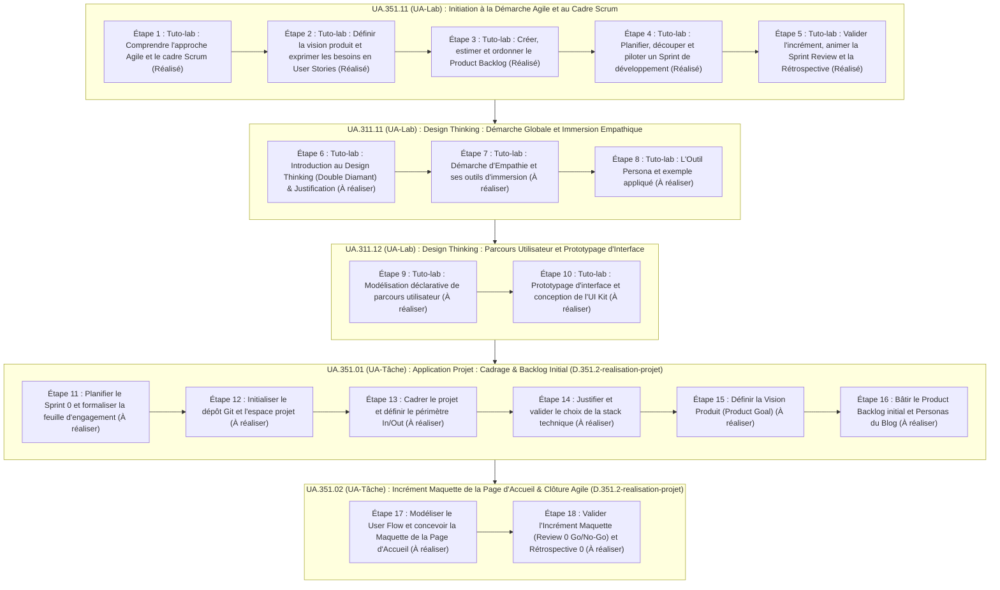

# Flux de Travail Opérationnel — Session S0 : Maquette de la Page d'Accueil

Ce document définit le flux de travail opérationnel du **Sprint 0**.
Il est centré sur la production de son incrément majeur : la **Maquette de la Page d'Accueil** du Blog des Lauréats.

Le flux sépare de manière étanche les Unités d'Apprentissage d'ateliers pratiques (**UA-Lab**) et les Unités d'Apprentissage d'application opérationnelle sur le projet (**UA-Tâche**), totalisant **5 UAs** et **18 étapes de travail**.

Les durées temporelles (80 heures / 10 jours) sont fournies à titre purement indicatif pour les formateurs et le concepteur.

---

## 1. Fiche d'Identification de la Session S0

- **Identifiant :** Session S0 (Sprint 0)
- **Titre centré sur l'incrément :** Maquette de la Page d'Accueil
- **Incrément produit :** Maquette interactive de la page d'accueil avec son User Flow textuel, son UI Kit de composants validé, et le cadrage initial du produit (Product Backlog ordonné)
- **Durée indicative :** 80 heures (10 jours ouvrés)
- **Référentiel des compétences :** Conforme au document de référence [.agents/references/domaines-competences.md](../../.agents/references/domaines-competences.md)
- **Domaines de compétences et Unités d'Apprentissage mobilisés :**
  - Domaine Scrum & Gouvernance Agile (`D.351.1-scrum`) :
    - Unité d'apprentissage `UA.351.11` (UA-Lab) : *Initiation à la Démarche Agile et Cadre Scrum* (Statut : **Réalisée**)
  - Domaine Conception & Design Thinking (`D.311.1-design`) :
    - Unité d'apprentissage `UA.311.11` (UA-Lab) : *Design Thinking : Démarche Globale et Immersion Empathique* (Statut : **À réaliser**)
    - Unité d'apprentissage `UA.311.12` (UA-Lab) : *Design Thinking : Parcours Utilisateur et Prototypage d'Interface* (Statut : **À réaliser**)
  - Domaine Réalisation et Conduite de Projet (`D.351.2-realisation-projet`) :
    - Unité d'apprentissage `UA.351.01` (UA-Tâche) : *Application Projet : Dépôt, Cadrage, Stack et Backlog Initial* (Statut : **À réaliser**)
    - Unité d'apprentissage `UA.351.02` (UA-Tâche) : *Incrément Maquette de la Page d'Accueil et Clôture Agile* (Statut : **À réaliser**)
- **Objectif global d'apprentissage :**
  - Découvrir la méthode agile Scrum et organiser la gouvernance de promotion avec le Groupe 1 en Product Owner.
  - Maîtriser les étapes amont du Design Thinking (Empathie, Définition) grâce à un lab guidé sur l'application Todo List, puis les appliquer aux usagers du Blog.
  - Maîtriser les étapes aval du Design Thinking (Idéation, Prototypage) pour formaliser le parcours utilisateur et concevoir les composants de l'UI Kit.
  - Concevoir la charte graphique et prototyper la maquette interactive de la page d'accueil du Blog des Lauréats.
  - Valider formellement la maquette et le cadrage lors de la Sprint Review 0 (Jalon Go/No-Go).

---

## 2. Organisation de la Promotion et Prérequis de Lancement du Sprint 0

Pour lancer la dynamique collective du Sprint 0, l'organisation de la promotion repose sur un découpage en 5 groupes dont les numéros reflètent directement la priorité des missions d'ingénierie et d'accompagnement :

- **Condition d'accès aux Groupes Opérationnels 1 à 4 :**  
  Pour être affecté dans l'un des groupes 1 à 4, chaque apprenant doit obligatoirement avoir validé les **5 labs initiaux prérequis fondamentaux** :
  - `lab-startup` : Prise en main de l'environnement de développement et initialisation du poste.
  - `lab-markdown` : Maîtrise de la rédaction documentaire structurée en Markdown standard.
  - `lab-marp` : Conception de diaporamas professionnels au format Marp Markdown.
  - `lab-prompt` : Formulation de prompts d'assistance et interaction avec l'Agent IA copilote.
  - `lab-presentation-pro` : Posture professionnelle et animation de soutenance technique.

- **Groupe 5 (Priorité 5 — Prérequis Fondamentaux & Sas de Rattrapage) :**  
  Les apprenants n'ayant pas encore validé l'ensemble des 5 labs initiaux sont affectés au Groupe 5. Leur priorité absolue est de finaliser et faire valider ces prérequis indispensables avant d'intégrer les groupes opérationnels 1 à 4.

- **Rôle Opérationnel des Groupes 1 à 4 (Exclusif aux Tuto-Tâches) :**  
  *Règle méthodologique stricte :* Les groupes ne sont pas sollicités pendant le déroulement des séances d'UA-Lab (qui relèvent d'un apprentissage collectif et individuel guidé par le formateur). Ils interviennent pour **débloquer et accompagner les apprenants sur les tuto-tâches** d'application projet avant et pendant leur réalisation :
  - **Groupe 1 (Priorité 1 — Product Owner / Vision & Backlog) :**  
    Porte la vision métier du *Blog des Lauréats*, priorise les User Stories initiales du Product Backlog et débloque les arbitrages fonctionnels sur les tâches de cadrage et de backlog. Il statue lors de la Sprint Review 0.
  - **Groupe 2 (Priorité 2 — Design Thinking & Prototypage) :**  
    Assure la cohérence de la démarche centrée utilisateur. Il guide et débloque les pairs sur les tâches d'immersion terrain, la formalisation des Cartes d'Empathie, la rédaction des fiches Personas, ainsi que sur le User Flow et les maquettes.
  - **Groupe 3 (Priorité 3 — Cadre Scrum & Organisation Agile) :**  
    Veille à la bonne appropriation du cadre Scrum. Il guide et débloque les pairs sur la feuille d'engagement d'équipe (`sprint-0.md`) et le respect des cérémonies agiles.
  - **Groupe 4 (Priorité 4 — Cadrage Transverse, Plan de Rapport & Diaporama) :**  
    Prépare les formats de capitalisation transverses en travaillant sur son projet fil rouge : élaboration du plan type de rapport modulaire et du plan type de présentation de soutenance Marp.

---

## 3. Cadre Tri-Projets

- **Projet d'Imitation (*Blog des Lauréats*) :** Réalisation pas-à-pas en classe active des étapes de cadrage, d'empathie, de backlog, d'UI Kit et de la maquette de la page d'accueil.
- **Projet Technique (*Portfolio Développeur*) :**
  - En fin de sprint, chaque apprenant reproduit la réalisation concrète du sprint sur son portfolio personnel (initialisation du dépôt Git et maquette de sa propre page d'accueil).
  - **Règle formelle d'exigence :** Les documents de cadrage et de conception (note de cadrage, personas, vision produit) **ne sont pas demandés** pour le portfolio dans la session. L'apprenant reste libre de les réaliser pour lui-même, mais ils ne font l'objet d'aucune évaluation formelle.
- **Projet Fil Rouge (*Application Métier*, ex : Gestion de Cinéma) :** Cadrage fonctionnel, formalisation des Personas et initialisation du Product Backlog de l'application métier par les équipes projet.

---

## 4. Déroulement Opérationnel des 5 Unités d'Apprentissage du Sprint 0

---

### Unité d'Apprentissage UA.351.11 (UA-Lab) : Initiation à la Démarche Agile et au Cadre Scrum (Domaine D.351.1-scrum)
*Atelier d'apprentissage pratique guidé par le formateur.*

- **Étape 1 : Tutoriel-lab : Comprendre l'approche Agile et le cadre Scrum**
  - Statut : **Réalisé** (`UA.351.11`)
  - Entrées : Manifeste Agile (4 valeurs, 12 principes) et Guide officiel Scrum.
  - Notions de base à apprendre :
    - Différence entre cycle en cascade (effet tunnel, spécifications figées) et démarche itérative empirique.
    - Les piliers de Scrum : Transparence, Inspection, Adaptation.
    - Les 3 rôles Scrum : Product Owner, Scrum Master, Développeurs.
    - Les 5 événements et 3 artéfacts avec leurs engagements respectifs.
  - Livrables à donner par l'apprenant (2 livrables) :
    - Guide explicatif détaillé : `tutoriels/scrum/initiation-scrum/comprendre-scrum/comprendre-scrum.md`.
    - Support de présentation au format Marp Markdown : `tutoriels/scrum/initiation-scrum/comprendre-scrum/presentation-comprendre-scrum.md`.
- **Étape 2 : Tutoriel-lab : Définir la vision produit et exprimer les besoins en User Stories**
  - Statut : **Réalisé** (`UA.351.11`)
  - Entrées : Principes de modélisation du besoin utilisateur.
  - Notions de base à apprendre :
    - Formulation d'une Vision Produit claire et partagée (Product Goal).
    - Structure sémantique d'une User Story : « En tant que... je veux... afin de... ».
    - Les critères de qualité INVEST (Indépendante, Négociable, Valeur, Estimable, Suffisamment petite, Testable).
    - Définition des critères d'acceptation opérationnels.
  - Livrables à donner par l'apprenant (2 livrables) :
    - Guide explicatif détaillé : `tutoriels/scrum/initiation-scrum/vision-besoins/vision-besoins.md`.
    - Support de présentation au format Marp Markdown : `tutoriels/scrum/initiation-scrum/vision-besoins/presentation-vision-besoins.md`.
- **Étape 3 : Tutoriel-lab : Créer, estimer et ordonner le Product Backlog**
  - Statut : **Réalisé** (`UA.351.11`)
  - Entrées : Liste brute d'exigences et guide de priorisation agile.
  - Notions de base à apprendre :
    - Rôle du Product Backlog comme source vivante d'exigences.
    - Techniques d'estimation agile relative (Story Points, suite de Fibonacci, Planning Poker).
    - Méthodes d'ordonnancement et priorisation : méthode MoSCoW (Must, Should, Could, Won't) et valeur métier.
    - Notions d'affinement du backlog (Backlog Refinement / Grooming).
  - Livrables à donner par l'apprenant (2 livrables) :
    - Guide explicatif détaillé : `tutoriels/scrum/initiation-scrum/product-backlog/product-backlog.md`.
    - Support de présentation au format Marp Markdown : `tutoriels/scrum/initiation-scrum/product-backlog/presentation-product-backlog.md`.
- **Étape 4 : Tutoriel-lab : Planifier, découper et piloter un Sprint de développement**
  - Statut : **Réalisé** (`UA.351.11`)
  - Entrées : Product Backlog priorisé et capacité d'équipe.
  - Notions de base à apprendre :
    - Cérémonie du Sprint Planning (Partie 1 : Quoi faire ? / Partie 2 : Comment le faire ?).
    - Formulation de l'objectif de sprint (Sprint Goal) et engagement sur le Sprint Backlog.
    - Découpage des User Stories en tâches techniques d'ingénierie logicielle (timebox $\le$ 8h).
    - Animation du Daily Scrum (15 min chrono, 3 questions) et suivi d'avancement par Burndown chart.
  - Livrables à donner par l'apprenant (2 livrables) :
    - Guide explicatif détaillé : `tutoriels/scrum/initiation-scrum/sprint-planning-execution/sprint-planning-execution.md`.
    - Support de présentation au format Marp Markdown : `tutoriels/scrum/initiation-scrum/sprint-planning-execution/presentation-sprint-planning-execution.md`.
- **Étape 5 : Tutoriel-lab : Valider l'incrément, animer la Sprint Review et la Rétrospective**
  - Statut : **Réalisé** (`UA.351.11`)
  - Entrées : Incrément potentiellement livrable et critères de la Definition of Done (DoD).
  - Notions de base à apprendre :
    - Rôle et animation de la Sprint Review : démonstration concrète devant le Product Owner et recueil de feedback.
    - Audit strict des critères de la Definition of Done (DoD) et arbitrage formel Go/No-Go.
    - Cérémonie de Rétrospective de Sprint : analyse réflexive (Ce qui a fonctionné, axes d'amélioration) et plan d'action immédiat.
  - Livrables à donner par l'apprenant (2 livrables) :
    - Guide explicatif détaillé : `tutoriels/scrum/initiation-scrum/revue-retrospective/revue-retrospective.md`.
    - Support de présentation au format Marp Markdown : `tutoriels/scrum/initiation-scrum/revue-retrospective/presentation-revue-retrospective.md`.

---

### Unité d'Apprentissage UA.311.11 (UA-Lab) : Design Thinking : Démarche Globale et Immersion Empathique (Domaine D.311.1-design)
*Atelier d'apprentissage pratique de la démarche centrée utilisateur et des méthodes d'immersion.*

> [!NOTE]
> **Justification Pédagogique du Choix de l'Application Todo List :**  
> Pour assimiler efficacement la démarche de Design Thinking sans surcharge cognitive, cet atelier s'appuie sur une application de gestion de tâches personnelles (**Todo List**).  
> *Pourquoi la Todo List plutôt que le Blog des Lauréats ?*  
> 1. **Absence de barrière métier :** Les cas d'usage de gestion de tâches sont universellement connus de tous les apprenants, évitant tout débat fonctionnel superflu.  
> 2. **Focalisation exclusive sur la méthode :** Les apprenants peuvent concentrer 100% de leur attention cognitive sur l'écoute active, l'empathie, l'identification des frustrations réelles et la formulation des personas, sans être distraits par l'architecture technique ou les règles de gestion du blog.  
> 3. **Transférabilité immédiate :** Une fois la méthode maîtrisée sur ce cas épuré, son application sur le *Blog des Lauréats* (dans l'UA.351.01) s'effectue avec rigueur et fluidité.

- **Étape 6 : Tutoriel-lab : Introduction au Design Thinking (Double Diamant) et justification de l'application support**
  - Statut : **À réaliser**
  - Unité d'apprentissage : *Démarche de Design Thinking*.
  - Entrées : Principes fondamentaux du Design Thinking et justification de l'exercice Todo List.
  - Notions de base à apprendre :
    - Philosophie de la conception centrée utilisateur (User-Centered Design).
    - Les 5 étapes itératives du Design Thinking : Empathie, Définition, Idéation, Prototypage, Test.
    - Modèle du Double Diamant : divergence (explorer largement) et convergence (cibler et synthétiser).
    - Justification du choix de la Todo List comme cas d'étude d'apprentissage méthodologique.
  - Livrables à donner par l'apprenant (2 livrables) :
    - Guide explicatif détaillé : `tutoriels/design/design-thinking/demarche-design-thinking/demarche-design-thinking.md`.
    - Support de présentation au format Marp Markdown : `tutoriels/design/design-thinking/demarche-design-thinking/presentation-demarche-design-thinking.md`.
- **Étape 7 : Tutoriel-lab : Démarche d'Empathie et ses outils d'immersion**
  - Statut : **À réaliser**
  - Unité d'apprentissage : *Empathie*.
  - Entrées : Méthodes qualitatives d'immersion appliquées aux usagers d'une Todo List.
  - Notions de base à apprendre :
    - Posture d'écoute active, bienveillance et neutralité sans biais de confirmation.
    - Outils d'immersion : observation directe du comportement, entretiens semi-directifs et grille de questionnement.
    - Élaboration de la Carte d'Empathie à 4 quadrants (Ce qu'il Dit, Fait, Pense, Ressent) appliquée à un utilisateur surchargé de tâches.
    - Identification des points de douleur (*pains*) et bénéfices recherchés (*gains*).
  - Livrables à donner par l'apprenant (2 livrables) :
    - Guide explicatif détaillé : `tutoriels/design/design-thinking/immersion-empathie/immersion-empathie.md`.
    - Support de présentation au format Marp Markdown : `tutoriels/design/design-thinking/immersion-empathie/presentation-immersion-empathie.md`.
- **Étape 8 : Tutoriel-lab : L'Outil Persona et exemple appliqué**
  - Statut : **À réaliser**
  - Unité d'apprentissage : *Empathie*.
  - Entrées : Données d'empathie recueillies sur la Todo List.
  - Notions de base à apprendre :
    - Définition et utilité d'un Persona comme archétype cible pour aligner les décisions produit.
    - Structure modulaire d'une fiche Persona : identité, portrait psychologique, objectifs, freins majeurs, citation représentative.
    - Exemple complet et détaillé appliqué au cas de la Todo List (*ex : Julien, 24 ans, apprenant submergé par la dispersion des priorités*).
  - Livrables à donner par l'apprenant (2 livrables) :
    - Guide explicatif détaillé : `tutoriels/design/design-thinking/empathie-personas/empathie-personas.md`.
    - Support de présentation au format Marp Markdown : `tutoriels/design/design-thinking/empathie-personas/presentation-empathie-personas.md`.

---

### Unité d'Apprentissage UA.311.12 (UA-Lab) : Design Thinking : Parcours Utilisateur et Prototypage d'Interface (Domaine D.311.1-design)
*Atelier d'apprentissage pratique des étapes aval du Design Thinking (Idéation et Prototypage).*

- **Étape 9 : Tutoriel-lab : Modélisation déclarative de parcours utilisateur**
  - Statut : **À réaliser**
  - Unité d'apprentissage : *Modélisation de parcours utilisateur*.
  - Entrées : Principes de cartographie visuelle de parcours d'écran (User Flow) issus de l'étape d'Idéation.
  - Notions de base à apprendre :
    - Cartographie visuelle d'un parcours utilisateur écran par écran (User Flow).
    - Syntaxe déclarative textuelle (au moyen de l'outil Mermaid `flowchart`) : nœuds rectangulaires, décisions en losange, sous-graphes et connecteurs annotés.
    - Traçabilité et versioning du design sous Git grâce aux fichiers textes `.mmd`.
  - Livrables à donner par l'apprenant (2 livrables) :
    - Guide explicatif détaillé : `tutoriels/design/parcours-utilisateur/user-flow/user-flow.md`.
    - Support de présentation au format Marp Markdown : `tutoriels/design/parcours-utilisateur/user-flow/presentation-user-flow.md`.
- **Étape 10 : Tutoriel-lab : Prototypage d'interface et conception de l'UI Kit**
  - Statut : **À réaliser**
  - Unité d'apprentissage : *Prototypage d'interface*.
  - Entrées : Principes de Design System et bibliothèque de composants Preline UI sous Tailwind CSS.
  - Notions de base à apprendre :
    - Définition d'un système de conception modulaire (Design System et UI Kit).
    - Palette de couleurs sémantiques, hiérarchie typographique et espacements standardisés sous Tailwind CSS.
    - Sélection et intégration de composants d'accueil Preline UI : Navbar, Hero section, Card article, Footer, Badges.
  - Livrables à donner par l'apprenant (2 livrables) :
    - Guide explicatif détaillé : `tutoriels/design/prototypage-ui-kit/prototypage-ui-kit.md`.
    - Support de présentation au format Marp Markdown : `tutoriels/design/prototypage-ui-kit/presentation-prototypage-ui-kit.md`.

---

### Unité d'Apprentissage UA.351.01 (UA-Tâche) : Application Projet : Dépôt, Cadrage, Stack et Backlog Initial (Domaine D.351.2-realisation-projet)
*Bloc d'ingénierie opérationnelle mené sur le Blog des Lauréats, débloqué et accompagné par les groupes opérationnels selon leur ordre de priorité.*

- **Étape 11 : Planifier le Sprint 0 et formaliser la feuille d'engagement d'équipe**
  - Statut : **À réaliser**
  - Domaine de compétence : `D.351.2-realisation-projet`.
  - Correspondance flux générique : Étape Générique 1 (Planifier le Sprint 0).
  - Accompagnement : Débloqué par le **Groupe 3 (Scrum)** pour la contractualisation agile.
  - Entrées : Guide Scrum et présentation formelle du **Groupe 1** assurant le rôle de Product Owner.
  - Travail d'application sur le Blog : Fixer la timebox du Sprint 0, contractualiser l'organisation avec le Groupe 1 (Product Owner), établir la répartition des rôles Développeurs et Scrum Master, définir les critères de la DoD de cadrage et signer la feuille d'engagement d'équipe.
  - Sortie (1 seul livrable) : `sprints/sprint-0.md`.
- **Étape 12 : Initialiser le dépôt Git et l'espace projet**
  - Statut : **À réaliser**
  - Domaine de compétence : `D.351.2-realisation-projet`.
  - Correspondance flux générique : Étape Générique 2 (Initialiser le dépôt Git et l'espace projet).
  - Entrées : Fiche d'engagement signée d'équipe `sprints/sprint-0.md`.
  - Travail d'application sur le Blog : Créer le dépôt Git local et distant sur GitHub, mettre en place le `.gitignore` adapté, créer l'arborescence documentaire (`docs/cadrage/`, `docs/analyse/`, `docs/produit/`, `docs/conception/`, `docs/architecture/`, `sprints/`, `scrum/`, `tutoriels/`, `src/`), et rédiger la documentation d'accueil vitrine.
  - Sortie (1 seul livrable) : `README.md`.
- **Étape 13 : Cadrer le projet et définir le périmètre (In-Scope / Out-of-Scope)**
  - Statut : **À réaliser**
  - Domaine de compétence : `D.351.2-realisation-projet`.
  - Correspondance flux générique : Étape Générique 3 (Cadrer le projet).
  - Accompagnement : Débloqué par le **Groupe 1 (Product Owner)** pour les arbitrages de périmètre.
  - Entrées : Vision initiale du Blog des Lauréats et besoins exprimés par le Groupe 1 (PO).
  - Travail d'application sur le Blog : Définir les objectifs SMART et les indicateurs clés de succès, construire la matrice de périmètre stricte (In-Scope vs Out-of-Scope), identifier les contraintes de délai et d'accessibilité.
  - Sortie (1 seul livrable) : `docs/cadrage/note-cadrage.md`.
- **Étape 14 : Justifier et valider le choix de la stack technique**
  - Statut : **À réaliser**
  - Domaine de compétence : `D.351.2-realisation-projet`.
  - Correspondance flux générique : Étape Générique 4 (Choisir et valider la stack technique).
  - Entrées : Note de cadrage `docs/cadrage/note-cadrage.md`.
  - Travail d'application sur le Blog : Justifier formellement chaque composant de la solution technique retenue : Framework Backend (Laravel 13), Base de données relationnelle (MySQL exclusivement), Interface (Tailwind CSS avec Preline UI), Frontend réactif (Alpine.js), Assistance IA Copilote (Agent Antigravity), Sécurité (Policies/Gates et Spatie RBAC).
  - Sortie (1 seul livrable) : `docs/cadrage/stack-technique.md`.
- **Étape 15 : Définir la Vision Produit (Product Goal)**
  - Statut : **À réaliser**
  - Domaine de compétence : `D.351.2-realisation-projet`.
  - Correspondance flux générique : Étape Générique 6 (Définir la Vision Produit).
  - Accompagnement : Débloqué par le **Groupe 1 (Product Owner)**.
  - Entrées : Note de cadrage validée et retours de l'atelier d'expression de besoins avec le Groupe 1 (PO).
  - Travail d'application sur le Blog : En concertation avec le Product Owner (Groupe 1), formaliser la Vision Produit (Product Goal) définissant la proposition de valeur partagée pour les apprenants et lauréats de l'EFP.
  - Sortie (1 seul livrable) : `docs/produit/vision-produit.md`.
- **Étape 16 : Bâtir le Product Backlog initial et formaliser les Personas du Blog**
  - Statut : **À réaliser**
  - Domaine de compétence : `D.351.2-realisation-projet`.
  - Correspondance flux générique : Étapes Génériques 5 & 7 (Comprendre l'utilisateur & Construire le Product Backlog).
  - Accompagnement : Débloqué par le **Groupe 2 (Design Thinking)** pour les Personas et le **Groupe 1 (Product Owner)** pour la priorisation du backlog.
  - Entrées : Vision Produit et application de la démarche d'empathie aux utilisateurs du Blog.
  - Travail d'application sur le Blog :
    - Formaliser les fiches Personas détaillées pour chaque profil type du Blog (Lecteur apprenant, Auteur lauréat, Responsable pédagogique EFP).
    - Animer l'atelier de découpage des besoins avec le Groupe 1 (PO), rédiger les User Stories INVEST avec critères d'acceptation, et prioriser selon la méthode MoSCoW.
  - Sorties (2 livrables) : `docs/analyse/personas.md` et `scrum/product-backlog.md`.

---

### Unité d'Apprentissage UA.351.02 (UA-Tâche) : Incrément Maquette de la Page d'Accueil et Clôture Agile (Domaine D.351.2-realisation-projet)
*Bloc de réalisation concrète de l'incrément visuel et de validation formelle Go/No-Go.*

- **Étape 17 : Modéliser le User Flow et concevoir la Maquette de la Page d'Accueil**
  - Statut : **À réaliser**
  - Domaine de compétence : `D.351.2-realisation-projet`.
  - Correspondance flux générique : Étapes Génériques 8 & 9 (Concevoir la Charte & Modéliser les Maquettes).
  - Entrées : User Stories prioritaires du Sprint 1, fiches Personas et composants d'accueil.
  - Travail d'application sur le Blog :
    - Spécifier l'UI Kit Tailwind CSS avec les composants Preline UI réutilisables.
    - Modéliser en syntaxe textuelle déclarative le parcours utilisateur d'arrivée sur le site et de sélection d'un article.
    - Concevoir les maquettes interactives de la page d'accueil du Blog des Lauréats (Hero section, grille des derniers articles, filtre des catégories).
  - Sorties (2 livrables) : `docs/conception/ui-kit.md` et `docs/conception/maquettes-sprint-1.md`.
- **Étape 18 : Valider l'Incrément Maquette (Sprint Review 0 — Jalon Go/No-Go) et Rétrospective 0**
  - Statut : **À réaliser**
  - Domaine de compétence : `D.351.2-realisation-projet`.
  - Correspondance flux générique : Étapes Génériques 10 & 11 (Sprint Review 0 & Sprint Retrospective 0).
  - Entrées : Note de cadrage, Product Backlog initial, UI Kit, maquettes de la page d'accueil et engagement `sprints/sprint-0.md`.
  - Travail d'application sur le Blog :
    - Animer la séance de démonstration contradictoire devant le Product Owner (Groupe 1) et les parties prenantes.
    - Faire tester l'ergonomie des maquettes de la page d'accueil à des utilisateurs cibles et recueillir leurs retours.
    - Prononcer la décision collégiale Go/No-Go autorisant le lancement du Sprint 1 (Delivery applicatif).
    - Mener la rétrospective réflexive d'équipe sur le fonctionnement du Sprint 0 et formaliser 2 engagements d'amélioration continue.
  - Sorties (2 livrables) : `sprints/pv-review-0.md` et `sprints/retrospective-0.md`.
