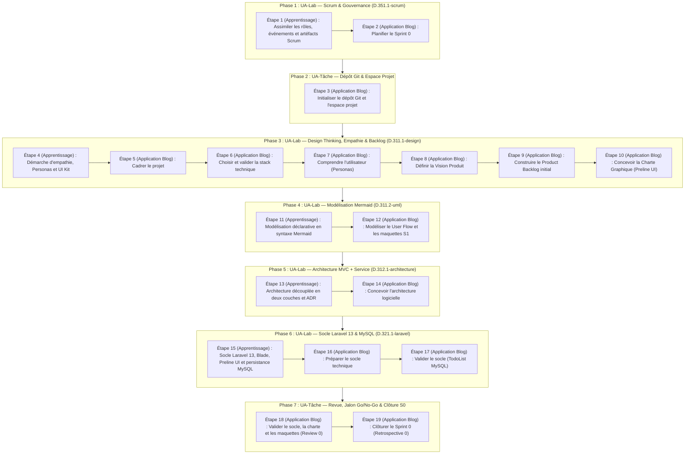

# Flux de Travail Opérationnel — Session S0 : Cadrage, Design Macro et Socle Technique

Ce document définit le flux de travail opérationnel du **Sprint 0** (80 heures / 10 jours ouvrés).
Il est structuré en **7 phases typées** alternant les unités d'apprentissage (**UA-Lab**) avec leurs applications immédiates sur le projet d'imitation, et les phases opérationnelles d'ingénierie (**UA-Tâche**).

---

## 1. Fiche d'Identification de la Session S0

- **Identifiant :** Session S0 (Sprint 0)
- **Titre :** Cadrage, Design Macro et Socle Technique
- **Durée totale ferme :** 80 heures (10 jours ouvrés)
- **Positionnement :** Sprint initial d'alignement méthodologique et technique avant les cycles de delivery
- **Domaines de compétences mobilisés :**
  - Initiation Scrum & Gouvernance Agile (`D.351.1-scrum`)
  - Design Thinking, Empathie, Personas et UI Kit Preline UI (`D.311.1-design`)
  - Modélisation déclarative en syntaxe Mermaid (`D.311.2-uml`)
  - Architecture Logicielle MVC, Couche Service et ADR (`D.312.1-architecture`)
  - Socle technique Laravel 13, Blade, Preline UI et persistance MySQL (`D.321.1-laravel`)
- **Objectif global d'apprentissage :**
  - Assimiler les principes Scrum et planifier le Sprint 0 avec la charte d'équipe.
  - Initialiser le dépôt Git et la structure documentaire du projet.
  - Cadrer le projet, justifier la stack technique et conduire la démarche d'empathie (Personas et Vision Produit).
  - Découper les exigences en User Stories INVEST pour bâtir le Product Backlog initial.
  - Concevoir l'UI Kit Tailwind CSS avec les composants Preline UI, modéliser le User Flow en syntaxe Mermaid et prototyper les maquettes interactives du Sprint 1.
  - Définir l'architecture logicielle découplée en 2 couches officialisée par l'ADR-01.
  - Installer le socle Laravel 13 sous MySQL et valider la persistance effective via un composant TodoList fonctionnel pour prononcer la décision formelle Go/No-Go lors de la Review 0.

---

## 2. Organisation dans le Cadre Tri-Projets (80h / 10 jours)

- **Jours 1 à 7 : Projet d'Imitation (*Blog des Lauréats*)**
  - Réalisation pas-à-pas en classe active des étapes de cadrage, de design et de socle technique.
  - Alternance immédiate : chaque atelier théorique est mis en œuvre sur le Blog.
- **Jour 8 : Projet Technique (*Portfolio Développeur*)**
  - **Codage technique pur en totale autonomie (sans cadrage ni planification)**.
  - L'apprenant initialise son propre dépôt Git, configure son squelette applicatif Laravel 13 connecté à MySQL, et déploie sa page d'accueil minimale.
  - Épreuve sommative d'évaluation technique du socle.
- **Jours 9 et 10 : Projet Fil Rouge (*Application Métier*, ex : Gestion de Cinéma)**
  - Création des premiers Skills agentiques dans `.agent/skills/` (cadrage, personas, initialisation de socle).
  - Rétrospective et clôture de session.

---

## 3. Déroulement des 7 Phases du Sprint 0

---

### Phase 1 : UA-Lab — Initiation à Scrum et Gouvernance Agile (Domaine D.351.1-scrum)
*Cette phase introduit le cadre méthodologique de gestion de projet. Elle comprend l'étape d'apprentissage théorique suivie immédiatement de la planification concrète du Sprint 0.*

- **Étape 1 (Apprentissage) : Assimiler les rôles, événements et artéfacts Scrum**
  - Entrées : Guide méthodologique Scrum et valeurs du manifeste agile.
  - Notions de base à apprendre :
    - Différence entre cycle en V et itération agile, les 4 valeurs et 12 principes.
    - Les 3 rôles Scrum : Product Owner (Groupe 1), Scrum Master (lab prérequis), Développeurs.
    - Les 5 événements Scrum : Sprint (timebox de 80h), Sprint Planning, Daily Scrum, Sprint Review, Sprint Retrospective.
    - Les 3 artéfacts et engagements : Product Backlog, Sprint Backlog, Incrément (Definition of Done).
    - Découpage en User Stories INVEST et méthode MoSCoW.
  - Sortie de l'atelier d'apprentissage (1 seul livrable) : `tutoriels/scrum/guide-scrum.md`.
- **Étape 2 (Application sur le Blog) : Planifier le Sprint 0**
  - Entrées : Charte d'équipe et lettre de mission du Blog des Lauréats.
  - Travail d'application sur le Blog : Fixer la timebox ferme (80h), formaliser la répartition des rôles avec le Product Owner (Groupe 1), définir les critères de la DoD de cadrage et signer la feuille d'engagement.
  - Sortie (1 seul livrable) : `sprints/sprint-0.md`.

---

### Phase 2 : UA-Tâche — Initialisation du Dépôt Git et Espace Projet
*Cette phase ne contient pas de nouvel apport théorique. Elle regroupe les tâches opérationnelles d'initialisation du versioning et de la documentation d'accueil.*

- **Étape 3 (Application sur le Blog) : Initialiser le dépôt Git et l'espace projet**
  - Entrées : Fiche d'engagement `sprints/sprint-0.md`.
  - Travail d'application sur le Blog : Initialiser le dépôt Git local, connecter le remote GitHub, créer le fichier `.gitignore` et l'arborescence des dossiers (`docs/`, `sprints/`, `scrum/`, `tutoriels/`), et rédiger la documentation d'accueil du dépôt.
  - Sortie (1 seul livrable) : `README.md`.

---

### Phase 3 : UA-Lab — Design Thinking, Empathie, Personas et UI Kit (Domaine D.311.1-design)
*Cette phase introduit la démarche de conception centrée utilisateur. Elle s'organise en une étape d'apprentissage conceptuel suivie de la réalisation complète du cadrage produit et de la charte visuelle.*

- **Étape 4 (Apprentissage) : Démarche d'empathie, Personas et principes UI Kit**
  - Entrées : Guide de Design Thinking et composants Preline UI.
  - Notions de base à apprendre :
    - Les 5 phases du Design Thinking : Empathie, Définition, Idéation, Prototypage, Test.
    - Techniques d'immersion et carte d'empathie (Say, Do, Think, Feel).
    - Structure modulaire d'une fiche Persona (motivations, freins, scénarios).
    - Formulation de la Vision Produit et promesse de valeur.
    - UI Design avec Tailwind CSS et bibliothèque de composants Preline UI.
  - Sortie de l'atelier d'apprentissage (1 seul livrable) : `tutoriels/design/guide-design-thinking-s0.md`.
- **Étape 5 (Application sur le Blog) : Cadrer le projet**
  - Entrées : Fiche d'engagement et guide Design Thinking.
  - Travail d'application sur le Blog : Définir les objectifs métiers et indicateurs de succès, construire la matrice In-Scope vs Out-of-Scope, identifier les contraintes de délai et d'architecture.
  - Sortie (1 seul livrable) : `docs/cadrage/note-cadrage.md`.
- **Étape 6 (Application sur le Blog) : Choisir et valider la stack technique**
  - Entrées : Note de cadrage `docs/cadrage/note-cadrage.md`.
  - Travail d'application sur le Blog : Justifier formellement chaque choix technologique : Laravel 13, MySQL exclusivement, Preline UI avec Tailwind CSS, Alpine.js, Agent Antigravity & Copilot, Policies/Gates et Spatie RBAC.
  - Sortie (1 seul livrable) : `docs/cadrage/stack-technique.md`.
- **Étape 7 (Application sur le Blog) : Comprendre l'utilisateur (Design Thinking — Empathie & Personas)**
  - Entrées : Note de cadrage et compétences d'empathie.
  - Travail d'application sur le Blog : Observer les besoins réels des lauréats et des apprenants, et rédiger les fiches Personas détaillées pour chaque profil type.
  - Sortie (1 seul livrable) : `docs/analyse/personas.md`.
- **Étape 8 (Application sur le Blog) : Définir la Vision Produit**
  - Entrées : Fiches Personas et note de cadrage.
  - Travail d'application sur le Blog : Synthétiser les besoins sous format Point of View (POV) et formaliser la promesse de valeur en accord avec le Product Owner (Groupe 1).
  - Sortie (1 seul livrable) : `docs/produit/vision-produit.md`.
- **Étape 9 (Application sur le Blog) : Construire le Product Backlog initial**
  - Entrées : Vision Produit et fiches Personas.
  - Travail d'application sur le Blog : Découper le projet en exigences fonctionnelles INVEST, rédiger les critères d'acceptation et prioriser selon la méthode MoSCoW.
  - Sortie (1 seul livrable) : `scrum/product-backlog.md`.
- **Étape 10 (Application sur le Blog) : Concevoir la Charte Graphique (UI Kit Tailwind CSS)**
  - Entrées : Personas, identité visuelle et composants Preline UI.
  - Travail d'application sur le Blog : Définir la palette de couleurs, l'échelle typographique et composer l'UI Kit sous forme de composants Preline UI documentés.
  - Sortie (1 seul livrable) : `docs/design/ui-kit.md`.

---

### Phase 4 : UA-Lab — Modélisation Déclarative en Syntaxe Mermaid (Domaine D.311.2-uml)
*Cette phase introduit la modélisation graphique déclarative. Elle s'organise en une étape d'apprentissage théorique suivie de la modélisation du parcours utilisateur et des maquettes du Sprint 1.*

- **Étape 11 (Apprentissage) : Modélisation déclarative en syntaxe Mermaid**
  - Entrées : Guide de syntaxe Mermaid.js.
  - Notions de base à apprendre :
    - Syntaxe Mermaid.js pour graphes et flux (`flowchart TD / LR`), sous-graphes et styles.
    - Diagramme de contexte système (boîte noire, frontières, acteurs et flux).
    - Modélisation de parcours utilisateur (User Flow) et d'entités préliminaires (`erDiagram`).
  - Sortie de l'atelier d'apprentissage (1 seul livrable) : `tutoriels/uml/guide-mermaid-s0.md`.
- **Étape 12 (Application sur le Blog) : Modéliser le User Flow et les maquettes du Sprint 1**
  - Entrées : User Stories prioritaires, UI Kit Preline UI et guide Mermaid.
  - Travail d'application sur le Blog : Modéliser en syntaxe Mermaid le parcours complet de consultation d'un article écran par écran et prototyper les maquettes interactives associées.
  - Sortie (1 seul livrable) : `docs/design/maquettes-sprint-1.md`.

---

### Phase 5 : UA-Lab — Architecture Logicielle MVC avec Couche Service et Formalisme ADR (Domaine D.312.1-architecture)
*Cette phase introduit la conception architecturale découplée. Elle s'organise en une étape d'apprentissage théorique suivie de la conception du patron d'architecture du projet.*

- **Étape 13 (Apprentissage) : Architecture logicielle MVC avec couche Service et formalisme ADR**
  - Entrées : Notions de conception orientée objet.
  - Notions de base à apprendre :
    - Responsabilités du patron Modèle-Vue-Contrôleur (MVC).
    - Couche Service métier : séparation stricte entre contrôleur HTTP mince et logique métier.
    - Formalisme formel d'un Architectural Decision Record (ADR) : Titre, Statut, Contexte, Décision, Conséquences.
  - Sortie de l'atelier d'apprentissage (1 seul livrable) : `tutoriels/architecture/guide-architecture-s0.md`.
- **Étape 14 (Application sur le Blog) : Concevoir l'architecture logicielle**
  - Entrées : Maquettes S1, User Flow et stack technique validée.
  - Travail d'application sur le Blog : Modéliser le schéma relationnel initial des données en syntaxe Mermaid, définir le patron contrôleur mince vers Service métier, et rédiger l'ADR-01.
  - Sortie (1 seul livrable) : `docs/architecture/architecture-initiale.md`.

---

### Phase 6 : UA-Lab — Socle Laravel 13, Blade, Preline UI et Persistance MySQL (Domaine D.321.1-laravel)
*Cette phase introduit le développement du socle applicatif sous Laravel 13. Elle s'organise en une étape d'apprentissage technique suivie de l'installation et de la validation par un composant TodoList connecté à MySQL.*

- **Étape 15 (Apprentissage) : Socle Laravel 13, Blade, Preline UI et persistance MySQL**
  - Entrées : Documentation Laravel 13 et Preline UI.
  - Notions de base à apprendre :
    - Installation et arborescence de répertoires de **Laravel 13**.
    - Configuration de l'environnement `.env` pour la connexion au serveur **MySQL**.
    - Routage web (`routes/web.php`) et gabarits Blade (`resources/views/`).
    - Intégration de Tailwind CSS avec **Preline UI**.
    - Schéma relationnel : migrations (`php artisan make:migration`) et seeders sous MySQL.
    - Contrôleur et vue Blade affichant une liste de tâches (TodoList) depuis MySQL pour prouver la persistance effective.
  - Sortie de l'atelier d'apprentissage (1 seul livrable) : `tutoriels/laravel/guide-demarrage-laravel13.md`.
- **Étape 16 (Application sur le Blog) : Préparer le socle technique**
  - Entrées : Architecture logicielle et compétences Laravel 13 acquises.
  - Travail d'application sur le Blog : Installer le squelette Laravel 13, configurer le fichier `.env`, intégrer Preline UI avec Tailwind CSS, et créer la vue d'accueil responsive Blade.
  - Sortie (1 seul livrable) : `resources/views/welcome.blade.php`.
- **Étape 17 (Application sur le Blog) : Valider le socle technique par un composant persistant (TodoList connectée à MySQL)**
  - Entrées : Squelette Laravel 13 opérationnel et serveur MySQL.
  - Travail d'application sur le Blog : Coder la migration MySQL de la table `todos`, insérer les données d'essai via Seeder, et implémenter `TodoController` avec la vue Blade Preline UI pour prouver la chaîne complète.
  - Sortie (1 seul livrable) : `app/Http/Controllers/TodoController.php`.

---

### Phase 7 : UA-Tâche — Revue, Validation Go/No-Go et Rétrospective du Sprint 0
*Cette phase ne contient aucun nouveau UA-lab. Il s'agit d'une UA-Tâche opérationnelle de validation contradictoire et d'amélioration continue du processus de cadrage.*

- **Étape 18 (Application sur le Blog) : Valider le socle, la charte graphique et les maquettes (Sprint Review 0 — Jalon Go/No-Go)**
  - Entrées : Socle Laravel 13 connecté à MySQL (TodoList fonctionnelle), charte Preline UI et maquettes interactives S1.
  - Travail d'application sur le Blog : Animer la démonstration devant le Product Owner (Groupe 1), faire tester les maquettes aux usagers cibles, et prononcer la décision formelle Go/No-Go.
  - Sortie (1 seul livrable) : `sprints/pv-review-0.md`.
- **Étape 19 (Application sur le Blog) : Clôturer le Sprint 0 (Sprint Retrospective 0)**
  - Entrées : Déroulement et retours de la Review 0.
  - Travail d'application sur le Blog : Analyser le fonctionnement d'équipe, arrêter 2 actions d'amélioration concrètes pour le delivery et consigner les règles de vie du groupe.
  - Sortie (1 seul livrable) : `sprints/retrospective-0.md`.
