# Flux de Travail — Session S0 (Sprint 0 - 80h)

Ce document détaille le flux de travail opérationnel du **Sprint 0 : Cadrage, Design Macro et Socle Technique** pour le projet de formation N3.

Il applique directement les étapes de la Phase 1 du [Flux de Travail Générique](../flux-travail-generique.md) en alternant de manière synchrone l'acquisition de compétences théoriques dans les UA-labs et leur application immédiate sur le projet d'imitation.

---

## 1. Fiche d'Identification de la Session

- **Code de Session :** S0
- **Intitulé du Sprint :** Cadrage, Design Macro et Socle Technique
- **Durée Ferme (Timebox) :** 80 heures (10 jours ouvrés)
- **Positionnement :** Sprint initial d'alignement et d'outillage avant le premier cycle de delivery

---

## 2. Objectif d'Apprentissage Global

Acquérir et appliquer de manière synchrone les fondamentaux du cadre Scrum, de la démarche Design Thinking (immersion empathique et Personas), de la modélisation déclarative Mermaid, de l'architecture MVC avec couche Service et du framework Laravel 13 ; initialiser le dépôt Git et l'espace projet ; cadrer le projet en équipe, formaliser la vision produit et le Product Backlog initial selon les critères INVEST ; concevoir la charte graphique sous forme d'UI Kit Tailwind CSS avec **Preline UI**, modéliser le **User Flow** écran par écran et les maquettes interactives du Sprint 1 ; initialiser le socle technique sous **Laravel 13** et **MySQL**, valider le fonctionnement de la base de données via un composant TodoList fonctionnel, et valider le jalon Go/No-Go lors de la Sprint Review 0.

---

## 3. Prérequis Bloquants de Lancement

Pour démarrer la session et lancer le projet :
- **Prérequis Bloquant Product Owner :** Validation du lab `lab-product-owner` par le **Groupe 1** (groupe pilote d'apprenants ayant déjà mené un projet collectif en amont et validé le lab `lab-design-thinking`). Le Groupe 1 porte le besoin métier, la vision produit et valide formellement les livrables lors des Sprint Reviews.
- **Prérequis Bloquant Scrum Master :** Validation du lab `lab-scrum-master` par l'ensemble des apprenants de la promotion pour maîtriser l'animation des rituels et les artéfacts agiles.
- **Rôles Opérationnels :** Les apprenants occupent les rôles de **Développeurs** et de **Scrum Master** (en alternance).

---

## 4. Cadre Tri-Projets et Organisation Temporelle (80h / 10 jours)

- **Jours 1 à 7 : Projet d'Imitation (*Blog des Lauréats*)**
  - Réalisation guidée pas-à-pas en classe active.
  - Alternance directe entre l'assimilation d'un UA-lab et l'exécution de l'étape de réalisation correspondante.
- **Jour 8 : Projet Technique (*Portfolio Développeur*)**
  - **Codage technique pur en totale autonomie**.
  - L'apprenant réalise uniquement le développement technique : initialisation de son propre dépôt Git, configuration de son squelette Laravel 13 connecté à MySQL, et mise en place de sa page d'accueil minimale.
  - Aucune étape de planification ni de conception n'est demandée sur cette journée.
- **Jours 9 et 10 : Projet Fil Rouge (*Application Métier*, ex : Cinéma)**
  - **Création et enrichissement systématique de Skills agentiques** dans `.agent/skills/`.
  - L'apprenant conçoit des Skills réutilisables permettant à l'Agent IA d'exécuter sur le domaine métier le travail appris dans le projet d'imitation (Skill de cadrage, de personas, de modélisation et de socle).
  - Clôture de session et bilan réflexif.

---

## 5. Déroulement Chronologique Intercalé du Sprint 0

Chaque étape théorique (**UA-lab**) est positionnée immédiatement avant sa mise en œuvre pratique dans une **Étape de Réalisation** (reprenant le nom exact du flux générique et produisant un livrable unique).

```mermaid
flowchart TD
    subgraph S01_Gouv ["Gouvernance & Dépôt Git"]
        U1["Étape 1 : UA-lab Scrum (D.351.1-scrum)"] --> R1["Étape 2 : Planifier le Sprint 0"]
        R1 --> R2["Étape 3 : Initialiser le dépôt Git et l'espace projet"]
    end

    subgraph S02_Design ["Design Thinking & Backlog"]
        R2 --> U2["Étape 4 : UA-lab Design Thinking (D.311.1-design)"]
        U2 --> R3["Étape 5 : Cadrer le projet"]
        R3 --> R4["Étape 6 : Choisir et valider la stack technique"]
        R4 --> R5["Étape 7 : Comprendre l'utilisateur (Personas)"]
        R5 --> R6["Étape 8 : Définir la Vision Produit"]
        R6 --> R7["Étape 9 : Construire le Product Backlog initial"]
        R7 --> R8["Étape 10 : Concevoir la Charte Graphique (Preline UI)"]
    end

    subgraph S03_Proto ["Modélisation & Architecture"]
        R8 --> U3["Étape 11 : UA-lab Mermaid (D.311.2-uml)"]
        U3 --> R9["Étape 12 : Modéliser le User Flow et les maquettes S1"]
        R9 --> U4["Étape 13 : UA-lab Architecture MVC (D.312.1-architecture)"]
        U4 --> R10["Étape 14 : Concevoir l'architecture logicielle"]
    end

    subgraph S04_Socle ["Socle Technique & Validation Go/No-Go"]
        R10 --> U5["Étape 15 : UA-lab Laravel 13 & MySQL (D.321.1-laravel)"]
        U5 --> R11["Étape 16 : Préparer le socle technique"]
        R11 --> R12["Étape 17 : Valider le socle (TodoList MySQL)"]
        R12 --> R13["Étape 18 : Valider le socle, la charte et les maquettes (Review 0)"]
        R13 --> R14["Étape 19 : Clôturer le Sprint 0 (Retrospective 0)"]
    end
```

---

### Étape 1 : UA-lab : Initiation à Scrum et gouvernance agile (Domaine D.351.1-scrum)
- **Objectif d'apprentissage :** Assimiler les principes agiles, les 3 rôles, les 5 événements et les 3 artéfacts Scrum pour organiser le projet dès le cadrage.
- **Notions de base à apprendre :**
  - Différence entre cycle en V et démarche agile itérative, les 4 valeurs du manifeste agile.
  - Les 3 rôles Scrum : Product Owner (porté par le Groupe 1), Scrum Master (lab prérequis), Développeurs.
  - Les 5 événements Scrum : Sprint (timebox ferme de 80h), Sprint Planning, Daily Scrum, Sprint Review, Sprint Retrospective.
  - Les 3 artéfacts et leurs engagements : Product Backlog (Objectif de Produit), Sprint Backlog (Objectif de Sprint), Incrément (Definition of Done).
  - Découpage des exigences en User Stories INVEST, critères d'acceptation et méthode de priorisation MoSCoW.
- **Sortie :** Charte d'équipe Scrum et règles d'engagement (`scrum/charte-equipe.md`).

### Étape 2 : Planifier le Sprint 0 (Étape Générique 1)
- **Entrées :** Charte d'équipe `scrum/charte-equipe.md` et lettre de mission du projet.
- **Activités de réalisation :**
  - Fixer la timebox ferme du Sprint 0 (80 heures / 10 jours).
  - Formaliser la répartition des rôles en accord avec le Product Owner (Groupe 1).
  - Définir les 7 critères de la Definition of Done (DoD) pour la phase de cadrage.
  - Recenser les risques initiaux et signer la feuille d'engagement d'équipe.
- **Sortie principale :** Fiche d'engagement d'équipe du Sprint 0 (`sprints/sprint-0.md`).

### Étape 3 : Initialiser le dépôt Git et l'espace projet (Étape Générique 2)
- **Entrées :** Fiche d'engagement `sprints/sprint-0.md`.
- **Activités de réalisation :**
  - Initialiser le dépôt Git local et configurer le remote GitHub du projet d'imitation.
  - Créer le fichier `.gitignore` adapté à l'environnement de développement.
  - Créer l'arborescence des dossiers de livrables (`docs/`, `sprints/`, `scrum/`, `tutoriels/`).
  - Rédiger la documentation d'accueil initiale du dépôt avec la description du projet et les conventions de travail.
- **Sortie principale :** Fichier de présentation et d'orientation du dépôt (`README.md`).

### Étape 4 : UA-lab : Design Thinking, démarche d'empathie, Personas et UI Kit (Domaine D.311.1-design)
- **Objectif d'apprentissage :** Maîtriser la démarche de conception centrée utilisateur pour cadrer le besoin, formaliser les usagers types et concevoir la charte graphique sous Preline UI.
- **Notions de base à apprendre :**
  - Les 5 étapes du Design Thinking : Empathie, Définition, Idéation, Prototypage, Test.
  - Démarche d'empathie : techniques d'immersion, observation terrain, carte d'empathie (Say, Do, Think, Feel).
  - Fiches Personas : structure modulaire (profil, motivations, points de douleur *pain points*, scénarios).
  - Formulation de la Vision Produit partagée et promesse de valeur.
  - Principes d'UI Design et création d'un UI Kit avec Tailwind CSS et composants Preline UI (boutons, formulaires, cartes, badges, navigation).
- **Sortie :** Dossier méthodologique Design Thinking, Empathie et UI Kit (`tutoriels/design/guide-design-thinking-s0.md`).

### Étape 5 : Cadrer le projet (Étape Générique 3)
- **Entrées :** Fiche d'engagement et guide méthodologique Design Thinking.
- **Activités de réalisation :**
  - Définir les objectifs métiers et les indicateurs clés de succès du Blog des Lauréats.
  - Construire la matrice de périmètre stricte : fonctionnalités In-Scope vs Out-of-Scope.
  - Identifier les contraintes de délai, de conformité et d'architecture.
- **Sortie principale :** Note de cadrage du projet (`docs/cadrage/note-cadrage.md`).

### Étape 6 : Choisir et valider la stack technique (Étape Générique 4)
- **Entrées :** Note de cadrage `docs/cadrage/note-cadrage.md`.
- **Activités de réalisation :**
  - Documenter et justifier formellement chaque brique technique de la solution retenue :
    - Framework Backend : **Laravel 13**.
    - Base de données relationnelle : **MySQL exclusivement**.
    - Solution d'interface : **Tailwind CSS avec la bibliothèque Preline UI**.
    - Bibliothèque frontend déclarative : **Alpine.js**.
    - Outillage d'assistance IA : **Agent Antigravity & GitHub Copilot**.
    - Sécurité applicative : **Policies/Gates et Spatie Laravel-Permission (RBAC)**.
- **Sortie principale :** Dossier de justification technique de la stack (`docs/cadrage/stack-technique.md`).

### Étape 7 : Comprendre l'utilisateur (Design Thinking — Empathie & Personas) (Étape Générique 5)
- **Entrées :** Note de cadrage et compétences d'empathie acquises à l'Étape 4.
- **Activités de réalisation :**
  - Observer et recueillir les attentes réelles des lecteurs et contributeurs cibles du Blog des Lauréats.
  - Rédiger les fiches Personas détaillées pour chaque profil type (Lecteur visiteur, Lauréat contributeur, Administrateur).
- **Sortie principale :** Fiches Personas représentatives des utilisateurs types (`docs/analyse/personas.md`).

### Étape 8 : Définir la Vision Produit (Étape Générique 6)
- **Entrées :** Note de cadrage et fiches Personas validées.
- **Activités de réalisation :**
  - Synthétiser les besoins et formuler le problème sous format Point of View (POV).
  - Énoncer la promesse de valeur partagée en concertation étroite avec le Product Owner (Groupe 1).
- **Sortie principale :** Document formalisant la Vision Produit (`docs/produit/vision-produit.md`).

### Étape 9 : Construire le Product Backlog initial (Étape Générique 7)
- **Entrées :** Vision Produit et fiches Personas.
- **Activités de réalisation :**
  - Animer un atelier d'idéation pour découper le projet en exigences fonctionnelles.
  - Formaliser chaque User Story selon la norme INVEST avec des critères d'acceptation précis.
  - Prioriser les User Stories selon la méthode MoSCoW en accord avec le Product Owner.
- **Sortie principale :** Product Backlog initial ordonné (`scrum/product-backlog.md`).

### Étape 10 : Concevoir la Charte Graphique (UI Kit Tailwind CSS) (Étape Générique 8)
- **Entrées :** Fiches Personas, identité visuelle du produit et composants Preline UI.
- **Activités de réalisation :**
  - Définir la palette de couleurs sémantiques sous Tailwind CSS.
  - Définir l'échelle typographique et les espacements.
  - Composer l'UI Kit sous forme de composants Preline UI documentés (boutons, formulaires, cartes, badges, barre de navigation).
- **Sortie principale :** Spécification de l'UI Kit Tailwind CSS et Preline UI (`docs/design/ui-kit.md`).

### Étape 11 : UA-lab : Modélisation déclarative en syntaxe Mermaid (Domaine D.311.2-uml)
- **Objectif d'apprentissage :** Modéliser les parcours utilisateurs, flux et schémas d'entités sous forme de diagrammes déclaratifs Mermaid intégrés au Markdown.
- **Notions de base à apprendre :**
  - Syntaxe Mermaid.js pour graphes et flux (`flowchart TD / LR`), sous-graphes et stylisation.
  - Diagramme de contexte système : boîte noire, frontières applicatives, acteurs et échanges.
  - Modélisation déclarative de parcours utilisateur (User Flow) et d'entités préliminaires (`erDiagram`).
- **Sortie :** Guide de modélisation déclarative Mermaid (`tutoriels/uml/guide-mermaid-s0.md`).

### Étape 12 : Modéliser le User Flow et les maquettes du Sprint 1 (Étape Générique 9)
- **Entrées :** User Stories prioritaires du Sprint 1, UI Kit Preline UI et compétences Mermaid acquises à l'Étape 11.
- **Activités de réalisation :**
  - Modéliser en syntaxe Mermaid déclarative le parcours complet de consultation d'un article écran par écran.
  - Prototyper les maquettes interactives ciblées pour les écrans du Sprint 1 en utilisant les composants Preline UI.
- **Sortie principale :** Document intégrant le User Flow Mermaid et les maquettes interactives associées (`docs/design/maquettes-sprint-1.md`).

### Étape 13 : UA-lab : Architecture logicielle MVC avec couche Service et formalisme ADR (Domaine D.312.1-architecture)
- **Objectif d'apprentissage :** Structurer une application web selon le patron découplé MVC + Service et documenter les décisions d'architecture.
- **Notions de base à apprendre :**
  - Responsabilités respectives du patron Modèle-Vue-Contrôleur (MVC).
  - Couche Service métier : séparation stricte entre contrôleur HTTP mince et règles de gestion.
  - Formalisme formel d'un Architectural Decision Record (ADR) : Titre, Statut, Contexte, Décision, Conséquences.
- **Sortie :** Guide d'architecture MVC + Service Layer et formalisme ADR (`tutoriels/architecture/guide-architecture-s0.md`).

### Étape 14 : Concevoir l'architecture logicielle (Étape Générique 10)
- **Entrées :** Maquettes du Sprint 1, User Flow, guide d'architecture et stack validée.
- **Activités de réalisation :**
  - Modéliser le schéma relationnel initial des données Blog en syntaxe Mermaid (`erDiagram`).
  - Définir le patron architectural en couches : Contrôleur mince HTTP vers Service métier.
  - Rédiger la décision d'architecture fondatrice (ADR-01) formalisant ce découpage.
- **Sortie principale :** Dossier d'architecture initiale incluant le modèle relationnel et l'ADR (`docs/architecture/architecture-initiale.md`).

### Étape 15 : UA-lab : Socle Laravel 13, Blade, Preline UI et persistance MySQL (Domaine D.321.1-laravel)
- **Objectif d'apprentissage :** Déployer le framework Laravel 13, configurer la base de données MySQL, intégrer Preline UI et créer un premier composant fonctionnel TodoList connecté à MySQL.
- **Notions de base à apprendre :**
  - Installation et arborescence de répertoires de **Laravel 13**.
  - Configuration du fichier `.env` pour la connexion au serveur de base de données **MySQL**.
  - Routage web (`routes/web.php`) et gabarits Blade (`resources/views/`).
  - Intégration de Tailwind CSS avec la bibliothèque **Preline UI**.
  - Schéma relationnel : création de migrations avec le Schema Builder Laravel (`php artisan make:migration`) et exécution (`php artisan migrate`).
  - Données d'essai : création et exécution de Seeders pour peupler la base MySQL.
  - Contrôleur et vue Blade affichant une liste de tâches (TodoList) depuis MySQL pour prouver la persistance effective.
- **Sortie :** Guide technique Laravel 13, Preline UI et persistance MySQL (`tutoriels/laravel/guide-demarrage-laravel13.md`).

### Étape 16 : Préparer le socle technique (Étape Générique 11)
- **Entrées :** Architecture logicielle, compétences Laravel 13 acquises à l'Étape 15 et stack validée.
- **Activités de réalisation :**
  - Installer et initialiser le squelette applicatif Laravel 13.
  - Configurer les paramètres d'environnement dans le fichier `.env`.
  - Installer Tailwind CSS et le plugin Preline UI.
  - Créer la route racine `/` et la vue d'accueil responsive Blade.
- **Sortie principale :** Vue d'accueil Blade responsive opérationnelle (`resources/views/welcome.blade.php`).

### Étape 17 : Valider le socle technique par un composant persistant (TodoList connectée à MySQL) (Étape Générique 12)
- **Entrées :** Squelette Laravel 13 opérationnel et serveur MySQL.
- **Activités de réalisation :**
  - Coder la migration MySQL de la table `todos`.
  - Exécuter la migration et insérer des données de test via Seeder.
  - Implémenter le contrôleur `TodoController` et la vue Blade avec composants Preline UI affichant les données depuis MySQL pour prouver la chaîne complète.
- **Sortie principale :** Contrôleur opérationnel validant la persistance MySQL et l'affichage de données réelles (`app/Http/Controllers/TodoController.php`).

### Étape 18 : Valider le socle, la charte graphique et les maquettes (Sprint Review 0 — Jalon Go/No-Go) (Étape Générique 13)
- **Entrées :** Socle Laravel 13 connecté à MySQL (TodoList fonctionnelle), charte graphique Preline UI, User Flow et maquettes du Sprint 1.
- **Activités de réalisation :**
  - Animer la séance de revue devant le Product Owner (Groupe 1).
  - Démontrer la persistance MySQL et le fonctionnement du composant TodoList.
  - Faire tester les maquettes interactives du Sprint 1 à des usagers réels pour recueillir leurs retours ergonomiques.
  - Valider formellement la charte graphique.
  - Prononcer la décision formelle Go/No-Go pour autoriser le passage au Sprint 1.
- **Sortie principale :** Procès-verbal de la Review 0 actant la décision Go/No-Go et les retours d'ergonomie (`sprints/pv-review-0.md`).

### Étape 19 : Clôturer le Sprint 0 (Sprint Retrospective 0) (Étape Générique 14)
- **Entrées :** Déroulement et retours de la Review 0.
- **Activités de réalisation :**
  - Analyser le fonctionnement de l'équipe durant les 80 heures de cadrage.
  - Identifier les réussites et les difficultés d'organisation.
  - Arrêter 2 actions d'amélioration concrètes pour le premier sprint de delivery.
  - Consigner les règles de fonctionnement et de vie d'équipe.
- **Sortie principale :** Bilan rétrospectif du Sprint 0 et plan d'amélioration continue (`sprints/retrospective-0.md`).
