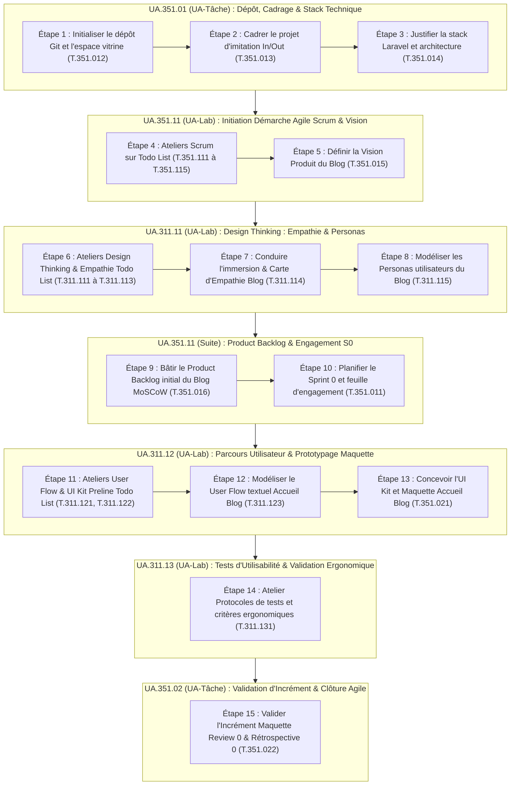

# Flux de Travail Opérationnel — Session S0 : Maquette de la Page d'Accueil

Ce document définit le flux de travail opérationnel du **Sprint 0**.
Il est centré sur la production de son incrément majeur : la **Maquette de la Page d'Accueil** du Blog des Lauréats.

Le flux articule de manière cohérente les Unités d'Apprentissage d'ateliers pratiques (**UA-Lab**) et les Unités d'Apprentissage d'application opérationnelle sur le projet (**UA-Tâche**), totalisant **6 UAs**, **15 étapes chronologiques** et **22 tutoriels d'ingénierie**.

Les durées temporelles (80 heures / 10 jours) sont fournies à titre purement indicatif pour les formateurs et le concepteur.

---

## 1. Fiche d'Identification de la Session S0

- **Identifiant :** Session S0 (Sprint 0)
- **Titre centré sur l'incrément :** Maquette de la Page d'Accueil
- **Incrément produit :** Maquette interactive de la page d'accueil avec son User Flow textuel, son UI Kit de composants validé, et le cadrage initial du produit (Product Backlog ordonné)
- **Durée indicative :** 80 heures (10 jours ouvrés)
- **Référentiel des compétences :** Conforme au document de référence [.agents/references/domaines-competences.md](../../.agents/references/domaines-competences.md)
- **Domaines de compétences et Unités d'Apprentissage mobilisés :**
  - Domaine Réalisation et Conduite de Projet (`D.351.2-realisation-projet`) :
    - Unité d'apprentissage `UA.351.01` (UA-Tâche) : *Application Projet : Dépôt, Cadrage et Stack Technique* (Statut : **À réaliser**)
  - Domaine Scrum & Gouvernance Agile (`D.351.1-scrum`) :
    - Unité d'apprentissage `UA.351.11` (UA-Lab) : *Initiation à la Démarche Agile et Cadre Scrum* (Statut : **Réalisée**)
  - Domaine Conception & Design Thinking (`D.311.1-design`) :
    - Unité d'apprentissage `UA.311.11` (UA-Lab) : *Design Thinking : Démarche Globale et Immersion Empathique* (Statut : **À réaliser**)
    - Unité d'apprentissage `UA.311.12` (UA-Lab) : *Design Thinking : Parcours Utilisateur et Prototypage d'Interface* (Statut : **À réaliser**)
    - Unité d'apprentissage `UA.311.13` (UA-Lab) : *Design Thinking : Tests d'Utilisabilité et Validation Ergonomique* (Statut : **À réaliser**)
  - Domaine Réalisation et Conduite de Projet (`D.351.2-realisation-projet`) :
    - Unité d'apprentissage `UA.351.02` (UA-Tâche) : *Application Projet : Validation d'Incrément et Clôture Agile* (Statut : **À réaliser**)
- **Objectif global d'apprentissage :**
  - Cadrer le projet initial et configurer l'espace de développement Git officiel.
  - Découvrir la méthode agile Scrum et organiser la gouvernance de promotion avec le Groupe 1 en Product Owner.
  - Maîtriser les étapes amont du Design Thinking (Empathie, Définition) sur le cas Todo List, puis conduire l'immersion usagers et formaliser les Personas du Blog.
  - Bâtir le Product Backlog initial ordonné selon MoSCoW et signer la feuille d'engagement d'équipe du Sprint 0.
  - Maîtriser les étapes aval du Design Thinking (Idéation, Prototypage) pour modéliser le User Flow et prototyper la maquette d'accueil avec Tailwind CSS et Preline UI.
  - Découvrir les protocoles de tests d'utilisabilité et valider formellement la maquette lors de la Sprint Review 0 (Jalon Go/No-Go).

---

## 2. Organisation de la Promotion et Prérequis de Lancement du Sprint 0

Pour lancer la dynamique collective du Sprint 0, l'organisation de la promotion repose sur un découpage en 5 groupes dont les numéros reflètent directement la priorité des missions d'ingénierie et d'accompagnement :

- **Condition d'accès aux Groupes Opérationnels 1 à 4 :**  
  Pour être affecté dans l'un des groupes 1 à 4, chaque apprenant doit obligatoirement avoir validé les **5 labs initiaux prérequis fondamentaux** :
  - `lab-startup` : Prise en main de l'environnement de développement et initialisation du poste.
  - `lab-markdown` : Maîtrise de la rédaction documentaire structurée en Markdown standard.
  - `lab-marp` : Conception de diaporamas professionnels au format Marp Markdown.
  - `lab-prompt` : Formulation de prompts d'assistance et interaction avec l'Agent IA copilote.
  - `lab-presentation-pro` : Posture professionnelle et animation de soutenance technique.

- **Groupe 5 (Priorité 5 — Prérequis Fondamentaux & Sas de Rattrapage) :**  
  Les apprenants n'ayant pas encore validé l'ensemble des 5 labs initiaux sont affectés au Groupe 5. Leur priorité absolue est de finaliser et faire valider ces prérequis indispensables avant d'intégrer les groupes opérationnels 1 à 4.

- **Rôle Opérationnel des Groupes 1 à 4 (Exclusif aux Tuto-Tâches) :**  
  *Règle méthodologique stricte :* Les groupes ne sont pas sollicités pendant le déroulement des séances d'UA-Lab (qui relèvent d'un apprentissage guidé par le formateur). Ils interviennent pour **débloquer et accompagner les apprenants sur les tuto-tâches** d'application projet avant et pendant leur réalisation :
  - **Groupe 1 (Priorité 1 — Product Owner / Vision & Backlog) :**  
    Porte la vision métier du *Blog des Lauréats*, priorise les User Stories initiales du Product Backlog et débloque les arbitrages fonctionnels sur les tâches de vision, de cadrage et de backlog. Il statue lors de la Sprint Review 0.
  - **Groupe 2 (Priorité 2 — Design Thinking & Prototypage) :**  
    Assure la cohérence de la démarche centrée utilisateur. Il guide et débloque les pairs sur les tâches d'immersion terrain, la formalisation des Cartes d'Empathie, la modélisation des fiches Personas, ainsi que sur le User Flow et les maquettes interactives.
  - **Groupe 3 (Priorité 3 — Cadre Scrum & Organisation Agile) :**  
    Veille à la bonne appropriation du cadre Scrum. Il guide et débloque les pairs sur la feuille d'engagement d'équipe (`sprint-0.md`) et le respect des cérémonies agiles.
  - **Groupe 4 (Priorité 4 — Cadrage Transverse, Plan de Rapport & Diaporama) :**  
    Prépare les formats de capitalisation transverses en travaillant sur son projet fil rouge : élaboration du plan type de rapport modulaire et du plan type de présentation de soutenance Marp.

---

## 3. Cadre Tri-Projets

- **Projet d'Imitation (*Blog des Lauréats*) :** Réalisation pas-à-pas en classe active des étapes de cadrage, d'empathie, de backlog, d'UI Kit et de la maquette de la page d'accueil.
- **Projet Technique (*Portfolio Développeur*) :**
  - En fin de sprint, chaque apprenant reproduit la réalisation concrète du sprint sur son portfolio personnel (initialisation du dépôt Git et maquette de sa propre page d'accueil).
  - **Règle formelle d'exigence :** Les documents de cadrage et de conception (note de cadrage, personas, vision produit) **ne sont pas demandés** pour le portfolio dans la session. L'apprenant reste libre de les réaliser pour lui-même, mais ils ne font l'objet d'aucune évaluation formelle.
- **Projet Fil Rouge (*Application Métier*, ex : Gestion de Cinéma) :** Cadrage fonctionnel, formalisation des Personas et initialisation du Product Backlog de l'application métier par les équipes projet.

---

## 4. Déroulement Opérationnel des 6 Unités d'Apprentissage (15 Étapes — 22 Tutoriels)

---

### Unité d'Apprentissage UA.351.01 (UA-Tâche) : Application Projet : Dépôt, Cadrage et Stack Technique
*Domaine Réalisation et Conduite de Projet (`D.351.2-realisation-projet`)*

#### Étape 1 : Initialiser le dépôt Git et l'espace projet vitrine
- **Fiche Tutoriel :** `T.351.012` | **Type :** `tuto-tache` | **Attribut étape :** `etape: 1` (`nav_order: 1`)
- **Statut :** **À réaliser**
- **Domaine de compétence :** `D.351.2-realisation-projet`
- **Entrées :** Consignes du formateur et cahier des charges initial.
- **Travail d'application sur le Blog :**
  - Cloner le dépôt officiel `projet-imitation-n3`.
  - Créer et basculer sur la branche de travail dédiée `sprint0`.
  - Configurer l'arborescence standard conforme à `organisation-livrables.md`.
  - Rédiger le `README.md` racine de présentation du produit, des objectifs et de la stack.
- **Sortie (1 livrable) :** `README.md`.

#### Étape 2 : Cadrer le projet d'imitation et rédiger la note de cadrage
- **Fiche Tutoriel :** `T.351.013` | **Type :** `tuto-tache` | **Attribut étape :** `etape: 2` (`nav_order: 2`)
- **Statut :** **À réaliser**
- **Domaine de compétence :** `D.351.2-realisation-projet`
- **Entrées :** Fiche d'expression des besoins brute du Blog des Lauréats de l'EFP.
- **Travail d'application sur le Blog :**
  - Clarifier le contexte professionnel, la problématique et les objectifs mesurables.
  - Définir les parties prenantes et leurs attentes clés.
  - Établir la matrice de périmètre stricte : *In-Scope* (fonctionnalités cibles) vs *Out-of-Scope* (exclusions formelles du MVP).
  - Identifier les contraintes réglementaires (RGPD), temporelles et d'accessibilité.
- **Sortie (1 livrable) :** `docs/cadrage/note-cadrage.md`.

#### Étape 3 : Justifier et valider le choix de la stack technologique (Laravel)
- **Fiche Tutoriel :** `T.351.014` | **Type :** `tuto-tache` | **Attribut étape :** `etape: 3` (`nav_order: 3`)
- **Statut :** **À réaliser**
- **Domaine de compétence :** `D.351.2-realisation-projet`
- **Entrées :** Note de cadrage `docs/cadrage/note-cadrage.md`.
- **Travail d'application sur le Blog :**
  - Justifier formellement chaque brique technique retenue : Framework Backend (Laravel 13), Base de données (MySQL), Styling (Tailwind CSS avec Preline UI), Frontend réactif (Alpine.js), Assistance IA (Copilote Antigravity).
  - Argumenter le choix architectural face aux contraintes de maintenabilité, sécurité (Policies/Gates, Spatie RBAC) et rapidité de prototypage.
- **Sortie (1 livrable) :** `docs/cadrage/stack-technique.md`.

---

### Unité d'Apprentissage UA.351.11 (UA-Lab) : Initiation à la Démarche Agile et Cadre Scrum
*Domaine Scrum & Gouvernance Agile (`D.351.1-scrum`)*

#### Étape 4 (Atelier 1/5) : Comprendre les principes fondamentaux et les valeurs de Scrum
- **Fiche Tutoriel :** `T.351.111` | **Type :** `tuto-atelier-notions` | **Attribut étape :** `etape: 4` (`nav_order: 1`)
- **Statut :** **Réalisé**
- **Domaine de compétence :** `D.351.1-scrum`
- **Entrées :** Manifeste Agile (4 valeurs, 12 principes) et Guide officiel Scrum.
- **Notions fondamentales apprises :** Différence entre cycle en cascade et démarche empirique, piliers Scrum (Transparence, Inspection, Adaptation), rôles Scrum (PO, SM, Développeurs), 5 événements et 3 artéfacts.
- **Livrables de référence formateur (cas Todo List) :**
  - Fiche d'atelier : `ua-lab/scrum/initiation-scrum/comprendre-scrum/comprendre-scrum.md`.
  - Diaporama Marp : `ua-lab/scrum/initiation-scrum/comprendre-scrum/presentation-comprendre-scrum.md`.

#### Étape 4 (Atelier 2/5) : Formaliser la vision produit et cadrer les besoins utilisateurs
- **Fiche Tutoriel :** `T.351.112` | **Type :** `tuto-atelier-notions` | **Attribut étape :** `etape: 4` (`nav_order: 2`)
- **Statut :** **Réalisé**
- **Domaine de compétence :** `D.351.1-scrum`
- **Entrées :** Principes de modélisation du besoin utilisateur.
- **Notions fondamentales apprises :** Formulation de la Vision Produit (Product Goal), structure standard d'une User Story, critères qualité INVEST, critères d'acceptation opérationnels.
- **Livrables de référence formateur (cas Todo List) :**
  - Fiche d'atelier : `ua-lab/scrum/initiation-scrum/vision-besoins/vision-besoins.md`.
  - Diaporama Marp : `ua-lab/scrum/initiation-scrum/vision-besoins/presentation-vision-besoins.md`.

#### Étape 4 (Atelier 3/5) : Concevoir et ordonner un Product Backlog selon MoSCoW
- **Fiche Tutoriel :** `T.351.113` | **Type :** `tuto-atelier-notions` | **Attribut étape :** `etape: 4` (`nav_order: 3`)
- **Statut :** **Réalisé**
- **Domaine de compétence :** `D.351.1-scrum`
- **Entrées :** Liste brute d'exigences et techniques d'estimation agile relative.
- **Notions fondamentales apprises :** Rôle du Product Backlog comme référentiel vivant, estimation agile (Story Points, suite de Fibonacci), méthode de priorisation MoSCoW (Must, Should, Could, Won't), rituels d'affinement (Refinement).
- **Livrables de référence formateur (cas Todo List) :**
  - Fiche d'atelier : `ua-lab/scrum/initiation-scrum/product-backlog/product-backlog.md`.
  - Diaporama Marp : `ua-lab/scrum/initiation-scrum/product-backlog/presentation-product-backlog.md`.

#### Étape 4 (Atelier 4/5) : Planifier un Sprint et piloter l'exécution par la valeur
- **Fiche Tutoriel :** `T.351.114` | **Type :** `tuto-atelier-notions` | **Attribut étape :** `etape: 4` (`nav_order: 4`)
- **Statut :** **Réalisé**
- **Domaine de compétence :** `D.351.1-scrum`
- **Entrées :** Product Backlog ordonné et capacité nominale d'équipe.
- **Notions fondamentales apprises :** Déroulement du Sprint Planning (Partie 1 Quoi / Partie 2 Comment), formulation du Sprint Goal, découpage des US en tâches techniques ($\le$ 8h), suivi au Daily Scrum et pilotage par le Burndown chart.
- **Livrables de référence formateur (cas Todo List) :**
  - Fiche d'atelier : `ua-lab/scrum/initiation-scrum/sprint-planning-execution/sprint-planning-execution.md`.
  - Diaporama Marp : `ua-lab/scrum/initiation-scrum/sprint-planning-execution/presentation-sprint-planning-execution.md`.

#### Étape 4 (Atelier 5/5) : Conduire la Revue de Sprint et animer la Rétrospective d'équipe
- **Fiche Tutoriel :** `T.351.115` | **Type :** `tuto-atelier-notions` | **Attribut étape :** `etape: 4` (`nav_order: 5`)
- **Statut :** **Réalisé**
- **Domaine de compétence :** `D.351.1-scrum`
- **Entrées :** Incrément livrable et critères de la Definition of Done (DoD).
- **Notions fondamentales apprises :** Démonstration contradictoire en Sprint Review devant le PO, validation formelle au regard de la DoD, animation réflexive de la Rétrospective et engagement sur des actions concrètes d'amélioration.
- **Livrables de référence formateur (cas Todo List) :**
  - Fiche d'atelier : `ua-lab/scrum/initiation-scrum/revue-retrospective/revue-retrospective.md`.
  - Diaporama Marp : `ua-lab/scrum/initiation-scrum/revue-retrospective/presentation-revue-retrospective.md`.

#### Étape 5 (Tâche 1) : Définir la Vision Produit (Product Goal) du Blog des Lauréats
- **Fiche Tutoriel :** `T.351.015` | **Type :** `tuto-tache` | **Attribut étape :** `etape: 5` (`nav_order: 6`)
- **Statut :** **À réaliser**
- **Domaine de compétence :** `D.351.1-scrum`
- **Accompagnement :** Débloqué par le **Groupe 1 (Product Owner)**.
- **Entrées :** Note de cadrage `docs/cadrage/note-cadrage.md`.
- **Travail d'application sur le Blog :**
  - En concertation avec le Product Owner (Groupe 1), formaliser la Vision Produit définissant la proposition de valeur claire pour les apprenants et lauréats de l'EFP.
  - Spécifier le positionnement éditorial, la cible et les métriques de succès stratégiques.
- **Sortie (1 livrable) :** `docs/produit/vision-produit.md`.

#### Étape 9 (Tâche 2) : Bâtir et ordonner le Product Backlog initial du Blog (MoSCoW)
- **Fiche Tutoriel :** `T.351.016` | **Type :** `tuto-tache` | **Attribut étape :** `etape: 9` (`nav_order: 7`)
- **Statut :** **À réaliser**
- **Domaine de compétence :** `D.351.1-scrum`
- **Accompagnement :** Débloqué par le **Groupe 1 (Product Owner)**.
- **Entrées :** Vision Produit `docs/produit/vision-produit.md` et fiches Personas validées `docs/analyse/personas.md`.
- **Travail d'application sur le Blog :**
  - Animer l'atelier d'expression des besoins avec le PO (Groupe 1).
  - Découper le produit en User Stories INVEST complètes avec critères d'acceptation testables.
  - Ordonner rigoureusement le Product Backlog selon la méthode MoSCoW (Must, Should, Could, Won't) en isolant le périmètre prioritaire du Sprint 1.
- **Sortie (1 livrable) :** `scrum/product-backlog.md`.

#### Étape 10 (Tâche 3) : Planifier le Sprint 0 et formaliser la feuille d'engagement d'équipe
- **Fiche Tutoriel :** `T.351.011` | **Type :** `tuto-tache` | **Attribut étape :** `etape: 10` (`nav_order: 8`)
- **Statut :** **À réaliser**
- **Domaine de compétence :** `D.351.1-scrum`
- **Accompagnement :** Débloqué par le **Groupe 3 (Cadre Scrum & Organisation Agile)**.
- **Entrées :** Product Backlog ordonné `scrum/product-backlog.md` et capacité de travail de la promotion.
- **Travail d'application sur le Blog :**
  - Définir l'objectif du Sprint 0 (*Sprint Goal* : production et validation de la maquette d'accueil, du User Flow et de l'UI Kit).
  - Établir la composition des équipes et les rôles (PO, Scrum Master, Développeurs).
  - Sélectionner les User Stories et découper les tâches d'ingénierie opérationnelle.
  - Établir la Definition of Done (DoD) de la maquette et signer la feuille d'engagement d'équipe.
- **Sortie (1 livrable) :** `sprints/sprint-0.md`.

---

### Unité d'Apprentissage UA.311.11 (UA-Lab) : Design Thinking : Démarche Globale et Immersion Empathique
*Domaine Conception & Design Thinking (`D.311.1-design`)*

#### Étape 6 (Atelier 1/3) : Découvrir la démarche globale du Design Thinking et ses 5 phases
- **Fiche Tutoriel :** `T.311.111` | **Type :** `tuto-atelier` | **Attribut étape :** `etape: 6` (`nav_order: 1`)
- **Statut :** **À réaliser**
- **Domaine de compétence :** `D.311.1-design`
- **Entrées :** Méthodologie du Double Diamant (Design Council).
- **Travail d'atelier :** S'approprier les 5 phases (Empathie, Définition, Idéation, Prototypage, Test), distinguer les modes de pensée divergente et convergente.
- **Livrables attendus (sur Todo List) :**
  - Fiche d'atelier : `tutoriels/design/design-thinking-empathie/demarche-design-thinking/demarche-design-thinking.md`.
  - Diaporama Marp : `tutoriels/design/design-thinking-empathie/demarche-design-thinking/presentation-demarche-design-thinking.md`.

#### Étape 6 (Atelier 2/3) : Conduire une immersion utilisateur et formaliser la carte d'empathie
- **Fiche Tutoriel :** `T.311.112` | **Type :** `tuto-atelier` | **Attribut étape :** `etape: 6` (`nav_order: 2`)
- **Statut :** **À réaliser**
- **Domaine de compétence :** `D.311.1-design`
- **Entrées :** Techniques d'observation terrain et canevas de Carte d'Empathie.
- **Travail d'atelier :** Mener l'immersion sur les usagers d'une Todo List, renseigner les 4 quadrants (Dit, Fait, Pense, Ressent) et formaliser les frustrations et gains.
- **Livrables attendus (sur Todo List) :**
  - Fiche d'atelier : `tutoriels/design/design-thinking-empathie/immersion-empathie/immersion-empathie.md`.
  - Diaporama Marp : `tutoriels/design/design-thinking-empathie/immersion-empathie/presentation-immersion-empathie.md`.

#### Étape 6 (Atelier 3/3) : Modéliser les profils utilisateurs types à travers les Personas
- **Fiche Tutoriel :** `T.311.113` | **Type :** `tuto-atelier` | **Attribut étape :** `etape: 6` (`nav_order: 3`)
- **Statut :** **À réaliser**
- **Domaine de compétence :** `D.311.1-design`
- **Entrées :** Carte d'Empathie Todo List validée.
- **Travail d'atelier :** Modéliser un Persona archétypal sur Todo List (objectifs, motivations, scénario d'usage type).
- **Livrables attendus (sur Todo List) :**
  - Fiche d'atelier : `tutoriels/design/design-thinking-empathie/empathie-personas/empathie-personas.md`.
  - Diaporama Marp : `tutoriels/design/design-thinking-empathie/empathie-personas/presentation-empathie-personas.md`.

#### Étape 7 (Tâche 1) : Conduire l'immersion usagers et formaliser la Carte d'Empathie du Blog
- **Fiche Tutoriel :** `T.311.114` | **Type :** `tuto-tache` | **Attribut étape :** `etape: 7` (`nav_order: 4`)
- **Statut :** **À réaliser**
- **Domaine de compétence :** `D.311.1-design`
- **Accompagnement :** Débloqué par le **Groupe 2 (Design Thinking)**.
- **Entrées :** Vision Produit `docs/produit/vision-produit.md` et grille de recueil terrain.
- **Travail d'application sur le Blog :**
  - Mener l'immersion terrain auprès des profils clés (apprenants en recherche d'inspiration, lauréats souhaitant partager, formateurs).
  - Synthétiser les verbatims et comportements observés dans la Carte d'Empathie du Blog.
- **Sortie (1 livrable) :** `docs/analyse/empathie.md`.

#### Étape 8 (Tâche 2) : Modéliser et formaliser les Personas types du Blog des Lauréats
- **Fiche Tutoriel :** `T.311.115` | **Type :** `tuto-tache` | **Attribut étape :** `etape: 8` (`nav_order: 5`)
- **Statut :** **À réaliser**
- **Domaine de compétence :** `D.311.1-design`
- **Accompagnement :** Débloqué par le **Groupe 2 (Design Thinking)**.
- **Entrées :** Carte d'Empathie du Blog `docs/analyse/empathie.md`.
- **Travail d'application sur le Blog :**
  - Formaliser les 3 fiches Personas détaillées du Blog des Lauréats :
    - *Youssef*, apprenant en formation (besoin de retours d'expérience concrets et de conseils méthodologiques).
    - *Sara*, lauréate en poste développeur web (volonté de valoriser son parcours et de transmettre son vécu).
    - *Karim*, tuteur / responsable pédagogique EFP (souhait de créer du lien durable et de valoriser l'insertion des promotions).
  - Spécifier leurs objectifs prioritaires, points de friction et opportunités fonctionnelles pour le Blog.
- **Sortie (1 livrable) :** `docs/analyse/personas.md`.

---

### Unité d'Apprentissage UA.311.12 (UA-Lab) : Design Thinking : Parcours Utilisateur et Prototypage d'Interface
*Domaine Conception & Design Thinking (`D.311.1-design`)*

#### Étape 11 (Atelier 1/2) : Modéliser un User Flow et concevoir l'architecture de navigation
- **Fiche Tutoriel :** `T.311.121` | **Type :** `tuto-atelier` | **Attribut étape :** `etape: 11` (`nav_order: 1`)
- **Statut :** **À réaliser**
- **Domaine de compétence :** `D.311.1-design`
- **Entrées :** Scénarios d'usage d'une Todo List.
- **Travail d'atelier :** Maîtriser la syntaxe déclarative textuelle pour exprimer les flux utilisateurs (points d'entrée, actions utilisateur, décisions conditionnelles, écrans de sortie) appliquée au cas Todo List.
- **Livrables attendus (sur Todo List) :**
  - Fiche d'atelier : `tutoriels/design/parcours-utilisateur-prototypage/user-flow/user-flow.md`.
  - Diaporama Marp : `tutoriels/design/parcours-utilisateur-prototypage/user-flow/presentation-user-flow.md`.

#### Étape 11 (Atelier 2/2) : Concevoir un UI Kit de composants réutilisables avec Tailwind CSS et Preline UI
- **Fiche Tutoriel :** `T.311.122` | **Type :** `tuto-atelier` | **Attribut étape :** `etape: 11` (`nav_order: 2`)
- **Statut :** **À réaliser**
- **Domaine de compétence :** `D.311.1-design`
- **Entrées :** Notions d'Atomic Design et bibliothèque de composants Tailwind CSS / Preline UI.
- **Travail d'atelier :** Concevoir une bibliothèque modulaire de composants d'interface sur Todo List (tokens de design, typographie, boutons, champs, alertes, cartes réutilisables).
- **Livrables attendus (sur Todo List) :**
  - Fiche d'atelier : `tutoriels/design/parcours-utilisateur-prototypage/prototypage-ui-kit/prototypage-ui-kit.md`.
  - Diaporama Marp : `tutoriels/design/parcours-utilisateur-prototypage/prototypage-ui-kit/presentation-prototypage-ui-kit.md`.

#### Étape 12 (Tâche 1) : Modéliser le User Flow textuel de la Page d'Accueil du Blog
- **Fiche Tutoriel :** `T.311.123` | **Type :** `tuto-tache` | **Attribut étape :** `etape: 12` (`nav_order: 3`)
- **Statut :** **À réaliser**
- **Domaine de compétence :** `D.311.1-design`
- **Accompagnement :** Débloqué par le **Groupe 2 (Design Thinking)**.
- **Entrées :** Fiches Personas `docs/analyse/personas.md` et User Stories du Product Backlog `scrum/product-backlog.md`.
- **Travail d'application sur le Blog :**
  - Modéliser en syntaxe déclarative textuelle le parcours utilisateur complet d'un apprenant visitant la page d'accueil du Blog (atterrissage sur la Hero section, parcours des articles récents, filtrage par tag/catégorie, clic vers la fiche lauréat détaillée).
  - Cartographier les états d'erreur, les états de chargement et les transitions interactives.
- **Sortie (1 livrable) :** `docs/conception/user-flow.md`.

#### Étape 13 (Tâche 2) : Concevoir l'UI Kit et prototyper la Maquette de la Page d'Accueil
- **Fiche Tutoriel :** `T.351.021` | **Type :** `tuto-tache` | **Attribut étape :** `etape: 13` (`nav_order: 4`)
- **Statut :** **À réaliser**
- **Domaine de compétence :** `D.311.1-design`
- **Accompagnement :** Débloqué par le **Groupe 2 (Design Thinking)**.
- **Entrées :** User Flow `docs/conception/user-flow.md` et composants Preline UI.
- **Travail d'application sur le Blog :**
  - Spécifier l'UI Kit officiel du Blog des Lauréats (palette de couleurs, typographie, boutons, badges, cartes d'articles, navbar avec logo, footer).
  - Prototyper la maquette interactive et responsive de la page d'accueil du Blog (Hero section accueillante, grille d'articles, filtres par catégorie, pied de page).
- **Sorties (2 livrables) :** `docs/conception/ui-kit.md` et `docs/conception/maquettes-sprint-1.md`.

---

### Unité d'Apprentissage UA.311.13 (UA-Lab) : Design Thinking : Tests d'Utilisabilité et Validation Ergonomique
*Domaine Conception & Design Thinking (`D.311.1-design`)*

#### Étape 14 (Atelier 1/1) : Définir et exécuter les protocoles de tests d'utilisabilité et validation ergonomique
- **Fiche Tutoriel :** `T.311.131` | **Type :** `tuto-atelier` | **Attribut étape :** `etape: 14` (`nav_order: 1`)
- **Statut :** **À réaliser**
- **Domaine de compétence :** `D.311.1-design`
- **Entrées :** Maquette d'accueil et grille des heuristiques ergonomiques de Nielsen / Bastien & Scapin.
- **Travail d'atelier :**
  - Définir un protocole d'évaluation ergonomique standardisé (scénarios de test, critères de succès, mesure du temps et des erreurs).
  - Exécuter une session de test guidée et formaliser la grille d'évaluation des critères d'utilisabilité (guidage, charge de travail, contrôle explicite, adaptabilité, gestion des erreurs).
- **Livrables attendus (méthodologie générale) :**
  - Fiche d'atelier : `tutoriels/design/tests-utilisabilite/tests-utilisabilite-ergonomie/tests-utilisabilite-ergonomie.md`.
  - Diaporama Marp : `tutoriels/design/tests-utilisabilite/tests-utilisabilite-ergonomie/presentation-tests-utilisabilite-ergonomie.md`.

---

### Unité d'Apprentissage UA.351.02 (UA-Tâche) : Application Projet : Validation d'Incrément et Clôture Agile
*Domaine Réalisation et Conduite de Projet (`D.351.2-realisation-projet`)*

#### Étape 15 : Valider l'Incrément Maquette (Sprint Review 0 Go/No-Go) et animer la Rétrospective 0
- **Fiche Tutoriel :** `T.351.022` | **Type :** `tuto-tache` | **Attribut étape :** `etape: 15` (`nav_order: 1`)
- **Statut :** **À réaliser**
- **Domaine de compétence :** `D.351.2-realisation-projet`
- **Accompagnement :** Arbitré par le **Groupe 1 (Product Owner)** pour la Review et facilité par le **Groupe 3 (Cadre Scrum)** pour la Rétrospective.
- **Entrées :** Note de cadrage, Product Backlog initial, UI Kit, maquette interactive de la page d'accueil, retours de tests ergonomiques et engagement `sprints/sprint-0.md`.
- **Travail d'application sur le Blog :**
  - Animer la séance de démonstration contradictoire de la maquette devant le Product Owner (Groupe 1) et les parties prenantes.
  - Auditer rigoureusement les critères de la Definition of Done (DoD) de la maquette.
  - Prononcer la décision collégiale Go/No-Go autorisant le lancement du Sprint 1 (Delivery applicatif Laravel).
  - Mener la rétrospective réflexive d'équipe sur le déroulement du Sprint 0 et formaliser 2 engagements d'amélioration continue.
- **Sorties (2 livrables) :** `sprints/pv-review-0.md` et `sprints/retrospective-0.md`.
