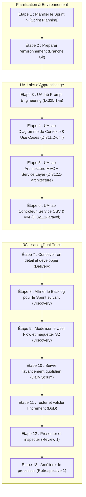

# Flux de Travail — Session S01 (Sprint 1 - 80h)

Ce document détaille le flux de travail opérationnel de la **Session S01 : Consultation Publique d'un Article** pour le projet de formation N3.

Il applique directement les étapes de la Phase 2 du [Flux de Travail Générique](../flux-travail-generique.md) en alternant l'acquisition des compétences dans les UA-labs et leur application immédiate sur le projet d'imitation.

---

## 1. Fiche d'Identification de la Session

- **Code de Session :** S01
- **Intitulé du Sprint :** Consultation Publique d'un Article
- **Durée Ferme (Timebox) :** 80 heures (10 jours ouvrés)
- **Positionnement :** Premier sprint de delivery applicatif Dual-Track

---

## 2. Objectif d'Apprentissage Global

Créer la branche du sprint et actualiser la documentation projet ; outiller son poste de travail par le Prompt Engineering (méthode RIO et Context Engineering) avec **Agent Antigravity & GitHub Copilot** ; modéliser les frontières système (diagramme de contexte) et l'ensemble des cas d'utilisation macro en syntaxe Mermaid déclarative ; et développer sous **Laravel 13** un premier incrément déployable de consultation détaillée d'un article selon une **Architecture MVC avec couche Service** (Contrôleur mince IoC -> Classe `ArticleService` sur persistance CSV transitoire en mémoire) avec gabarit Blade responsive sous **Tailwind CSS & Preline UI** et gestion robuste de l'erreur 404 (`abort(404)`).

---

## 3. Prérequis Bloquants de Lancement

Pour démarrer la session :
- **Validation du Sprint 0 :** Note de cadrage validée, dépôt Git initialisé, UI Kit Preline UI documenté, maquettes interactives de S1 testées et décision Go prononcée lors de la Review 0.
- **Rôles Opérationnels :** Product Owner incarné par le Groupe 1, Scrum Master et Développeurs en alternance.

---

## 4. Cadre Tri-Projets et Organisation Temporelle (80h / 10 jours)

- **Jours 1 à 7 : Projet d'Imitation (*Blog des Lauréats*)**
  - Réalisation guidée pas-à-pas en classe active.
  - Alternance directe entre l'assimilation d'un UA-lab et l'exécution de l'étape de réalisation correspondante.
- **Jour 8 : Projet Technique (*Portfolio Développeur*)**
  - **Codage technique pur en totale autonomie**.
  - L'apprenant réalise uniquement le développement technique : implémentation sous Laravel 13 de la route, du contrôleur, du service et de la vue de consultation d'une réalisation avec gestion 404.
  - Aucune étape de planification ni de conception n'est demandée sur cette journée.
  - Épreuve sommative de **Live Coding (40 min chrono sans assistance — 65% de la note)**.
- **Jours 9 et 10 : Projet Fil Rouge (*Application Métier*, ex : Cinéma)**
  - **Création et enrichissement systématique de Skills agentiques** dans `.agent/skills/`.
  - L'apprenant conçoit des Skills réutilisables permettant à l'Agent IA d'exécuter sur l'application métier le travail appris dans le projet d'imitation (Skill de génération de tranche de consultation, d'affinement de backlog, d'audit DoD).
  - Clôture de session et bilan réflexif.

---

## 5. Épreuve de Live Coding (40 min chrono sans assistance — 65% de la note)

- **Contexte :** À partir du dossier de départ fourni (`dossier-depart/`), coder en autonomie complète une fonctionnalité de consultation d'une réalisation du portfolio.
- **Consignes opérationnelles :**
  - Déclarer la route paramétrée dynamique `/realisations/{id}` dans `routes/web.php`.
  - Implémenter le contrôleur mince `RealisationController` avec injection de dépendance.
  - Implémenter la méthode `RealisationService::find($id)` effectuant la lecture et l'extraction depuis le fichier source CSV en mémoire.
  - Coder la vue Blade responsive avec Tailwind CSS et composants de carte Preline UI.
  - Intercepter proprement les identifiants introuvables et déclencher l'erreur HTTP 404 via `abort(404)`.
- **Critères d'évaluation :** Respect strict de l'architecture MVC + Service (zéro logique métier dans le contrôleur), conformité visuelle Preline UI, code propre PSR-12, gestion robuste du cas 404.

---

## 6. Déroulement Chronologique Intercalé du Sprint 1

---

### Étape 1 : Planifier le Sprint N (Sprint Planning — Piste Delivery) (Étape Générique 15)
- **Entrées :** Product Backlog initial et capacité d'équipe (80h).
- **Activités de réalisation :**
  - Définir le Sprint Goal S1 : "Permettre à tout visiteur de consulter le détail d'un article publié avec un affichage responsive et une gestion propre des articles inexistants".
  - Sélectionner la User Story prioritaire : "En tant que visiteur, je veux consulter le détail d'un article afin de lire son contenu complet".
  - Décomposer la User Story en tâches techniques élémentaires (1 à 4 heures).
  - Formaliser la Definition of Done (DoD) du sprint selon les 7 critères de référence.
- **Sortie principale :** Document du Sprint Backlog S1 ordonné (`scrum/sprint-backlog-s1.md`).

### Étape 2 : Préparer l'environnement de sprint (Branche Git et README.md) (Étape Générique 16)
- **Entrées :** Sprint Backlog S1 validé et branche `main`.
- **Activités de réalisation :**
  - Créer et basculer sur la branche Git du sprint : `git checkout -b sprint-1`.
  - Actualiser le fichier `README.md` avec le Sprint Goal S1, la composition de l'équipe et les dates jalons.
  - Vérifier le fonctionnement de l'environnement Laravel 13 et des dépendances Preline UI.
- **Sortie principale :** Fichier `README.md` actualisé sur la branche active.

### Étape 3 : UA-lab : Prompt Engineering & Context Engineering dans l'IDE (Domaine D.325.1-ia)
- **Objectif d'apprentissage :** Maîtriser les techniques avancées d'instruction des LLMs de code dans l'IDE avec Agent Antigravity et GitHub Copilot avant d'entamer le développement assisté.
- **Notions de base à apprendre :**
  - Principes des modèles de langage pour le code : fenêtres de contexte, tokens, hallucinations et déterminisme.
  - Méthode RIO : Rôle (persona expert développeur web), Instructions (tâche précise et étapes ordonnées), Objectif (livrable attendu et format).
  - Contraintes négatives : formulation explicite de ce que l'agent ne doit jamais faire.
  - Context Engineering : injection de code existant, schémas Mermaid et règles d'architecture dans l'environnement IDE.
- **Sortie :** Guide opérationnel de prompting RIO pour l'équipe (`tutoriels/ia/guide-rio.md`).

### Étape 4 : UA-lab : Diagramme de contexte et cas d'utilisation macro en syntaxe Mermaid (Domaine D.311.2-uml)
- **Objectif d'apprentissage :** Délimiter les frontières du système et modéliser l'ensemble des cas d'utilisation en syntaxe déclarative Mermaid avant la conception détaillée (un seul lab consolidant tout le domaine UML du sprint).
- **Notions de base à apprendre :**
  - Notion de boîte noire système et identification des frontières applicatives.
  - Acteurs externes : primaires et secondaires (Lecteur visiteur, Auteur contributeur, Administrateur).
  - Flux d'informations entrants et sortants.
  - Cas d'utilisation élémentaires, granularité fonctionnelle, relations d'inclusion (`<<include>>`), extension (`<<extend>>`) et généralisation.
  - Représentation déclarative Mermaid.js (`flowchart` pour le contexte et diagramme des cas d'utilisation macro).
- **Sortie :** Guide et diagrammes déclaratifs Mermaid du contexte et des cas d'utilisation (`tutoriels/uml/guide-contexte-usecases.md`).

### Étape 5 : UA-lab : Architecture logicielle en deux couches MVC + Service Layer et formalisation ADR (Domaine D.312.1-architecture)
- **Objectif d'apprentissage :** Structurer le code applicatif selon le patron découplé MVC + Service Layer et documenter les choix d'architecture par ADR.
- **Notions de base à apprendre :**
  - Responsabilités d'un contrôleur mince HTTP (réception, validation de surface, délégation au service, retour de réponse).
  - Responsabilités de la couche Service métier (règles de gestion, manipulation des données, indépendance du protocole HTTP).
  - Principe d'Inversion de Contrôle (IoC) et injection de dépendance automatique par le conteneur de services de Laravel.
  - Structure formelle d'un Architectural Decision Record (ADR-01) : Titre, Statut, Contexte, Décision, Conséquences.
- **Sortie :** Fiche d'architecture S1 incluant la décision fondatrice ADR-01 (`tutoriels/architecture/guide-mvc-service.md`).

### Étape 6 : UA-lab : Contrôleur mince, Service CSV, gabarit Preline UI et gestion robuste 404 (Domaine D.321.1-laravel)
- **Objectif d'apprentissage :** Assimiler l'implémentation sous Laravel 13 d'une tranche verticale de consultation détaillée avec persistance transitoire CSV et gestion d'erreur 404 (un seul lab consolidant tout le domaine Laravel du sprint).
- **Notions de base à apprendre :**
  - Déclaration de routes dynamiques paramétrées (`Route::get('/articles/{id}', ...)`) avec contraintes d'identifiant.
  - Injection de dépendance de la classe Service dans le constructeur du contrôleur.
  - Extraction et manipulation de données depuis un fichier CSV en mémoire (`fgetcsv`, collections Laravel).
  - Gabarit Blade responsive avec Tailwind CSS et composants de carte **Preline UI**.
  - Résilience applicative : détection de ressource inexistante et déclenchement propre de `abort(404)`.
- **Sortie :** Guide technique de la consultation d'article sous Laravel 13 (`tutoriels/laravel/guide-article-show.md`).

### Étape 7 : Concevoir en détail et développer (Piste Delivery) (Étape Générique 17)
- **Entrées :** Spécifications de la User Story, notions assimilées dans les 4 UA-labs, architecture MVC + Service et gabarit validé.
- **Activités de réalisation :**
  - *Projet d'Imitation :* Coder la route dynamique, le contrôleur mince `ArticleController`, et la classe `ArticleService` extrayant les articles depuis la source CSV avec retour typé et déclenchement propre de `abort(404)`.
  - *Projet Technique (Codage pur - Jour 8) :* Coder la route, le contrôleur `RealisationController` et le service `RealisationService` sur son portfolio (Live Coding 40 min).
  - *Projet Fil Rouge (Jours 9-10) :* Créer le Skill `.agent/skills/article-show-generator/` pour automatiser la génération d'une tranche verticale de consultation découplée sur le domaine métier.
- **Sortie principale :** Classe Service métier opérationnelle (`app/Services/ArticleService.php`).

### Étape 8 : Affiner le Backlog pour le Sprint suivant (Piste Discovery — ~10% temps) (Étape Générique 18)
- **Entrées :** Product Backlog et retours d'utilisation initiaux.
- **Activités de réalisation :**
  - Collaborer avec le Groupe 1 (Product Owner) pour clarifier le besoin fonctionnel des User Stories du Sprint 2 (Page d'accueil et CRUD Catégories).
  - Rédiger les critères d'acceptation précis pour chaque User Story candidate.
  - Estimer la complexité relative des tâches en Story Points.
- **Sortie principale :** Fiche de raffinement du backlog pour le Sprint 2 (`scrum/backlog-refinement-s2.md`).

### Étape 9 : Modéliser le User Flow et maquetter pour le Sprint suivant (Piste Discovery — ~10% temps) (Étape Générique 19)
- **Entrées :** User Stories raffinées pour le Sprint 2 et UI Kit Preline UI.
- **Activités de réalisation :**
  - Modéliser en syntaxe déclarative Mermaid (`flowchart TD / LR`) le parcours utilisateur de la future page d'accueil.
  - Prototyper les maquettes interactives du Sprint 2 basées sur les composants Preline UI.
  - Préparer le protocole de test utilisateur pour la prochaine Sprint Review.
- **Sortie principale :** Document regroupant le User Flow et les maquettes interactives du Sprint 2 (`docs/design/maquettes-sprint-2.md`).

### Étape 10 : Suivre l'avancement quotidien (Daily Scrum — Delivery & Discovery) (Étape Générique 20)
- **Entrées :** Tableau Kanban et tâches en cours.
- **Activités de réalisation :**
  - Animer la réunion quotidienne debout de 15 minutes.
  - Partager le travail réalisé la veille sur le delivery et le discovery.
  - Identifier et lever immédiatement les points de blocage techniques.
  - Mettre à jour l'état d'avancement des tâches sur le tableau visuel.
- **Sortie principale :** Journal de suivi journalier des tâches et résolution des blocages (`issues/issues-sprint-1.md`).

### Étape 11 : Tester et valider l'Incrément (Piste Delivery — DoD) (Étape Générique 21)
- **Entrées :** Code source complet du Sprint 1 et critères formels de la Definition of Done.
- **Activités de réalisation :**
  - Contrôler le respect strict des 7 critères de la DoD :
    - Affichage responsive vérifié sur mobile, tablette et poste de travail.
    - Gestion de l'erreur 404 testée et validée sans régression.
    - Code source conforme aux standards PSR-12.
    - Documentation à jour sur la branche active.
- **Sortie principale :** Rapport formel de conformité à la Definition of Done (`docs/qualite/rapport-dod-sprint-1.md`).

### Étape 12 : Présenter et inspecter (Sprint Review N — Double Validation Delivery & Discovery) (Étape Générique 22)
- **Entrées :** Incrément logiciel S1 opérationnel et maquettes interactives du Sprint 2.
- **Activités de réalisation :**
  - Démontrer l'Incrément 1 en direct devant le Groupe 1 (Product Owner).
  - Obtenir la validation formelle de la User Story "Consultation d'un article".
  - Faire tester les maquettes interactives du Sprint 2 aux utilisateurs cibles pour recueillir leurs retours avant le Sprint Planning 2.
- **Sortie principale :** Procès-verbal de la Review 1 actant la validation de l'incrément et les retours sur les maquettes (`sprints/pv-review-1.md`).

### Étape 13 : Améliorer le processus (Sprint Retrospective N — Amélioration continue) (Étape Générique 23)
- **Entrées :** Retours de la Sprint Review 1 et vécu de l'équipe durant l'itération.
- **Activités de réalisation :**
  - Conduire l'analyse réflexive d'équipe sur l'organisation du travail.
  - Constater le choc méthodologique de la **dette d'empathie** (avoir développé sans immersion usagers préalable).
  - Décider de prioriser l'immersion terrain et la formalisation des Personas dès le Sprint 2.
  - Définir 2 actions d'amélioration concrètes pour le prochain sprint.
- **Sortie principale :** Bilan rétrospectif du Sprint 1 consignant la dette d'empathie vers S2 (`scrum/retrospective-s1.md`).
