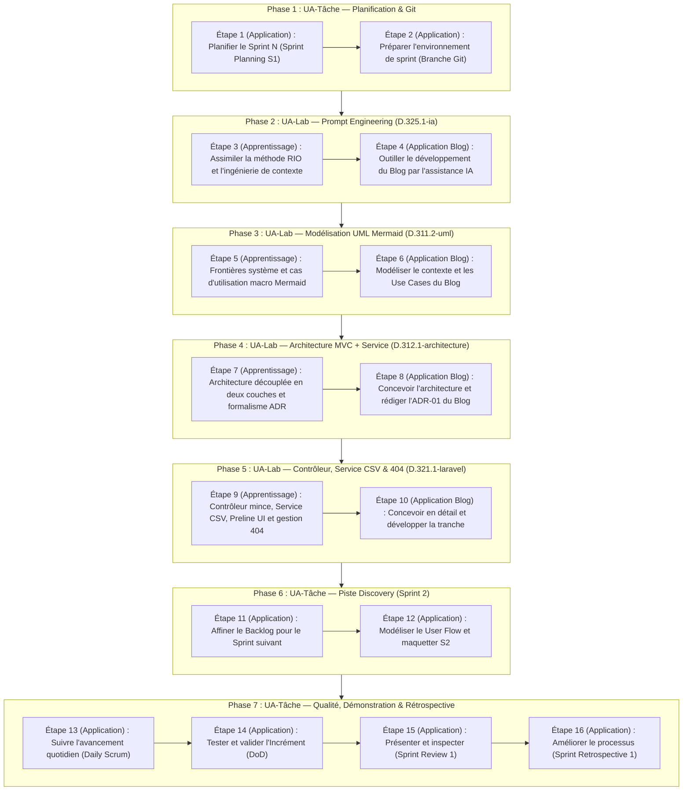

# Flux de Travail Opérationnel — Session S01 : Consultation Publique d'un Article

Ce document définit le flux de travail de la **Session S01** (Sprint 1) pour le niveau N3.
Il est structuré en **7 phases typées** alternant les unités d'apprentissage (**UA-Lab**) avec leurs applications immédiates sur le projet d'imitation, et les phases opérationnelles d'ingénierie (**UA-Tâche**).

---

## 1. Fiche d'Identification de la Session S01

- **Identifiant :** Session S01 (Sprint 1)
- **Titre :** Consultation Publique d'un Article (Tranche Verticale découplée MVC + Service)
- **Durée totale ferme :** 80 heures (10 jours ouvrés)
- **Domaines de compétences mobilisés :**
  - Prompt Engineering & Context Engineering (`D.325.1-ia`)
  - Modélisation UML Mermaid (`D.311.2-uml`)
  - Architecture Logicielle en Deux Couches & ADR (`D.312.1-architecture`)
  - Développement Backend Laravel 13, Service CSV, Preline UI & 404 (`D.321.1-laravel`)
- **Objectif global d'apprentissage :**
  - Mettre en place l'environnement de sprint sur Git.
  - Outiller le poste de développement par le Prompt Engineering (méthode RIO).
  - Délimiter les frontières système et modéliser les cas d'utilisation en syntaxe déclarative Mermaid.
  - Concevoir une architecture logicielle découplée en 2 couches (Contrôleur mince et Service Layer) formalisée par un Architectural Decision Record (ADR).
  - Développer sous Laravel 13 la consultation d'un article avec extraction CSV, composants Preline UI et gestion de l'erreur 404.
  - Préparer la piste Discovery du Sprint 2 et clôturer l'itération avec la détection de la dette d'empathie.

---

## 2. Organisation dans le Cadre Tri-Projets (80h / 10 jours)

- **Jours 1 à 7 : Projet d'Imitation (*Blog des Lauréats*)**
  - Développement guidé pas-à-pas de la tranche verticale de consultation d'un article.
  - Alternance immédiate : chaque atelier d'apprentissage est appliqué directement sur le code du Blog.
- **Jour 8 : Projet Technique (*Portfolio Développeur*)**
  - **Codage technique pur en autonomie totale (sans conception ni planification)**.
  - L'apprenant implémente la consultation d'une réalisation sur son portfolio personnel (`RealisationController`, `RealisationService`).
  - **Épreuve sommative de Live Coding (40 min chrono sans assistance — 65% de la note finale du module)**.
- **Jours 9 et 10 : Projet Fil Rouge (*Application Métier*, ex : Gestion de Cinéma)**
  - Création du Skill agentique `.agent/skills/article-show-generator/` pour automatiser la génération d'une tranche de consultation découplée.
  - Bilan réflexif et consolidation des acquis.

---

## 3. Déroulement des 7 Phases de la Session S01

---

### Phase 1 : UA-Tâche — Planification du Sprint 1 et Préparation de l'Environnement Git
*Cette phase ne requiert aucun nouvel apport conceptuel. Elle rassemble les tâches opérationnelles d'initialisation de l'itération.*

- **Étape 1 (Application) : Planifier le Sprint N (Sprint Planning — Piste Delivery)**
  - Entrées : Product Backlog initial et capacité d'équipe (80h).
  - Travail d'application sur le Blog : Définir le Sprint Goal S1 ("Permettre aux visiteurs de consulter un article complet"), sélectionner la User Story US-01, décomposer en tâches de 1 à 4 heures et fixer la Definition of Done.
  - Sortie (1 seul livrable) : `scrum/sprint-backlog-s1.md`.
- **Étape 2 (Application) : Préparer l'environnement de sprint (Branche Git et README.md)**
  - Entrées : Sprint Backlog S1 validé et branche `main`.
  - Travail d'application sur le Blog : Créer la branche Git `sprint-1`, actualiser le fichier `README.md` avec le Sprint Goal S1, les jalons temporels et la composition d'équipe.
  - Sortie (1 seul livrable) : `README.md`.

---

### Phase 2 : UA-Lab — Prompt Engineering & Context Engineering dans l'IDE (Domaine D.325.1-ia)
*Cette phase introduit une nouvelle compétence outillée. Elle s'organise en une étape d'apprentissage conceptuel suivie de son étape d'application immédiate sur le Blog des Lauréats.*

- **Étape 3 (Apprentissage) : Assimiler la méthode RIO et l'ingénierie de contexte dans l'IDE**
  - Entrées : Documentation LLM et environnement IDE (Antigravity & GitHub Copilot).
  - Notions de base à apprendre :
    - Principes des modèles de langage pour le code : fenêtres de contexte, tokens, hallucinations et déterminisme.
    - Méthode RIO : Rôle (persona expert développeur web), Instructions (tâche précise, étapes ordonnées), Objectif (format attendu).
    - Contraintes négatives : formulation stricte des interdictions applicatives.
    - Context Engineering : injection de snippets de code, schémas Mermaid et règles d'architecture.
  - Sortie de l'atelier d'apprentissage (1 seul livrable) : `tutoriels/ia/guide-rio.md`.
- **Étape 4 (Application sur le Blog) : Outiller le développement du Blog par l'assistance IA**
  - Entrées : Guide RIO validé et spécifications du Blog des Lauréats.
  - Travail d'application sur le Blog : Configurer le contexte d'assistance IA pour le Blog des Lauréats (règles de prompting spécifiques au projet, contraintes de style et règles d'architecture à respecter par l'agent et Copilot).
  - Sortie (1 seul livrable) : `docs/ia/guide-rio-blog.md`.

---

### Phase 3 : UA-Lab — Modélisation du Contexte et des Cas d'Utilisation en Syntaxe Mermaid (Domaine D.311.2-uml)
*Cette phase introduit la modélisation fonctionnelle déclarative. Elle s'organise en une étape d'apprentissage conceptuel suivie de son étape d'application immédiate sur le Blog des Lauréats.*

- **Étape 5 (Apprentissage) : Délimiter les frontières système et modéliser les cas d'utilisation macro en syntaxe Mermaid**
  - Entrées : Guide de syntaxe déclarative Mermaid.
  - Notions de base à apprendre :
    - Notion de boîte noire système et identification des frontières applicatives.
    - Acteurs externes : primaires et secondaires (Lecteur visiteur, Auteur lauréat, Administrateur).
    - Flux d'échanges entrants et sortants.
    - Cas d'utilisation élémentaires, granularité fonctionnelle, relations d'inclusion (`<<include>>`), extension (`<<extend>>`) et généralisation.
    - Représentation déclarative Mermaid.js (`flowchart` pour le contexte et diagramme des Use Cases macro).
  - Sortie de l'atelier d'apprentissage (1 seul livrable) : `tutoriels/uml/guide-contexte-usecases.md`.
- **Étape 6 (Application sur le Blog) : Modéliser le contexte et les cas d'utilisation du Blog des Lauréats**
  - Entrées : Guide Mermaid et vision produit du Blog des Lauréats.
  - Travail d'application sur le Blog : Modéliser en syntaxe déclarative Mermaid le diagramme de contexte complet du Blog des Lauréats et formaliser l'ensemble des 15 cas d'utilisation macro du système.
  - Sortie (1 seul livrable) : `docs/analyse/contexte-et-usecases-blog.mmd`.

---

### Phase 4 : UA-Lab — Architecture Logicielle en Deux Couches MVC + Service Layer et Formalisation ADR (Domaine D.312.1-architecture)
*Cette phase introduit le découpage architectural découplé. Elle s'organise en une étape d'apprentissage conceptuel suivie de son étape d'application immédiate sur le Blog des Lauréats.*

- **Étape 7 (Apprentissage) : Structurer le code en architecture découplée MVC + Service et formaliser un ADR**
  - Entrées : Notions de conception logicielle orientée objet.
  - Notions de base à apprendre :
    - Responsabilités respectives du contrôleur mince HTTP (réception, validation de surface, délégation, réponse).
    - Responsabilités de la classe Service métier (règles de gestion, manipulation des données, indépendance du transport HTTP).
    - Principe d'Inversion de Contrôle (IoC) et injection de dépendance automatique par le conteneur Laravel.
    - Structure formelle d'un Architectural Decision Record (ADR) : Titre, Statut, Contexte, Décision, Conséquences.
  - Sortie de l'atelier d'apprentissage (1 seul livrable) : `tutoriels/architecture/guide-mvc-service.md`.
- **Étape 8 (Application sur le Blog) : Concevoir l'architecture en deux couches de la consultation d'article**
  - Entrées : Cas d'utilisation du Blog et guide d'architecture.
  - Travail d'application sur le Blog : Modéliser le découpage en 2 couches de la tranche de consultation d'un article du Blog et rédiger la décision fondatrice ADR-01 officialisant l'injection de `ArticleService` dans `ArticleController`.
  - Sortie (1 seul livrable) : `docs/architecture/architecture-sprint1.md`.

---

### Phase 5 : UA-Lab — Contrôleur Mince, Service CSV, Gabarit Preline UI et Gestion Robuste 404 (Domaine D.321.1-laravel)
*Cette phase introduit le développement effectif de la tranche verticale sous Laravel 13. Elle s'organise en une étape d'apprentissage technique suivie de son étape d'application immédiate sur le Blog des Lauréats.*

- **Étape 9 (Apprentissage) : Assimiler le routage dynamique, l'extraction de données CSV, les composants Preline UI et la gestion d'erreur 404**
  - Entrées : Documentation Laravel 13 et bibliothèque Preline UI.
  - Notions de base à apprendre :
    - Déclaration de routes paramétrées dynamiques (`Route::get('/articles/{id}', ...)`) avec contraintes d'identifiant.
    - Injection de dépendance de la classe Service dans le constructeur du contrôleur.
    - Extraction et manipulation de données depuis un fichier CSV en mémoire (`fgetcsv`, collections Laravel).
    - Gabarit Blade responsive avec Tailwind CSS et composants de carte Preline UI.
    - Résilience applicative : détection d'article absent et déclenchement propre de `abort(404)`.
  - Sortie de l'atelier d'apprentissage (1 seul livrable) : `tutoriels/laravel/guide-article-show.md`.
- **Étape 10 (Application sur le Blog) : Concevoir en détail et développer (Piste Delivery)**
  - Entrées : Notions Laravel assimilées, architecture MVC + Service validée et spécifications du Blog.
  - Travail d'application sur le Blog :
    - *Projet d'Imitation :* Coder la route `/articles/{id}`, le contrôleur mince `ArticleController`, la classe `ArticleService` extrayant les articles depuis la source CSV avec retour typé, la gestion propre de l'erreur 404 (`abort(404)`), et la vue Blade responsive sous Preline UI.
    - *Projet Technique (Codage pur - Jour 8) :* Coder la route, le contrôleur `RealisationController` et le service `RealisationService` sur son portfolio personnel (Épreuve de Live Coding de 40 min).
    - *Projet Fil Rouge (Jours 9-10) :* Créer le Skill `.agent/skills/article-show-generator/` pour automatiser la génération d'une tranche de consultation découplée sur l'application métier.
  - Sortie (1 seul livrable) : `app/Services/ArticleService.php`.

---

### Phase 6 : UA-Tâche — Piste Discovery : Affinement du Backlog et Maquettage du Sprint 2
*Cette phase ne requiert aucun nouvel apport conceptuel. Il s'agit d'une UA-Tâche d'ingénierie opérationnelle menée en temps masqué (~10% du temps) pour préparer le sprint suivant.*

- **Étape 11 (Application) : Affiner le Backlog pour le Sprint suivant (Piste Discovery)**
  - Entrées : Product Backlog et retours d'utilisation.
  - Travail d'application : Collaborer avec le Product Owner pour clarifier les User Stories du Sprint 2 (Page d'accueil dynamique et CRUD Catégories), rédiger les critères d'acceptation et estimer la complexité en Story Points.
  - Sortie (1 seul livrable) : `scrum/backlog-refinement-s2.md`.
- **Étape 12 (Application) : Modéliser le User Flow et maquetter pour le Sprint suivant (Piste Discovery)**
  - Entrées : User Stories raffinées pour le Sprint 2 et UI Kit Preline UI.
  - Travail d'application : Modéliser en syntaxe Mermaid le parcours utilisateur de la future page d'accueil et prototyper les maquettes interactives S2 avec les composants Preline UI.
  - Sortie (1 seul livrable) : `docs/design/maquettes-sprint-2.md`.

---

### Phase 7 : UA-Tâche — Clôture du Sprint 1, Démonstration, Tests DoD et Rétrospective
*Cette phase ne contient aucun nouveau UA-lab. Il s'agit d'une UA-Tâche opérationnelle regroupant les rituels agiles et la validation de conformité finale du sprint.*

- **Étape 13 (Application) : Suivre l'avancement quotidien (Daily Scrum — Delivery & Discovery)**
  - Entrées : Tableau Kanban et tâches du Sprint 1.
  - Travail d'application : Animer la réunion quotidienne debout de 15 minutes, synchroniser les travaux sur le delivery et le discovery, lever immédiatement les points de blocage.
  - Sortie (1 seul livrable) : `issues/issues-sprint-1.md`.
- **Étape 14 (Application) : Tester et valider l'Incrément (Piste Delivery — DoD)**
  - Entrées : Code source complet du Blog des Lauréats et critères formels de la Definition of Done.
  - Travail d'application : Exécuter la checklist des 7 critères formels de la DoD (responsive mobile/desktop avec Preline UI, résilience 404 sans régression, respect des standards PSR-12).
  - Sortie (1 seul livrable) : `docs/qualite/rapport-dod-sprint-1.md`.
- **Étape 15 (Application) : Présenter et inspecter (Sprint Review N — Double Validation Delivery & Discovery)**
  - Entrées : Incrément logiciel S1 opérationnel et maquettes interactives du Sprint 2.
  - Travail d'application : Démontrer l'Incrément 1 en direct devant le Product Owner, valider la User Story "Consultation d'un article", et faire tester les maquettes de S2 aux utilisateurs cibles pour recueillir leurs retours avant le Planning 2.
  - Sortie (1 seul livrable) : `sprints/pv-review-1.md`.
- **Étape 16 (Application) : Améliorer le processus (Sprint Retrospective N — Amélioration continue)**
  - Entrées : Retours de la Review 1 et vécu de l'équipe durant l'itération.
  - Travail d'application : Conduire l'analyse réflexive d'équipe, constater le choc méthodologique de la **dette d'empathie** (avoir développé sans immersion usagers préalable), et décider de prioriser l'immersion Personas dès le début du Sprint 2.
  - Sortie (1 seul livrable) : `scrum/retrospective-s1.md`.
