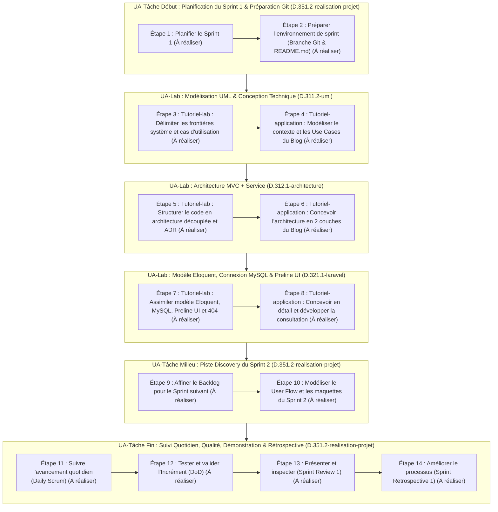

# Flux de Travail Opérationnel — Session S1 : Page de Consultation Publique d'un Article

Ce document définit le flux de travail opérationnel de la **Session S1** (Sprint 1) pour le niveau N3.
Il est centré sur la production de son incrément majeur : la **Page de Consultation Publique d'un Article** du Blog des Lauréats.

Le flux sépare de manière étanche les Unités d'Apprentissage d'ateliers pratiques (**UA-Lab**) et les Unités d'Apprentissage d'application opérationnelle sur le projet (**UA-Tâche**), totalisant **6 UAs** et **14 étapes de travail**.

Les durées temporelles (80 heures / 10 jours) sont fournies à titre purement indicatif pour les formateurs et le concepteur.

---

## 1. Fiche d'Identification de la Session S1

- **Identifiant :** Session S1 (Sprint 1)
- **Titre centré sur l'incrément :** Page de Consultation Publique d'un Article
- **Incrément produit :** Tranche verticale de consultation d'un article complet sous Laravel 13, modèle Eloquent connecté à MySQL, Service Layer découplé, gabarit Blade responsive Preline UI et gestion robuste de l'erreur 404
- **Durée indicative :** 80 heures (10 jours ouvrés)
- **Positionnement :** Premier sprint de delivery applicatif Dual-Track
- **Référentiel des compétences :** Conforme au document de référence [.agents/references/domaines-competences.md](../../.agents/references/domaines-competences.md)
- **Domaines de compétences et Unités d'Apprentissage mobilisés :**
  - Domaine Modélisation UML & Conception Technique (`D.311.2-uml`) :
    - Unité d'apprentissage (UA-Lab) : *Contexte système et cas d'utilisation* (Statut : **À réaliser**)
  - Domaine Architecture Logicielle (`D.312.1-architecture`) :
    - Unité d'apprentissage (UA-Lab) : *Architecture en deux couches MVC + Service et ADR* (Statut : **À réaliser**)
  - Domaine Développement Backend Laravel & MySQL (`D.321.1-laravel`) :
    - Unité d'apprentissage (UA-Lab) : *Contrôleur mince, modèle Eloquent, MySQL et gestion 404* (Statut : **À réaliser**)
  - Domaine Réalisation et Conduite de Projet (`D.351.2-realisation-projet`) :
    - Unité d'apprentissage 1 (UA-Tâche) : *Planification du Sprint 1 et Préparation Git* (Statut : **À réaliser**)
    - Unité d'apprentissage 2 (UA-Tâche) : *Piste Discovery : Affinement du Backlog et Maquettage du Sprint 2* (Statut : **À réaliser**)
    - Unité d'apprentissage 3 (UA-Tâche) : *Suivi Quotidien, Qualité DoD, Démonstration et Rétrospective* (Statut : **À réaliser**)
- **Objectif global d'apprentissage :**
  - Mettre en place l'environnement de sprint sur Git avec la branche `sprint-1`.
  - Délimiter les frontières système et modéliser les cas d'utilisation en syntaxe déclarative textuelle.
  - Concevoir une architecture logicielle découplée en 2 couches (Contrôleur mince et Service Layer) formalisée par un Architectural Decision Record (ADR).
  - Développer sous Laravel 13 la consultation d'un article avec modèle Eloquent, base MySQL, composants Preline UI et gestion robuste de l'erreur 404.
  - Préparer la piste Discovery du Sprint 2 et clôturer l'itération avec la détection de la dette d'empathie.

---

## 2. Organisation dans le Cadre Tri-Projets

- **Rôles Scrum & Autonomie :** Après le cadrage initial du Sprint 0, chaque apprenant endosse le rôle de Product Owner pour son propre projet et pilote son backlog en autonomie lors des sprints de delivery.
- **Jours 1 à 7 : Projet d'Imitation (*Blog des Lauréats*)**
  - Développement guidé pas-à-pas de la tranche verticale de consultation d'un article.
  - Alternance immédiate : chaque atelier d'apprentissage est appliqué directement sur le code du Blog.
- **Jour 8 : Projet Technique (*Portfolio Développeur*)**
  - **Épreuve sommative de Live Coding (40 min chrono sans assistance — 65% de la note finale du module)** : Implémentation autonome et fluide de la tranche verticale de consultation (`RealisationController`, `RealisationService`, modèle Eloquent `Realisation` et vue Blade responsive Preline UI).
  - **Règle formelle d'exigence :** Les documents de cadrage et de conception préalable ne sont pas demandés pour le portfolio dans la session.
- **Jours 9 et 10 : Projet Fil Rouge (*Application Métier*, ex : Gestion de Cinéma)**
  - Application du découpage architectural et développement de la tranche de consultation d'entité métier avec modèle Eloquent et MySQL sur l'application fil rouge (développement logiciel métier pur, sans agents IA ni ingénierie de prompt).
  - Bilan réflexif et consolidation des acquis.

---

## 3. Épreuve de Live Coding (40 min chrono sans assistance — 65% de la note)

- **Contexte :** À partir du projet starter fourni (`dossier-depart/`), implémenter en 40 minutes la tranche verticale de consultation d'une réalisation sur le portfolio personnel sous Laravel 13 et Preline UI.
- **Consignes opérationnelles :**
  - Déclarer la route `/realisations/{id}` dans `src/routes/web.php`.
  - Implémenter le contrôleur mince `RealisationController` avec injection de `RealisationService`.
  - Coder la méthode `find($id)` dans `RealisationService` avec gestion de l'erreur 404 (`abort(404)`).
  - Développer la vue Blade responsive `src/resources/views/realisations/show.blade.php` avec Preline UI.
- **Critères d'évaluation :** Séparation stricte MVC + Service, conformité visuelle Preline UI, code propre PSR-12, gestion robuste 404.

---

## 4. Déroulement Opérationnel des 6 Unités d'Apprentissage du Sprint 1

---

### Unité d'Apprentissage (UA-Tâche) : Planification du Sprint 1 et Préparation Git (Domaine D.351.2-realisation-projet)
*Bloc opérationnel d'initialisation du premier sprint de delivery applicatif.*

- **Étape 1 : Planifier le Sprint 1**
  - Statut : **À réaliser**
  - Domaine de compétence : `D.351.2-realisation-projet`.
  - Correspondance flux générique : Étape Générique 15 (Planifier le Sprint N).
  - Entrées : Product Backlog initial et capacité d'équipe.
  - Travail d'application sur le Blog : Chaque apprenant endosse le rôle de Product Owner pour son projet (la formation Scrum ayant été assimilée lors du Sprint 0), définit le Sprint Goal S1 ("Permettre aux visiteurs de consulter un article complet connecté à MySQL"), sélectionne la User Story US-01, décompose en tâches de 1 à 4 heures et fixe la Definition of Done.
  - Sortie (1 seul livrable) : `sprints/sprint-1.md`.
- **Étape 2 : Préparer l'environnement de sprint (Branche Git et README.md)**
  - Statut : **À réaliser**
  - Domaine de compétence : `D.351.2-realisation-projet`.
  - Correspondance flux générique : Étape Générique 16 (Préparer l'environnement de sprint).
  - Entrées : Sprint Backlog S1 validé et branche `main`.
  - Travail d'application sur le Blog : Créer la branche Git `sprint-1`, actualiser le fichier `README.md` avec le Sprint Goal S1, les jalons temporels et la composition d'équipe.
  - Sortie (1 seul livrable) : `README.md`.

---

### Unité d'Apprentissage (UA-Lab) : Modélisation du Contexte et des Cas d'Utilisation (Domaine D.311.2-uml)
*Atelier d'apprentissage pratique de la modélisation fonctionnelle déclarative avec alternance immédiate.*

- **Étape 3 : Tutoriel-lab : Délimiter les frontières système et modéliser les cas d'utilisation macro en syntaxe déclarative**
  - Statut : **À réaliser**
  - Unité d'apprentissage : *Contexte système et cas d'utilisation*.
  - Entrées : Guide de modélisation déclarative textuelle.
  - Notions de base à apprendre :
    - Notion de boîte noire système et identification des frontières applicatives.
    - Acteurs externes : primaires et secondaires (Lecteur visiteur, Auteur lauréat, Administrateur).
    - Flux d'échanges entrants et sortants.
    - Cas d'utilisation élémentaires, granularité fonctionnelle, relations d'inclusion (`<<include>>`), extension (`<<extend>>`) et généralisation.
    - Représentation déclarative textuelle pour le contexte et les Use Cases macro.
  - Sorties de l'atelier d'apprentissage (2 livrables) :
    - Guide explicatif détaillé : `tutoriels/uml/cas-utilisation/use-cases-mermaid/use-cases-mermaid.md`.
    - Support de présentation au format Marp Markdown : `tutoriels/uml/cas-utilisation/use-cases-mermaid/presentation-use-cases-mermaid.md`.
- **Étape 4 : Tutoriel-application : Modéliser le contexte et les cas d'utilisation du Blog des Lauréats**
  - Statut : **À réaliser**
  - Unité d'apprentissage : *Contexte système et cas d'utilisation*.
  - Entrées : Guide de modélisation et vision produit du Blog des Lauréats.
  - Travail d'application sur le Blog : Modéliser en syntaxe déclarative le diagramme de contexte complet du Blog des Lauréats et formaliser l'ensemble des 15 cas d'utilisation macro du système.
  - Sortie (1 seul livrable) : `docs/analyse/contexte-et-usecases-blog.mmd`.

---

### Unité d'Apprentissage (UA-Lab) : Architecture Logicielle en Deux Couches MVC + Service Layer et Formalisation ADR (Domaine D.312.1-architecture)
*Atelier d'apprentissage pratique du découpage architectural découplé avec alternance immédiate.*

- **Étape 5 : Tutoriel-lab : Structurer le code en architecture découplée MVC + Service et formaliser un ADR**
  - Statut : **À réaliser**
  - Unité d'apprentissage : *Architecture en deux couches MVC + Service et ADR*.
  - Entrées : Notions de conception logicielle orientée objet.
  - Notions de base à apprendre :
    - Responsabilités respectives du contrôleur mince HTTP (réception, validation de surface, délégation, réponse).
    - Responsabilités de la classe Service métier (règles de gestion, manipulation des données, indépendance du transport HTTP).
    - Principe d'Inversion de Contrôle (IoC) et injection de dépendance automatique par le conteneur Laravel.
    - Structure formelle d'un Architectural Decision Record (ADR) : Titre, Statut, Contexte, Décision, Conséquences.
  - Sorties de l'atelier d'apprentissage (2 livrables) :
    - Guide explicatif détaillé : `tutoriels/architecture/deux-couches/mvc-service/mvc-service.md`.
    - Support de présentation au format Marp Markdown : `tutoriels/architecture/deux-couches/mvc-service/presentation-mvc-service.md`.
- **Étape 6 : Tutoriel-application : Concevoir l'architecture en deux couches de la consultation d'article**
  - Statut : **À réaliser**
  - Unité d'apprentissage : *Architecture en deux couches MVC + Service et ADR*.
  - Entrées : Cas d'utilisation du Blog et guide d'architecture.
  - Travail d'application sur le Blog : Modéliser le découpage en 2 couches de la tranche de consultation d'un article du Blog et rédiger la décision fondatrice ADR-01 officialisant l'injection de `ArticleService` dans `ArticleController`.
  - Sortie (1 seul livrable) : `docs/architecture/adr-01-consultation-article.md`.

---

### Unité d'Apprentissage (UA-Lab) : Contrôleur Mince, Modèle Eloquent, Connexion MySQL, Preline UI et Gestion Robuste 404 (Domaine D.321.1-laravel)
*Atelier d'apprentissage pratique du développement de tranche verticale sous Laravel 13 connecté à MySQL.*

- **Étape 7 : Tutoriel-lab : Assimiler le modèle Eloquent, la connexion MySQL, les composants Preline UI et la gestion d'erreur 404**
  - Statut : **À réaliser**
  - Unité d'apprentissage : *Contrôleur mince, modèle Eloquent, MySQL et gestion 404*.
  - Entrées : Documentation Laravel 13, moteur MySQL et bibliothèque Preline UI.
  - Notions de base à apprendre :
    - Configuration de l'environnement `.env` et connexion à la base de données MySQL.
    - Création de la migration (`create_articles_table`), du Modèle Eloquent `Article` et du Seeder d'initialisation.
    - Déclaration de routes paramétrées dynamiques (`Route::get('/articles/{id}', ...)`) avec contraintes d'identifiant.
    - Injection de dépendance de la classe Service dans le constructeur du contrôleur.
    - Requêtage Eloquent dans la couche Service (`Article::findOrFail($id)` ou levée explicite d'`abort(404)`).
    - Gabarit Blade responsive avec Tailwind CSS et composants de carte Preline UI.
    - Résilience applicative : gestion robuste de l'erreur 404 en cas d'identifiant inexistant.
  - Sorties de l'atelier d'apprentissage (2 livrables) :
    - Guide explicatif détaillé : `tutoriels/laravel/tranche-verticale/show-mysql-preline/show-mysql-preline.md`.
    - Support de présentation au format Marp Markdown : `tutoriels/laravel/tranche-verticale/show-mysql-preline/presentation-show-mysql-preline.md`.
- **Étape 8 : Tutoriel-application : Concevoir en détail et développer la consultation d'un article**
  - Statut : **À réaliser**
  - Domaine de compétence : `D.321.1-laravel`.
  - Correspondance flux générique : Étape Générique 17 (Concevoir en détail et développer).
  - Entrées : Notions Laravel assimilées, architecture MVC + Service validée, base MySQL configurée et spécifications du Blog.
  - Travail d'application sur le Blog :
    - *Projet d'Imitation :* Coder la migration MySQL, le modèle Eloquent `Article`, le seeder de test, la route `/articles/{id}`, le contrôleur mince `ArticleController`, la classe `ArticleService` requêtant MySQL via Eloquent, la gestion propre de l'erreur 404 (`abort(404)`), et la vue Blade responsive sous Preline UI.
    - *Projet Technique (Jour 8) :* Coder la route, le modèle `Realisation`, le contrôleur `RealisationController` et le service `RealisationService` sur son portfolio personnel (Épreuve de Live Coding de 40 min).
    - *Projet Fil Rouge (Jours 9-10) :* Développer la tranche de consultation d'entité métier avec modèle Eloquent et MySQL sur l'application fil rouge.
  - Sortie (1 seul livrable) : `src/app/Services/ArticleService.php`.

---

### Unité d'Apprentissage (UA-Tâche) : Piste Discovery : Affinement du Backlog et Maquettage du Sprint 2 (Domaine D.351.2-realisation-projet)
*Bloc d'ingénierie opérationnelle mené en temps masqué pour préparer le sprint suivant.*

- **Étape 9 : Affiner le Backlog pour le Sprint suivant**
  - Statut : **À réaliser**
  - Domaine de compétence : `D.351.2-realisation-projet`.
  - Correspondance flux générique : Étape Générique 18 (Affiner le Backlog pour le Sprint suivant).
  - Entrées : Product Backlog et retours d'utilisation.
  - Travail d'application : Chaque apprenant, dans sa posture de Product Owner, clarifie les User Stories du Sprint 2 (Page d'accueil dynamique et CRUD Catégories avec tables MySQL associées), rédige les critères d'acceptation et estime la complexité en Story Points.
  - Sortie (1 seul livrable) : `scrum/backlog-refinement-s2.md`.
- **Étape 10 : Modéliser le User Flow et les maquettes du Sprint 2**
  - Statut : **À réaliser**
  - Domaine de compétence : `D.351.2-realisation-projet`.
  - Correspondance flux générique : Étape Générique 19 (Modéliser le User Flow et maquetter pour le Sprint suivant).
  - Entrées : User Stories raffinées pour le Sprint 2 et UI Kit Preline UI.
  - Travail d'application : Modéliser en syntaxe déclarative le parcours utilisateur de la future page d'accueil et prototyper les maquettes interactives S2 avec les composants Preline UI.
  - Sortie (1 seul livrable) : `docs/conception/maquettes-sprint-2.md`.

---

### Unité d'Apprentissage (UA-Tâche) : Suivi Quotidien, Qualité DoD, Démonstration et Rétrospective (Domaine D.351.2-realisation-projet)
*Rituels agiles de clôture et validation de conformité finale du sprint.*

- **Étape 11 : Suivre l'avancement quotidien (Daily Scrum)**
  - Statut : **À réaliser**
  - Domaine de compétence : `D.351.2-realisation-projet`.
  - Correspondance flux générique : Étape Générique 20 (Suivre l'avancement quotidien).
  - Entrées : Tableau Kanban et tâches du Sprint 1.
  - Travail d'application : Animer la réunion quotidienne debout de 15 minutes, synchroniser les travaux sur le delivery et le discovery, lever immédiatement les points de blocage.
  - Sortie (1 seul livrable) : Mise à jour du suivi des tâches dans `sprints/sprint-1.md`.
- **Étape 12 : Tester et valider l'Incrément (DoD)**
  - Statut : **À réaliser**
  - Domaine de compétence : `D.351.2-realisation-projet`.
  - Correspondance flux générique : Étape Générique 21 (Tester et valider l'Incrément).
  - Entrées : Code source complet du Blog des Lauréats et critères formels de la Definition of Done.
  - Travail d'application : Exécuter la checklist des 7 critères formels de la DoD (responsive mobile/desktop avec Preline UI, résilience 404 sans régression, respect des standards PSR-12).
  - Sortie (1 seul livrable) : `docs/qualite/rapport-dod-sprint-1.md`.
- **Étape 13 : Présenter et inspecter (Sprint Review 1)**
  - Statut : **À réaliser**
  - Domaine de compétence : `D.351.2-realisation-projet`.
  - Correspondance flux générique : Étape Générique 22 (Présenter et inspecter).
  - Entrées : Incrément logiciel S1 opérationnel et maquettes interactives du Sprint 2.
  - Travail d'application : Chaque apprenant anime la démonstration de son Incrément 1 en posture de Product Owner, valide la User Story "Consultation d'un article connecté à MySQL", et fait tester les maquettes de S2 aux utilisateurs cibles pour recueillir leurs retours avant le Planning 2.
  - Sortie (1 seul livrable) : `sprints/pv-review-1.md`.
- **Étape 14 : Améliorer le processus (Sprint Retrospective 1)**
  - Statut : **À réaliser**
  - Domaine de compétence : `D.351.2-realisation-projet`.
  - Correspondance flux générique : Étape Générique 23 (Améliorer le processus).
  - Entrées : Retours de la Review 1 et vécu de l'équipe durant l'itération.
  - Travail d'application : Conduire l'analyse réflexive d'équipe, constater le choc méthodologique de la dette d'empathie (avoir développé sans immersion usagers préalable), et décider de prioriser l'immersion Personas dès le début du Sprint 2.
  - Sortie (1 seul livrable) : `sprints/retrospective-1.md`.
