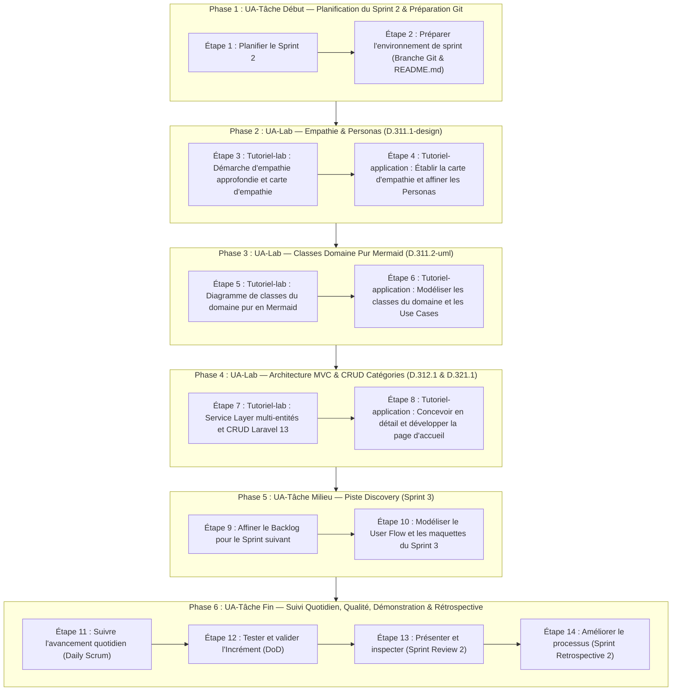

# Flux de Travail Opérationnel — Session S02 : Empathie Personas, Architecture MVC + Services & Page d'Accueil

Ce document définit le flux de travail de la **Session S02** (Sprint 2) pour le niveau N3.
Il est structuré en **6 phases typées** (3 unités d'apprentissage **UA-Lab** et 3 blocs d'ingénierie opérationnelle **UA-Tâche**), totalisant **14 étapes de travail**.

---

## 1. Fiche d'Identification de la Session S02

- **Identifiant :** Session S02 (Sprint 2)
- **Titre :** Empathie Personas, Architecture MVC + Services & Page d'Accueil Dynamique
- **Durée indicative :** 80 heures (10 jours ouvrés) — *fournie à titre indicatif pour le concepteur et les formateurs*
- **Positionnement :** Deuxième sprint de delivery applicatif Dual-Track
- **Domaines de compétences mobilisés :**
  - Empathie approfondie, Personas et Carte d'Empathie (`D.311.1-design`)
  - Modélisation du Domaine Pur et Diagramme de Classes Mermaid (`D.311.2-uml`)
  - Architecture Logicielle MVC avec Service Layer Multi-Entités (`D.312.1-architecture`)
  - Développement Laravel 13, CRUD Catégories, Preline UI & Page d'Accueil (`D.321.1-laravel`)
- **Objectif global d'apprentissage :**
  - Préparer la branche Git `sprint-2` et actualiser la documentation projet.
  - Conduire l'empathie approfondie du Design Thinking pour lever la dette d'empathie constatée au Sprint 1.
  - Modéliser les classes du domaine pur et les use cases de filtrage en syntaxe Mermaid.
  - Développer sous **Laravel 13** une page d'accueil dynamique complète orchestrée en architecture MVC + Service (Contrôleur `HomeController`, service `ArticleService`, persistance relationnelle MySQL et gabarit Blade sous Preline UI).
  - Préparer la piste Discovery du Sprint 3 et clôturer le sprint par la démonstration et la rétrospective agile.

---

## 2. Organisation dans le Cadre Tri-Projets

- **Jours 1 à 7 : Projet d'Imitation (*Blog des Lauréats*)**
  - Réalisation guidée pas-à-pas de la page d'accueil dynamique et du CRUD des catégories d'articles.
  - Alternance immédiate : chaque atelier théorique est mis en œuvre sur le Blog.
- **Jour 8 : Projet Technique (*Portfolio Développeur*)**
  - **Phase de conception préalable ciblée (1h)** : Élaboration du diagramme de classes Mermaid et formalisation de l'ADR d'architecture (modèle, service, contrôleur).
  - **Épreuve sommative de Live Coding (40 min chrono sans assistance — 65% de la note finale du module)** : Implémentation du CRUD compétences et de la page d'accueil vitrine de son portfolio sous Laravel 13 et Preline UI.
- **Jours 9 et 10 : Projet Fil Rouge (*Application Métier*, ex : Gestion de Cinéma)**
  - Développement du CRUD de classification d'entités avec modèle Eloquent et persistance MySQL sur l'application métier.
  - Bilan réflexif et consolidation des acquis.

---

## 3. Épreuve de Live Coding (40 min chrono sans assistance — 65% de la note)

- **Contexte :** À partir du projet starter fourni (`dossier-depart/`), implémenter en 40 minutes la page d'accueil du portfolio affichant les 6 réalisations récentes avec leurs étiquettes de catégories sous Preline UI.
- **Consignes opérationnelles :**
  - Déclarer la route d'accueil `/` dans `src/routes/web.php`.
  - Implémenter le contrôleur mince `HomeController` avec injection de `ArticleService`.
  - Coder la méthode `ArticleService::latestArticles(6)` effectuant la sélection limitée avec tri décroissant.
  - Développer la vue Blade responsive `src/resources/views/home.blade.php` avec boucle d'affichage et badges de catégories dynamiques Preline UI.
- **Critères d'évaluation :** Séparation stricte MVC + Service, conformité visuelle Preline UI, code propre PSR-12, gestion du cas de liste vide.

---

## 4. Déroulement des 6 Phases de la Session S02

---

### Phase 1 : UA-Tâche Début — Planification du Sprint 2 et Préparation Git
*Cette phase rassemble les tâches opérationnelles d'initialisation du sprint sans nouvel apport théorique.*

- **Étape 1 : Planifier le Sprint 2**
  - Correspondance flux générique : Étape Générique 15 (Planifier le Sprint N).
  - Entrées : Product Backlog actualisé, retours de la Review 1 et actions de la Rétrospective S1.
  - Travail d'application sur le Blog : Chaque apprenant endosse le rôle de Product Owner pour son projet, définit le Sprint Goal S2 ("Déployer la page d'accueil dynamique avec mise en avant des 6 derniers articles et gestion administrable des catégories sous MySQL"), décompose les User Stories en tâches techniques et valide le Sprint Backlog S2.
  - Sortie (1 seul livrable) : `scrum/sprint-backlog-s2.md`.
- **Étape 2 : Préparer l'environnement de sprint (Branche Git et README.md)**
  - Correspondance flux générique : Étape Générique 16 (Préparer l'environnement de sprint).
  - Entrées : Sprint Backlog S2 validé et branche `main`.
  - Travail d'application sur le Blog : Créer la branche Git `sprint-2`, mettre à jour le fichier `README.md` avec le Sprint Goal S2 et les dates jalons.
  - Sortie (1 seul livrable) : `README.md`.

---

### Phase 2 : UA-Lab — Empathie Approfondie, Personas et Carte d'Empathie (Domaine D.311.1-design)
*Cette phase introduit l'approfondissement empathique pour corriger la dette méthodologique du Sprint 1 avec alternance directe apprentissage et application.*

- **Étape 3 : Tutoriel-lab : Démarche d'empathie approfondie et carte d'empathie**
  - Entrées : Cadre de Design Thinking.
  - Notions de base à apprendre :
    - Techniques d'entretiens qualitatifs utilisateurs et observation non biaisée.
    - Carte d'empathie à 4 quadrants (Ce qu'il Dit, Fait, Pense, Ressent).
    - Identification des frustrations critiques et des leviers de satisfaction.
  - Sorties de l'atelier d'apprentissage (2 livrables) :
    - Guide explicatif détaillé : `tutoriels/design/guide-empathie-approfondie.md`.
    - Support de présentation au format Marp Markdown : `tutoriels/design/presentation-empathie-approfondie.md`.
- **Étape 4 : Tutoriel-application : Établir la carte d'empathie et affiner les Personas du Blog**
  - Entrées : Retours utilisateurs de la Review 1 et guide d'empathie.
  - Travail d'application sur le Blog : Réaliser les cartes d'empathie des profils Lauréat et Lecteur, et actualiser les fiches Personas avec des scénarios d'usage sur la page d'accueil.
  - Sortie (1 seul livrable) : `docs/analyse/carte-empathie-s2.md`.

---

### Phase 3 : UA-Lab — Modélisation du Domaine Pur et Diagramme de Classes Mermaid (Domaine D.311.2-uml)
*Cette phase introduit la modélisation formelle du domaine pur avec alternance directe apprentissage et application.*

- **Étape 5 : Tutoriel-lab : Diagramme de classes du domaine pur en syntaxe Mermaid**
  - Entrées : Guide de syntaxe déclarative Mermaid.js.
  - Notions de base à apprendre :
    - Différence fondamentale entre modèle de données relationnel (tables) et diagramme de classes du domaine (entités pures, encapsulation, méthodes).
    - Associations simples, multiplicités (`1..*`, `0..1`), agrégations et compositions.
    - Syntaxe Mermaid `classDiagram` : attributs typés, visibilité (`+`, `-`, `#`) et relations.
  - Sorties de l'atelier d'apprentissage (2 livrables) :
    - Guide explicatif détaillé : `tutoriels/uml/guide-classes-domaine-pur.md`.
    - Support de présentation au format Marp Markdown : `tutoriels/uml/presentation-classes-domaine-pur.md`.
- **Étape 6 : Tutoriel-application : Modéliser les classes du domaine et les Use Cases de filtrage**
  - Entrées : Guide Mermaid et vision produit actualisée.
  - Travail d'application sur le Blog : Modéliser le diagramme de classes du domaine pour les entités `Article`, `Category`, `User`, et formaliser les Use Cases de recherche et de filtrage.
  - Sortie (1 seul livrable) : `docs/analyse/classes-domaine-blog.mmd`.

---

### Phase 4 : UA-Lab — Architecture MVC & CRUD Catégories (Domaines D.312.1-architecture & D.321.1-laravel)
*Cette phase introduit le développement multi-entités sous Laravel 13 avec alternance directe apprentissage et application.*

- **Étape 7 : Tutoriel-lab : Service Layer multi-entités, filtrage et CRUD sous Laravel 13 & Preline UI**
  - Entrées : Documentation Laravel 13 et Preline UI.
  - Notions de base à apprendre :
    - Organisation d'une couche Service orchestrant plusieurs entités (`ArticleService` et `CategoryService`).
    - Requêtes Eloquent avec contraintes de sélection, tri (`orderByDesc`), limitations (`take(6)`) et pagination.
    - Élaboration d'un CRUD complet (Create, Read, Update, Delete) avec contrôleur dédié, FormRequest de validation et composants Preline UI.
  - Sorties de l'atelier d'apprentissage (2 livrables) :
    - Guide explicatif détaillé : `tutoriels/laravel/guide-crud-categories-mysql.md`.
    - Support de présentation au format Marp Markdown : `tutoriels/laravel/presentation-crud-categories-mysql.md`.
- **Étape 8 : Tutoriel-application : Concevoir en détail et développer la page d'accueil dynamique**
  - Correspondance flux générique : Étape Générique 17 (Concevoir en détail et développer).
  - Entrées : Compétences acquises, classes du domaine et maquettes S2.
  - Travail d'application sur le Blog :
    - *Projet d'Imitation :* Coder le contrôleur `HomeController`, le contrôleur `CategoryController`, le service métier étendu, les migrations MySQL des catégories, et la vue d'accueil responsive sous Preline UI avec affichage dynamique des 6 derniers articles.
    - *Projet Technique (Jour 8) :* Réaliser la conception préalable (diagramme de classes et ADR express), puis coder le CRUD compétences et la page d'accueil de son portfolio personnel (Épreuve de Live Coding de 40 min).
    - *Projet Fil Rouge (Jours 9-10) :* Développer le CRUD de classification d'entités avec modèle Eloquent et MySQL sur l'application métier.
  - Sortie (1 seul livrable) : `app/Http/Controllers/HomeController.php`.

---

### Phase 5 : UA-Tâche Milieu — Piste Discovery : Affinement du Backlog et Maquettage du Sprint 3
*Cette phase rassemble les activités d'ingénierie opérationnelle menées en temps masqué (~10% du temps) pour préparer le sprint suivant.*

- **Étape 9 : Affiner le Backlog pour le Sprint suivant**
  - Correspondance flux générique : Étape Générique 18 (Affiner le Backlog pour le Sprint suivant).
  - Entrées : Product Backlog et retours d'utilisation.
  - Travail d'application : Chaque apprenant, dans sa posture de Product Owner, clarifie les User Stories du Sprint 3 (Création sécurisée d'articles, validation de formulaires et tags Many-to-Many), rédige les critères d'acceptation et estime la complexité en Story Points.
  - Sortie (1 seul livrable) : `scrum/backlog-refinement-s3.md`.
- **Étape 10 : Modéliser le User Flow et les maquettes du Sprint 3**
  - Correspondance flux générique : Étape Générique 19 (Modéliser le User Flow et maquetter pour le Sprint suivant).
  - Entrées : User Stories raffinées pour S3 et UI Kit Preline UI.
  - Travail d'application : Modéliser le flux utilisateur de publication d'article et prototyper les maquettes interactives S3.
  - Sortie (1 seul livrable) : `docs/design/maquettes-sprint-3.md`.

---

### Phase 6 : UA-Tâche Fin — Suivi Quotidien, Qualité DoD, Démonstration et Rétrospective
*Cette phase regroupe les rituels agiles de clôture et l'analyse réflexive du sprint.*

- **Étape 11 : Suivre l'avancement quotidien (Daily Scrum)**
  - Correspondance flux générique : Étape Générique 20 (Suivre l'avancement quotidien).
  - Entrées : Tableau Kanban du Sprint 2.
  - Travail d'application : Animer la réunion debout quotidienne de 15 minutes et lever les blocages.
  - Sortie (1 seul livrable) : `issues/issues-sprint-2.md`.
- **Étape 12 : Tester et valider l'Incrément (DoD)**
  - Correspondance flux générique : Étape Générique 21 (Tester et valider l'Incrément).
  - Entrées : Code source du Blog et checklist des 7 critères de la DoD.
  - Travail d'application : Exécuter la checklist de validation (CRUD catégories opérationnel, page d'accueil responsive sous Preline UI, zéro régression).
  - Sortie (1 seul livrable) : `docs/qualite/rapport-dod-sprint-2.md`.
- **Étape 13 : Présenter et inspecter (Sprint Review 2)**
  - Correspondance flux générique : Étape Générique 22 (Présenter et inspecter).
  - Entrées : Incrément logiciel S2 et maquettes du Sprint 3.
  - Travail d'application : Chaque apprenant anime la démonstration de son Incrément 2 en posture de Product Owner, valide la page d'accueil et fait tester les maquettes de S3.
  - Sortie (1 seul livrable) : `sprints/pv-review-2.md`.
- **Étape 14 : Améliorer le processus (Sprint Retrospective 2)**
  - Correspondance flux générique : Étape Générique 23 (Améliorer le processus).
  - Entrées : Déroulement de la Review 2 et vécu d'équipe.
  - Travail d'application : Conduire l'analyse réflexive, constater l'efficacité de la levée de la dette d'empathie, et formaliser 2 axes d'amélioration pour S3.
  - Sortie (1 seul livrable) : `scrum/retrospective-s2.md`.
