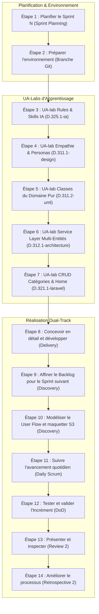

# Flux de Travail — Session S02 (Sprint 2 - 80h)

Ce document détaille le flux de travail opérationnel de la **Session S02 : Empathie Personas, Architecture MVC + Services & Page d'Accueil** pour le projet de formation N3.

Il applique directement les étapes de la Phase 2 du [Flux de Travail Générique](../flux-travail-generique.md) en alternant l'acquisition des compétences dans les UA-labs et leur application immédiate sur le projet d'imitation.

---

## 1. Fiche d'Identification de la Session

- **Code de Session :** S02
- **Intitulé du Sprint :** Empathie Personas, Architecture MVC + Services & Page d'Accueil
- **Durée Ferme (Timebox) :** 80 heures (10 jours ouvrés)
- **Positionnement :** Deuxième sprint de delivery applicatif Dual-Track

---

## 2. Objectif d'Apprentissage Global

Créer la branche Git et actualiser la documentation projet ; organiser son environnement IA en Rules et Skills modulaires avec **Agent Antigravity & GitHub Copilot** ; conduire la démarche d'empathie approfondie du Design Thinking (Personas et carte d'empathie) pour lever la dette d'empathie constatée au Sprint 1 ; modéliser les cas d'utilisation de filtrage et le diagramme de classes du domaine pur en syntaxe déclarative Mermaid ; et développer sous **Laravel 13** une page d'accueil dynamique complète orchestrée selon l'**Architecture MVC avec couche Service** (Contrôleur `HomeController`, service `ArticleService`, persistance relationnelle **MySQL** des catégories et gabarit Blade réactif sous Tailwind CSS et **Preline UI**).

---

## 3. Prérequis Bloquants de Lancement

Pour démarrer la session :
- **Validation du Sprint 1 :** Incrément de consultation d'un article validé par le Product Owner (Groupe 1), rétrospective S1 actant la dette d'empathie, et maquettes de S2 testées.
- **Rôles Opérationnels :** Product Owner porté par le Groupe 1, Scrum Master et Développeurs en alternance.

---

## 4. Cadre Tri-Projets et Organisation Temporelle (80h / 10 jours)

- **Jours 1 à 7 : Projet d'Imitation (*Blog des Lauréats*)**
  - Réalisation guidée pas-à-pas en classe active.
  - Alternance directe entre l'assimilation d'un UA-lab et l'exécution de l'étape de réalisation correspondante.
- **Jour 8 : Projet Technique (*Portfolio Développeur*)**
  - **Codage technique pur en totale autonomie**.
  - L'apprenant réalise uniquement le développement technique : CRUD compétences et page d'accueil vitrine de son portfolio personnel sous Laravel 13 avec Preline UI.
  - Aucune étape de planification ni de conception n'est demandée sur cette journée.
  - Épreuve sommative de **Live Coding (40 min chrono sans assistance — 65% de la note)**.
- **Jours 9 et 10 : Projet Fil Rouge (*Application Métier*, ex : Cinéma)**
  - **Création et enrichissement systématique de Skills agentiques** dans `.agent/skills/`.
  - L'apprenant conçoit des Skills réutilisables permettant à l'Agent IA d'analyser le domaine métier et d'automatiser la génération de la page d'accueil et des composants de filtrage.
  - Clôture de session et bilan réflexif.

---

## 5. Épreuve de Live Coding (40 min chrono sans assistance — 65% de la note)

- **Contexte :** À partir du projet starter fourni (`dossier-depart/`), coder en 40 minutes la page d'accueil du portfolio affichant les réalisations récentes avec leurs étiquettes de catégories.
- **Consignes opérationnelles :**
  - Déclarer la route d'accueil `/` dans `routes/web.php`.
  - Implémenter le contrôleur mince `HomeController` avec injection de `ArticleService`.
  - Coder la méthode `ArticleService::latestArticles(6)` effectuant la sélection limitée avec tri décroissant.
  - Développer la vue Blade responsive `resources/views/home.blade.php` avec boucle d'affichage et badges de catégories dynamiques Preline UI.
- **Critères d'évaluation :** Séparation stricte MVC + Service, conformité visuelle Preline UI, code propre PSR-12, gestion du cas de liste vide.

---

## 6. Déroulement Chronologique Intercalé du Sprint 2

---

### Étape 1 : Planifier le Sprint N (Sprint Planning — Piste Delivery) (Étape Générique 15)
- **Entrées :** Product Backlog actualisé, retours de la Review 1 et actions de la Rétrospective S1.
- **Activités de réalisation :**
  - Définir le Sprint Goal S2 : "Déployer la page d'accueil dynamique avec mise en avant des 6 derniers articles et gestion administrable des catégories sous MySQL".
  - Sélectionner les User Stories : "Affichage de la page d'accueil dynamique" et "Gestion du CRUD Catégories".
  - Décomposer les User Stories en tâches techniques élémentaires (1 à 4 heures).
  - Valider l'engagement d'équipe sur le Sprint Backlog S2.
- **Sortie principale :** Document du Sprint Backlog S2 ordonné (`scrum/sprint-backlog-s2.md`).

### Étape 2 : Préparer l'environnement de sprint (Branche Git et README.md) (Étape Générique 16)
- **Entrées :** Sprint Backlog S2 validé et branche `main`.
- **Activités de réalisation :**
  - Créer et basculer sur la branche Git du sprint : `git checkout -b sprint-2`.
  - Actualiser le fichier `README.md` avec le Sprint Goal S2, la composition d'équipe et les dates jalons.
- **Sortie principale :** Fichier `README.md` actualisé sur la branche `sprint-2`.

### Étape 3 : UA-lab : Organisation des prompts en Rules & Skills dans l'IDE (Domaine D.325.1-ia)
- **Objectif d'apprentissage :** Structurer son environnement d'assistance IA en règles permanentes et compétences modulaires réutilisables dans l'IDE avec Antigravity et Copilot.
- **Notions de base à apprendre :**
  - Distinction formelle entre Rules permanentes (standards de code, contraintes d'architecture) et Skills modulaires (tâches activables à la demande).
  - Injection automatique de contexte (*context injection*) : passage de code existant, schémas Mermaid et règles d'ingénierie.
  - Configuration de l'environnement d'assistance IA dans l'IDE.
- **Sortie :** Guide de structuration en Rules et Skills IA (`tutoriels/ia/guide-rules-skills.md`).

### Étape 4 : UA-lab : Démarche d'empathie approfondie et fiches Personas (Domaine D.311.1-design)
- **Objectif d'apprentissage :** Mener l'immersion auprès des utilisateurs réels pour comprendre leurs besoins et lever la dette d'empathie constatée au Sprint 1.
- **Notions de base à apprendre :**
  - Principes de l'immersion terrain et observation active.
  - Carte d'empathie complète (Say, Do, Think, Feel).
  - Structure modulaire d'une fiche Persona : démographie, motivations intrinsèques, points de douleur (*pain points*), scénarios d'utilisation.
- **Sortie :** Dossier d'empathie et fiches Personas (`tutoriels/design/guide-empathie-personas.md`).

### Étape 5 : UA-lab : Modélisation des cas d'utilisation de filtrage et classes du domaine pur Mermaid (Domaine D.311.2-uml)
- **Objectif d'apprentissage :** Modéliser en syntaxe déclarative Mermaid les interactions de filtrage dynamique et le diagramme de classes conceptuel du domaine pur (un seul lab consolidant tout le domaine UML du sprint).
- **Notions de base à apprendre :**
  - Cas d'utilisation détaillés de filtrage et de recherche avec préconditions et postconditions.
  - Identification des entités candidates par analyse grammaticale du domaine métier.
  - Associations conceptuelles, cardinalités et multiplicités strictes (`1..*`, `0..*`).
  - Typage pur du domaine métier indépendant de toute implémentation SQL ou framework.
- **Sortie :** Guide de modélisation du domaine pur en Mermaid (`tutoriels/uml/guide-classes-domaine.md`).

### Étape 6 : UA-lab : Architecture logicielle : Service Layer multi-entités et ADR-02 (Domaine D.312.1-architecture)
- **Objectif d'apprentissage :** Découpler l'orchestration des données entre plusieurs entités métier (Articles et Catégories) et consigner la décision architecturale.
- **Notions de base à apprendre :**
  - Patron Service Layer multi-entités orchestrant plusieurs sources de données.
  - Séparation stricte entre contrôleur d'affichage et service de requêtage métier.
  - Rédaction formelle de la décision d'architecture ADR-02.
- **Sortie :** Fiche d'architecture multi-entités et décision ADR-02 (`tutoriels/architecture/guide-service-layer.md`).

### Étape 7 : UA-lab : CRUD Catégories, persistance MySQL et Page d'accueil Blade Preline UI (Domaine D.321.1-laravel)
- **Objectif d'apprentissage :** Développer sous Laravel 13 et MySQL un module complet de ressource et une page d'accueil dynamique (un seul lab consolidant tout le domaine Laravel du sprint).
- **Notions de base à apprendre :**
  - Migrations MySQL avec l'outil de schéma Laravel (`Schema::create`, colonnes typées, clés étrangères).
  - Contrôleurs de ressources RESTful (`--resource`), méthodes `index`, `create`, `store`, `edit`, `update`, `destroy`.
  - Modèle Eloquent de base et Seeders de test.
  - Requêtes de sélection limitées avec tri (`latestArticles(6)`).
  - Passage de collections multiples à Blade (`$articles`, `$categories`).
  - Composants d'interface Preline UI (cartes d'articles, badges de catégories, grille responsive).
- **Sortie :** Guide technique CRUD Catégories et Page d'accueil dynamique (`tutoriels/laravel/guide-crud-home.md`).

### Étape 8 : Concevoir en détail et développer (Piste Delivery) (Étape Générique 17)
- **Entrées :** Spécifications fonctionnelles, architecture multi-entités et composants Preline UI validés.
- **Activités de réalisation :**
  - *Projet d'Imitation :* Coder les migrations MySQL des catégories, le modèle `Category`, le contrôleur de ressource `CategoryController`, connecter `HomeController` à `ArticleService` et finaliser la page d'accueil dynamique sous Blade et Preline UI.
  - *Projet Technique (Codage pur - Jour 8) :* Coder le CRUD compétences et la page d'accueil vitrine de son portfolio (Live Coding 40 min).
  - *Projet Fil Rouge (Jours 9-10) :* Créer le Skill `.agent/skills/home-page-builder/` pour automatiser la génération d'une page d'accueil multi-entités.
- **Sortie principale :** Contrôleur d'accueil opérationnel (`app/Http/Controllers/HomeController.php`).

### Étape 9 : Affiner le Backlog pour le Sprint suivant (Piste Discovery — ~10% temps) (Étape Générique 18)
- **Entrées :** Product Backlog et retours d'utilisation.
- **Activités de réalisation :**
  - Collaborer avec le Groupe 1 (Product Owner) pour clarifier le besoin des User Stories du Sprint 3 (Validation des formulaires par FormRequest et relations Eloquent riches).
  - Définir les critères d'acceptation et estimer la complexité en Story Points.
- **Sortie principale :** Fiche de raffinement du backlog pour le Sprint 3 (`scrum/backlog-refinement-s3.md`).

### Étape 10 : Modéliser le User Flow et maquetter pour le Sprint suivant (Piste Discovery — ~10% temps) (Étape Générique 19)
- **Entrées :** User Stories raffinées pour le Sprint 3 et UI Kit Preline UI.
- **Activités de réalisation :**
  - Modéliser en syntaxe Mermaid déclarative le parcours de création et de validation d'un article.
  - Concevoir les maquettes interactives des formulaires d'édition avec les composants Preline UI.
- **Sortie principale :** Document regroupant le User Flow et les maquettes interactives du Sprint 3 (`docs/design/maquettes-sprint-3.md`).

### Étape 11 : Suivre l'avancement quotidien (Daily Scrum — Delivery & Discovery) (Étape Générique 20)
- **Entrées :** Tableau Kanban et tâches du Sprint 2.
- **Activités de réalisation :**
  - Animer la réunion quotidienne debout de 15 minutes.
  - Partager l'état d'avancement sur le delivery (page d'accueil, CRUD catégories) et le discovery.
  - Lever les points de blocage techniques.
- **Sortie principale :** Journal de suivi journalier des tâches (`issues/issues-sprint-2.md`).

### Étape 12 : Tester et valider l'Incrément (Piste Delivery — DoD) (Étape Générique 21)
- **Entrées :** Code source complet du Sprint 2 et critères formels de la Definition of Done.
- **Activités de réalisation :**
  - Vérifier la conformité aux 7 critères formels de la DoD :
    - Affichage responsive vérifié sur mobile et desktop avec Preline UI.
    - Persistance effective des catégories en base de données MySQL.
    - Respect des standards de code PSR-12.
- **Sortie principale :** Rapport formel de validation de la Definition of Done (`docs/qualite/rapport-dod-sprint-2.md`).

### Étape 13 : Présenter et inspecter (Sprint Review N — Double Validation Delivery & Discovery) (Étape Générique 22)
- **Entrées :** Incrément logiciel S2 opérationnel et maquettes interactives du Sprint 3.
- **Activités de réalisation :**
  - Démontrer la page d'accueil dynamique et le CRUD Catégories devant le Product Owner (Groupe 1).
  - Valider formellement la fin des User Stories de S2.
  - Faire tester les maquettes de formulaires de S3 aux utilisateurs cibles pour recueillir leurs retours d'usage.
- **Sortie principale :** Procès-verbal de la Review 2 (`sprints/pv-review-2.md`).

### Étape 14 : Améliorer le processus (Sprint Retrospective N — Amélioration continue) (Étape Générique 23)
- **Entrées :** Déroulement et retours de la Review 2.
- **Activités de réalisation :**
  - Analyser le fonctionnement de l'équipe durant le Sprint 2.
  - Constater le choc réflexif d'avoir sauté l'étape formelle *Define* (problème mal formulé et besoin d'idéation plus structurée vers S03).
  - Définir 2 actions d'amélioration concrètes pour le Sprint 3.
- **Sortie principale :** Bilan rétrospectif du Sprint 2 constatant la nécessité d'une phase Define/Idéation (`scrum/retrospective-s2.md`).
