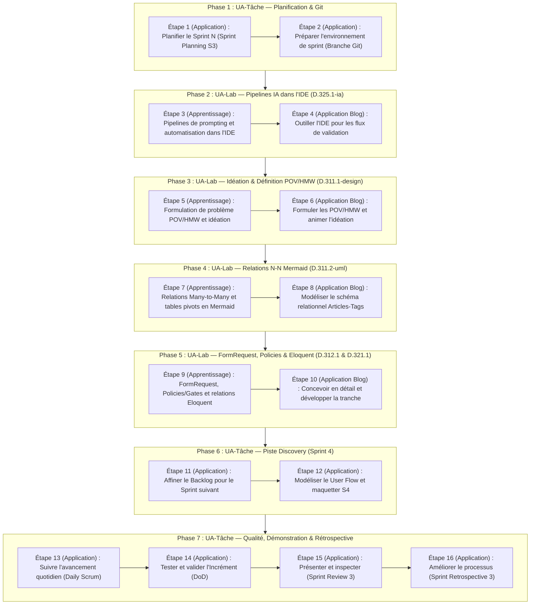

# Flux de Travail Opérationnel — Session S03 : Idéation, Définition de Problème, Sécurité (Policies/Gates) & Relations Eloquent

Ce document définit le flux de travail de la **Session S03** (Sprint 3 - 80 heures / 10 jours ouvrés).
Il est structuré en **7 phases typées** alternant les unités d'apprentissage (**UA-Lab**) avec leurs applications immédiates sur le projet d'imitation, et les phases opérationnelles d'ingénierie (**UA-Tâche**).

---

## 1. Fiche d'Identification de la Session S03

- **Identifiant :** Session S03 (Sprint 3)
- **Titre :** Idéation, Définition de Problème, Sécurité (Policies/Gates) & Relations Eloquent
- **Durée totale ferme :** 80 heures (10 jours ouvrés)
- **Positionnement :** Troisième sprint de delivery applicatif Dual-Track
- **Domaines de compétences mobilisés :**
  - Pipelines de prompting et automatisation dans l'IDE (`D.325.1-ia`)
  - Idéation, formulation de problème POV/HMW (`D.311.1-design`)
  - Modélisation des relations Many-to-Many et tables pivots en Mermaid (`D.311.2-uml`)
  - Sécurité applicative, validation FormRequest, CSRF et Policies/Gates (`D.312.1-architecture`)
  - Développement Laravel 13, relations riches Eloquent & Preline UI (`D.321.1-laravel`)
- **Objectif global d'apprentissage :**
  - Préparer la branche Git `sprint-3` et actualiser la documentation projet.
  - Orchestrer ses compétences IA en pipelines de travail automatisés dans l'IDE.
  - Formuler le problème métier selon la méthode POV/HMW et animer un atelier d'idéation structuré.
  - Modéliser les relations Many-to-Many et les tables pivots associées en syntaxe déclarative Mermaid.
  - Sécuriser les formulaires web par des classes `FormRequest`, protection CSRF et autorisations déclaratives **Policies/Gates**.
  - Implémenter sous **Laravel 13** avec **MySQL** les relations riches Eloquent (`belongsTo`, `hasMany`, `belongsToMany`) pour la création d'articles avec tags et catégories.
  - Préparer la piste Discovery du Sprint 4 et clôturer le sprint par la démonstration et la rétrospective agile.

---

## 2. Organisation dans le Cadre Tri-Projets (80h / 10 jours)

- **Jours 1 à 7 : Projet d'Imitation (*Blog des Lauréats*)**
  - Réalisation guidée pas-à-pas de la création sécurisée d'articles avec sélection de catégories et tags multiples.
  - Alternance immédiate : chaque atelier théorique est mis en œuvre sur le Blog.
- **Jour 8 : Projet Technique (*Portfolio Développeur*)**
  - **Codage technique pur en totale autonomie (sans conception ni planification)**.
  - L'apprenant implémente la validation `ProjectRequest`, les Policies de sécurité et les relations Eloquent Projets $\leftrightarrow$ Technologies sous Laravel 13 et MySQL.
  - **Épreuve sommative de Live Coding (40 min chrono sans assistance — 65% de la note finale du module)**.
- **Jours 9 et 10 : Projet Fil Rouge (*Application Métier*, ex : Gestion de Cinéma)**
  - Création du Skill agentique `.agent/skills/eloquent-relations-generator/` pour automatiser la génération des relations complexes et validations.
  - Bilan réflexif et consolidation des acquis.

---

## 3. Épreuve de Live Coding (40 min chrono sans assistance — 65% de la note)

- **Contexte :** À partir du projet starter fourni (`dossier-depart/`), implémenter en 40 minutes le formulaire d'ajout d'une réalisation avec validation stricte via `ProjectRequest`, contrôle d'autorisation par Gate, et association Many-to-Many aux technologies sélectionnées.
- **Consignes opérationnelles :**
  - Déclarer la route POST `/realisations` protégée par le middleware d'authentification.
  - Créer la classe `ProjectRequest` avec règles de validation typées.
  - Définir la Gate d'autorisation `manage-projects` dans `AppServiceProvider`.
  - Implémenter la méthode `store` synchronisant les IDs de technologies via la méthode `sync()` d'Eloquent.
- **Critères d'évaluation :** Sécurité FormRequest, conformité Gate, persistance relationnelle MySQL, messages d'erreurs clairs en français.

---

## 4. Déroulement des 7 Phases de la Session S03

---

### Phase 1 : UA-Tâche — Planification du Sprint 3 et Préparation de l'Environnement Git
*Cette phase ne requiert aucun nouvel apport théorique. Elle regroupe les tâches opérationnelles d'initialisation de l'itération.*

- **Étape 1 (Application) : Planifier le Sprint N (Sprint Planning — Piste Delivery)**
  - Entrées : Product Backlog actualisé, retours de la Review 2 et actions de la Rétrospective S2.
  - Travail d'application sur le Blog : Définir le Sprint Goal S3 ("Permettre aux lauréats d'ajouter et d'éditer des articles enrichis avec catégories, tags multiples et sécurité granulaire par Policies/Gates"), décomposer les tâches et valider le Sprint Backlog S3.
  - Sortie (1 seul livrable) : `scrum/sprint-backlog-s3.md`.
- **Étape 2 (Application) : Préparer l'environnement de sprint (Branche Git et README.md)**
  - Entrées : Sprint Backlog S3 validé et branche `main`.
  - Travail d'application sur le Blog : Créer la branche Git `sprint-3` et actualiser le fichier `README.md` avec les objectifs et jalons du sprint.
  - Sortie (1 seul livrable) : `README.md`.

---

### Phase 2 : UA-Lab — Pipelines de Prompting et Automatisation dans l'IDE (Domaine D.325.1-ia)
*Cette phase introduit l'enchaînement automatisé d'instructions IA. Elle comprend l'étape d'apprentissage conceptuel suivie de son outillage direct sur le Blog.*

- **Étape 3 (Apprentissage) : Pipelines de prompting et automatisation dans l'IDE**
  - Entrées : Outils Antigravity et GitHub Copilot.
  - Notions de base à apprendre :
    - Enchaînement séquentiel d'instructions IA : prompt de cadrage $\to$ prompt de validation $\to$ prompt de génération de code.
    - Utilisation de contextes enrichis avec schémas Mermaid et règles d'architecture.
    - Évaluation systématique de la fidélité du code généré par rapport aux contraintes applicatives.
  - Sortie de l'atelier d'apprentissage (1 seul livrable) : `tutoriels/ia/guide-pipelines-ia.md`.
- **Étape 4 (Application sur le Blog) : Outiller l'IDE pour les flux de validation**
  - Entrées : Guide des pipelines IA et spécifications fonctionnelles du Blog.
  - Travail d'application sur le Blog : Configurer les modèles de prompts de validation pour les formulaires du Blog et les règles de conformité Eloquent.
  - Sortie (1 seul livrable) : `docs/ia/prompts-validation-blog.md`.

---

### Phase 3 : UA-Lab — Idéation et Définition de Problème POV/HMW (Domaine D.311.1-design)
*Cette phase approfondit la démarche de cadrage fonctionnel. Elle s'organise en une étape d'apprentissage théorique suivie de la formalisation concrète sur le Blog.*

- **Étape 5 (Apprentissage) : Formulation de problème POV/HMW et idéation**
  - Entrées : Cadre de Design Thinking.
  - Notions de base à apprendre :
    - Formulation de la déclaration de point de vue : POV = Utilisateur + Besoin + Constat surprenant (*Insight*).
    - Déclinaison en questions stimulantes "How Might We" (HMW - Comment pourrions-nous).
    - Animation d'un atelier d'idéation : brainstorming structuré, matrice faisabilité/impact.
  - Sortie de l'atelier d'apprentissage (1 seul livrable) : `tutoriels/design/guide-ideation-hmw.md`.
- **Étape 6 (Application sur le Blog) : Formuler les POV/HMW et animer l'idéation pour la publication**
  - Entrées : Personas du Blog et retours d'utilisation.
  - Travail d'application sur le Blog : Rédiger le POV de l'auteur lauréat, formuler les axes HMW pour simplifier la saisie d'articles, et sélectionner les fonctionnalités d'édition prioritaires.
  - Sortie (1 seul livrable) : `docs/analyse/pov-hmw-publication.md`.

---

### Phase 4 : UA-Lab — Modélisation des Relations Many-to-Many en Syntaxe Mermaid (Domaine D.311.2-uml)
*Cette phase introduit la modélisation relationnelle riche. Elle s'organise en une étape d'apprentissage théorique suivie de la modélisation du schéma de données du Blog.*

- **Étape 7 (Apprentissage) : Relations Many-to-Many et tables pivots en Mermaid**
  - Entrées : Syntaxe Mermaid `erDiagram`.
  - Notions de base à apprendre :
    - Cardinalités complexes : Many-to-Many (`}o--o{`) et dissociation par table de jonction pivot.
    - Clés primaires composites et clés étrangères avec contraintes d'intégrité référentielle en cascade (`onDelete('cascade')`).
    - Syntaxe déclarative Mermaid pour représenter les entités `Article`, `Tag` et la table pivot `article_tag`.
  - Sortie de l'atelier d'apprentissage (1 seul livrable) : `tutoriels/uml/guide-relations-manytomany.md`.
- **Étape 8 (Application sur le Blog) : Modéliser le schéma relationnel Articles-Tags**
  - Entrées : Spécifications du Blog et guide Mermaid.
  - Travail d'application sur le Blog : Modéliser le schéma entité-association complet du Blog intégrant les articles, catégories, auteurs et tags avec la table pivot `article_tag`.
  - Sortie (1 seul livrable) : `docs/analyse/modele-relations-tags.mmd`.

---

### Phase 5 : UA-Lab — FormRequest, Policies/Gates et Relations Eloquent (Domaines D.312.1-architecture & D.321.1-laravel)
*Cette phase introduit le développement sécurisé et relationnel sous Laravel 13. Elle s'organise en une étape d'apprentissage technique suivie de la réalisation complète sur le Blog, le portfolio et le projet fil rouge.*

- **Étape 9 (Apprentissage) : FormRequest, Policies/Gates et relations Eloquent**
  - Entrées : Documentation Laravel 13 et Preline UI.
  - Notions de base à apprendre :
    - Validation découplée par classes `FormRequest` avec règles sémantiques et messages localisés en français.
    - Autorisations d'accès par Gates et Policies associées au modèle (`ArticlePolicy@update`, `@delete`).
    - Déclaration des relations Eloquent : `belongsTo(Category::class)`, `belongsToMany(Tag::class)`.
    - Méthodes de synchronisation de relations N-N : `attach()`, `detach()`, `sync()`.
  - Sortie de l'atelier d'apprentissage (1 seul livrable) : `tutoriels/laravel/guide-eloquent-policies.md`.
- **Étape 10 (Application sur le Blog) : Concevoir en détail et développer (Piste Delivery)**
  - Entrées : Notions acquises, modèle relationnel et maquettes validées.
  - Travail d'application sur le Blog :
    - *Projet d'Imitation :* Coder la migration `article_tag`, les relations Eloquent dans `Article` et `Tag`, la classe `StoreArticleRequest`, la politique de sécurité `ArticlePolicy`, et le formulaire Blade sous Preline UI avec sélection multiple de tags.
    - *Projet Technique (Codage pur - Jour 8) :* Coder la validation `ProjectRequest`, la Gate `manage-projects` et les relations Many-to-Many Technologies sur son portfolio (Épreuve de Live Coding de 40 min).
    - *Projet Fil Rouge (Jours 9-10) :* Créer le Skill `.agent/skills/eloquent-relations-generator/` pour automatiser la mise en place de relations Eloquent riches.
  - Sortie (1 seul livrable) : `app/Http/Requests/StoreArticleRequest.php`.

---

### Phase 6 : UA-Tâche — Piste Discovery : Affinement du Backlog et Maquettage du Sprint 4
*Cette phase ne requiert aucun nouvel apport conceptuel. Il s'agit d'une UA-Tâche d'ingénierie opérationnelle pour préparer le sprint suivant.*

- **Étape 11 (Application) : Affiner le Backlog pour le Sprint suivant (Piste Discovery)**
  - Entrées : Product Backlog et retours d'utilisation.
  - Travail d'application : Collaborer avec le Product Owner pour clarifier les User Stories du Sprint 4 (Automatisation des tests PHPUnit et prototypage interactif).
  - Sortie (1 seul livrable) : `scrum/backlog-refinement-s4.md`.
- **Étape 12 (Application) : Modéliser le User Flow et maquetter pour le Sprint suivant (Piste Discovery)**
  - Entrées : User Stories raffinées pour S4 et UI Kit Preline UI.
  - Travail d'application : Modéliser en syntaxe Mermaid les parcours de modération et prototyper les maquettes interactives S4.
  - Sortie (1 seul livrable) : `docs/design/maquettes-sprint-4.md`.

---

### Phase 7 : UA-Tâche — Clôture du Sprint 3, Démonstration, Tests DoD et Rétrospective
*Cette phase opérationnelle rassemble les rituels de clôture et l'amélioration continue du sprint.*

- **Étape 13 (Application) : Suivre l'avancement quotidien (Daily Scrum — Delivery & Discovery)**
  - Entrées : Tableau Kanban du Sprint 3.
  - Travail d'application : Animer la réunion quotidienne debout de 15 minutes et lever les blocages techniques.
  - Sortie (1 seul livrable) : `issues/issues-sprint-3.md`.
- **Étape 14 (Application) : Tester et valider l'Incrément (Piste Delivery — DoD)**
  - Entrées : Code source complet et critères de la Definition of Done.
  - Travail d'application : Exécuter la checklist de validation (formulaire sécurisé, validation FormRequest effective, protection CSRF active, relations N-N intègres dans MySQL).
  - Sortie (1 seul livrable) : `docs/qualite/rapport-dod-sprint-3.md`.
- **Étape 15 (Application) : Présenter et inspecter (Sprint Review N — Double Validation Delivery & Discovery)**
  - Entrées : Incrément logiciel S3 et maquettes du Sprint 4.
  - Travail d'application : Démontrer l'ajout et l'édition sécurisés d'un article devant le Product Owner (Groupe 1), valider la DoD et faire tester les maquettes de S4.
  - Sortie (1 seul livrable) : `sprints/pv-review-3.md`.
- **Étape 16 (Application) : Améliorer le processus (Sprint Retrospective N — Amélioration continue)**
  - Entrées : Déroulement de la Review 3 et vécu d'équipe.
  - Travail d'application : Conduire l'analyse réflexive d'équipe, acter la nécessité d'automatiser des tests de régression, et planifier l'introduction de PHPUnit au Sprint 4.
  - Sortie (1 seul livrable) : `scrum/retrospective-s3.md`.
