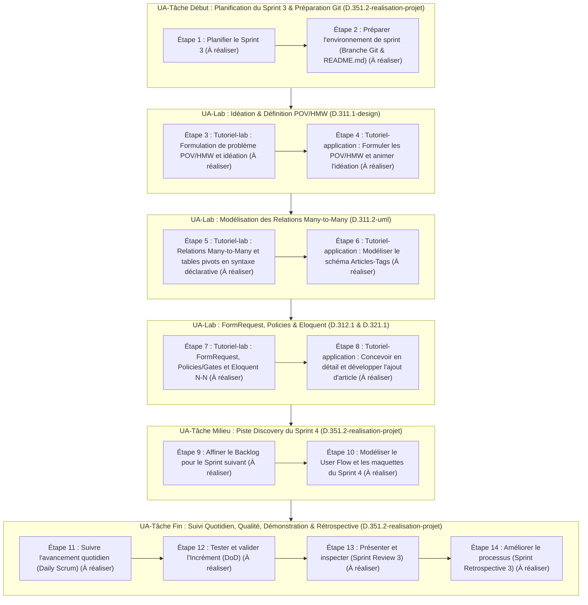

# Flux de Travail Opérationnel — Session S3 : Gestion des Articles et Tags Associés (Relations Many-to-Many)

Ce document définit le flux de travail opérationnel de la **Session S3** (Sprint 3) pour le niveau N3.
Il est centré sur la production de son incrément majeur : la **Gestion des Articles et Tags Associés (Relations Many-to-Many)** du Blog des Lauréats.

Le flux sépare de manière étanche les Unités d'Apprentissage d'ateliers pratiques (**UA-Lab**) et les Unités d'Apprentissage d'application opérationnelle sur le projet (**UA-Tâche**), totalisant **6 UAs** et **14 étapes de travail**.

Les durées temporelles (80 heures / 10 jours) sont fournies à titre purement indicatif pour les formateurs et le concepteur.

---

## 1. Fiche d'Identification de la Session S3

- **Identifiant :** Session S3 (Sprint 3)
- **Titre centré sur l'incrément :** Gestion des Articles et Tags Associés (Relations Many-to-Many)
- **Incrément produit :** Système complet de création et d'édition d'articles avec tags Many-to-Many, validation FormRequest sécurisée, contrôle d'accès par Policies/Gates et formulaire dynamique Preline UI
- **Durée indicative :** 80 heures (10 jours ouvrés)
- **Positionnement :** Troisième sprint de delivery applicatif Dual-Track
- **Référentiel des compétences :** Conforme au document de référence [.agents/references/domaines-competences.md](../../.agents/references/domaines-competences.md)
- **Domaines de compétences et Unités d'Apprentissage mobilisés :**
  - Domaine Conception & Design Thinking (`D.311.1-design`) :
    - Unité d'apprentissage (UA-Lab) : *Idéation et formulation de problèmes POV / HMW* (Statut : **À réaliser**)
  - Domaine Modélisation UML & Conception Technique (`D.311.2-uml`) :
    - Unité d'apprentissage (UA-Lab) : *Modélisation relationnelle Many-to-Many et tables pivots* (Statut : **À réaliser**)
  - Domaine Architecture (`D.312.1-architecture`) & Backend Laravel (`D.321.1-laravel`) :
    - Unité d'apprentissage (UA-Lab) : *FormRequest, Policies/Gates et relations Eloquent Many-to-Many* (Statut : **À réaliser**)
  - Domaine Réalisation et Conduite de Projet (`D.351.2-realisation-projet`) :
    - Unité d'apprentissage 1 (UA-Tâche) : *Planification du Sprint 3 et Préparation Git* (Statut : **À réaliser**)
    - Unité d'apprentissage 2 (UA-Tâche) : *Piste Discovery : Affinement du Backlog et Maquettage du Sprint 4* (Statut : **À réaliser**)
    - Unité d'apprentissage 3 (UA-Tâche) : *Suivi Quotidien, Qualité DoD, Démonstration et Rétrospective* (Statut : **À réaliser**)
- **Objectif global d'apprentissage :**
  - Préparer la branche Git `sprint-3` et actualiser la documentation projet.
  - Formuler le problème métier selon la méthode POV/HMW et animer un atelier d'idéation structuré.
  - Modéliser les relations Many-to-Many et les tables pivots associées en syntaxe déclarative textuelle.
  - Sécuriser les formulaires web par des classes `FormRequest`, protection CSRF et autorisations déclaratives **Policies/Gates**.
  - Implémenter sous **Laravel 13** avec **MySQL** les relations riches Eloquent (`belongsTo`, `hasMany`, `belongsToMany`) pour la création d'articles avec tags et catégories.
  - Préparer la piste Discovery du Sprint 4 et clôturer le sprint par la démonstration et la rétrospective agile.

---

## 2. Organisation dans le Cadre Tri-Projets

- **Rôles Scrum & Autonomie :** Chaque apprenant endosse le rôle de Product Owner pour son propre projet et pilote son backlog en autonomie.
- **Jours 1 à 7 : Projet d'Imitation (*Blog des Lauréats*)**
  - Réalisation guidée pas-à-pas de la création sécurisée d'articles avec sélection de catégories et tags multiples.
  - Alternance immédiate : chaque atelier théorique est mis en œuvre sur le Blog.
- **Jour 8 : Projet Technique (*Portfolio Développeur*)**
  - **Épreuve sommative de Live Coding (40 min chrono sans assistance — 65% de la note finale du module)** : Implémentation de la validation `ProjectRequest`, des Policies de sécurité et des relations Eloquent Projets $\leftrightarrow$ Technologies sous Laravel 13 et MySQL.
  - **Règle formelle d'exigence :** Les documents de cadrage et de conception préalable ne sont pas demandés pour le portfolio dans la session.
- **Jours 9 et 10 : Projet Fil Rouge (*Application Métier*, ex : Gestion de Cinéma)**
  - Développement des relations complexes et validations sécurisées avec persistance MySQL sur l'application fil rouge (développement logiciel métier pur, sans agents IA ni ingénierie de prompt).
  - Bilan réflexif et consolidation des acquis.

---

## 3. Épreuve de Live Coding (40 min chrono sans assistance — 65% de la note)

- **Contexte :** À partir du projet starter fourni (`dossier-depart/`), implémenter en 40 minutes le formulaire d'ajout d'une réalisation avec validation stricte via `ProjectRequest`, contrôle d'autorisation par Gate, et association Many-to-Many aux technologies sélectionnées.
- **Consignes opérationnelles :**
  - Déclarer la route POST `/realisations` protégée par le middleware d'authentification.
  - Créer la classe `ProjectRequest` avec règles de validation typées.
  - Définir la Gate d'autorisation `manage-projects` dans `AppServiceProvider`.
  - Implémenter la méthode `store` synchronisant les IDs de technologies via la méthode `sync()` d'Eloquent.
- **Critères d'évaluation :** Sécurité FormRequest, conformité Gate, persistance relationnelle MySQL, messages d'erreurs clairs en français.

---

## 4. Déroulement Opérationnel des 6 Unités d'Apprentissage du Sprint 3

---

### Unité d'Apprentissage (UA-Tâche) : Planification du Sprint 3 et Préparation Git (Domaine D.351.2-realisation-projet)
*Bloc opérationnel d'initialisation du sprint sans nouvel apport théorique.*

- **Étape 1 : Planifier le Sprint 3**
  - Statut : **À réaliser**
  - Domaine de compétence : `D.351.2-realisation-projet`.
  - Correspondance flux générique : Étape Générique 15 (Planifier le Sprint N).
  - Entrées : Product Backlog actualisé, retours de la Review 2 et actions de la Rétrospective S2.
  - Travail d'application sur le Blog : Chaque apprenant endosse le rôle de Product Owner pour son projet, définit le Sprint Goal S3 ("Permettre aux lauréats d'ajouter et d'éditer des articles enrichis avec catégories, tags multiples et sécurité granulaire par Policies/Gates"), décompose les tâches et valide le Sprint Backlog S3.
  - Sortie (1 seul livrable) : `sprints/sprint-3.md`.
- **Étape 2 : Préparer l'environnement de sprint (Branche Git et README.md)**
  - Statut : **À réaliser**
  - Domaine de compétence : `D.351.2-realisation-projet`.
  - Correspondance flux générique : Étape Générique 16 (Préparer l'environnement de sprint).
  - Entrées : Sprint Backlog S3 validé et branche `main`.
  - Travail d'application sur le Blog : Créer la branche Git `sprint-3` et actualiser le fichier `README.md` avec les objectifs et jalons du sprint.
  - Sortie (1 seul livrable) : `README.md`.

---

### Unité d'Apprentissage (UA-Lab) : Idéation et Définition de Problème POV/HMW (Domaine D.311.1-design)
*Atelier d'apprentissage pratique de la démarche d'idéation et de formulation de problèmes.*

- **Étape 3 : Tutoriel-lab : Formulation de problème POV/HMW et idéation**
  - Statut : **À réaliser**
  - Unité d'apprentissage : *Idéation et formulation de problèmes POV / HMW*.
  - Entrées : Cadre de Design Thinking.
  - Notions de base à apprendre :
    - Formulation de la déclaration de point de vue : POV = Utilisateur + Besoin + Constat surprenant (*Insight*).
    - Déclinaison en questions stimulantes "How Might We" (HMW - Comment pourrions-nous).
    - Animation d'un atelier d'idéation : brainstorming structuré, matrice faisabilité/impact.
  - Sorties de l'atelier d'apprentissage (2 livrables) :
    - Guide explicatif détaillé : `tutoriels/design/ideation/ideation-pov-hmw/ideation-pov-hmw.md`.
    - Support de présentation au format Marp Markdown : `tutoriels/design/ideation/ideation-pov-hmw/presentation-ideation-pov-hmw.md`.
- **Étape 4 : Tutoriel-application : Formuler les POV/HMW et animer l'idéation pour la publication**
  - Statut : **À réaliser**
  - Unité d'apprentissage : *Idéation et formulation de problèmes POV / HMW*.
  - Entrées : Personas du Blog et retours d'utilisation.
  - Travail d'application sur le Blog : Rédiger le POV de l'auteur lauréat, formuler les axes HMW pour simplifier la saisie d'articles, et sélectionner les fonctionnalités d'édition prioritaires.
  - Sortie (1 seul livrable) : `docs/analyse/pov-hmw-publication.md`.

---

### Unité d'Apprentissage (UA-Lab) : Modélisation des Relations Many-to-Many (Domaine D.311.2-uml)
*Atelier d'apprentissage pratique de la modélisation relationnelle riche avec alternance directe.*

- **Étape 5 : Tutoriel-lab : Relations Many-to-Many et tables pivots en syntaxe déclarative**
  - Statut : **À réaliser**
  - Unité d'apprentissage : *Modélisation relationnelle Many-to-Many et tables pivots*.
  - Entrées : Guide de modélisation entité-association textuelle.
  - Notions de base à apprendre :
    - Cardinalités complexes : Many-to-Many (`}o--o{`) et dissociation par table de jonction pivot.
    - Clés primaires composites et clés étrangères avec contraintes d'intégrité référentielle en cascade (`onDelete('cascade')`).
    - Syntaxe déclarative pour représenter les entités `Article`, `Tag` et la table pivot `article_tag`.
  - Sorties de l'atelier d'apprentissage (2 livrables) :
    - Guide explicatif détaillé : `tutoriels/uml/relations-many-to-many/many-to-many-mermaid/many-to-many-mermaid.md`.
    - Support de présentation au format Marp Markdown : `tutoriels/uml/relations-many-to-many/many-to-many-mermaid/presentation-many-to-many-mermaid.md`.
- **Étape 6 : Tutoriel-application : Modéliser le schéma relationnel Articles-Tags**
  - Statut : **À réaliser**
  - Unité d'apprentissage : *Modélisation relationnelle Many-to-Many et tables pivots*.
  - Entrées : Spécifications du Blog et guide de modélisation.
  - Travail d'application sur le Blog : Modéliser le schéma entité-association complet du Blog intégrant les articles, catégories, auteurs et tags avec la table pivot `article_tag`.
  - Sortie (1 seul livrable) : `docs/analyse/modele-relations-tags.mmd`.

---

### Unité d'Apprentissage (UA-Lab) : FormRequest, Policies/Gates et Relations Eloquent (Domaines D.312.1-architecture & D.321.1-laravel)
*Atelier d'apprentissage pratique du développement sécurisé et relationnel sous Laravel 13.*

- **Étape 7 : Tutoriel-lab : FormRequest, Policies/Gates et relations Eloquent Many-to-Many**
  - Statut : **À réaliser**
  - Unité d'apprentissage : *FormRequest, Policies/Gates et relations Eloquent Many-to-Many*.
  - Entrées : Documentation Laravel 13 et Preline UI.
  - Notions de base à apprendre :
    - Validation découplée par classes `FormRequest` avec règles sémantiques et messages localisés en français.
    - Autorisations d'accès par Gates et Policies associées au modèle (`ArticlePolicy@update`, `@delete`).
    - Déclaration des relations Eloquent : `belongsTo(Category::class)`, `belongsToMany(Tag::class)`.
    - Méthodes de synchronisation de relations N-N : `attach()`, `detach()`, `sync()`.
  - Sorties de l'atelier d'apprentissage (2 livrables) :
    - Guide explicatif détaillé : `tutoriels/laravel/formrequest-policies/formrequest-policies-eloquent/formrequest-policies-eloquent.md`.
    - Support de présentation au format Marp Markdown : `tutoriels/laravel/formrequest-policies/formrequest-policies-eloquent/presentation-formrequest-policies-eloquent.md`.
- **Étape 8 : Tutoriel-application : Concevoir en détail et développer la création sécurisée d'articles**
  - Statut : **À réaliser**
  - Domaine de compétence : `D.321.1-laravel`.
  - Correspondance flux générique : Étape Générique 17 (Concevoir en détail et développer).
  - Entrées : Notions acquises, modèle relationnel et maquettes validées.
  - Travail d'application sur le Blog :
    - *Projet d'Imitation :* Coder la migration `article_tag`, les relations Eloquent dans `Article` et `Tag`, la classe `StoreArticleRequest`, la politique de sécurité `ArticlePolicy`, et le formulaire Blade sous Preline UI avec sélection multiple de tags.
    - *Projet Technique (Jour 8) :* Coder la validation `ProjectRequest`, la Gate `manage-projects` et les relations Many-to-Many Technologies sur son portfolio (Épreuve de Live Coding de 40 min).
    - *Projet Fil Rouge (Jours 9-10) :* Développer les relations complexes et contrôles de sécurité avec persistance MySQL sur l'application fil rouge.
  - Sortie (1 seul livrable) : `src/app/Http/Requests/StoreArticleRequest.php`.

---

### Unité d'Apprentissage (UA-Tâche) : Piste Discovery : Affinement du Backlog et Maquettage du Sprint 4 (Domaine D.351.2-realisation-projet)
*Bloc d'ingénierie opérationnelle mené en temps masqué pour préparer le sprint suivant.*

- **Étape 9 : Affiner le Backlog pour le Sprint suivant**
  - Statut : **À réaliser**
  - Domaine de compétence : `D.351.2-realisation-projet`.
  - Correspondance flux générique : Étape Générique 18 (Affiner le Backlog pour le Sprint suivant).
  - Entrées : Product Backlog et retours d'utilisation.
  - Travail d'application : Chaque apprenant, dans sa posture de Product Owner, clarifie les User Stories du Sprint 4 (Automatisation des tests PHPUnit et prototypage interactif), rédige les critères d'acceptation et estime la complexité en Story Points.
  - Sortie (1 seul livrable) : `scrum/backlog-refinement-s4.md`.
- **Étape 10 : Modéliser le User Flow et les maquettes du Sprint 4**
  - Statut : **À réaliser**
  - Domaine de compétence : `D.351.2-realisation-projet`.
  - Correspondance flux générique : Étape Générique 19 (Modéliser le User Flow et maquetter pour le Sprint suivant).
  - Entrées : User Stories raffinées pour S4 et UI Kit Preline UI.
  - Travail d'application : Modéliser en syntaxe déclarative les parcours de modération et prototyper les maquettes interactives S4.
  - Sortie (1 seul livrable) : `docs/conception/maquettes-sprint-4.md`.

---

### Unité d'Apprentissage (UA-Tâche) : Suivi Quotidien, Qualité DoD, Démonstration et Rétrospective (Domaine D.351.2-realisation-projet)
*Rituels de clôture et amélioration continue du sprint.*

- **Étape 11 : Suivre l'avancement quotidien (Daily Scrum)**
  - Statut : **À réaliser**
  - Domaine de compétence : `D.351.2-realisation-projet`.
  - Correspondance flux générique : Étape Générique 20 (Suivre l'avancement quotidien).
  - Entrées : Tableau Kanban du Sprint 3.
  - Travail d'application : Animer la réunion quotidienne debout de 15 minutes et lever les blocages techniques.
  - Sortie (1 seul livrable) : Mise à jour du suivi des tâches dans `sprints/sprint-3.md`.
- **Étape 12 : Tester et valider l'Incrément (DoD)**
  - Statut : **À réaliser**
  - Domaine de compétence : `D.351.2-realisation-projet`.
  - Correspondance flux générique : Étape Générique 21 (Tester et valider l'Incrément).
  - Entrées : Code source complet et critères de la Definition of Done.
  - Travail d'application : Exécuter la checklist de validation (formulaire sécurisé, validation FormRequest effective, protection CSRF active, relations N-N intègres dans MySQL).
  - Sortie (1 seul livrable) : `docs/qualite/rapport-dod-sprint-3.md`.
- **Étape 13 : Présenter et inspecter (Sprint Review 3)**
  - Statut : **À réaliser**
  - Domaine de compétence : `D.351.2-realisation-projet`.
  - Correspondance flux générique : Étape Générique 22 (Présenter et inspecter).
  - Entrées : Incrément logiciel S3 et maquettes du Sprint 4.
  - Travail d'application : Chaque apprenant anime la démonstration de son Incrément 3 en posture de Product Owner, valide la DoD et fait tester les maquettes de S4.
  - Sortie (1 seul livrable) : `sprints/pv-review-3.md`.
- **Étape 14 : Améliorer le processus (Sprint Retrospective 3)**
  - Statut : **À réaliser**
  - Domaine de compétence : `D.351.2-realisation-projet`.
  - Correspondance flux générique : Étape Générique 23 (Améliorer le processus).
  - Entrées : Déroulement de la Review 3 et vécu d'équipe.
  - Travail d'application : Conduire l'analyse réflexive d'équipe, acter la nécessité d'automatiser des tests de régression, et planifier l'introduction de PHPUnit au Sprint 4.
  - Sortie (1 seul livrable) : `sprints/retrospective-3.md`.
