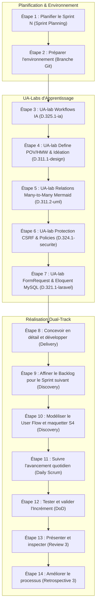

# Flux de Travail — Session S03 (Sprint 3 - 80h)

Ce document détaille le flux de travail opérationnel de la **Session S03 : Idéation, Définition de Problème, Sécurité (Policies/Gates) & Relations Eloquent** pour le projet de formation N3.

Il applique directement les étapes de la Phase 2 du [Flux de Travail Générique](../flux-travail-generique.md) en alternant l'acquisition des compétences dans les UA-labs et leur application immédiate sur le projet d'imitation.

---

## 1. Fiche d'Identification de la Session

- **Code de Session :** S03
- **Intitulé du Sprint :** Idéation, Définition de Problème, Sécurité (Policies/Gates) & Relations Eloquent
- **Durée Ferme (Timebox) :** 80 heures (10 jours ouvrés)
- **Positionnement :** Troisième sprint de delivery applicatif Dual-Track

---

## 2. Objectif d'Apprentissage Global

Préparer la branche Git et actualiser la documentation projet ; orchestrer ses compétences IA en pipelines de travail automatisés dans l'IDE avec **Agent Antigravity & GitHub Copilot** ; formuler le problème métier selon la méthode POV/HMW du Design Thinking et animer une idéation cadrée ; modéliser les relations Many-to-Many et les tables pivots en syntaxe Mermaid ; sécuriser les formulaires web par des classes `FormRequest`, protection CSRF et autorisations déclaratives **Policies/Gates** ; et modéliser et implémenter sous **Laravel 13** avec **MySQL** les relations riches Eloquent (`belongsTo`, `hasMany`, `belongsToMany`).

---

## 3. Prérequis Bloquants de Lancement

Pour démarrer la session :
- **Validation du Sprint 2 :** Page d'accueil dynamique et CRUD Catégories validés par le Product Owner (Groupe 1), rétrospective S2 actant le besoin de formaliser l'étape *Define*, et maquettes de S3 testées.
- **Rôles Opérationnels :** Product Owner porté par le Groupe 1, Scrum Master et Développeurs en alternance.

---

## 4. Cadre Tri-Projets et Organisation Temporelle (80h / 10 jours)

- **Jours 1 à 7 : Projet d'Imitation (*Blog des Lauréats*)**
  - Réalisation guidée pas-à-pas en classe active.
  - Alternance directe entre l'assimilation d'un UA-lab et l'exécution de l'étape de réalisation correspondante.
- **Jour 8 : Projet Technique (*Portfolio Développeur*)**
  - **Codage technique pur en totale autonomie**.
  - L'apprenant réalise uniquement le développement technique : validation `ProjectRequest`, Policies de sécurité et relations Eloquent Projets $\leftrightarrow$ Technologies sous Laravel 13 et MySQL.
  - Aucune étape de planification ni de conception n'est demandée sur cette journée.
  - Épreuve sommative de **Live Coding (40 min chrono sans assistance — 65% de la note)**.
- **Jours 9 et 10 : Projet Fil Rouge (*Application Métier*, ex : Cinéma)**
  - **Création et enrichissement systématique de Skills agentiques** dans `.agent/skills/`.
  - L'apprenant conçoit des Skills réutilisables permettant à l'Agent IA d'automatiser la validation FormRequest et les relations Eloquent complexes.
  - Clôture de session et bilan réflexif.

---

## 5. Épreuve de Live Coding (40 min chrono sans assistance — 65% de la note)

- **Contexte :** À partir du projet starter fourni (`dossier-depart/`), coder en 40 minutes la validation sécurisée et l'enregistrement persistant d'un article lié à sa catégorie en base MySQL.
- **Consignes opérationnelles :**
  - Coder la classe de validation `app/Http/Requests/ArticleRequest.php` (titre requis >= 5 caractères, contenu requis, `category_id` valide en base MySQL).
  - Implémenter le contrôleur d'enregistrement `ArticleController@store` persistant l'article avec sa catégorie Eloquent sous MySQL.
  - Afficher le message flash de confirmation dans Blade avec les styles Preline UI.
- **Critères d'évaluation :** Découplage FormRequest, respect des autorisations, persistance MySQL intègre, conformité visuelle Preline UI.

---

## 6. Déroulement Chronologique Intercalé du Sprint 3

---

### Étape 1 : Planifier le Sprint N (Sprint Planning — Piste Delivery) (Étape Générique 15)
- **Entrées :** Product Backlog actualisé et retours de la Review 2.
- **Activités de réalisation :**
  - Définir le Sprint Goal S3 : "Permettre la création et la publication sécurisées d'articles enrichis de catégories et d'étiquettes multiples sous validation stricte FormRequest et Policies".
  - Sélectionner les User Stories : "Création sécurisée d'un article" et "Association d'étiquettes multiples".
  - Décomposer les User Stories en tâches techniques élémentaires (1 à 4 heures).
  - Valider l'engagement d'équipe sur le Sprint Backlog S3.
- **Sortie principale :** Document du Sprint Backlog S3 ordonné (`scrum/sprint-backlog-s3.md`).

### Étape 2 : Préparer l'environnement de sprint (Branche Git et README.md) (Étape Générique 16)
- **Entrées :** Sprint Backlog S3 validé et branche `main`.
- **Activités de réalisation :**
  - Créer et basculer sur la branche Git du sprint : `git checkout -b sprint-3`.
  - Actualiser le fichier `README.md` avec le Sprint Goal S3, la composition d'équipe et les dates jalons.
- **Sortie principale :** Fichier `README.md` actualisé sur la branche `sprint-3`.

### Étape 3 : UA-lab : Orchestration des skills en flux de travail automatisés (Domaine D.325.1-ia)
- **Objectif d'apprentissage :** Chaîner des compétences agentiques spécialisées en pipelines d'ingénierie dans l'IDE avec Antigravity et Copilot.
- **Notions de base à apprendre :**
  - Concept de pipeline agentique : enchaînement ordonné analyse $\to$ génération $\to$ audit.
  - Coordination et délégation inter-agents.
  - Création de méta-skills orchestrateurs.
- **Sortie :** Guide des workflows agentiques automatisés (`tutoriels/ia/guide-workflows-agentiques.md`).

### Étape 4 : UA-lab : Définition de problème (*Define* / POV / HMW) et Idéation (Domaine D.311.1-design)
- **Objectif d'apprentissage :** Formuler avec rigueur le problème usager selon la méthode POV/HMW et animer une séance d'idéation pour lever la dette méthodologique de S2.
- **Notions de base à apprendre :**
  - Méthode Point of View (Utilisateur + Besoin + Découverte surprenante).
  - Déclinaison en questions stimulantes *How Might We* (HMW).
  - Techniques d'idéation divergente puis convergente.
- **Sortie :** Dossier de cadrage du problème et d'idéation (`tutoriels/design/guide-define-ideation.md`).

### Étape 5 : UA-lab : Modélisation des relations Many-to-Many & tables pivots Mermaid (Domaine D.311.2-uml)
- **Objectif d'apprentissage :** Modéliser les associations relationnelles complexes et les tables de liaison en syntaxe déclarative Mermaid (un seul lab consolidant tout le domaine UML du sprint).
- **Notions de base à apprendre :**
  - Associations n-n et identification des clés étrangères MySQL.
  - Concept de table de liaison / table pivot et attributs portés par la relation.
  - Modélisation déclarative des relations en Mermaid (`erDiagram`).
- **Sortie :** Guide de modélisation des relations complexes en Mermaid (`tutoriels/uml/guide-relations-complexes.md`).

### Étape 6 : UA-lab : Protection CSRF et autorisations par Policies/Gates (Domaine D.324.1-securite)
- **Objectif d'apprentissage :** Verrouiller les points d'entrée applicatifs contre les failles CSRF et implémenter le contrôle d'accès déclaratif par Policies/Gates.
- **Notions de base à apprendre :**
  - Vulnérabilité Cross-Site Request Forgery (CSRF) et jeton de protection `@csrf`.
  - Définition de règles d'autorisation déclaratives avec les Policies Laravel (`Gate::define`, méthode `authorize()`, classe `Policy`).
- **Sortie :** Guide de sécurisation CSRF et Policies déclaratives (`tutoriels/securite/guide-csrf-policies.md`).

### Étape 7 : UA-lab : Validation déclarative FormRequest et relations Eloquent MySQL (Domaine D.321.1-laravel)
- **Objectif d'apprentissage :** Découpler la validation des requêtes dans des classes dédiées et manipuler les associations relationnelles en base MySQL (un seul lab consolidant tout le domaine Laravel du sprint).
- **Notions de base à apprendre :**
  - Classe FormRequest (`php artisan make:request`), méthodes `rules()`, messages personnalisés en français, méthode `authorize()`.
  - Définition des méthodes de relation Eloquent (`belongsTo`, `hasMany`, `belongsToMany`).
  - Clés étrangères et contraintes d'intégrité en base MySQL.
  - Synchronisation de tables pivots avec Eloquent (`attach()`, `sync()`, `detach()`).
- **Sortie :** Guide technique FormRequest et relations Eloquent MySQL (`tutoriels/laravel/guide-formrequest-eloquent.md`).

### Étape 8 : Concevoir en détail et développer (Piste Delivery) (Étape Générique 17)
- **Entrées :** Spécifications fonctionnelles, modèle relationnel Mermaid et règles de validation FormRequest.
- **Activités de réalisation :**
  - *Projet d'Imitation :* Coder la classe de validation `ArticleRequest`, la politique d'accès `ArticlePolicy`, les relations Eloquent dans le modèle `Article`, et le contrôleur `ArticleController` avec synchronisation des étiquettes.
  - *Projet Technique (Codage pur - Jour 8) :* Coder `ProjectRequest` et les relations Projets $\leftrightarrow$ Technologies sur son portfolio (Live Coding 40 min).
  - *Projet Fil Rouge (Jours 9-10) :* Créer le Skill `.agent/skills/eloquent-crud-builder/` pour automatiser la génération de formulaires validés par FormRequest et persistés en relations Eloquent.
- **Sortie principale :** Contrôleur d'articles sécurisé opérationnel (`app/Http/Controllers/ArticleController.php`).

### Étape 9 : Affiner le Backlog pour le Sprint suivant (Piste Discovery — ~10% temps) (Étape Générique 18)
- **Entrées :** Product Backlog et retours d'utilisation.
- **Activités de réalisation :**
  - Collaborer avec le Groupe 1 (Product Owner) pour clarifier les User Stories du Sprint 4 (Prototypage d'écrans complexes, middlewares de route et tests unitaires PHPUnit).
  - Rédiger les critères d'acceptation et estimer la complexité en Story Points.
- **Sortie principale :** Fiche de raffinement du backlog pour le Sprint 4 (`scrum/backlog-refinement-s4.md`).

### Étape 10 : Modéliser le User Flow et maquetter pour le Sprint suivant (Piste Discovery — ~10% temps) (Étape Générique 19)
- **Entrées :** User Stories raffinées pour le Sprint 4 et UI Kit Preline UI.
- **Activités de réalisation :**
  - Modéliser le parcours utilisateur des écrans d'administration et de modération en syntaxe Mermaid.
  - Concevoir les maquettes interactives correspondantes avec les composants Preline UI.
- **Sortie principale :** Document regroupant le User Flow et les maquettes interactives du Sprint 4 (`docs/design/maquettes-sprint-4.md`).

### Étape 11 : Suivre l'avancement quotidien (Daily Scrum — Delivery & Discovery) (Étape Générique 20)
- **Entrées :** Tableau Kanban et tâches du Sprint 3.
- **Activités de réalisation :**
  - Animer la réunion quotidienne debout de 15 minutes.
  - Partager le travail réalisé sur la validation, les relations Eloquent et le discovery.
  - Lever immédiatement les blocages techniques.
- **Sortie principale :** Journal de suivi journalier des tâches (`issues/issues-sprint-3.md`).

### Étape 12 : Tester et valider l'Incrément (Piste Delivery — DoD) (Étape Générique 21)
- **Entrées :** Code source complet du Sprint 3 et critères formels de la Definition of Done.
- **Activités de réalisation :**
  - Vérifier la conformité aux 7 critères formels de la DoD :
    - Formulaires protégés par jeton CSRF et messages d'erreurs en français.
    - Relations Eloquent intègres sans orphelins en base MySQL.
    - Règles d'autorisation par Policies opérationnelles.
- **Sortie principale :** Rapport formel de validation de la Definition of Done (`docs/qualite/rapport-dod-sprint-3.md`).

### Étape 13 : Présenter et inspecter (Sprint Review N — Double Validation Delivery & Discovery) (Étape Générique 22)
- **Entrées :** Incrément logiciel S3 opérationnel et maquettes interactives du Sprint 4.
- **Activités de réalisation :**
  - Démontrer la création sécurisée d'articles et la persistance relationnelle MySQL devant le Product Owner (Groupe 1).
  - Valider formellement la fin des User Stories de S3.
  - Faire tester les maquettes d'administration du Sprint 4 aux utilisateurs cibles.
- **Sortie principale :** Procès-verbal de la Review 3 (`sprints/pv-review-3.md`).

### Étape 14 : Améliorer le processus (Sprint Retrospective N — Amélioration continue) (Étape Générique 23)
- **Entrées :** Déroulement et retours de la Review 3.
- **Activités de réalisation :**
  - Analyser le déroulement du Sprint 3 en équipe.
  - Constater le choc réflexif d'avoir codé sans maquettes validées au préalable pour certains écrans et sans tests unitaires automatisés (besoin de suites PHPUnit vers S04).
  - Définir 2 actions d'amélioration concrètes pour le Sprint 4.
- **Sortie principale :** Bilan rétrospectif du Sprint 3 constatant la nécessité d'automatiser les tests unitaires (`scrum/retrospective-s3.md`).
