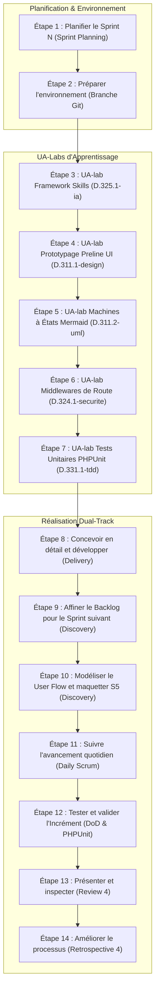

# Flux de Travail — Session S04 (Sprint 4 - 80h)

Ce document détaille le flux de travail opérationnel de la **Session S04 : Prototypage, Tests PHPUnit & Framework Skills** pour le projet de formation N3.

Il applique directement les étapes de la Phase 2 du [Flux de Travail Générique](../flux-travail-generique.md) en alternant l'acquisition des compétences dans les UA-labs et leur application immédiate sur le projet d'imitation.

---

## 1. Fiche d'Identification de la Session

- **Code de Session :** S04
- **Intitulé du Sprint :** Prototypage, Tests PHPUnit & Framework Skills
- **Durée Ferme (Timebox) :** 80 heures (10 jours ouvrés)
- **Positionnement :** Quatrième sprint de delivery applicatif Dual-Track

---

## 2. Objectif d'Apprentissage Global

Préparer la branche Git et actualiser la documentation projet ; normaliser l'architecture des compétences agentiques dans l'IDE avec Antigravity et GitHub Copilot selon un framework standardisé ; concevoir des maquettes interactives et prototypes d'interface cliquables validant l'ergonomie utilisateur avec **Preline UI** ; modéliser les machines à états finis en syntaxe déclarative Mermaid ; renforcer la sécurité applicative par des autorisations granulaires (**Policies/Gates** et middlewares de route) ; et automatiser sous **PHPUnit** la validation unitaire des classes de service métier (`ArticleServiceTest`) pour garantir la robustesse et la non-régression du code applicatif.

---

## 3. Prérequis Bloquants de Lancement

Pour démarrer la session :
- **Validation du Sprint 3 :** Création sécurisée d'articles et relations Eloquent validées par le Product Owner (Groupe 1), rétrospective S3 actant la nécessité de tests unitaires, et maquettes de S4 testées.
- **Rôles Opérationnels :** Product Owner porté par le Groupe 1, Scrum Master et Développeurs en alternance.

---

## 4. Cadre Tri-Projets et Organisation Temporelle (80h / 10 jours)

- **Jours 1 à 7 : Projet d'Imitation (*Blog des Lauréats*)**
  - Réalisation guidée pas-à-pas en classe active.
  - Alternance directe entre l'assimilation d'un UA-lab et l'exécution de l'étape de réalisation correspondante.
- **Jour 8 : Projet Technique (*Portfolio Développeur*)**
  - **Codage technique pur en totale autonomie**.
  - L'apprenant réalise uniquement le développement technique : écriture et exécution d'une suite de tests unitaires PHPUnit automatisés sur les classes de service de son portfolio personnel.
  - Aucune étape de planification ni de conception n'est demandée sur cette journée.
  - Épreuve sommative de **Live Coding (40 min chrono sans assistance — 65% de la note)**.
- **Jours 9 et 10 : Projet Fil Rouge (*Application Métier*, ex : Cinéma)**
  - **Création et enrichissement systématique de Skills agentiques** dans `.agent/skills/`.
  - L'apprenant conçoit des Skills réutilisables permettant à l'Agent IA d'automatiser la génération de tests unitaires PHPUnit et de maquettes Preline UI.
  - Clôture de session et bilan réflexif.

---

## 5. Épreuve de Live Coding (40 min chrono sans assistance — 65% de la note)

- **Contexte :** À partir du projet starter fourni (`dossier-depart/`), coder en 40 minutes une suite de tests unitaires automatisés validant la logique métier pure d'un service sous PHPUnit.
- **Consignes opérationnelles :**
  - Créer la classe de test unitaire `tests/Unit/ArticleServiceTest.php`.
  - Implémenter le test de calcul du temps de lecture estimé d'un article.
  - Implémenter le test de génération d'un slug textuel unique et sécurisé.
  - Implémenter le test de rejet et de levée d'une exception personnalisée lorsqu'un contenu obligatoire est absent.
  - Exécuter la suite de tests en ligne de commande et obtenir 100% de tests au vert.
- **Critères d'évaluation :** Isolation unitaire stricte (sans dépendance à la base de données), assertions PHPUnit adaptées, couverture des cas limites, code propre PSR-12.

---

## 6. Déroulement Chronologique Intercalé du Sprint 4

---

### Étape 1 : Planifier le Sprint N (Sprint Planning — Piste Delivery) (Étape Générique 15)
- **Entrées :** Product Backlog actualisé et retours de la Review 3.
- **Activités de réalisation :**
  - Définir le Sprint Goal S4 : "Sécuriser les routes d'édition par des middlewares d'autorisation et verrouiller la logique métier de service par une suite de tests unitaires PHPUnit".
  - Sélectionner les User Stories : "Filtrage d'accès par middleware propriétaire" et "Validation automatique de la logique de service par tests unitaires".
  - Décomposer les User Stories en tâches techniques élémentaires (1 à 4 heures).
  - Valider l'engagement d'équipe sur le Sprint Backlog S4.
- **Sortie principale :** Document du Sprint Backlog S4 ordonné (`scrum/sprint-backlog-s4.md`).

### Étape 2 : Préparer l'environnement de sprint (Branche Git et README.md) (Étape Générique 16)
- **Entrées :** Sprint Backlog S4 validé et branche `main`.
- **Activités de réalisation :**
  - Créer et basculer sur la branche Git du sprint : `git checkout -b sprint-4`.
  - Actualiser le fichier `README.md` avec le Sprint Goal S4, la composition d'équipe et les dates jalons.
- **Sortie principale :** Fichier `README.md` actualisé sur la branche `sprint-4`.

### Étape 3 : UA-lab : Normalisation d'un Framework de Skills dans l'IDE (Domaine D.325.1-ia)
- **Objectif d'apprentissage :** Standardiser l'architecture des compétences agentiques et auditer les permissions d'exécution dans l'IDE.
- **Notions de base à apprendre :**
  - Standard de métadonnées YAML de skills, arborescence normalisée (`scripts/`, `references/`).
  - Audit de conformité des permissions d'agent dans l'IDE.
  - Modularité et réutilisabilité inter-projets.
- **Sortie :** Guide de standardisation d'un framework de skills agentiques (`tutoriels/ia/guide-framework-skills.md`).

### Étape 4 : UA-lab : Prototypage interactif sous Preline UI (Domaine D.311.1-design)
- **Objectif d'apprentissage :** Concevoir des prototypes d'interface cliquables pour les écrans complexes d'édition et de modération.
- **Notions de base à apprendre :**
  - Principes d'affordance et de guidage visuel dans les formulaires d'édition.
  - Assemblage de composants modulaires complexes Preline UI (zones d'édition, sélecteurs d'état, modales de confirmation).
- **Sortie :** Dossier de prototypage interactif (`tutoriels/design/guide-prototypage-interactif.md`).

### Étape 5 : UA-lab : Modélisation des machines à états finis Mermaid (Domaine D.311.2-uml)
- **Objectif d'apprentissage :** Représenter les cycles de vie des entités métier en diagramme déclaratif Mermaid (un seul lab consolidant tout le domaine UML du sprint).
- **Notions de base à apprendre :**
  - Énumérations de statuts (Brouillon, Soumis, Publié, Archivé).
  - Transitions d'état valides et règles de transition invalidantes en Mermaid (`stateDiagram-v2`).
- **Sortie :** Guide de modélisation des machines à états finis en Mermaid (`tutoriels/uml/guide-machines-etats.md`).

### Étape 6 : UA-lab : Middlewares de route et filtrage d'accès (Domaine D.324.1-securite)
- **Objectif d'apprentissage :** Intercepter les flux de requêtes HTTP avant les contrôleurs applicatifs pour verrouiller les accès aux ressources.
- **Notions de base à apprendre :**
  - Création de middlewares Laravel (`php artisan make:middleware`).
  - Mécanisme d'interception de requête (`handle($request, Closure $next)`).
  - Filtrage d'accès propriétaire (seul l'auteur d'un article ou un administrateur peut accéder à la modification).
- **Sortie :** Guide des middlewares de sécurité et filtrage de requêtes (`tutoriels/securite/guide-middlewares.md`).

### Étape 7 : UA-lab : Tests unitaires isolés sous PHPUnit (Domaine D.331.1-tdd)
- **Objectif d'apprentissage :** Rédiger des suites de tests unitaires automatisés validant la logique métier pure avant le développement en production.
- **Notions de base à apprendre :**
  - Structure d'un test sous PHPUnit (`TestCase`, annotations, méthodes de test).
  - Assertions de référence (`assertEquals`, `assertTrue`, `assertFalse`, `expectException`).
  - Isolation unitaire stricte : tests sans base de données pour une exécution ultra-rapide.
  - Exécution CLI (`php artisan test --filter ArticleServiceTest`).
- **Sortie :** Guide de rédaction et d'exécution des tests unitaires sous PHPUnit (`tutoriels/tdd/guide-tests-unitaires.md`).

### Étape 8 : Concevoir en détail et développer (Piste Delivery) (Étape Générique 17)
- **Entrées :** Spécifications fonctionnelles, maquettes validées et compétences acquises dans les UA-labs.
- **Activités de réalisation :**
  - *Projet d'Imitation :* Coder le middleware `EnsureArticleBelongsToUser`, l'enregistrer dans `bootstrap/app.php`, verrouiller les routes d'édition dans `routes/web.php` et intégrer les états de publication dans la classe `ArticleService`.
  - *Projet Fil Rouge (Jours 9-10) :* Créer le Skill `.agent/skills/laravel-middleware-builder/` pour automatiser la génération de middlewares de protection de route.
- **Sortie principale :** Fichier de définition des routes sécurisées (`routes/web.php`).

### Étape 9 : Affiner le Backlog pour le Sprint suivant (Piste Discovery — ~10% temps) (Étape Générique 18)
- **Entrées :** Product Backlog et retours d'utilisation.
- **Activités de réalisation :**
  - Collaborer avec le Groupe 1 (Product Owner) pour clarifier les User Stories du Sprint 5 (Single Page Application avec Alpine.js et protocole de tests d'utilisabilité Peer Testing).
  - Définir les critères d'acceptation et estimer la complexité en Story Points.
- **Sortie principale :** Fiche de raffinement du backlog pour le Sprint 5 (`scrum/backlog-refinement-s5.md`).

### Étape 10 : Modéliser le User Flow et maquetter pour le Sprint suivant (Piste Discovery — ~10% temps) (Étape Générique 19)
- **Entrées :** User Stories raffinées pour le Sprint 5 et UI Kit Preline UI.
- **Activités de réalisation :**
  - Modéliser en syntaxe Mermaid le parcours de recherche et de filtrage instantané sans rechargement.
  - Concevoir les maquettes interactives de la SPA avec composants Preline UI.
- **Sortie principale :** Document regroupant le User Flow et les maquettes interactives du Sprint 5 (`docs/design/maquettes-sprint-5.md`).

### Étape 11 : Suivre l'avancement quotidien (Daily Scrum — Delivery & Discovery) (Étape Générique 20)
- **Entrées :** Tableau Kanban et tâches du Sprint 4.
- **Activités de réalisation :**
  - Animer la réunion quotidienne debout de 15 minutes.
  - Partager le travail réalisé sur les middlewares, les tests unitaires et le discovery.
  - Lever immédiatement les points de blocage.
- **Sortie principale :** Journal de suivi journalier des tâches (`issues/issues-sprint-4.md`).

### Étape 12 : Tester et valider l'Incrément (Piste Delivery — DoD & Tests automatisés) (Étape Générique 21)
- **Entrées :** Code source complet du Sprint 4, suite de tests PHPUnit et critères formels de la Definition of Done.
- **Activités de réalisation :**
  - Exécuter la suite complète de tests unitaires automatisés `ArticleServiceTest` et s'assurer d'un résultat à 100% au vert.
  - *Projet Technique (Codage pur - Jour 8) :* Coder la suite de tests unitaires sur son portfolio (Live Coding 40 min).
  - *Projet Fil Rouge (Jours 9-10) :* Créer le Skill `.agent/skills/phpunit-test-generator/` pour automatiser la génération de tests unitaires.
  - Contrôler le respect des 7 critères formels de la Definition of Done.
- **Sortie principale :** Rapport formel de validation de la Definition of Done et résultats des tests PHPUnit (`docs/qualite/rapport-dod-sprint-4.md`).

### Étape 13 : Présenter et inspecter (Sprint Review N — Double Validation Delivery & Discovery) (Étape Générique 22)
- **Entrées :** Incrément logiciel S4 opérationnel, rapport de tests PHPUnit et maquettes interactives du Sprint 5.
- **Activités de réalisation :**
  - Démontrer l'efficacité du middleware de sécurité et l'exécution verte des tests automatisés devant le Product Owner (Groupe 1).
  - Valider formellement la fin des User Stories de S4.
  - Faire tester les maquettes de SPA du Sprint 5 aux utilisateurs cibles.
- **Sortie principale :** Procès-verbal de la Review 4 (`sprints/pv-review-4.md`).

### Étape 14 : Améliorer le processus (Sprint Retrospective N — Amélioration continue) (Étape Générique 23)
- **Entrées :** Déroulement et retours de la Review 4.
- **Activités de réalisation :**
  - Analyser le déroulement du Sprint 4 en équipe.
  - Constater le choc réflexif d'avoir des tests unitaires de code sans mesurer l'expérience ergonomique des utilisateurs finaux (besoin d'un protocole rigoureux de tests d'utilisabilité vers S05).
  - Définir 2 actions d'amélioration concrètes pour le Sprint 5.
- **Sortie principale :** Bilan rétrospectif du Sprint 4 constatant la nécessité de tests utilisateurs protocolés (`scrum/retrospective-s4.md`).
