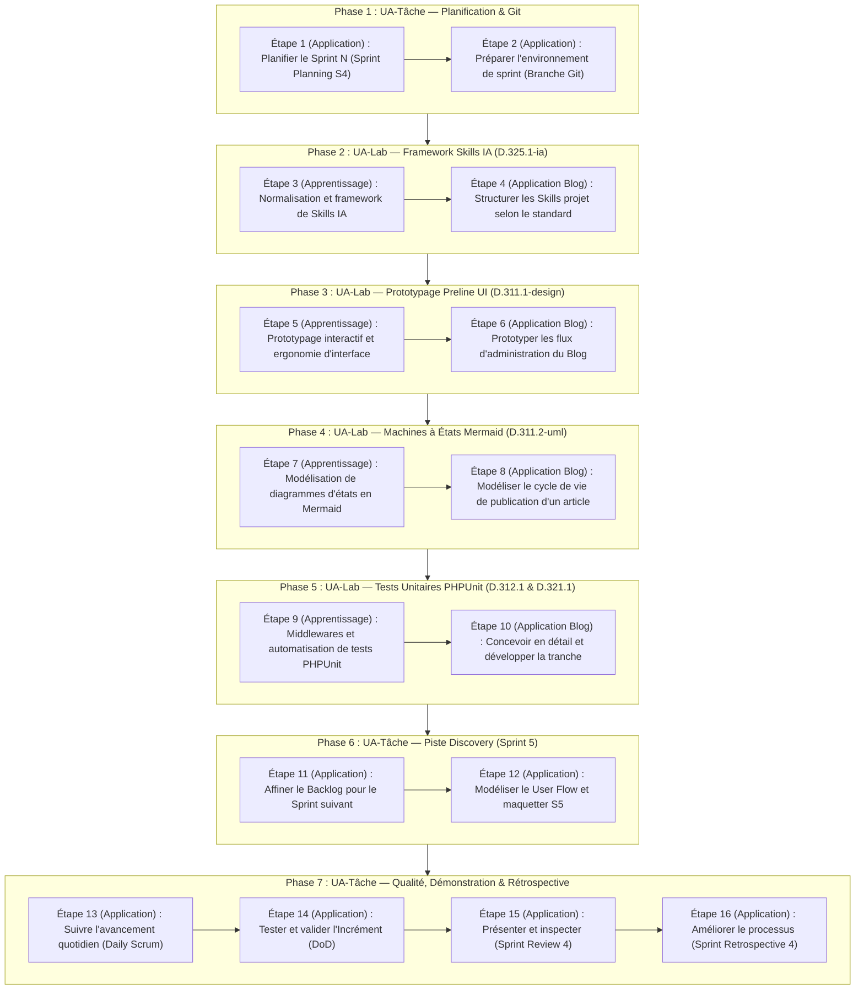

# Flux de Travail Opérationnel — Session S04 : Prototypage, Tests PHPUnit & Framework Skills

Ce document définit le flux de travail de la **Session S04** (Sprint 4 - 80 heures / 10 jours ouvrés).
Il est structuré en **7 phases typées** alternant les unités d'apprentissage (**UA-Lab**) avec leurs applications immédiates sur le projet d'imitation, et les phases opérationnelles d'ingénierie (**UA-Tâche**).

---

## 1. Fiche d'Identification de la Session S04

- **Identifiant :** Session S04 (Sprint 4)
- **Titre :** Prototypage, Tests PHPUnit & Framework Skills
- **Durée totale ferme :** 80 heures (10 jours ouvrés)
- **Positionnement :** Quatrième sprint de delivery applicatif Dual-Track
- **Domaines de compétences mobilisés :**
  - Normalisation et framework de Skills IA (`D.325.1-ia`)
  - Prototypage rapide et ergonomie utilisateur Preline UI (`D.311.1-design`)
  - Modélisation de machines à états finis en Mermaid (`D.311.2-uml`)
  - Middlewares et sécurité granulaire des routes (`D.312.1-architecture`)
  - Automatisation des tests unitaires sous PHPUnit (`D.321.1-laravel`)
- **Objectif global d'apprentissage :**
  - Préparer la branche Git `sprint-4` et actualiser la documentation projet.
  - Normaliser l'architecture des compétences agentiques selon le format compact standard.
  - Concevoir des maquettes interactives et prototypes validant l'expérience utilisateur sous **Preline UI**.
  - Modéliser les cycles de vie des articles (états de publication) en diagramme d'états déclaratif Mermaid.
  - Sécuriser les accès d'administration par middlewares et autorisations granulaires.
  - Automatiser sous **PHPUnit** la validation unitaire des classes de service métier (`ArticleServiceTest`) pour garantir la non-régression applicative.
  - Préparer la piste Discovery du Sprint 5 et clôturer le sprint par la démonstration et la rétrospective agile.

---

## 2. Organisation dans le Cadre Tri-Projets (80h / 10 jours)

- **Jours 1 à 7 : Projet d'Imitation (*Blog des Lauréats*)**
  - Réalisation guidée pas-à-pas de la suite de tests unitaires PHPUnit et du cycle de vie des articles.
  - Alternance immédiate : chaque atelier théorique est mis en œuvre sur le Blog.
- **Jour 8 : Projet Technique (*Portfolio Développeur*)**
  - **Codage technique pur en totale autonomie (sans conception ni planification)**.
  - L'apprenant écrit et exécute une suite complète de tests PHPUnit sur les classes de service de son portfolio personnel.
  - **Épreuve sommative de Live Coding (40 min chrono sans assistance — 65% de la note finale du module)**.
- **Jours 9 et 10 : Projet Fil Rouge (*Application Métier*, ex : Gestion de Cinéma)**
  - Création du Skill agentique `.agent/skills/phpunit-test-generator/` pour automatiser la génération de tests unitaires et de fixtures.
  - Bilan réflexif et consolidation des acquis.

---

## 3. Épreuve de Live Coding (40 min chrono sans assistance — 65% de la note)

- **Contexte :** À partir du projet starter fourni (`dossier-depart/`), écrire en 40 minutes la classe de tests unitaire `ProjectServiceTest` validant l'ensemble des méthodes métier avec isolation des données.
- **Consignes opérationnelles :**
  - Créer le fichier de test unitaire dans `tests/Unit/Services/ProjectServiceTest.php`.
  - Écrire 3 cas de test indépendants : cas nominal, cas de filtrage sans résultat, et cas d'erreur attendue avec assertion d'exception.
  - Exécuter la suite avec `php artisan test --filter ProjectServiceTest` et obtenir 100% de passage au vert.
- **Critères d'évaluation :** Utilisation propre des assertions PHPUnit, isolation par transactions ou mocks, couverture des cas limites, code de test lisible.

---

## 4. Déroulement des 7 Phases de la Session S04

---

### Phase 1 : UA-Tâche — Planification du Sprint 4 et Préparation de l'Environnement Git
*Cette phase ne contient pas de nouvel apport conceptuel. Elle regroupe les activités opérationnelles de lancement.*

- **Étape 1 (Application) : Planifier le Sprint N (Sprint Planning — Piste Delivery)**
  - Entrées : Product Backlog actualisé, retours de la Review 3 et actions de la Rétrospective S3.
  - Travail d'application sur le Blog : Définir le Sprint Goal S4 ("Sécuriser le cycle de vie des articles par middlewares et automatiser la suite de tests unitaires PHPUnit garantissant la non-régression"), décomposer les tâches et valider le Sprint Backlog S4.
  - Sortie (1 seul livrable) : `scrum/sprint-backlog-s4.md`.
- **Étape 2 (Application) : Préparer l'environnement de sprint (Branche Git et README.md)**
  - Entrées : Sprint Backlog S4 validé et branche `main`.
  - Travail d'application sur le Blog : Créer la branche Git `sprint-4` et actualiser la notice `README.md`.
  - Sortie (1 seul livrable) : `README.md`.

---

### Phase 2 : UA-Lab — Normalisation et Framework de Skills IA (Domaine D.325.1-ia)
*Cette phase introduit la normalisation des compétences agentiques. Elle comprend l'étape d'apprentissage conceptuel suivie de la mise en conformité des compétences projet.*

- **Étape 3 (Apprentissage) : Normalisation et framework de Skills IA**
  - Entrées : Spécifications des Skills Antigravity.
  - Notions de base à apprendre :
    - Structure canonique d'un skill ($\le 75$ lignes, frontmatter, mission, déclencheurs, missions).
    - Modularité et séparation claire entre instructions génériques et missions opérationnelles.
    - Évaluation de performance et tests de non-régression des skills.
  - Sortie de l'atelier d'apprentissage (1 seul livrable) : `tutoriels/ia/guide-framework-skills.md`.
- **Étape 4 (Application sur le Blog) : Structurer les Skills projet selon le standard**
  - Entrées : Guide du framework Skills et compétences du Blog.
  - Travail d'application sur le Blog : Auditer et normaliser les compétences agentiques créées pour le projet d'imitation selon le format canonique.
  - Sortie (1 seul livrable) : `docs/ia/audit-skills-projet.md`.

---

### Phase 3 : UA-Lab — Prototypage Rapide et Ergonomie Preline UI (Domaine D.311.1-design)
*Cette phase introduit les techniques de prototypage d'interface. Elle s'organise en une étape d'apprentissage théorique suivie du prototypage sur le Blog.*

- **Étape 5 (Apprentissage) : Prototypage interactif et ergonomie d'interface**
  - Entrées : Composants de formulaires et modales Preline UI.
  - Notions de base à apprendre :
    - Principes d'utilisabilité : clarté des statuts système, prévention des erreurs, guidage visuel.
    - Prototypage interactif : modales de confirmation, tiroirs coulissants (*drawers*) et alertes contextuelles.
    - Évaluation heuristique d'interface selon les critères de Bastien et Scapin.
  - Sortie de l'atelier d'apprentissage (1 seul livrable) : `tutoriels/design/guide-prototypage-preline.md`.
- **Étape 6 (Application sur le Blog) : Prototyper les flux d'administration du Blog**
  - Entrées : User Stories d'administration et UI Kit Preline UI.
  - Travail d'application sur le Blog : Prototyper les flux de modération et de publication d'articles avec les composants interactifs Preline UI.
  - Sortie (1 seul livrable) : `docs/design/prototypes-administration.md`.

---

### Phase 4 : UA-Lab — Modélisation de Machines à États Finis en Mermaid (Domaine D.311.2-uml)
*Cette phase introduit la modélisation dynamique des états. Elle s'organise en une étape d'apprentissage théorique suivie de la modélisation des états d'articles sur le Blog.*

- **Étape 7 (Apprentissage) : Modélisation de diagrammes d'états en syntaxe Mermaid**
  - Entrées : Guide de syntaxe Mermaid `stateDiagram-v2`.
  - Notions de base à apprendre :
    - Concepts d'état initial, état intermédiaire, état final et transitions déclenchées par un événement.
    - Gardes de transition et conditions logiques d'invalidation.
    - Syntaxe Mermaid `stateDiagram-v2` pour formaliser les changements de statuts.
  - Sortie de l'atelier d'apprentissage (1 seul livrable) : `tutoriels/uml/guide-diagramme-etats.md`.
- **Étape 8 (Application sur le Blog) : Modéliser le cycle de vie de publication d'un article**
  - Entrées : Règles métiers du Blog et guide Mermaid.
  - Travail d'application sur le Blog : Modéliser le diagramme d'états complet d'un article : `Brouillon` $\to$ `EnRelecture` $\to$ `Publie` $\to$ `Archive`.
  - Sortie (1 seul livrable) : `docs/analyse/cycle-vie-articles.mmd`.

---

### Phase 5 : UA-Lab — Tests Unitaires Automatisés sous PHPUnit (Domaines D.312.1-architecture & D.321.1-laravel)
*Cette phase introduit l'automatisation des tests sous Laravel 13. Elle s'organise en une étape d'apprentissage technique suivie de la réalisation complète sur le Blog, le portfolio et le projet fil rouge.*

- **Étape 9 (Apprentissage) : Middlewares et automatisation de tests sous PHPUnit**
  - Entrées : Framework PHPUnit et environnement Laravel 13.
  - Notions de base à apprendre :
    - Configuration de `phpunit.xml` et environnement de test en mémoire.
    - Écriture de tests unitaires purs sur les classes Service avec mocks et stubs.
    - Assertions PHPUnit indispensables : `assertEquals`, `assertTrue`, `assertCount`, `expectException`.
    - Création et rattachement de middlewares HTTP personnalisés pour contrôler les statuts d'articles.
  - Sortie de l'atelier d'apprentissage (1 seul livrable) : `tutoriels/laravel/guide-phpunit-services.md`.
- **Étape 10 (Application sur le Blog) : Concevoir en détail et développer (Piste Delivery)**
  - Entrées : Spécifications, diagramme d'états et compétences PHPUnit acquises.
  - Travail d'application sur le Blog :
    - *Projet d'Imitation :* Coder la suite de tests unitaires `ArticleServiceTest` couvrant 100% des méthodes de consultation, filtrage et transition d'états, et implémenter le middleware de contrôle des articles publiés.
    - *Projet Technique (Codage pur - Jour 8) :* Coder et exécuter la suite de tests unitaires `ProjectServiceTest` sur son portfolio (Épreuve de Live Coding de 40 min).
    - *Projet Fil Rouge (Jours 9-10) :* Créer le Skill `.agent/skills/phpunit-test-generator/` pour automatiser la génération de tests unitaires.
  - Sortie (1 seul livrable) : `tests/Unit/Services/ArticleServiceTest.php`.

---

### Phase 6 : UA-Tâche — Piste Discovery : Affinement du Backlog et Maquettage du Sprint 5
*Cette phase opérationnelle prépare le cycle suivant sans théorie supplémentaire.*

- **Étape 11 (Application) : Affiner le Backlog pour le Sprint suivant (Piste Discovery)**
  - Entrées : Product Backlog et retours d'utilisation.
  - Travail d'application : Collaborer avec le Product Owner pour clarifier les User Stories du Sprint 5 (Single Page Application réactive sous Alpine.js et tests d'utilisabilité SUS).
  - Sortie (1 seul livrable) : `scrum/backlog-refinement-s5.md`.
- **Étape 12 (Application) : Modéliser le User Flow et maquetter pour le Sprint suivant (Piste Discovery)**
  - Entrées : User Stories S5 et UI Kit Preline UI.
  - Travail d'application : Modéliser le parcours SPA sans rechargement et prototyper les maquettes interactives associées.
  - Sortie (1 seul livrable) : `docs/design/maquettes-sprint-5.md`.

---

### Phase 7 : UA-Tâche — Clôture du Sprint 4, Démonstration, Tests DoD et Rétrospective
*Cette phase opérationnelle rassemble les rituels de clôture et l'amélioration continue.*

- **Étape 13 (Application) : Suivre l'avancement quotidien (Daily Scrum — Delivery & Discovery)**
  - Entrées : Tableau Kanban du Sprint 4.
  - Travail d'application : Animer la réunion quotidienne debout de 15 minutes et synchroniser l'équipe.
  - Sortie (1 seul livrable) : `issues/issues-sprint-4.md`.
- **Étape 14 (Application) : Tester et valider l'Incrément (Piste Delivery — DoD)**
  - Entrées : Code source complet et rapport d'exécution des tests PHPUnit.
  - Travail d'application : Exécuter la checklist de validation (100% des tests PHPUnit au vert, transitions d'états conformes, zéro régression).
  - Sortie (1 seul livrable) : `docs/qualite/rapport-dod-sprint-4.md`.
- **Étape 15 (Application) : Présenter et inspecter (Sprint Review N — Double Validation Delivery & Discovery)**
  - Entrées : Incrément logiciel S4 et maquettes du Sprint 5.
  - Travail d'application : Démontrer l'exécution des tests unitaires et la solidité des transitions d'états devant le Product Owner, et faire tester les maquettes de S5.
  - Sortie (1 seul livrable) : `sprints/pv-review-4.md`.
- **Étape 16 (Application) : Améliorer le processus (Sprint Retrospective N — Amélioration continue)**
  - Entrées : Déroulement de la Review 4 et vécu d'équipe.
  - Travail d'application : Conduire l'analyse réflexive d'équipe, acter l'apport déterminant des tests automatisés, et planifier l'intégration d'Alpine.js pour S5.
  - Sortie (1 seul livrable) : `scrum/retrospective-s4.md`.
