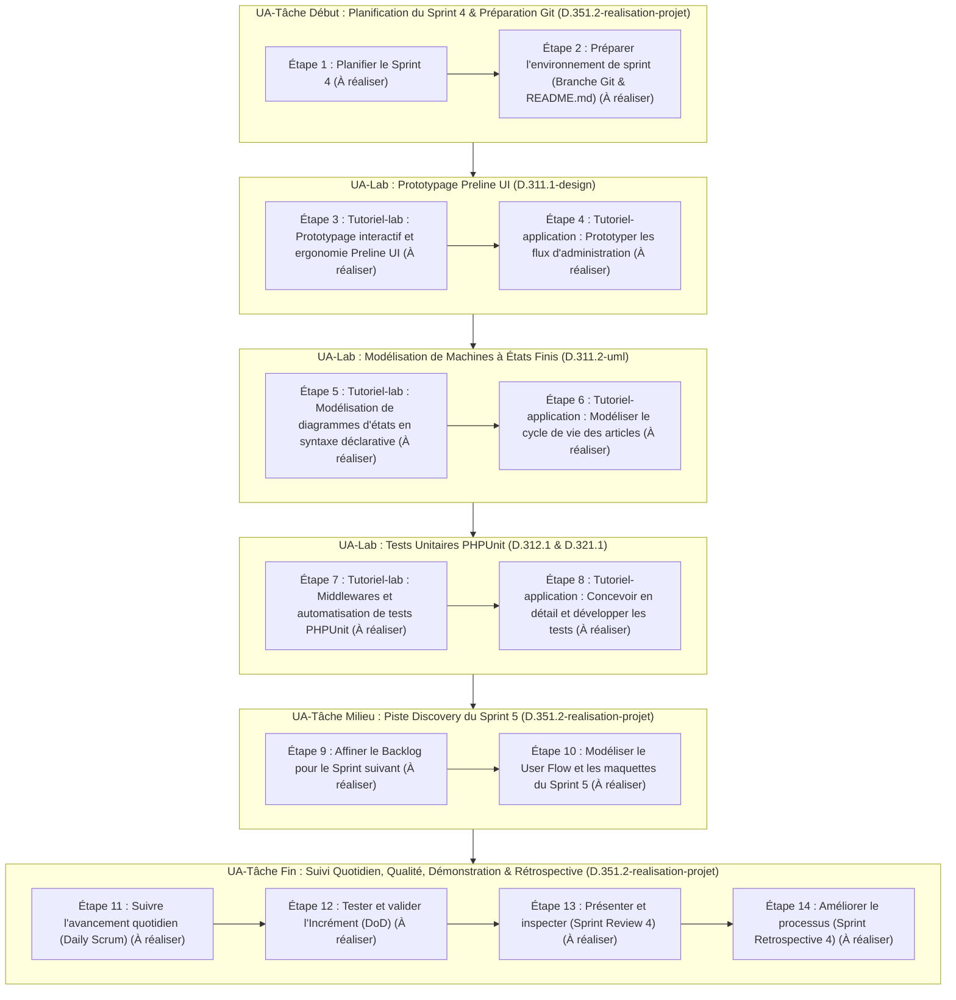

# Flux de Travail Opérationnel — Session S4 : Cycle de Vie Éditorial des Articles et Suite de Tests Unitaires

Ce document définit le flux de travail opérationnel de la **Session S4** (Sprint 4) pour le niveau N3.
Il est centré sur la production de son incrément majeur : le **Cycle de Vie Éditorial des Articles et la Suite de Tests Unitaires** du Blog des Lauréats.

Le flux sépare de manière étanche les Unités d'Apprentissage d'ateliers pratiques (**UA-Lab**) et les Unités d'Apprentissage d'application opérationnelle sur le projet (**UA-Tâche**), totalisant **6 UAs** et **14 étapes de travail**.

Les durées temporelles (80 heures / 10 jours) sont fournies à titre purement indicatif pour les formateurs et le concepteur.

---

## 1. Fiche d'Identification de la Session S4

- **Identifiant :** Session S4 (Sprint 4)
- **Titre centré sur l'incrément :** Cycle de Vie Éditorial des Articles et Suite de Tests Unitaires
- **Incrément produit :** Workflow complet de publication des articles (Brouillon, En révision, Publié, Archivé) régi par une machine à états finis, sécurisé par Middlewares HTTP et couvert par une suite de tests unitaires automatisés sous PHPUnit
- **Durée indicative :** 80 heures (10 jours ouvrés)
- **Positionnement :** Quatrième sprint de delivery applicatif Dual-Track
- **Référentiel des compétences :** Conforme au document de référence [.agents/references/domaines-competences.md](../../.agents/references/domaines-competences.md)
- **Domaines de compétences et Unités d'Apprentissage mobilisés :**
  - Domaine Conception & Design Thinking (`D.311.1-design`) :
    - Unité d'apprentissage (UA-Lab) : *Prototypage rapide et ergonomie des formulaires Preline UI* (Statut : **À réaliser**)
  - Domaine Modélisation UML & Conception Technique (`D.311.2-uml`) :
    - Unité d'apprentissage (UA-Lab) : *Modélisation des machines à états finis* (Statut : **À réaliser**)
  - Domaine Architecture (`D.312.1-architecture`) & Backend Laravel (`D.321.1-laravel`) :
    - Unité d'apprentissage (UA-Lab) : *Middlewares HTTP et automatisation de tests unitaires sous PHPUnit* (Statut : **À réaliser**)
  - Domaine Réalisation et Conduite de Projet (`D.351.2-realisation-projet`) :
    - Unité d'apprentissage 1 (UA-Tâche) : *Planification du Sprint 4 et Préparation Git* (Statut : **À réaliser**)
    - Unité d'apprentissage 2 (UA-Tâche) : *Piste Discovery : Affinement du Backlog et Maquettage du Sprint 5* (Statut : **À réaliser**)
    - Unité d'apprentissage 3 (UA-Tâche) : *Suivi Quotidien, Qualité DoD, Démonstration et Rétrospective* (Statut : **À réaliser**)
- **Objectif global d'apprentissage :**
  - Préparer la branche Git `sprint-4` et actualiser la documentation projet.
  - Concevoir des maquettes interactives et prototypes validant l'expérience utilisateur sous **Preline UI**.
  - Modéliser les cycles de vie des articles (états de publication) en diagramme d'états déclaratif textuel.
  - Sécuriser les accès d'administration par middlewares et autorisations granulaires.
  - Automatiser sous **PHPUnit** la validation unitaire des classes de service métier (`ArticleServiceTest`) pour garantir la non-régression applicative.
  - Préparer la piste Discovery du Sprint 5 et clôturer le sprint par la démonstration et la rétrospective agile.

---

## 2. Organisation dans le Cadre Tri-Projets

- **Rôles Scrum & Autonomie :** Chaque apprenant endosse le rôle de Product Owner pour son propre projet et pilote son backlog en autonomie.
- **Jours 1 à 7 : Projet d'Imitation (*Blog des Lauréats*)**
  - Réalisation guidée pas-à-pas de la suite de tests unitaires PHPUnit et du cycle de vie des articles.
  - Alternance immédiate : chaque atelier théorique est mis en œuvre sur le Blog.
- **Jour 8 : Projet Technique (*Portfolio Développeur*)**
  - **Épreuve sommative de Live Coding (40 min chrono sans assistance — 65% de la note finale du module)** : L'apprenant écrit et exécute une suite complète de tests PHPUnit sur les classes de service de son portfolio personnel.
  - **Règle formelle d'exigence :** Les documents de cadrage et de conception préalable ne sont pas demandés pour le portfolio dans la session.
- **Jours 9 et 10 : Projet Fil Rouge (*Application Métier*, ex : Gestion de Cinéma)**
  - Développement de la suite de tests unitaires et mise en place des middlewares de filtrage sur l'application fil rouge (développement logiciel métier pur, sans agents IA ni ingénierie de prompt).
  - Bilan réflexif et consolidation des acquis.

---

## 3. Épreuve de Live Coding (40 min chrono sans assistance — 65% de la note)

- **Contexte :** À partir du projet starter fourni (`dossier-depart/`), écrire en 40 minutes la classe de tests unitaire `ProjectServiceTest` validant l'ensemble des méthodes métier avec isolation des données.
- **Consignes opérationnelles :**
  - Créer le fichier de test unitaire dans `src/tests/Unit/Services/ProjectServiceTest.php`.
  - Écrire 3 cas de test indépendants : cas nominal, cas de filtrage sans résultat, et cas d'erreur attendue avec assertion d'exception.
  - Exécuter la suite avec `php artisan test --filter ProjectServiceTest` et obtenir 100% de passage au vert.
- **Critères d'évaluation :** Utilisation propre des assertions PHPUnit, isolation par transactions ou mocks, couverture des cas limites, code de test lisible.

---

## 4. Déroulement Opérationnel des 6 Unités d'Apprentissage du Sprint 4

---

### Unité d'Apprentissage (UA-Tâche) : Planification du Sprint 4 et Préparation Git (Domaine D.351.2-realisation-projet)
*Bloc opérationnel d'initialisation de l'itération sans nouvel apport conceptuel.*

- **Étape 1 : Planifier le Sprint 4**
  - Statut : **À réaliser**
  - Domaine de compétence : `D.351.2-realisation-projet`.
  - Correspondance flux générique : Étape Générique 15 (Planifier le Sprint N).
  - Entrées : Product Backlog actualisé, retours de la Review 3 et actions de la Rétrospective S3.
  - Travail d'application sur le Blog : Chaque apprenant endosse le rôle de Product Owner pour son projet, définit le Sprint Goal S4 ("Sécuriser le cycle de vie des articles par middlewares et automatiser la suite de tests unitaires PHPUnit garantissant la non-régression"), décompose les tâches et valide le Sprint Backlog S4.
  - Sortie (1 seul livrable) : `sprints/sprint-4.md`.
- **Étape 2 : Préparer l'environnement de sprint (Branche Git et README.md)**
  - Statut : **À réaliser**
  - Domaine de compétence : `D.351.2-realisation-projet`.
  - Correspondance flux générique : Étape Générique 16 (Préparer l'environnement de sprint).
  - Entrées : Sprint Backlog S4 validé et branche `main`.
  - Travail d'application sur le Blog : Créer la branche Git `sprint-4` et actualiser la notice `README.md`.
  - Sortie (1 seul livrable) : `README.md`.

---

### Unité d'Apprentissage (UA-Lab) : Prototypage Rapide et Ergonomie Preline UI (Domaine D.311.1-design)
*Atelier d'apprentissage pratique des techniques de prototypage d'interface avec alternance directe.*

- **Étape 3 : Tutoriel-lab : Prototypage interactif et ergonomie d'interface avec Preline UI**
  - Statut : **À réaliser**
  - Unité d'apprentissage : *Prototypage rapide et ergonomie des formulaires Preline UI*.
  - Entrées : Composants de formulaires et modales Preline UI.
  - Notions de base à apprendre :
    - Principes d'utilisabilité : clarté des statuts système, prévention des erreurs, guidage visuel.
    - Prototypage interactif : modales de confirmation, tiroirs coulissants (*drawers*) et alertes contextuelles.
    - Évaluation heuristique d'interface selon les critères de Bastien et Scapin.
  - Sorties de l'atelier d'apprentissage (2 livrables) :
    - Guide explicatif détaillé : `tutoriels/design/prototypage/prototypage-preline/prototypage-preline.md`.
    - Support de présentation au format Marp Markdown : `tutoriels/design/prototypage/prototypage-preline/presentation-prototypage-preline.md`.
- **Étape 4 : Tutoriel-application : Prototyper les flux d'administration du Blog**
  - Statut : **À réaliser**
  - Unité d'apprentissage : *Prototypage rapide et ergonomie des formulaires Preline UI*.
  - Entrées : User Stories d'administration et UI Kit Preline UI.
  - Travail d'application sur le Blog : Prototyper les flux de modération et de publication d'articles avec les composants interactifs Preline UI.
  - Sortie (1 seul livrable) : `docs/conception/prototypes-administration.md`.

---

### Unité d'Apprentissage (UA-Lab) : Modélisation de Machines à États Finis (Domaine D.311.2-uml)
*Atelier d'apprentissage pratique de la modélisation dynamique des états avec alternance directe.*

- **Étape 5 : Tutoriel-lab : Modélisation de diagrammes d'états en syntaxe déclarative**
  - Statut : **À réaliser**
  - Unité d'apprentissage : *Modélisation des machines à états finis*.
  - Entrées : Guide de modélisation d'états finis déclarative.
  - Notions de base à apprendre :
    - Concepts d'état initial, état intermédiaire, état final et transitions déclenchées par un événement.
    - Gardes de transition et conditions logiques d'invalidation.
    - Syntaxe déclarative pour formaliser les changements de statuts.
  - Sorties de l'atelier d'apprentissage (2 livrables) :
    - Guide explicatif détaillé : `tutoriels/uml/machines-etats/machines-etats-mermaid/machines-etats-mermaid.md`.
    - Support de présentation au format Marp Markdown : `tutoriels/uml/machines-etats/machines-etats-mermaid/presentation-machines-etats-mermaid.md`.
- **Étape 6 : Tutoriel-application : Modéliser le cycle de vie de publication d'un article**
  - Statut : **À réaliser**
  - Unité d'apprentissage : *Modélisation des machines à états finis*.
  - Entrées : Règles métiers du Blog et guide de modélisation.
  - Travail d'application sur le Blog : Modéliser le diagramme d'états complet d'un article : `Brouillon` $\to$ `EnRelecture` $\to$ `Publie` $\to$ `Archive`.
  - Sortie (1 seul livrable) : `docs/analyse/cycle-vie-articles.mmd`.

---

### Unité d'Apprentissage (UA-Lab) : Tests Unitaires Automatisés sous PHPUnit (Domaines D.312.1-architecture & D.321.1-laravel)
*Atelier d'apprentissage pratique de l'automatisation des tests sous Laravel 13.*

- **Étape 7 : Tutoriel-lab : Middlewares HTTP et automatisation de tests PHPUnit**
  - Statut : **À réaliser**
  - Unité d'apprentissage : *Middlewares HTTP et automatisation de tests unitaires sous PHPUnit*.
  - Entrées : Framework PHPUnit et environnement Laravel 13.
  - Notions de base à apprendre :
    - Configuration de `phpunit.xml` et environnement de test en mémoire.
    - Écriture de tests unitaires purs sur les classes Service avec mocks et stubs.
    - Assertions PHPUnit indispensables : `assertEquals`, `assertTrue`, `assertCount`, `expectException`.
    - Création et rattachement de middlewares HTTP personnalisés pour contrôler les statuts d'articles.
  - Sorties de l'atelier d'apprentissage (2 livrables) :
    - Guide explicatif détaillé : `tutoriels/laravel/middlewares-tests/middlewares-tests-phpunit/middlewares-tests-phpunit.md`.
    - Support de présentation au format Marp Markdown : `tutoriels/laravel/middlewares-tests/middlewares-tests-phpunit/presentation-middlewares-tests-phpunit.md`.
- **Étape 8 : Tutoriel-application : Concevoir en détail et développer les tests unitaires et le middleware**
  - Statut : **À réaliser**
  - Domaine de compétence : `D.321.1-laravel`.
  - Correspondance flux générique : Étape Générique 17 (Concevoir en détail et développer).
  - Entrées : Spécifications, diagramme d'états et compétences PHPUnit acquises.
  - Travail d'application sur le Blog :
    - *Projet d'Imitation :* Coder la suite de tests unitaires `ArticleServiceTest` couvrant 100% des méthodes de consultation, filtrage et transition d'états, et implémenter le middleware de contrôle des articles publiés.
    - *Projet Technique (Jour 8) :* Coder et exécuter la suite de tests unitaires `ProjectServiceTest` sur son portfolio (Épreuve de Live Coding de 40 min).
    - *Projet Fil Rouge (Jours 9-10) :* Développer la suite de tests unitaires automatisés et middlewares sur l'application fil rouge.
  - Sortie (1 seul livrable) : `src/tests/Unit/Services/ArticleServiceTest.php`.

---

### Unité d'Apprentissage (UA-Tâche) : Piste Discovery : Affinement du Backlog et Maquettage du Sprint 5 (Domaine D.351.2-realisation-projet)
*Bloc d'ingénierie opérationnelle mené en temps masqué pour préparer le sprint suivant.*

- **Étape 9 : Affiner le Backlog pour le Sprint suivant**
  - Statut : **À réaliser**
  - Domaine de compétence : `D.351.2-realisation-projet`.
  - Correspondance flux générique : Étape Générique 18 (Affiner le Backlog pour le Sprint suivant).
  - Entrées : Product Backlog et retours d'utilisation.
  - Travail d'application : Chaque apprenant, dans sa posture de Product Owner, clarifie les User Stories du Sprint 5 (Single Page Application réactive sous Alpine.js et tests d'utilisabilité SUS).
  - Sortie (1 seul livrable) : `scrum/backlog-refinement-s5.md`.
- **Étape 10 : Modéliser le User Flow et les maquettes du Sprint 5**
  - Statut : **À réaliser**
  - Domaine de compétence : `D.351.2-realisation-projet`.
  - Correspondance flux générique : Étape Générique 19 (Modéliser le User Flow et maquetter pour le Sprint suivant).
  - Entrées : User Stories S5 et UI Kit Preline UI.
  - Travail d'application : Modéliser le parcours SPA sans rechargement et prototyper les maquettes interactives associées.
  - Sortie (1 seul livrable) : `docs/conception/maquettes-sprint-5.md`.

---

### Unité d'Apprentissage (UA-Tâche) : Suivi Quotidien, Qualité DoD, Démonstration et Rétrospective (Domaine D.351.2-realisation-projet)
*Rituels opérationnels de clôture et amélioration continue.*

- **Étape 11 : Suivre l'avancement quotidien (Daily Scrum)**
  - Statut : **À réaliser**
  - Domaine de compétence : `D.351.2-realisation-projet`.
  - Correspondance flux générique : Étape Générique 20 (Suivre l'avancement quotidien).
  - Entrées : Tableau Kanban du Sprint 4.
  - Travail d'application : Animer la réunion quotidienne debout de 15 minutes et synchroniser l'équipe.
  - Sortie (1 seul livrable) : Mise à jour du suivi des tâches dans `sprints/sprint-4.md`.
- **Étape 12 : Tester et valider l'Incrément (DoD)**
  - Statut : **À réaliser**
  - Domaine de compétence : `D.351.2-realisation-projet`.
  - Correspondance flux générique : Étape Générique 21 (Tester et valider l'Incrément).
  - Entrées : Code source complet et rapport d'exécution des tests PHPUnit.
  - Travail d'application : Exécuter la checklist de validation (100% des tests PHPUnit au vert, transitions d'états conformes, zéro régression).
  - Sortie (1 seul livrable) : `docs/qualite/rapport-dod-sprint-4.md`.
- **Étape 13 : Présenter et inspecter (Sprint Review 4)**
  - Statut : **À réaliser**
  - Domaine de compétence : `D.351.2-realisation-projet`.
  - Correspondance flux générique : Étape Générique 22 (Présenter et inspecter).
  - Entrées : Incrément logiciel S4 et maquettes du Sprint 5.
  - Travail d'application : Chaque apprenant anime la démonstration de son Incrément 4 en posture de Product Owner, valide la DoD et fait tester les maquettes de S5.
  - Sortie (1 seul livrable) : `sprints/pv-review-4.md`.
- **Étape 14 : Améliorer le processus (Sprint Retrospective 4)**
  - Statut : **À réaliser**
  - Domaine de compétence : `D.351.2-realisation-projet`.
  - Correspondance flux générique : Étape Générique 23 (Améliorer le processus).
  - Entrées : Déroulement de la Review 4 et vécu d'équipe.
  - Travail d'application : Conduire l'analyse réflexive d'équipe, acter l'apport déterminant des tests automatisés, et planifier l'intégration d'Alpine.js pour S5.
  - Sortie (1 seul livrable) : `sprints/retrospective-4.md`.
