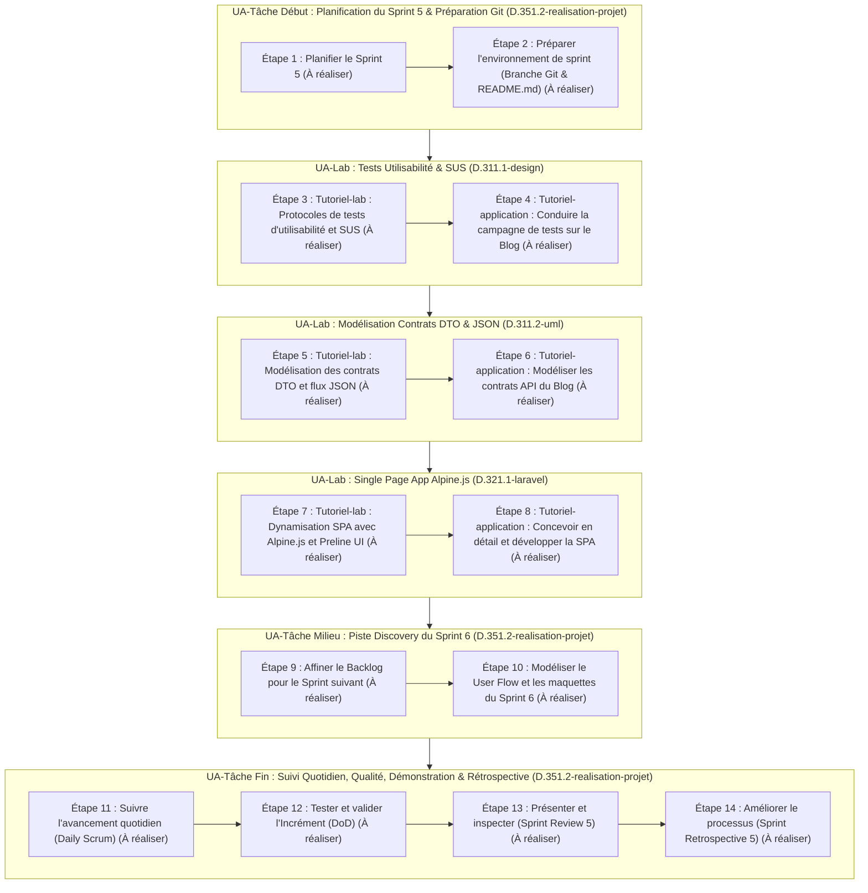

# Flux de Travail Opérationnel — Session S5 : Single Page Application Réactive et API REST des Articles

Ce document définit le flux de travail opérationnel de la **Session S5** (Sprint 5) pour le niveau N3.
Il est centré sur la production de son incrément majeur : la **Single Page Application Réactive et l'API REST des Articles** du Blog des Lauréats.

Le flux sépare de manière étanche les Unités d'Apprentissage d'ateliers pratiques (**UA-Lab**) et les Unités d'Apprentissage d'application opérationnelle sur le projet (**UA-Tâche**), totalisant **6 UAs** et **14 étapes de travail**.

Les durées temporelles (80 heures / 10 jours) sont fournies à titre purement indicatif pour les formateurs et le concepteur.

---

## 1. Fiche d'Identification de la Session S5

- **Identifiant :** Session S5 (Sprint 5)
- **Titre centré sur l'incrément :** Single Page Application Réactive et API REST des Articles
- **Incrément produit :** Interface Single Page Application réactive avec Alpine.js et Preline UI consommant les endpoints JSON de l'API REST du Blog, validée par un protocole de tests d'utilisabilité par les pairs avec calcul du score SUS
- **Durée indicative :** 80 heures (10 jours ouvrés)
- **Positionnement :** Cinquième sprint de delivery applicatif Dual-Track
- **Référentiel des compétences :** Conforme au document de référence [.agents/references/domaines-competences.md](../../.agents/references/domaines-competences.md)
- **Domaines de compétences et Unités d'Apprentissage mobilisés :**
  - Domaine Conception & Design Thinking (`D.311.1-design`) :
    - Unité d'apprentissage (UA-Lab) : *Protocoles de tests d'utilisabilité et score SUS* (Statut : **À réaliser**)
  - Domaine Modélisation UML & Conception Technique (`D.311.2-uml`) :
    - Unité d'apprentissage (UA-Lab) : *Modélisation de contrats DTO et flux JSON* (Statut : **À réaliser**)
  - Domaine Développement Backend Laravel & SPA Alpine.js (`D.321.1-laravel`) :
    - Unité d'apprentissage (UA-Lab) : *Single Page Application réactive avec Alpine.js et Preline UI* (Statut : **À réaliser**)
  - Domaine Réalisation et Conduite de Projet (`D.351.2-realisation-projet`) :
    - Unité d'apprentissage 1 (UA-Tâche) : *Planification du Sprint 5 et Préparation Git* (Statut : **À réaliser**)
    - Unité d'apprentissage 2 (UA-Tâche) : *Piste Discovery : Affinement du Backlog et Maquettage du Sprint 6* (Statut : **À réaliser**)
    - Unité d'apprentissage 3 (UA-Tâche) : *Suivi Quotidien, Qualité DoD, Démonstration et Rétrospective* (Statut : **À réaliser**)
- **Objectif global d'apprentissage :**
  - Préparer la branche Git `sprint-5` et actualiser la documentation projet.
  - Conduire un protocole de tests d'utilisabilité (*Peer Testing*) et calculer le score System Usability Scale (SUS).
  - Modéliser les flux de données asynchrones, structures DTO et contrats JSON en syntaxe déclarative textuelle.
  - Développer sous **Alpine.js** et **Preline UI** une interface réactive Single Page Application (SPA) avec filtrage asynchrone instantané sans aucun rechargement de page.
  - Préparer la piste Discovery du Sprint 6 et clôturer le sprint par la démonstration et la rétrospective agile.

---

## 2. Organisation dans le Cadre Tri-Projets

- **Rôles Scrum & Autonomie :** Chaque apprenant endosse le rôle de Product Owner pour son propre projet et pilote son backlog en autonomie.
- **Jours 1 à 7 : Projet d'Imitation (*Blog des Lauréats*)**
  - Réalisation guidée pas-à-pas de l'expérience Single Page Application sous Alpine.js pour la recherche et le filtrage dynamique d'articles.
  - Alternance immédiate : chaque atelier théorique est mis en œuvre sur le Blog.
- **Jour 8 : Projet Technique (*Portfolio Développeur*)**
  - **Épreuve sommative de Live Coding (40 min chrono sans assistance — 65% de la note finale du module)** : Dynamisation sous Alpine.js de la galerie de réalisations de son portfolio personnel sans aucun rechargement de page.
  - **Règle formelle d'exigence :** Les documents de cadrage et de conception préalable ne sont pas demandés pour le portfolio dans la session.
- **Jours 9 et 10 : Projet Fil Rouge (*Application Métier*, ex : Gestion de Cinéma)**
  - Développement de l'interface dynamique SPA avec Alpine.js connectée aux endpoints REST JSON sur l'application fil rouge (développement logiciel métier pur, sans agents IA ni ingénierie de prompt).
  - Bilan réflexif et consolidation des acquis.

---

## 3. Épreuve de Live Coding (40 min chrono sans assistance — 65% de la note)

- **Contexte :** À partir du projet starter fourni (`dossier-depart/`), implémenter en 40 minutes le composant de filtrage en temps réel des projets du portfolio sous Alpine.js (`x-data`, `fetch()`, `x-for`) avec styles Preline UI.
- **Consignes opérationnelles :**
  - Créer la route API `/api/realisations` retournant les données au format JSON structuré.
  - Coder le composant Alpine.js avec initialisation d'état réactif et gestion du spinner de chargement.
  - Implémenter le filtrage instantané par catégorie avec mise à jour du DOM sans rechargement.
- **Critères d'évaluation :** Réactivité fluide, gestion propre du cycle de vie asynchrone, intégration Preline UI, code sans console warnings.

---

## 4. Déroulement Opérationnel des 6 Unités d'Apprentissage du Sprint 5

---

### Unité d'Apprentissage (UA-Tâche) : Planification du Sprint 5 et Préparation Git (Domaine D.351.2-realisation-projet)
*Bloc opérationnel d'initialisation de l'itération sans nouvel apport conceptuel.*

- **Étape 1 : Planifier le Sprint 5**
  - Statut : **À réaliser**
  - Domaine de compétence : `D.351.2-realisation-projet`.
  - Correspondance flux générique : Étape Générique 15 (Planifier le Sprint N).
  - Entrées : Product Backlog actualisé, retours de la Review 4 et actions de la Rétrospective S4.
  - Travail d'application sur le Blog : Chaque apprenant endosse le rôle de Product Owner pour son projet, définit le Sprint Goal S5 ("Transformer la consultation et le filtrage d'articles en une expérience Single Page Application fluide sous Alpine.js avec validation ergonomique par score SUS"), décompose les tâches et valide le Sprint Backlog S5.
  - Sortie (1 seul livrable) : `sprints/sprint-5.md`.
- **Étape 2 : Préparer l'environnement de sprint (Branche Git et README.md)**
  - Statut : **À réaliser**
  - Domaine de compétence : `D.351.2-realisation-projet`.
  - Correspondance flux générique : Étape Générique 16 (Préparer l'environnement de sprint).
  - Entrées : Sprint Backlog S5 validé et branche `main`.
  - Travail d'application sur le Blog : Créer la branche Git `sprint-5` et mettre à jour le fichier `README.md`.
  - Sortie (1 seul livrable) : `README.md`.

---

### Unité d'Apprentissage (UA-Lab) : Protocoles de Tests d'Utilisabilité et Score SUS (Domaine D.311.1-design)
*Atelier d'apprentissage pratique de la mesure quantitative de l'utilisabilité avec alternance directe.*

- **Étape 3 : Tutoriel-lab : Protocoles de tests d'utilisabilité et mesure du score SUS**
  - Statut : **À réaliser**
  - Unité d'apprentissage : *Protocoles de tests d'utilisabilité et score SUS*.
  - Entrées : Méthodologie du questionnaire System Usability Scale (SUS).
  - Notions de base à apprendre :
    - Protocole d'évaluation par les pairs (*Peer Testing*) : consignes neutres, tâches scénarisées, chronométrage.
    - Grille standardisée des 10 questions du test SUS (alternance items positifs et négatifs).
    - Méthode de calcul du score normalisé sur 100 et interprétation ergonomique.
  - Sorties de l'atelier d'apprentissage (2 livrables) :
    - Guide explicatif détaillé : `tutoriels/design/tests-utilisabilite/tests-utilisabilite-sus/tests-utilisabilite-sus.md`.
    - Support de présentation au format Marp Markdown : `tutoriels/design/tests-utilisabilite/tests-utilisabilite-sus/presentation-tests-utilisabilite-sus.md`.
- **Étape 4 : Tutoriel-application : Conduire la campagne de tests sur le Blog**
  - Statut : **À réaliser**
  - Unité d'apprentissage : *Protocoles de tests d'utilisabilité et score SUS*.
  - Entrées : Incrément logiciel disponible et formulaire SUS.
  - Travail d'application sur le Blog : Faire tester le Blog des Lauréats par 5 apprenants pairs, calculer le score SUS moyen et formaliser les recommandations ergonomiques.
  - Sortie (1 seul livrable) : `docs/conception/rapport-sus-blog.md`.

---

### Unité d'Apprentissage (UA-Lab) : Modélisation de Contrats DTO et Sérialisation JSON (Domaine D.311.2-uml)
*Atelier d'apprentissage pratique de la formalisation des échanges API asynchrones avec alternance directe.*

- **Étape 5 : Tutoriel-lab : Modélisation des contrats DTO et flux JSON en syntaxe déclarative**
  - Statut : **À réaliser**
  - Unité d'apprentissage : *Modélisation de contrats DTO et flux JSON*.
  - Entrées : Guide de modélisation déclarative de flux de séquence.
  - Notions de base à apprendre :
    - Patron Data Transfer Object (DTO) : découplage entre modèle de base de données et charge utile JSON.
    - Représentation déclarative séquentielle des requêtes AJAX `fetch()`, du statut HTTP 200 et des structures de réponse.
    - Formatage normalisé des erreurs asynchrones (status 422, payload JSON d'erreurs).
  - Sorties de l'atelier d'apprentissage (2 livrables) :
    - Guide explicatif détaillé : `tutoriels/uml/dto-json/dto-json-mermaid/dto-json-mermaid.md`.
    - Support de présentation au format Marp Markdown : `tutoriels/uml/dto-json/dto-json-mermaid/presentation-dto-json-mermaid.md`.
- **Étape 6 : Tutoriel-application : Modéliser les contrats API du Blog**
  - Statut : **À réaliser**
  - Unité d'apprentissage : *Modélisation de contrats DTO et flux JSON*.
  - Entrées : Guide de modélisation et besoins de recherche dynamique.
  - Travail d'application sur le Blog : Modéliser le contrat de données DTO retourné par l'endpoint `/api/articles` et le diagramme de séquence des échanges asynchrones.
  - Sortie (1 seul livrable) : `docs/analyse/contrat-api-articles.mmd`.

---

### Unité d'Apprentissage (UA-Lab) : Single Page Application Réactive avec Alpine.js et Preline UI (Domaine D.321.1-laravel)
*Atelier d'apprentissage pratique de la dynamisation client réactive avec alternance directe.*

- **Étape 7 : Tutoriel-lab : Dynamisation SPA avec Alpine.js et Preline UI**
  - Statut : **À réaliser**
  - Unité d'apprentissage : *Single Page Application réactive avec Alpine.js et Preline UI*.
  - Entrées : Bibliothèque Alpine.js et Preline UI.
  - Notions de base à apprendre :
    - Directives réactives essentielles : `x-data`, `x-init`, `x-bind`, `x-on:click`, `x-model`, `x-show`, `x-for`.
    - Appels asynchrones avec `fetch()` vers les endpoints JSON Laravel avec gestion du statut de chargement (*loading state*).
    - Manipulation fluide du DOM et transition d'affichage avec les classes utilitaires Preline UI.
  - Sorties de l'atelier d'apprentissage (2 livrables) :
    - Guide explicatif détaillé : `tutoriels/laravel/spa-alpine/spa-alpine-preline/spa-alpine-preline.md`.
    - Support de présentation au format Marp Markdown : `tutoriels/laravel/spa-alpine/spa-alpine-preline/presentation-spa-alpine-preline.md`.
- **Étape 8 : Tutoriel-application : Concevoir en détail et développer la SPA de consultation d'articles**
  - Statut : **À réaliser**
  - Domaine de compétence : `D.321.1-laravel`.
  - Correspondance flux générique : Étape Générique 17 (Concevoir en détail et développer).
  - Entrées : Spécifications, contrats DTO et compétences Alpine.js acquises.
  - Travail d'application sur le Blog :
    - *Projet d'Imitation :* Coder l'endpoint JSON `/api/articles` avec filtrage par catégorie et mot-clé, et implémenter la vue SPA sous Alpine.js et Preline UI sans aucun rechargement de page.
    - *Projet Technique (Jour 8) :* Dynamiser sous Alpine.js la galerie de réalisations de son portfolio personnel (Épreuve de Live Coding de 40 min).
    - *Projet Fil Rouge (Jours 9-10) :* Développer l'interface réactive SPA Alpine.js connectée aux endpoints REST sur l'application fil rouge.
  - Sortie (1 seul livrable) : `src/resources/views/articles/index-spa.blade.php`.

---

### Unité d'Apprentissage (UA-Tâche) : Piste Discovery : Affinement du Backlog et Maquettage du Sprint 6 (Domaine D.351.2-realisation-projet)
*Bloc d'ingénierie opérationnelle mené en temps masqué pour préparer le sprint suivant.*

- **Étape 9 : Affiner le Backlog pour le Sprint suivant**
  - Statut : **À réaliser**
  - Domaine de compétence : `D.351.2-realisation-projet`.
  - Correspondance flux générique : Étape Générique 18 (Affiner le Backlog pour le Sprint suivant).
  - Entrées : Product Backlog et retours d'utilisation.
  - Travail d'application : Chaque apprenant, dans sa posture de Product Owner, clarifie les User Stories du Sprint 6 (Sécurité Spatie RBAC et démarche TDD complète).
  - Sortie (1 seul livrable) : `scrum/backlog-refinement-s6.md`.
- **Étape 10 : Modéliser le User Flow et les maquettes du Sprint 6**
  - Statut : **À réaliser**
  - Domaine de compétence : `D.351.2-realisation-projet`.
  - Correspondance flux générique : Étape Générique 19 (Modéliser le User Flow et maquetter pour le Sprint suivant).
  - Entrées : User Stories S6 et UI Kit Preline UI.
  - Travail d'application : Modéliser les parcours d'administration RBAC et prototyper les maquettes interactives associées.
  - Sortie (1 seul livrable) : `docs/conception/maquettes-sprint-6.md`.

---

### Unité d'Apprentissage (UA-Tâche) : Suivi Quotidien, Qualité DoD, Démonstration et Rétrospective (Domaine D.351.2-realisation-projet)
*Rituels opérationnels de clôture et amélioration continue.*

- **Étape 11 : Suivre l'avancement quotidien (Daily Scrum)**
  - Statut : **À réaliser**
  - Domaine de compétence : `D.351.2-realisation-projet`.
  - Correspondance flux générique : Étape Générique 20 (Suivre l'avancement quotidien).
  - Entrées : Tableau Kanban du Sprint 5.
  - Travail d'application : Animer la réunion debout quotidienne de 15 minutes et synchroniser l'équipe.
  - Sortie (1 seul livrable) : Mise à jour du suivi des tâches dans `sprints/sprint-5.md`.
- **Étape 12 : Tester et valider l'Incrément (DoD)**
  - Statut : **À réaliser**
  - Domaine de compétence : `D.351.2-realisation-projet`.
  - Correspondance flux générique : Étape Générique 21 (Tester et valider l'Incrément).
  - Entrées : Code source complet et métriques de performance SPA.
  - Travail d'application : Exécuter la checklist de validation (filtrage instantané fluide sans rechargement, absence d'erreurs console, score SUS $\ge 70$).
  - Sortie (1 seul livrable) : `docs/qualite/rapport-dod-sprint-5.md`.
- **Étape 13 : Présenter et inspecter (Sprint Review 5)**
  - Statut : **À réaliser**
  - Domaine de compétence : `D.351.2-realisation-projet`.
  - Correspondance flux générique : Étape Générique 22 (Présenter et inspecter).
  - Entrées : Incrément logiciel S5 et maquettes du Sprint 6.
  - Travail d'application : Chaque apprenant anime la démonstration de son Incrément 5 en posture de Product Owner, présente le score SUS et fait tester les maquettes de S6.
  - Sortie (1 seul livrable) : `sprints/pv-review-5.md`.
- **Étape 14 : Améliorer le processus (Sprint Retrospective 5)**
  - Statut : **À réaliser**
  - Domaine de compétence : `D.351.2-realisation-projet`.
  - Correspondance flux générique : Étape Générique 23 (Améliorer le processus).
  - Entrées : Déroulement de la Review 5 et vécu d'équipe.
  - Travail d'application : Conduire l'analyse réflexive d'équipe, acter l'excellence du ressenti utilisateur sous Alpine.js, et préparer l'implémentation de Spatie RBAC pour S6.
  - Sortie (1 seul livrable) : `sprints/retrospective-5.md`.
