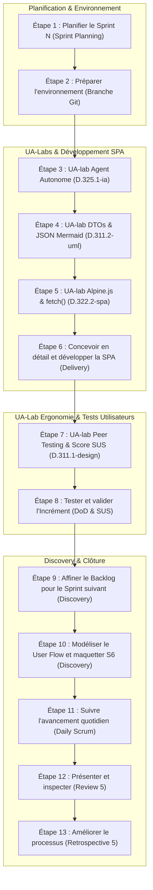

# Flux de Travail — Session S05 (Sprint 5 - 80h)

Ce document détaille le flux de travail opérationnel de la **Session S05 : Tests Utilisateurs, SPA Alpine.js & Agent IA** pour le projet de formation N3.

Il applique directement les étapes de la Phase 2 du [Flux de Travail Générique](../flux-travail-generique.md) en alternant l'acquisition des compétences dans les UA-labs et leur application immédiate sur le projet d'imitation.

---

## 1. Fiche d'Identification de la Session

- **Code de Session :** S05
- **Intitulé du Sprint :** Tests Utilisateurs, SPA Alpine.js & Agent IA
- **Durée Ferme (Timebox) :** 80 heures (10 jours ouvrés)
- **Positionnement :** Cinquième sprint de delivery applicatif Dual-Track

---

## 2. Objectif d'Apprentissage Global

Préparer la branche Git et actualiser la documentation projet ; configurer et brider un agent IA autonome opérant en boucle fermée dans l'IDE avec **Agent Antigravity & GitHub Copilot** ; modéliser les contrats de données DTO et la sérialisation JSON en syntaxe Mermaid ; dynamiser l'interface web sous forme de Single Page Application (SPA) réactive avec **Alpine.js** (`x-data`, `fetch()`, filtrage temps réel asynchrone sans rechargement de page) et styles **Preline UI** ; et conduire un protocole rigoureux de tests d'utilisabilité (*Peer Testing*) consignant les métriques ergonomiques et le score SUS sur la SPA développée.

---

## 3. Prérequis Bloquants de Lancement

Pour démarrer la session :
- **Validation du Sprint 4 :** Middlewares de sécurité et suite de tests unitaires PHPUnit validés par le Product Owner (Groupe 1), rétrospective S4 actant le besoin de tests d'utilisabilité réels, et maquettes de S5 testées.
- **Rôles Opérationnels :** Product Owner porté par le Groupe 1, Scrum Master et Développeurs en alternance.

---

## 4. Cadre Tri-Projets et Organisation Temporelle (80h / 10 jours)

- **Jours 1 à 7 : Projet d'Imitation (*Blog des Lauréats*)**
  - Réalisation guidée pas-à-pas en classe active.
  - Alternance directe entre l'assimilation d'un UA-lab et l'exécution de l'étape de réalisation correspondante.
- **Jour 8 : Projet Technique (*Portfolio Développeur*)**
  - **Codage technique pur en totale autonomie**.
  - L'apprenant réalise uniquement le développement technique : dynamisation réactive de la galerie de réalisations de son portfolio personnel sous Alpine.js et styles Preline UI sans aucun rechargement.
  - Aucune étape de planification ni de conception n'est demandée sur cette journée.
  - Épreuve sommative de **Live Coding (40 min chrono sans assistance — 65% de la note)**.
- **Jours 9 et 10 : Projet Fil Rouge (*Application Métier*, ex : Cinéma)**
  - **Création et enrichissement systématique de Skills agentiques** dans `.agent/skills/`.
  - L'apprenant conçoit des Skills réutilisables permettant à l'Agent IA d'automatiser la génération de composants réactifs Alpine.js et la grille d'audit SUS.
  - Clôture de session et bilan réflexif.

---

## 5. Épreuve de Live Coding (40 min chrono sans assistance — 65% de la note)

- **Contexte :** À partir du projet starter fourni (`dossier-depart/`), coder en 40 minutes un composant d'interface réactif autonome avec Alpine.js.
- **Consignes opérationnelles :**
  - Coder dans une vue Blade un composant Alpine.js autonome (`x-data`).
  - Gérer la saisie réactive d'un champ texte de recherche avec filtrage instantané côté client.
  - Gérer le filtrage par bouton de catégorie sélectionnée sans aucun rechargement de page.
  - Afficher un indicateur visuel de chargement asynchrone (*spinner*) avec les styles Preline UI pendant la récupération des données.
- **Critères d'évaluation :** Réactivité déclarative sans étape de build, manipulation fluide du DOM par Alpine.js, conformité visuelle Preline UI, code propre.

---

## 6. Déroulement Chronologique Intercalé du Sprint 5

---

### Étape 1 : Planifier le Sprint N (Sprint Planning — Piste Delivery) (Étape Générique 15)
- **Entrées :** Product Backlog actualisé et retours de la Review 4.
- **Activités de réalisation :**
  - Définir le Sprint Goal S5 : "Construire un module de recherche instantanée d'articles sous forme de Single Page Application avec Alpine.js et valider son ergonomie par une campagne de Peer Testing".
  - Sélectionner les User Stories : "Recherche instantanée sans rechargement de page" et "Filtrage asynchrone par catégorie".
  - Décomposer les User Stories en tâches techniques élémentaires (1 à 4 heures).
  - Valider l'engagement d'équipe sur le Sprint Backlog S5.
- **Sortie principale :** Document du Sprint Backlog S5 ordonné (`scrum/sprint-backlog-s5.md`).

### Étape 2 : Préparer l'environnement de sprint (Branche Git et README.md) (Étape Générique 16)
- **Entrées :** Sprint Backlog S5 validé et branche `main`.
- **Activités de réalisation :**
  - Créer et basculer sur la branche Git du sprint : `git checkout -b sprint-5`.
  - Actualiser le fichier `README.md` avec le Sprint Goal S5, la composition d'équipe et les dates jalons.
- **Sortie principale :** Fichier `README.md` actualisé sur la branche `sprint-5`.

### Étape 3 : UA-lab : Architecture d'un Agent IA autonome (Domaine D.325.1-ia)
- **Objectif d'apprentissage :** Configurer et brider un agent de développement opérant en boucle fermée dans l'IDE.
- **Notions de base à apprendre :**
  - Fonctionnement en boucle fermée (observation $\to$ action $\to$ vérification).
  - Garde-fous de sécurité et contrôle d'accès aux fichiers du projet.
  - Audit de conformité des commandes exécutées par l'agent.
- **Sortie :** Guide de configuration et d'audit d'un agent IA autonome (`tutoriels/ia/guide-agent-autonome.md`).

### Étape 4 : UA-lab : Modélisation des contrats DTO et sérialisation JSON Mermaid (Domaine D.311.2-uml)
- **Objectif d'apprentissage :** Définir les structures de données allégées pour les échanges asynchrones frontend/backend avant de concevoir la SPA (un seul lab consolidant tout le domaine UML du sprint).
- **Notions de base à apprendre :**
  - Concept de Data Transfer Object (DTO) pour découpler la couche de persistance de la vue.
  - Utilisation des Resources API de Laravel pour formater la réponse JSON.
  - Étanchéité des données privées (masquage des champs sensibles).
  - Représentation déclarative des structures JSON en Mermaid (`classDiagram`).
- **Sortie :** Guide des contrats de données DTO et sérialisation JSON en Mermaid (`tutoriels/uml/guide-dto-json.md`).

### Étape 5 : UA-lab : Single Page Application Alpine.js et requêtes asynchrones fetch() (Domaine D.322.2-spa)
- **Objectif d'apprentissage :** Maîtriser le framework déclaratif léger Alpine.js et les composants de recherche instantanée avant le développement de la SPA (un seul lab consolidant tout le domaine SPA du sprint).
- **Notions de base à apprendre :**
  - Directives déclaratives `x-data`, `x-bind`, `x-on`, `x-show`, `x-model`.
  - Réactivité déclarative sans étape de compilation ni bundler lourd.
  - Requêtes asynchrones avec l'API standard `fetch()`.
  - Gestion des états d'interface : état initial, chargement en cours, liste vide, affichage des résultats.
  - Intégration fluide avec les composants et styles Preline UI.
- **Sortie :** Guide technique Alpine.js et SPA déclarative (`tutoriels/spa/guide-alpine-spa.md`).

### Étape 6 : Concevoir en détail et développer (Piste Delivery) (Étape Générique 17)
- **Entrées :** Contrats DTO validés, endpoint JSON et compétences Alpine.js acquises.
- **Activités de réalisation :**
  - *Projet d'Imitation :* Coder le contrôleur API `ArticleSearchController` renvoyant le flux JSON filtré, et développer la vue Blade responsive avec composant réactif Alpine.js et styles Preline UI.
  - *Projet Technique (Codage pur - Jour 8) :* Coder la galerie projets réactive sur son portfolio personnel (Live Coding 40 min).
  - *Projet Fil Rouge (Jours 9-10) :* Créer le Skill `.agent/skills/alpine-spa-generator/` pour automatiser la génération d'un composant de recherche SPA.
- **Sortie principale :** Contrôleur API de recherche opérationnel (`app/Http/Controllers/Api/ArticleSearchController.php`).

### Étape 7 : UA-lab : Protocole de tests d'utilisabilité Peer Testing et score SUS (Domaine D.311.1-design)
- **Objectif d'apprentissage :** Assimiler le protocole rigoureux de tests ergonomiques sur utilisateurs réels immédiatement avant de tester l'incrément SPA développé.
- **Notions de base à apprendre :**
  - Définition d'un protocole de Peer Testing : scénarios d'utilisation non dirigés, observation silencieuse.
  - Recueil des métriques d'utilisabilité : temps d'accomplissement, taux d'erreur, hésitations.
  - Calcul et interprétation du score normalisé System Usability Scale (SUS).
- **Sortie :** Guide du protocole de Peer Testing et grille de calcul du score SUS (`tutoriels/design/guide-peer-testing.md`).

### Étape 8 : Tester et valider l'Incrément (Piste Delivery — DoD & Tests Utilisateurs) (Étape Générique 21)
- **Entrées :** SPA opérationnelle et protocole de Peer Testing acquis à l'Étape 7.
- **Activités de réalisation :**
  - Conduire la campagne de Peer Testing auprès d'apprenants pairs jouant le rôle d'utilisateurs cibles.
  - Consigner les observations, calculer le score SUS et vérifier la conformité aux critères de la Definition of Done.
- **Sortie principale :** Rapport formel de validation de la Definition of Done intégrant le bilan des tests utilisateurs SUS (`docs/qualite/rapport-dod-sprint-5.md`).

### Étape 9 : Affiner le Backlog pour le Sprint suivant (Piste Discovery — ~10% temps) (Étape Générique 18)
- **Entrées :** Product Backlog et retours d'utilisation.
- **Activités de réalisation :**
  - Collaborer avec le Groupe 1 (Product Owner) pour clarifier les User Stories du Sprint 6 (Sécurité Spatie Laravel-Permission RBAC et démarche TDD complète).
  - Définir les critères d'acceptation et estimer la complexité en Story Points.
- **Sortie principale :** Fiche de raffinement du backlog pour le Sprint 6 (`scrum/backlog-refinement-s6.md`).

### Étape 10 : Modéliser le User Flow et maquetter pour le Sprint suivant (Piste Discovery — ~10% temps) (Étape Générique 19)
- **Entrées :** User Stories raffinées pour le Sprint 6 et UI Kit Preline UI.
- **Activités de réalisation :**
  - Modéliser le parcours utilisateur selon les profils et rôles autorisés (Admin vs Rédacteur) en Mermaid.
  - Concevoir les maquettes interactives de l'espace d'administration sécurisé sous Preline UI.
- **Sortie principale :** Document regroupant le User Flow et les maquettes interactives du Sprint 6 (`docs/design/maquettes-sprint-6.md`).

### Étape 11 : Suivre l'avancement quotidien (Daily Scrum — Delivery & Discovery) (Étape Générique 20)
- **Entrées :** Tableau Kanban et tâches du Sprint 5.
- **Activités de réalisation :**
  - Animer la réunion quotidienne debout de 15 minutes.
  - Partager le travail réalisé sur la SPA Alpine.js, les tests utilisateurs et le discovery.
  - Lever immédiatement les points de blocage.
- **Sortie principale :** Journal de suivi journalier des tâches (`issues/issues-sprint-5.md`).

### Étape 12 : Présenter et inspecter (Sprint Review N — Double Validation Delivery & Discovery) (Étape Générique 22)
- **Entrées :** SPA opérationnelle, rapport de Peer Testing avec score SUS et maquettes interactives du Sprint 6.
- **Activités de réalisation :**
  - Démontrer la SPA de recherche réactive et présenter les résultats ergonomiques SUS devant le Product Owner (Groupe 1).
  - Valider formellement la fin des User Stories de S5.
  - Faire tester les maquettes d'administration du Sprint 6 aux utilisateurs cibles.
- **Sortie principale :** Procès-verbal de la Review 5 (`sprints/pv-review-5.md`).

### Étape 13 : Améliorer le processus (Sprint Retrospective N — Amélioration continue) (Étape Générique 23)
- **Entrées :** Déroulement et retours de la Review 5.
- **Activités de réalisation :**
  - Analyser le déroulement du Sprint 5 en équipe.
  - Constater le choc réflexif d'une gestion artisanale des droits d'accès (nécessité d'un standard industriel RBAC multi-rôles et de TDD rigoureux vers S06).
  - Définir 2 actions d'amélioration concrètes pour le Sprint 6.
- **Sortie principale :** Bilan rétrospectif du Sprint 5 constatant le besoin d'un socle formel RBAC (`scrum/retrospective-s5.md`).
