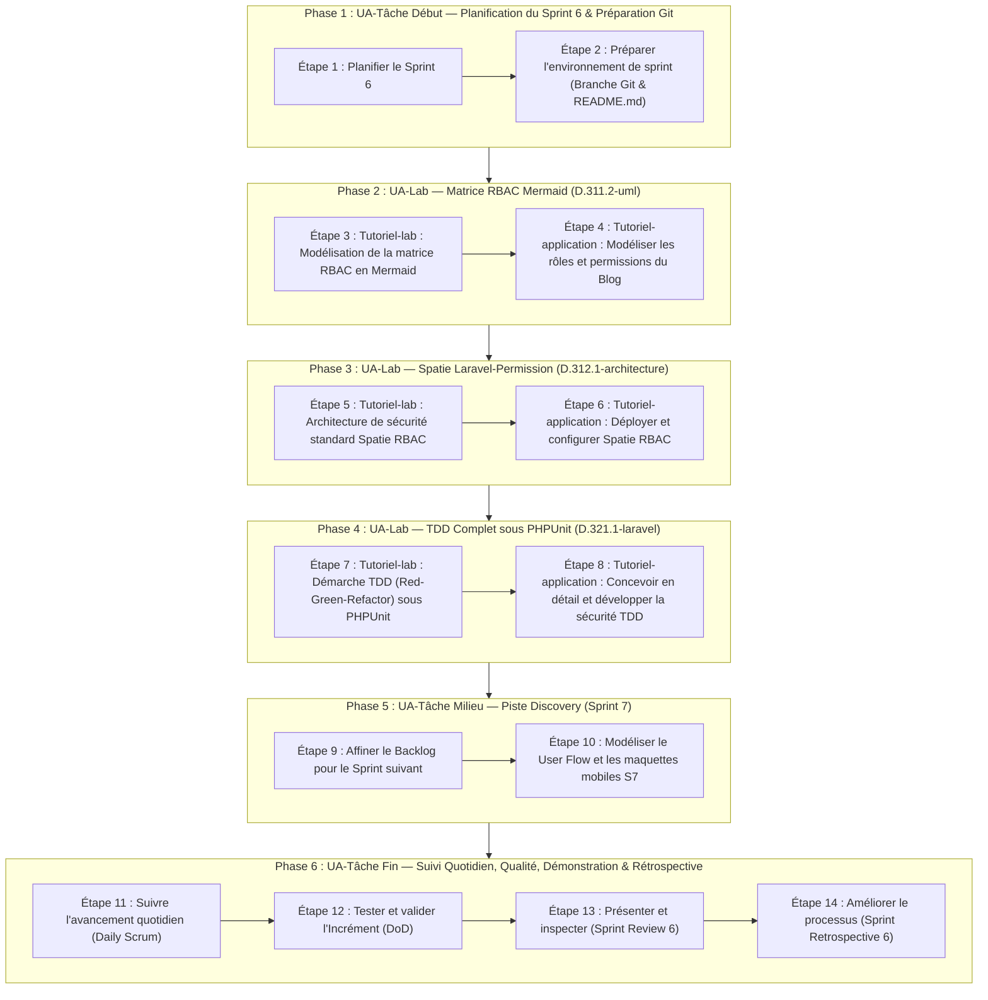

# Flux de Travail Opérationnel — Session S06 : Sécurité Spatie (RBAC) & TDD Complet

Ce document définit le flux de travail de la **Session S06** (Sprint 6) pour le niveau N3.
Il est structuré en **6 phases typées** (3 unités d'apprentissage **UA-Lab** et 3 blocs d'ingénierie opérationnelle **UA-Tâche**), totalisant **14 étapes de travail**.

---

## 1. Fiche d'Identification de la Session S06

- **Identifiant :** Session S06 (Sprint 6)
- **Titre :** Sécurité Spatie (RBAC) & TDD Complet
- **Durée indicative :** 80 heures (10 jours ouvrés) — *fournie à titre indicatif pour le concepteur et les formateurs*
- **Positionnement :** Sixième sprint de delivery applicatif Dual-Track
- **Domaines de compétences mobilisés :**
  - Modélisation de la matrice RBAC et métamodèle Spatie en Mermaid (`D.311.2-uml`)
  - Contrôle d'accès basé sur les rôles et permissions (RBAC) (`D.312.1-architecture`)
  - Développement guidé par les tests (TDD Red-Green-Refactor) sous PHPUnit (`D.321.1-laravel`)
- **Objectif global d'apprentissage :**
  - Préparer la branche Git `sprint-6` et actualiser la documentation projet.
  - Modéliser la matrice d'habilitation RBAC et le métamodèle des rôles/permissions en syntaxe Mermaid.
  - Installer et configurer le package industriel standard **Spatie Laravel-Permission** sous **MySQL** (migrations, middlewares, directives `@can` et `@hasrole`).
  - Appliquer rigoureusement la démarche de **Développement Guidé par les Tests (TDD - Red-Green-Refactor)** sous **PHPUnit** pour verrouiller les contrôles d'accès avant toute écriture de code de production.
  - Préparer la piste Discovery du Sprint 7 (Volet Mobile Natif) et clôturer le sprint par la démonstration et la rétrospective agile.

---

## 2. Organisation dans le Cadre Tri-Projets

- **Jours 1 à 7 : Projet d'Imitation (*Blog des Lauréats*)**
  - Réalisation guidée pas-à-pas de la sécurité multi-niveaux Spatie RBAC selon le cycle strict TDD.
  - Alternance immédiate : chaque atelier théorique est mis en œuvre sur le Blog.
- **Jour 8 : Projet Technique (*Portfolio Développeur*)**
  - **Codage technique pur en totale autonomie (sans conception ni planification)**.
  - L'apprenant implémente en démarche TDD sous PHPUnit les règles d'accès sécurisées de son portfolio personnel.
  - **Épreuve sommative de Live Coding (40 min chrono sans assistance — 65% de la note finale du module)**.
- **Jours 9 et 10 : Projet Fil Rouge (*Application Métier*, ex : Gestion de Cinéma)**
  - Création du Skill agentique `.agent/skills/spatie-rbac-generator/` pour automatiser l'installation et le paramétrage des rôles et permissions.
  - Bilan réflexif et consolidation des acquis.

---

## 3. Épreuve de Live Coding (40 min chrono sans assistance — 65% de la note)

- **Contexte :** À partir du projet starter fourni (`dossier-depart/`), implémenter en 40 minutes selon le cycle strict TDD (test rouge d'abord, puis code de passage au vert) l'attribution d'un rôle d'administration et la protection d'une route sensible avec assertion de statut HTTP 403.
- **Consignes opérationnelles :**
  - Écrire le test d'autorisation dans `src/tests/Feature/AuthorizationTest.php` simulant un accès refusé sans permission et vérifiant le code HTTP 403.
  - Exécuter le test pour constater l'échec (Red).
  - Installer ou configurer le middleware de permission Spatie sur la route.
  - Réexécuter le test jusqu'au passage complet au vert (Green), puis refactoriser.
- **Critères d'évaluation :** Respect strict de la démarche TDD, utilisation propre des factories et seeders de rôles, zéro faille de sécurité.

---

## 4. Déroulement des 6 Phases de la Session S06

---

### Phase 1 : UA-Tâche Début — Planification du Sprint 6 et Préparation Git
*Cette phase rassemble les activités opérationnelles d'initialisation de l'itération sans apport théorique.*

- **Étape 1 : Planifier le Sprint 6**
  - Correspondance flux générique : Étape Générique 15 (Planifier le Sprint N).
  - Entrées : Product Backlog actualisé, retours de la Review 5 et actions de la Rétrospective S5.
  - Travail d'application sur le Blog : Définir le Sprint Goal S6 ("Sécuriser l'ensemble des fonctionnalités du Blog par la mise en place du contrôle d'accès Spatie RBAC sous une démarche TDD rigoureuse"), décomposer les tâches et valider le Sprint Backlog S6.
  - Sortie (1 seul livrable) : `sprints/sprint-6.md`.
- **Étape 2 : Préparer l'environnement de sprint (Branche Git et README.md)**
  - Correspondance flux générique : Étape Générique 16 (Préparer l'environnement de sprint).
  - Entrées : Sprint Backlog S6 validé et branche `main`.
  - Travail d'application sur le Blog : Créer la branche Git `sprint-6` et actualiser le fichier `README.md`.
  - Sortie (1 seul livrable) : `README.md`.

---

### Phase 2 : UA-Lab — Modélisation de la Matrice RBAC en Syntaxe Mermaid (Domaine D.311.2-uml)
*Cette phase introduit la formalisation des habilitations avec alternance directe apprentissage et application.*

- **Étape 3 : Tutoriel-lab : Modélisation de la matrice RBAC et métamodèle en syntaxe Mermaid**
  - Entrées : Norme ANSI/INCITS RBAC et syntaxe Mermaid `erDiagram`.
  - Notions de base à apprendre :
    - Concepts fondamentaux RBAC : Utilisateurs, Rôles, Permissions, Sessions.
    - Relations N-N entre rôles et permissions, et attribution de rôles aux utilisateurs.
    - Représentation Mermaid déclarative du métamodèle Spatie (`roles`, `permissions`, `model_has_roles`, `role_has_permissions`).
  - Sorties de l'atelier d'apprentissage (2 livrables) :
    - Guide explicatif détaillé : `tutoriels/uml/matrice-rbac/matrice-rbac-mermaid/matrice-rbac-mermaid.md`.
    - Support de présentation au format Marp Markdown : `tutoriels/uml/matrice-rbac/matrice-rbac-mermaid/presentation-matrice-rbac-mermaid.md`.
- **Étape 4 : Tutoriel-application : Modéliser les rôles et permissions du Blog**
  - Entrées : Spécifications des profils (Lecteur, Lauréat contributeur, Modérateur, Administrateur).
  - Travail d'application sur le Blog : Établir la matrice complète des droits et modéliser le schéma d'habilitation du Blog des Lauréats en syntaxe Mermaid.
  - Sortie (1 seul livrable) : `docs/analyse/matrice-rbac-blog.mmd`.

---

### Phase 3 : UA-Lab — Contrôle d'Accès Standardisé avec Spatie Laravel-Permission (Domaine D.312.1-architecture)
*Cette phase introduit le standard industriel de sécurité sous Laravel avec alternance directe apprentissage et application.*

- **Étape 5 : Tutoriel-lab : Architecture de sécurité standard avec Spatie Laravel-Permission**
  - Entrées : Documentation officielle du package `spatie/laravel-permission`.
  - Notions de base à apprendre :
    - Trait `HasRoles` et intégration au modèle `User`.
    - Migrations standard du package et peuplement initial via seeders (`RoleSeeder`, `PermissionSeeder`).
    - Middlewares de route : `role:admin`, `permission:publish articles`.
    - Directives Blade conditionnelles `@can`, `@cannot`, `@hasrole`.
  - Sorties de l'atelier d'apprentissage (2 livrables) :
    - Guide explicatif détaillé : `tutoriels/architecture/spatie-permission/spatie-permission-seeder/spatie-permission-seeder.md`.
    - Support de présentation au format Marp Markdown : `tutoriels/architecture/spatie-permission/spatie-permission-seeder/presentation-spatie-permission-seeder.md`.
- **Étape 6 : Tutoriel-application : Déployer et configurer Spatie RBAC**
  - Entrées : Guide Spatie et matrice RBAC du Blog.
  - Travail d'application sur le Blog : Installer le package, exécuter les migrations MySQL, implémenter les seeders de rôles et rattacher le trait `HasRoles` au modèle `User`.
  - Sortie (1 seul livrable) : `src/database/seeders/RoleAndPermissionSeeder.php`.

---

### Phase 4 : UA-Lab — Développement Guidé par les Tests (TDD Red-Green-Refactor) sous PHPUnit (Domaine D.321.1-laravel)
*Cette phase introduit la démarche de conception pilotée par les tests avec alternance directe apprentissage et application.*

- **Étape 7 : Tutoriel-lab : Démarche TDD (Red-Green-Refactor) sous PHPUnit**
  - Entrées : Méthodologie Test-Driven Development (TDD).
  - Notions de base à apprendre :
    - Le cycle immuable en 3 temps : 1. Écrire le test qui échoue (Red), 2. Écrire le code minimal pour passer le test (Green), 3. Améliorer la structure du code sans altérer le comportement (Refactor).
    - Tests de fonctionnalités (*Feature Tests*) simulant des requêtes authentifiées avec différents rôles (`actingAs($user)`).
    - Assertions de sécurité : `assertForbidden()`, `assertUnauthorized()`, `assertSuccessful()`.
  - Sorties de l'atelier d'apprentissage (2 livrables) :
    - Guide explicatif détaillé : `tutoriels/laravel/tdd-phpunit/tdd-phpunit-red-green/tdd-phpunit-red-green.md`.
    - Support de présentation au format Marp Markdown : `tutoriels/laravel/tdd-phpunit/tdd-phpunit-red-green/presentation-tdd-phpunit-red-green.md`.
- **Étape 8 : Tutoriel-application : Concevoir en détail et développer la sécurité en TDD**
  - Correspondance flux générique : Étape Générique 17 (Concevoir en détail et développer).
  - Entrées : Spécifications, package Spatie configuré et guide TDD.
  - Travail d'application sur le Blog :
    - *Projet d'Imitation :* Coder en démarche TDD stricte l'ensemble des protections de routes et des actions d'administration du Blog des Lauréats avec 100% de tests au vert.
    - *Projet Technique (Codage pur - Jour 8) :* Implémenter en TDD sous PHPUnit les règles de sécurité de son portfolio personnel (Épreuve de Live Coding de 40 min).
    - *Projet Fil Rouge (Jours 9-10) :* Créer le Skill `.agent/skills/spatie-rbac-generator/` pour automatiser la génération de tests TDD et configurations RBAC.
  - Sortie (1 seul livrable) : `src/tests/Feature/ArticleSecurityTest.php`.

---

### Phase 5 : UA-Tâche Milieu — Piste Discovery : Affinement du Backlog et Maquettage du Sprint 7
*Cette phase rassemble les activités d'ingénierie opérationnelle menées en temps masqué (~10% du temps) pour préparer le sprint suivant.*

- **Étape 9 : Affiner le Backlog pour le Sprint suivant**
  - Correspondance flux générique : Étape Générique 18 (Affiner le Backlog pour le Sprint suivant).
  - Entrées : Product Backlog et retours d'utilisation.
  - Travail d'application : Collaborer avec le Product Owner pour clarifier les User Stories du Sprint 7 (Application mobile native Android sous Kotlin et Jetpack Compose).
  - Sortie (1 seul livrable) : `scrum/backlog-refinement-s7.md`.
- **Étape 10 : Modéliser le User Flow et les maquettes mobiles du Sprint 7**
  - Correspondance flux générique : Étape Générique 19 (Modéliser le User Flow et maquetter pour le Sprint suivant).
  - Entrées : User Stories S7 et contraintes ergonomiques mobiles.
  - Travail d'application : Modéliser le parcours mobile de consultation et prototyper les maquettes d'écrans pour smartphone.
  - Sortie (1 seul livrable) : `docs/conception/maquettes-sprint-7.md`.

---

### Phase 6 : UA-Tâche Fin — Suivi Quotidien, Qualité DoD, Démonstration et Rétrospective
*Cette phase opérationnelle rassemble les rituels de clôture et l'amélioration continue.*

- **Étape 11 : Suivre l'avancement quotidien (Daily Scrum)**
  - Correspondance flux générique : Étape Générique 20 (Suivre l'avancement quotidien).
  - Entrées : Tableau Kanban du Sprint 6.
  - Travail d'application : Animer la réunion debout quotidienne de 15 minutes et lever les blocages.
  - Sortie (1 seul livrable) : Mise à jour du suivi des tâches dans `sprints/sprint-6.md`.
- **Étape 12 : Tester et valider l'Incrément (DoD)**
  - Correspondance flux générique : Étape Générique 21 (Tester et valider l'Incrément).
  - Entrées : Code source complet et rapport d'exécution des tests TDD.
  - Travail d'application : Exécuter la checklist de validation (étanchéité totale des rôles, zéro accès non autorisé, 100% des tests passants).
  - Sortie (1 seul livrable) : `docs/qualite/rapport-dod-sprint-6.md`.
- **Étape 13 : Présenter et inspecter (Sprint Review 6)**
  - Correspondance flux générique : Étape Générique 22 (Présenter et inspecter).
  - Entrées : Incrément logiciel S6 et maquettes mobiles du Sprint 7.
  - Travail d'application : Démontrer le cloisonnement des rôles devant le Product Owner et faire tester les maquettes mobiles S7.
  - Sortie (1 seul livrable) : `sprints/pv-review-6.md`.
- **Étape 14 : Améliorer le processus (Sprint Retrospective 6)**
  - Correspondance flux générique : Étape Générique 23 (Améliorer le processus).
  - Entrées : Déroulement de la Review 6 et vécu d'équipe.
  - Travail d'application : Conduire l'analyse réflexive d'équipe, acter la maturité acquise en sécurité et préparer l'ouverture au développement mobile sous Kotlin.
  - Sortie (1 seul livrable) : `sprints/retrospective-6.md`.
