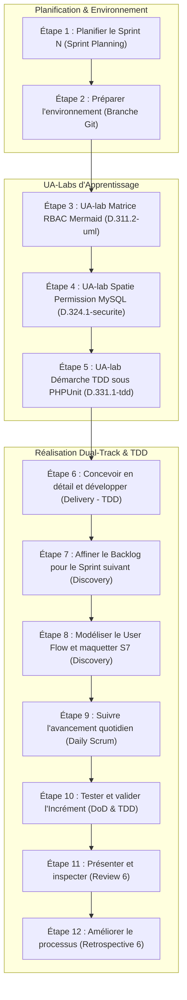

# Flux de Travail — Session S06 (Sprint 6 - 80h)

Ce document détaille le flux de travail opérationnel de la **Session S06 : Sécurité Spatie (RBAC) & TDD Complet** pour le projet de formation N3.

Il applique directement les étapes de la Phase 2 du [Flux de Travail Générique](../flux-travail-generique.md) en alternant l'acquisition des compétences dans les UA-labs et leur application immédiate sur le projet d'imitation.

---

## 1. Fiche d'Identification de la Session

- **Code de Session :** S06
- **Intitulé du Sprint :** Sécurité Spatie (RBAC) & TDD Complet
- **Durée Ferme (Timebox) :** 80 heures (10 jours ouvrés)
- **Positionnement :** Sixième sprint de delivery applicatif Dual-Track

---

## 2. Objectif d'Apprentissage Global

Préparer la branche Git et actualiser la documentation projet ; modéliser la matrice d'habilitation RBAC et le métamodèle Spatie en syntaxe déclarative Mermaid ; installer et configurer une sécurité multi-niveaux basée sur les rôles et permissions avec le standard industriel **Spatie Laravel-Permission (RBAC)** sous **MySQL** (migrations, middlewares de route, directives Blade conditionnelles `@can`, `@hasrole`) ; et appliquer rigoureusement la démarche de Développement Guidé par les Tests (**TDD - Red-Green-Refactor**) sous **PHPUnit** pour verrouiller les contrôles d'accès avant toute écriture de code de production.

---

## 3. Prérequis Bloquants de Lancement

Pour démarrer la session :
- **Validation du Sprint 5 :** Single Page Application Alpine.js et rapport de tests d'utilisabilité SUS validés par le Product Owner (Groupe 1), rétrospective S5 actant le besoin d'un socle RBAC robuste, et maquettes de S6 testées.
- **Rôles Opérationnels :** Product Owner porté par le Groupe 1, Scrum Master et Développeurs en alternance.

---

## 4. Cadre Tri-Projets et Organisation Temporelle (80h / 10 jours)

- **Jours 1 à 7 : Projet d'Imitation (*Blog des Lauréats*)**
  - Réalisation guidée pas-à-pas en classe active.
  - Alternance directe entre l'assimilation d'un UA-lab et l'exécution de l'étape de réalisation correspondante selon le cycle TDD.
- **Jour 8 : Projet Technique (*Portfolio Développeur*)**
  - **Codage technique pur en totale autonomie**.
  - L'apprenant réalise uniquement le développement technique : implémentation TDD sous PHPUnit des règles d'accès sécurisées de son portfolio personnel.
  - Aucune étape de planification ni de conception n'est demandée sur cette journée.
  - Épreuve sommative de **Live Coding (40 min chrono sans assistance — 65% de la note)**.
- **Jours 9 et 10 : Projet Fil Rouge (*Application Métier*, ex : Cinéma)**
  - **Création et enrichissement systématique de Skills agentiques** dans `.agent/skills/`.
  - L'apprenant conçoit des Skills réutilisables permettant à l'Agent IA d'automatiser l'installation du package Spatie RBAC et le cycle TDD.
  - Clôture de session et bilan réflexif.

---

## 5. Épreuve de Live Coding (40 min chrono sans assistance — 65% de la note)

- **Contexte :** À partir du projet starter fourni (`dossier-depart/`), implémenter en 40 minutes selon la démarche TDD complète la protection d'un point d'accès par permission Spatie.
- **Consignes opérationnelles :**
  - Rédiger dans `tests/Feature/ArticleAccessTest.php` le test fonctionnel vérifiant que seuls les utilisateurs possédant la permission `creer-article` peuvent poster sur `/articles` (attente HTTP 201), alors que les utilisateurs sans permission reçoivent un code HTTP 403 Forbidden.
  - Exécuter le test et constater son échec initial (phase **Red**).
  - Écrire le code minimal dans le contrôleur et le middleware pour faire passer le test au vert (phase **Green**).
  - Nettoyer le code et respecter les standards PSR-12 (phase **Refactor**).
- **Critères d'évaluation :** Respect strict du cycle Red-Green-Refactor, assertions HTTP précises (`actingAs`, statut 201/403), code de production propre.

---

## 6. Déroulement Chronologique Intercalé du Sprint 6

---

### Étape 1 : Planifier le Sprint N (Sprint Planning — Piste Delivery) (Étape Générique 15)
- **Entrées :** Product Backlog actualisé et retours de la Review 5.
- **Activités de réalisation :**
  - Définir le Sprint Goal S6 : "Installer le contrôle d'accès multi-rôles Spatie Laravel-Permission sous MySQL et sécuriser l'espace d'administration selon la démarche TDD complète".
  - Sélectionner les User Stories : "Habilitations d'administration par rôles et permissions" et "Verrouillage TDD des accès d'écriture".
  - Décomposer les User Stories en tâches techniques élémentaires (1 à 4 heures).
  - Valider l'engagement d'équipe sur le Sprint Backlog S6.
- **Sortie principale :** Document du Sprint Backlog S6 ordonné (`scrum/sprint-backlog-s6.md`).

### Étape 2 : Préparer l'environnement de sprint (Branche Git et README.md) (Étape Générique 16)
- **Entrées :** Sprint Backlog S6 validé et branche `main`.
- **Activités de réalisation :**
  - Créer et basculer sur la branche Git du sprint : `git checkout -b sprint-6`.
  - Actualiser le fichier `README.md` avec le Sprint Goal S6, la composition d'équipe et les dates jalons.
- **Sortie principale :** Fichier `README.md` actualisé sur la branche `sprint-6`.

### Étape 3 : UA-lab : Modélisation de la matrice des habilitations RBAC et métamodèle Spatie Mermaid (Domaine D.311.2-uml)
- **Objectif d'apprentissage :** Établir la matrice formelle des droits d'accès CRUD vs rôles et modéliser le métamodèle Spatie en Mermaid (un seul lab consolidant tout le domaine UML du sprint).
- **Notions de base à apprendre :**
  - Matrice d'habilitation : rôles usagers (Admin, Rédacteur, Lecteur) croisés avec les permissions CRUD.
  - Modélisation des Use Cases sécurisés sous conditions d'habilitation.
  - Schéma relationnel du métamodèle Spatie en Mermaid : tables `roles`, `permissions`, `model_has_roles`, `model_has_permissions`.
- **Sortie :** Guide de modélisation de la matrice d'habilitation RBAC en Mermaid (`tutoriels/uml/guide-rbac-uml.md`).

### Étape 4 : UA-lab : Sécurité RBAC complète Spatie Laravel-Permission sous MySQL (Domaine D.324.1-securite)
- **Objectif d'apprentissage :** Configurer le socle d'autorisations RBAC en base MySQL, verrouiller les routes et conditionner l'interface Blade avec Preline UI (un seul lab consolidant tout le domaine Sécurité du sprint).
- **Notions de base à apprendre :**
  - Installation et configuration du package `spatie/laravel-permission`.
  - Exécution des migrations MySQL créant les tables de sécurité.
  - Intégration du trait `HasRoles` sur le modèle Eloquent `User`.
  - Création de Seeders pour initialiser les rôles et permissions par défaut.
  - Middlewares de route Spatie (`role:admin`, `permission:editer-article`).
  - Directives Blade conditionnelles pour masquer ou afficher les éléments Preline UI (`@can`, `@cannot`, `@hasrole`).
- **Sortie :** Guide technique Spatie Laravel-Permission sous MySQL (`tutoriels/securite/guide-spatie-rbac.md`).

### Étape 5 : UA-lab : Démarche TDD complète (Red-Green-Refactor) sous PHPUnit (Domaine D.331.1-tdd)
- **Objectif d'apprentissage :** Pratiquer le développement piloté par les tests sous PHPUnit pour verrouiller les contrôles d'accès avant d'écrire le code de production.
- **Notions de base à apprendre :**
  - Les 3 phases fondamentales du cycle TDD : Red (test qui échoue), Green (code minimal pour réussir), Refactor (nettoyage et factorisation).
  - Écriture de tests fonctionnels HTTP sous PHPUnit (`actingAs($user)`, appels `$this->post()`, `$this->get()`).
  - Assertions de statut HTTP (`assertStatus(201)`, `assertStatus(403)`, `assertRedirect()`).
- **Sortie :** Guide pratique du cycle TDD sous PHPUnit (`tutoriels/tdd/guide-cycle-tdd.md`).

### Étape 6 : Concevoir en détail et développer (Piste Delivery — TDD) (Étape Générique 17)
- **Entrées :** Matrice d'habilitation, package Spatie installé et démarche TDD maîtrisée.
- **Activités de réalisation :**
  - *Projet d'Imitation :* Rédiger les tests de sécurité sous PHPUnit, coder le contrôleur `ArticleAdminController` pour valider les tests au vert, et conditionner les boutons de l'interface d'administration sous Blade et Preline UI.
  - *Projet Fil Rouge (Jours 9-10) :* Créer le Skill `.agent/skills/spatie-rbac-setup/` pour automatiser la mise en place d'un socle Spatie RBAC.
- **Sortie principale :** Contrôleur d'administration protégé opérationnel (`app/Http/Controllers/Admin/ArticleAdminController.php`).

### Étape 7 : Affiner le Backlog pour le Sprint suivant (Piste Discovery — ~10% temps) (Étape Générique 18)
- **Entrées :** Product Backlog et retours d'utilisation.
- **Activités de réalisation :**
  - Collaborer avec le Groupe 1 (Product Owner) pour clarifier les User Stories du Sprint 7 (Développement mobile sous Android Studio avec le langage Kotlin et Jetpack Compose).
  - Définir les critères d'acceptation et estimer la complexité en Story Points.
- **Sortie principale :** Fiche de raffinement du backlog pour le Sprint 7 (`scrum/backlog-refinement-s7.md`).

### Étape 8 : Modéliser le User Flow et maquetter pour le Sprint suivant (Piste Discovery — ~10% temps) (Étape Générique 19)
- **Entrées :** User Stories raffinées pour le Sprint 7 et spécifications d'ergonomie mobile.
- **Activités de réalisation :**
  - Modéliser le parcours utilisateur sur smartphone (vue liste défilante vers vue détails) en Mermaid.
  - Concevoir les maquettes des écrans mobiles respectant les standards Material Design 3 de Jetpack Compose.
- **Sortie principale :** Document regroupant le User Flow et les maquettes mobiles du Sprint 7 (`docs/design/maquettes-sprint-7.md`).

### Étape 9 : Suivre l'avancement quotidien (Daily Scrum — Delivery & Discovery) (Étape Générique 20)
- **Entrées :** Tableau Kanban et tâches du Sprint 6.
- **Activités de réalisation :**
  - Animer la réunion quotidienne debout de 15 minutes.
  - Partager l'état d'avancement sur les tests TDD, les permissions RBAC et le discovery mobile.
  - Lever immédiatement les points de blocage.
- **Sortie principale :** Journal de suivi journalier des tâches (`issues/issues-sprint-6.md`).

### Étape 10 : Tester et valider l'Incrément (Piste Delivery — DoD & TDD) (Étape Générique 21)
- **Entrées :** Code source complet du Sprint 6, suite de tests de sécurité et critères formels de la Definition of Done.
- **Activités de réalisation :**
  - *Projet d'Imitation :* Exécuter la suite complète de tests fonctionnels `ArticleSecurityTest` à 100% au vert.
  - *Projet Technique (Codage pur - Jour 8) :* Coder `ArticleAccessTest` selon le cycle TDD complet sur son portfolio (Live Coding 40 min).
  - *Projet Fil Rouge (Jours 9-10) :* Créer le Skill `.agent/skills/tdd-workflow-master/` pour outiller l'exécution TDD.
  - Contrôler le respect des 7 critères formels de la Definition of Done.
- **Sortie principale :** Rapport formel de validation de la Definition of Done et résultats des tests de sécurité (`docs/qualite/rapport-dod-sprint-6.md`).

### Étape 11 : Présenter et inspecter (Sprint Review N — Double Validation Delivery & Discovery) (Étape Générique 22)
- **Entrées :** Incrément logiciel S6 sécurisé par Spatie, suite de tests TDD et maquettes mobiles du Sprint 7.
- **Activités de réalisation :**
  - Démontrer le fonctionnement des habilitations RBAC et l'étanchéité des rôles devant le Product Owner (Groupe 1).
  - Valider formellement la fin des User Stories de S6.
  - Faire tester les maquettes d'écrans mobiles du Sprint 7 aux utilisateurs cibles.
- **Sortie principale :** Procès-verbal de la Review 6 (`sprints/pv-review-6.md`).

### Étape 12 : Améliorer le processus (Sprint Retrospective N — Amélioration continue) (Étape Générique 23)
- **Entrées :** Déroulement et retours de la Review 6.
- **Activités de réalisation :**
  - Analyser le déroulement du Sprint 6 en équipe.
  - Constater le choc réflexif du besoin d'accès nomade sur smartphone (limites du web mobile responsive et nécessité d'un client natif vers S07).
  - Définir 2 actions d'amélioration concrètes pour le Sprint 7.
- **Sortie principale :** Bilan rétrospectif du Sprint 6 constatant l'exigence d'une expérience native mobile (`scrum/retrospective-s6.md`).
