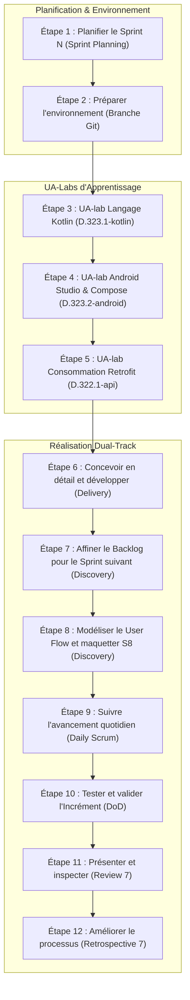

# Flux de Travail — Session S07 (Sprint 7 - 80h)

Ce document détaille le flux de travail opérationnel de la **Session S07 : Kotlin & Android Studio (Client Mobile)** pour le projet de formation N3.

Il applique directement les étapes de la Phase 2 du [Flux de Travail Générique](../flux-travail-generique.md) en alternant l'acquisition des compétences dans les UA-labs et leur application immédiate sur le projet d'imitation.

---

## 1. Fiche d'Identification de la Session

- **Code de Session :** S07
- **Intitulé du Sprint :** Kotlin & Android Studio (Client Mobile)
- **Durée Ferme (Timebox) :** 80 heures (10 jours ouvrés)
- **Positionnement :** Septième sprint de delivery applicatif Dual-Track (Volet Mobile Natif)

---

## 2. Objectif d'Apprentissage Global

Préparer la branche Git et actualiser la documentation projet ; assimiler les fondamentaux du langage moderne **Kotlin** (null-safety, coroutines, typage fort) ; développer une application mobile native sous Android Studio avec le framework d'interface déclarative **Jetpack Compose** (gestion d'état, listes défilantes optimisées avec `LazyColumn`, navigation multi-écrans `NavHost`) ; et connecter l'application mobile à l'**API RESTful Laravel 13** via Retrofit pour consulter les données en mobilité.

---

## 3. Prérequis Bloquants de Lancement

Pour démarrer la session :
- **Validation du Sprint 6 :** Contrôle d'accès Spatie RBAC et suite TDD validés par le Product Owner (Groupe 1), rétrospective S6 actant la demande d'accès mobile natif, et maquettes de S7 testées.
- **Rôles Opérationnels :** Product Owner porté par le Groupe 1, Scrum Master et Développeurs en alternance.

---

## 4. Cadre Tri-Projets et Organisation Temporelle (80h / 10 jours)

- **Jours 1 à 7 : Projet d'Imitation (*Blog des Lauréats*)**
  - Réalisation guidée pas-à-pas en classe active.
  - Alternance directe entre l'assimilation d'un UA-lab et l'exécution de l'étape de réalisation correspondante.
- **Jour 8 : Projet Technique (*Portfolio Développeur*)**
  - **Codage technique pur en totale autonomie**.
  - L'apprenant réalise uniquement le développement technique : application mobile native vitrine de son portfolio développeur sous Android Studio et Jetpack Compose.
  - Aucune étape de planification ni de conception n'est demandée sur cette journée.
  - Épreuve sommative de **Live Coding (40 min chrono sans assistance — 65% de la note)**.
- **Jours 9 et 10 : Projet Fil Rouge (*Application Métier*, ex : Cinéma)**
  - **Création et enrichissement systématique de Skills agentiques** dans `.agent/skills/`.
  - L'apprenant conçoit des Skills réutilisables permettant à l'Agent IA d'automatiser la génération de composants Jetpack Compose et la configuration client Retrofit.
  - Clôture de session et bilan réflexif.

---

## 5. Épreuve de Live Coding (40 min chrono sans assistance — 65% de la note)

- **Contexte :** À partir du projet Android starter fourni (`dossier-depart/`), coder en 40 minutes sous Android Studio un écran mobile déclaratif avec Jetpack Compose.
- **Consignes opérationnelles :**
  - Créer le composable `ArticleListScreen` utilisant `LazyColumn` pour afficher une liste d'articles reçue en paramètre.
  - Gérer l'état de chargement asynchrone avec affichage d'un `CircularProgressIndicator`.
  - Configurer les clés uniques pour optimiser le recyclage mémoire des éléments de liste.
  - Déclencher l'événement de clic `onArticleClick(articleId)` lors de l'appui sur un élément.
- **Critères d'évaluation :** Utilisation correcte de Jetpack Compose, state hoisting, gestion des états loading/success/empty, code propre en Kotlin.

---

## 6. Déroulement Chronologique Intercalé du Sprint 7

---

### Étape 1 : Planifier le Sprint N (Sprint Planning — Piste Delivery) (Étape Générique 15)
- **Entrées :** Product Backlog actualisé et retours de la Review 6.
- **Activités de réalisation :**
  - Définir le Sprint Goal S7 : "Développer l'application mobile native sous Android Studio avec Jetpack Compose et consommer l'API REST Laravel pour consulter les articles en mobilité".
  - Sélectionner les User Stories : "Consultation mobile des articles en liste fluide" et "Affichage détaillé d'un article sur smartphone".
  - Décomposer les User Stories en tâches techniques élémentaires (1 à 4 heures).
  - Valider l'engagement d'équipe sur le Sprint Backlog S7.
- **Sortie principale :** Document du Sprint Backlog S7 ordonné (`scrum/sprint-backlog-s7.md`).

### Étape 2 : Préparer l'environnement de sprint (Branche Git et README.md) (Étape Générique 16)
- **Entrées :** Sprint Backlog S7 validé et branche `main`.
- **Activités de réalisation :**
  - Créer et basculer sur la branche Git du sprint : `git checkout -b sprint-7`.
  - Actualiser le fichier `README.md` avec le Sprint Goal S7, la composition d'équipe et les dates jalons.
- **Sortie principale :** Fichier `README.md` actualisé sur la branche `sprint-7`.

### Étape 3 : UA-lab : Fondamentaux du langage Kotlin et null-safety (Domaine D.323.1-kotlin)
- **Objectif d'apprentissage :** Maîtriser le langage moderne Kotlin pour le développement mobile avant d'aborder le framework Android.
- **Notions de base à apprendre :**
  - Typage fort et inférence de type en Kotlin.
  - Système de gestion de la nullité : variables nullables (`?`), opérateur d'accès sécurisé, opérateur Elvis (`?:`), assertion non-null (`!!`).
  - Définition de structures de données : Data classes, collections immutables, lambdas et fonctions d'ordre supérieur.
- **Sortie :** Guide des fondamentaux du langage Kotlin (`tutoriels/kotlin/guide-kotlin-fondamentaux.md`).

### Étape 4 : UA-lab : Android Studio, scripts Gradle, Jetpack Compose, LazyColumn et NavHost (Domaine D.323.2-android)
- **Objectif d'apprentissage :** Configurer le projet mobile sous Android Studio et construire des interfaces déclaratives complètes (un seul lab consolidant tout le domaine Android du sprint).
- **Notions de base à apprendre :**
  - Configuration de l'environnement Android Studio, scripts Gradle en Kotlin DSL (`build.gradle.kts`), manifeste applicatif (`AndroidManifest.xml`).
  - Paradigme de programmation déclarative avec Jetpack Compose : fonctions `@Composable`, prévisualisation `@Preview`.
  - Affichage de listes défilantes performantes avec `LazyColumn` et gestion des clés uniques.
  - Structuration de l'état : state hoisting, `remember { mutableStateOf() }`, conteneur d'écran `Scaffold`.
  - Navigation déclarative entre écrans avec `NavHostController` et passage d'arguments typés.
- **Sortie :** Guide technique Jetpack Compose et navigation mobile (`tutoriels/android/guide-jetpack-compose.md`).

### Étape 5 : UA-lab : Consommation HTTP Retrofit et Coroutines Kotlin (Domaine D.322.1-api)
- **Objectif d'apprentissage :** Consommer l'API REST Laravel 13 en arrière-plan asynchrone avant l'intégration finale dans l'interface mobile.
- **Notions de base à apprendre :**
  - Configuration du client HTTP Retrofit avec convertisseur JSON Gson/Moshi.
  - Définition des interfaces d'API avec méthodes annotées (`@GET`, `@Path`).
  - Exécution des requêtes réseau asynchrones hors du thread d'interface principale grâce aux Coroutines Kotlin (`suspend fun`, `Dispatchers.IO`).
  - Gestion des erreurs réseau et des codes HTTP retournés par Laravel.
- **Sortie :** Guide de consommation d'API REST avec Retrofit et Coroutines (`tutoriels/api/guide-retrofit-coroutines.md`).

### Étape 6 : Concevoir en détail et développer (Piste Delivery) (Étape Générique 17)
- **Entrées :** Maquettes mobiles, API REST Laravel opérationnelle et compétences Compose/Retrofit acquises.
- **Activités de réalisation :**
  - *Projet d'Imitation :* Assembler l'application mobile native complète connectée à l'API Laravel : écran d'accueil avec `LazyColumn`, écran de détails et gestion de la navigation déclarative.
  - *Projet Technique (Codage pur - Jour 8) :* Coder `ArticleListScreen` avec `LazyColumn` et indicateur de chargement sur son portfolio mobile (Live Coding 40 min).
  - *Projet Fil Rouge (Jours 9-10) :* Créer le Skill `.agent/skills/compose-app-builder/` pour automatiser la génération d'écrans Jetpack Compose.
- **Sortie principale :** Écran mobile principal opérationnel (`android/app/src/main/java/ui/HomeScreen.kt`).

### Étape 7 : Affiner le Backlog pour le Sprint suivant (Piste Discovery — ~10% temps) (Étape Générique 18)
- **Entrées :** Product Backlog et retours d'utilisation.
- **Activités de réalisation :**
  - Collaborer avec le Groupe 1 (Product Owner) pour clarifier les User Stories du Sprint 8 (Portabilité multiplateforme avec NativePHP, recette globale et préparation de la soutenance officielle N3).
  - Définir les critères d'acceptation et estimer la complexité en Story Points.
- **Sortie principale :** Fiche de raffinement du backlog pour le Sprint 8 (`scrum/backlog-refinement-s8.md`).

### Étape 8 : Modéliser le User Flow et maquetter pour le Sprint suivant (Piste Discovery — ~10% temps) (Étape Générique 19)
- **Entrées :** User Stories raffinées pour le Sprint 8 et contraintes multiplateformes.
- **Activités de réalisation :**
  - Modéliser le parcours utilisateur unifié multiplateforme (Desktop et Mobile) en Mermaid.
  - Concevoir les maquettes des notifications natives et de l'accès déconnecté.
- **Sortie principale :** Document regroupant le User Flow et les maquettes multiplateformes du Sprint 8 (`docs/design/maquettes-sprint-8.md`).

### Étape 9 : Suivre l'avancement quotidien (Daily Scrum — Delivery & Discovery) (Étape Générique 20)
- **Entrées :** Tableau Kanban et tâches du Sprint 7.
- **Activités de réalisation :**
  - Animer la réunion quotidienne debout de 15 minutes.
  - Partager le travail réalisé sur Compose, Retrofit et le discovery multiplateforme.
  - Lever immédiatement les points de blocage.
- **Sortie principale :** Journal de suivi journalier des tâches (`issues/issues-sprint-7.md`).

### Étape 10 : Tester et valider l'Incrément (Piste Delivery — DoD) (Étape Générique 21)
- **Entrées :** Application Android compilée et critères formels de la Definition of Done.
- **Activités de réalisation :**
  - Vérifier la conformité aux 7 critères formels de la DoD :
    - Défilement fluide sans saccade sur émulateur et terminal Android réel.
    - Synchronisation intègre des données avec l'API REST Laravel 13.
    - Gestion robuste des coupures de réseau avec message d'information à l'utilisateur.
- **Sortie principale :** Rapport formel de validation de la Definition of Done (`docs/qualite/rapport-dod-sprint-7.md`).

### Étape 11 : Présenter et inspecter (Sprint Review N — Double Validation Delivery & Discovery) (Étape Générique 22)
- **Entrées :** Application Android opérationnelle et maquettes multiplateformes du Sprint 8.
- **Activités de réalisation :**
  - Démontrer l'application mobile en direct sur terminal réel devant le Product Owner (Groupe 1).
  - Valider formellement la fin des User Stories de S7.
  - Faire tester les maquettes multiplateformes de S8 aux utilisateurs cibles.
- **Sortie principale :** Procès-verbal de la Review 7 (`sprints/pv-review-7.md`).

### Étape 12 : Améliorer le processus (Sprint Retrospective N — Amélioration continue) (Étape Générique 23)
- **Entrées :** Déroulement et retours de la Review 7.
- **Activités de réalisation :**
  - Analyser le déroulement du Sprint 7 en équipe.
  - Constater le choc réflexif du coût de maintenance élevé de deux bases de code séparées (Web sous Laravel vs Mobile sous Kotlin) et le besoin d'unifier le code via NativePHP vers S08.
  - Définir 2 actions d'amélioration concrètes pour le sprint final.
- **Sortie principale :** Bilan rétrospectif du Sprint 7 constatant le besoin d'unification du socle applicatif (`scrum/retrospective-s7.md`).
