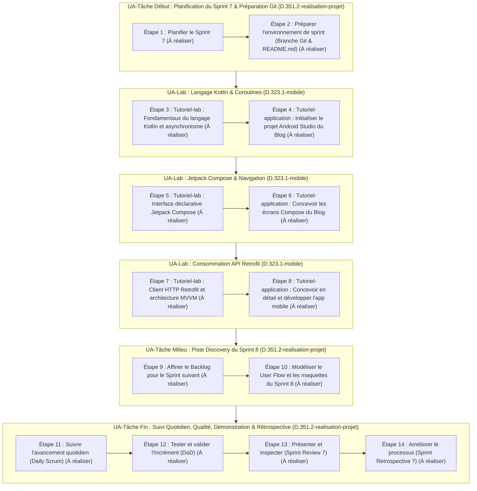

# Flux de Travail Opérationnel — Session S7 : Application Mobile Android Native Jetpack Compose

Ce document définit le flux de travail opérationnel de la **Session S7** (Sprint 7) pour le niveau N3.
Il est centré sur la production de son incrément majeur : l'**Application Mobile Android Native Jetpack Compose** du Blog des Lauréats.

Le flux sépare de manière étanche les Unités d'Apprentissage d'ateliers pratiques (**UA-Lab**) et les Unités d'Apprentissage d'application opérationnelle sur le projet (**UA-Tâche**), totalisant **6 UAs** et **14 étapes de travail**.

Les durées temporelles (80 heures / 10 jours) sont fournies à titre purement indicatif pour les formateurs et le concepteur.

---

## 1. Fiche d'Identification de la Session S7

- **Identifiant :** Session S7 (Sprint 7)
- **Titre centré sur l'incrément :** Application Mobile Android Native Jetpack Compose
- **Incrément produit :** Application mobile Android native complète en Kotlin avec interface déclarative Jetpack Compose (Scaffold, LazyColumn), architecture MVVM (StateFlow), connectée aux endpoints REST du Blog des Lauréats via Retrofit 2
- **Durée indicative :** 80 heures (10 jours ouvrés)
- **Positionnement :** Septième sprint de delivery applicatif Dual-Track (Volet Mobile Natif)
- **Référentiel des compétences :** Conforme au document de référence [.agents/references/domaines-competences.md](../../.agents/references/domaines-competences.md)
- **Domaines de compétences et Unités d'Apprentissage mobilisés :**
  - Domaine Client Mobile Android Natif (`D.323.1-mobile`) :
    - Unité d'apprentissage 1 (UA-Lab) : *Fondamentaux du langage Kotlin et Coroutines* (Statut : **À réaliser**)
    - Unité d'apprentissage 2 (UA-Lab) : *Interface déclarative Jetpack Compose et navigation mobile* (Statut : **À réaliser**)
    - Unité d'apprentissage 3 (UA-Lab) : *Consommation API RESTful avec Retrofit et architecture MVVM* (Statut : **À réaliser**)
  - Domaine Réalisation et Conduite de Projet (`D.351.2-realisation-projet`) :
    - Unité d'apprentissage 1 (UA-Tâche) : *Planification du Sprint 7 et Préparation Git* (Statut : **À réaliser**)
    - Unité d'apprentissage 2 (UA-Tâche) : *Piste Discovery : Affinement du Backlog et Maquettage du Sprint 8* (Statut : **À réaliser**)
    - Unité d'apprentissage 3 (UA-Tâche) : *Suivi Quotidien, Qualité DoD, Démonstration et Rétrospective* (Statut : **À réaliser**)
- **Objectif global d'apprentissage :**
  - Préparer la branche Git `sprint-7` et actualiser la documentation projet.
  - Assimiler les fondamentaux du langage **Kotlin** (typage fort, null-safety, coroutines asynchrones).
  - Développer sous Android Studio une interface mobile native avec **Jetpack Compose** (gestion d'état `remember`, listes optimisées `LazyColumn`, navigation déclarative `NavHost`).
  - Connecter l'application mobile à l'**API RESTful Laravel 13** via **Retrofit** et Moshi pour consulter et afficher les articles en mobilité.
  - Préparer la piste Discovery du Sprint 8 (Portabilité multiplateforme NativePHP et soutenance finale) et clôturer le sprint par la démonstration et la rétrospective agile.

---

## 2. Organisation dans le Cadre Tri-Projets

- **Rôles Scrum & Autonomie :** Chaque apprenant endosse le rôle de Product Owner pour son propre projet et pilote son backlog en autonomie.
- **Jours 1 à 7 : Projet d'Imitation (*Blog des Lauréats - Client Mobile*)**
  - Réalisation guidée pas-à-pas de l'application Android native consommant l'API Laravel du Blog.
  - Alternance immédiate : chaque atelier théorique est mis en œuvre sur l'application mobile.
- **Jour 8 : Projet Technique (*Portfolio Développeur Mobile*)**
  - **Épreuve sommative de Live Coding (40 min chrono sans assistance — 65% de la note finale du module)** : L'apprenant implémente l'application mobile native vitrine de son portfolio sous Android Studio et Jetpack Compose.
  - **Règle formelle d'exigence :** Les documents de cadrage et de conception préalable ne sont pas demandés pour le portfolio dans la session.
- **Jours 9 et 10 : Projet Fil Rouge (*Application Métier*, ex : Gestion de Cinéma)**
  - Développement des interfaces mobiles déclaratives sous Jetpack Compose et connexion aux endpoints REST sur l'application fil rouge (développement logiciel métier pur, sans agents IA ni ingénierie de prompt).
  - Bilan réflexif et consolidation des acquis.

---

## 3. Épreuve de Live Coding (40 min chrono sans assistance — 65% de la note)

- **Contexte :** À partir du projet Android starter fourni (`dossier-depart/`), implémenter en 40 minutes l'écran de consultation des réalisations du portfolio sous Jetpack Compose avec appel réseau asynchrone Retrofit et gestion d'état (`Loading`, `Success`, `Error`).
- **Consignes opérationnelles :**
  - Définir l'interface Retrofit et la fonction suspendue d'appel API.
  - Coder le ViewModel exposant un `StateFlow` réactif.
  - Implémenter la vue Compose avec `LazyColumn` affichant les cartes de réalisations.
  - Gérer l'indicateur de progression `CircularProgressIndicator` durant le chargement.
- **Critères d'évaluation :** Utilisation propre des coroutines, gestion des 3 états d'affichage, fluidité du défilement, absence de plantage lors de coupure réseau.

---

## 4. Déroulement Opérationnel des 6 Unités d'Apprentissage du Sprint 7

---

### Unité d'Apprentissage (UA-Tâche) : Planification du Sprint 7 et Préparation Git (Domaine D.351.2-realisation-projet)
*Bloc opérationnel d'initialisation de l'itération sans apport théorique.*

- **Étape 1 : Planifier le Sprint 7**
  - Statut : **À réaliser**
  - Domaine de compétence : `D.351.2-realisation-projet`.
  - Correspondance flux générique : Étape Générique 15 (Planifier le Sprint N).
  - Entrées : Product Backlog actualisé, retours de la Review 6 et actions de la Rétrospective S6.
  - Travail d'application sur le Blog : Définir le Sprint Goal S7 ("Développer et déployer l'application mobile Android native sous Jetpack Compose connectée à l'API du Blog pour la consultation nomade"), décomposer les tâches et valider le Sprint Backlog S7.
  - Sortie (1 seul livrable) : `sprints/sprint-7.md`.
- **Étape 2 : Préparer l'environnement de sprint (Branche Git et README.md)**
  - Statut : **À réaliser**
  - Domaine de compétence : `D.351.2-realisation-projet`.
  - Correspondance flux générique : Étape Générique 16 (Préparer l'environnement de sprint).
  - Entrées : Sprint Backlog S7 validé et branche `main`.
  - Travail d'application sur le Blog : Créer la branche Git `sprint-7` et actualiser le fichier `README.md`.
  - Sortie (1 seul livrable) : `README.md`.

---

### Unité d'Apprentissage (UA-Lab) : Fondamentaux du Langage Kotlin et Coroutines (Domaine D.323.1-mobile)
*Atelier d'apprentissage pratique du langage Kotlin pour l'écosystème mobile avec alternance directe.*

- **Étape 3 : Tutoriel-lab : Fondamentaux du langage Kotlin et programmation asynchrone avec Coroutines**
  - Statut : **À réaliser**
  - Unité d'apprentissage : *Fondamentaux du langage Kotlin et Coroutines*.
  - Entrées : Documentation officielle Kotlin et Android Studio.
  - Notions de base à apprendre :
    - Syntaxe moderne : val vs var, typage inféré, null-safety (`?`, `?:`, `!!`), data classes et smart casts.
    - Programmation fonctionnelle en Kotlin : lambdas, fonctions d'extension et collections d'ordre supérieur.
    - Concurrence moderne avec les Coroutines : `Dispatchers.IO`, `Dispatchers.Main`, suspend functions et `viewModelScope`.
  - Sorties de l'atelier d'apprentissage (2 livrables) :
    - Guide explicatif détaillé : `tutoriels/mobile/kotlin-coroutines/kotlin-coroutines-basics/kotlin-coroutines-basics.md`.
    - Support de présentation au format Marp Markdown : `tutoriels/mobile/kotlin-coroutines/kotlin-coroutines-basics/presentation-kotlin-coroutines-basics.md`.
- **Étape 4 : Tutoriel-application : Initialiser le projet Android Studio du Blog**
  - Statut : **À réaliser**
  - Unité d'apprentissage : *Fondamentaux du langage Kotlin et Coroutines*.
  - Entrées : Guide Kotlin et spécifications du client mobile.
  - Travail d'application sur le Blog : Initialiser le projet Android Studio dans le sous-dossier `src/mobile/`, configurer Gradle Kotlin DSL et déclarer les dépendances Compose et Retrofit.
  - Sortie (1 seul livrable) : `src/mobile/app/build.gradle.kts`.

---

### Unité d'Apprentissage (UA-Lab) : Interface Déclarative Jetpack Compose et Navigation Mobile (Domaine D.323.1-mobile)
*Atelier d'apprentissage pratique de l'UI déclarative sur Android avec alternance directe.*

- **Étape 5 : Tutoriel-lab : Interface déclarative Jetpack Compose et navigation mobile**
  - Statut : **À réaliser**
  - Unité d'apprentissage : *Interface déclarative Jetpack Compose et navigation mobile*.
  - Entrées : Composants Material 3 Jetpack Compose.
  - Notions de base à apprendre :
    - Paradigme déclaratif : fonctions `@Composable`, recomposition et conservation d'état (`remember`, `mutableStateOf`).
    - Dispositions fondamentales : `Column`, `Row`, `Box`, `Scaffold` et listes recyclées `LazyColumn`.
    - Navigation multi-écrans avec `NavHost`, contrôleur `rememberNavController` et passage d'arguments d'articles.
  - Sorties de l'atelier d'apprentissage (2 livrables) :
    - Guide explicatif détaillé : `tutoriels/mobile/jetpack-compose/jetpack-compose-navigation/jetpack-compose-navigation.md`.
    - Support de présentation au format Marp Markdown : `tutoriels/mobile/jetpack-compose/jetpack-compose-navigation/presentation-jetpack-compose-navigation.md`.
- **Étape 6 : Tutoriel-application : Concevoir les écrans Compose du Blog**
  - Statut : **À réaliser**
  - Unité d'apprentissage : *Interface déclarative Jetpack Compose et navigation mobile*.
  - Entrées : Maquettes mobiles S7 et bibliothèque Compose.
  - Travail d'application sur le Blog : Implémenter les composants Compose pour la liste d'articles (`ArticleListScreen`) et la vue de détail (`ArticleDetailScreen`).
  - Sortie (1 seul livrable) : `src/mobile/app/src/main/java/com/solicode/blog/ui/ArticleScreens.kt`.

---

### Unité d'Apprentissage (UA-Lab) : Consommation API RESTful avec Retrofit et Architecture MVVM (Domaine D.323.1-mobile)
*Atelier d'apprentissage pratique de l'interconnexion réseau et du patron MVVM avec alternance directe.*

- **Étape 7 : Tutoriel-lab : Client HTTP Retrofit et architecture MVVM mobile**
  - Statut : **À réaliser**
  - Unité d'apprentissage : *Consommation API RESTful avec Retrofit et architecture MVVM*.
  - Entrées : Bibliothèque Retrofit 2 et convertisseur Moshi JSON.
  - Notions de base à apprendre :
    - Définition d'interfaces d'appels HTTP avec annotations `@GET`, `@Path`.
    - Sérialisation et désérialisation automatique des modèles DTO Kotlin avec Moshi.
    - Architecture MVVM : séparation stricte entre le modèle de données, le `ArticleViewModel` et les vues Compose.
  - Sorties de l'atelier d'apprentissage (2 livrables) :
    - Guide explicatif détaillé : `tutoriels/mobile/retrofit-mvvm/retrofit-mvvm-api/retrofit-mvvm-api.md`.
    - Support de présentation au format Marp Markdown : `tutoriels/mobile/retrofit-mvvm/retrofit-mvvm-api/presentation-retrofit-mvvm-api.md`.
- **Étape 8 : Tutoriel-application : Concevoir en détail et développer le client mobile Android**
  - Statut : **À réaliser**
  - Domaine de compétence : `D.323.1-mobile`.
  - Correspondance flux générique : Étape Générique 17 (Concevoir en détail et développer).
  - Entrées : Endpoints API Laravel 13 validés et composants Compose.
  - Travail d'application sur le Blog :
    - *Projet d'Imitation :* Coder le client Retrofit, le repository de données, le `ArticleViewModel` et connecter l'affichage Compose aux données réelles servies par l'API Laravel 13 du Blog des Lauréats.
    - *Projet Technique (Jour 8) :* Coder l'application mobile Android vitrine de son portfolio sous Jetpack Compose (Épreuve de Live Coding de 40 min).
    - *Projet Fil Rouge (Jours 9-10) :* Développer les composants Compose et connecter les endpoints REST sur l'application fil rouge.
  - Sortie (1 seul livrable) : `src/mobile/app/src/main/java/com/solicode/blog/network/BlogApiService.kt`.

---

### Unité d'Apprentissage (UA-Tâche) : Piste Discovery : Affinement du Backlog et Maquettage du Sprint 8 (Domaine D.351.2-realisation-projet)
*Bloc d'ingénierie opérationnelle mené en temps masqué pour préparer le sprint suivant.*

- **Étape 9 : Affiner le Backlog pour le Sprint suivant**
  - Statut : **À réaliser**
  - Domaine de compétence : `D.351.2-realisation-projet`.
  - Correspondance flux générique : Étape Générique 18 (Affiner le Backlog pour le Sprint suivant).
  - Entrées : Product Backlog et retours d'utilisation.
  - Travail d'application : Collaborer avec le Product Owner pour clarifier les exigences du Sprint 8 (Portabilité multiplateforme NativePHP, recette globale et mise en production).
  - Sortie (1 seul livrable) : `scrum/backlog-refinement-s8.md`.
- **Étape 10 : Modéliser le User Flow et les maquettes du Sprint 8**
  - Statut : **À réaliser**
  - Domaine de compétence : `D.351.2-realisation-projet`.
  - Correspondance flux générique : Étape Générique 19 (Modéliser le User Flow et maquetter pour le Sprint suivant).
  - Entrées : Spécifications de déploiement et packaging.
  - Travail d'application : Modéliser le pipeline de déploiement continu et prototyper l'expérience installable NativePHP.
  - Sortie (1 seul livrable) : `docs/conception/maquettes-sprint-8.md`.

---

### Unité d'Apprentissage (UA-Tâche) : Suivi Quotidien, Qualité DoD, Démonstration et Rétrospective (Domaine D.351.2-realisation-projet)
*Rituels opérationnels de clôture et amélioration continue.*

- **Étape 11 : Suivre l'avancement quotidien (Daily Scrum)**
  - Statut : **À réaliser**
  - Domaine de compétence : `D.351.2-realisation-projet`.
  - Correspondance flux générique : Étape Générique 20 (Suivre l'avancement quotidien).
  - Entrées : Tableau Kanban du Sprint 7.
  - Travail d'application : Animer la réunion quotidienne debout de 15 minutes et synchroniser l'équipe.
  - Sortie (1 seul livrable) : Mise à jour du suivi des tâches dans `sprints/sprint-7.md`.
- **Étape 12 : Tester et valider l'Incrément (DoD)**
  - Statut : **À réaliser**
  - Domaine de compétence : `D.351.2-realisation-projet`.
  - Correspondance flux générique : Étape Générique 21 (Tester et valider l'Incrément).
  - Entrées : Application mobile compilée (APK) et suite de tests instrumentés.
  - Travail d'application : Exécuter la checklist de validation (défilement fluide sans saccade sur émulateur/device physique, reprise réseau robuste, conformité aux maquettes).
  - Sortie (1 seul livrable) : `docs/qualite/rapport-dod-sprint-7.md`.
- **Étape 13 : Présenter et inspecter (Sprint Review 7)**
  - Statut : **À réaliser**
  - Domaine de compétence : `D.351.2-realisation-projet`.
  - Correspondance flux générique : Étape Générique 22 (Présenter et inspecter).
  - Entrées : Incrément logiciel mobile S7 opérationnel et maquettes du Sprint 8.
  - Travail d'application : Démontrer l'application mobile en direct sur smartphone devant le Product Owner et faire tester les maquettes de S8.
  - Sortie (1 seul livrable) : `sprints/pv-review-7.md`.
- **Étape 14 : Améliorer le processus (Sprint Retrospective 7)**
  - Statut : **À réaliser**
  - Domaine de compétence : `D.351.2-realisation-projet`.
  - Correspondance flux générique : Étape Générique 23 (Améliorer le processus).
  - Entrées : Déroulement de la Review 7 et vécu d'équipe.
  - Travail d'application : Conduire l'analyse réflexive d'équipe, acter la réussite de l'extension mobile et préparer le sprint final de certification.
  - Sortie (1 seul livrable) : `sprints/retrospective-7.md`.
