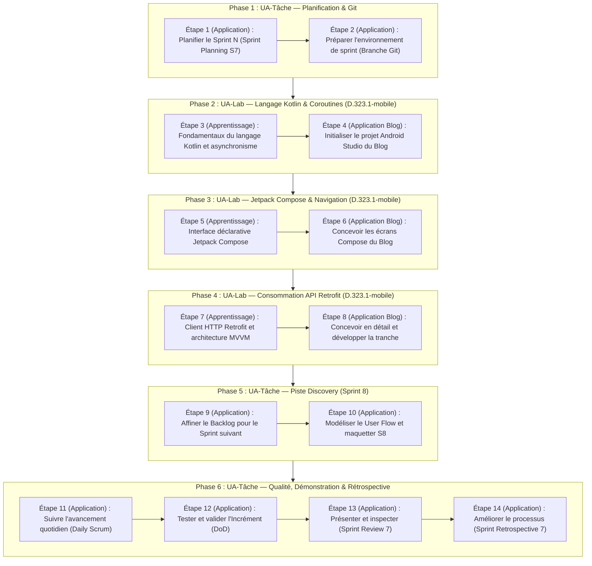

# Flux de Travail Opérationnel — Session S07 : Kotlin & Android Studio (Client Mobile)

Ce document définit le flux de travail de la **Session S07** (Sprint 7 - 80 heures / 10 jours ouvrés).
Il est structuré en **6 phases typées** alternant les unités d'apprentissage (**UA-Lab**) avec leurs applications immédiates sur le projet d'imitation, et les phases opérationnelles d'ingénierie (**UA-Tâche**).

---

## 1. Fiche d'Identification de la Session S07

- **Identifiant :** Session S07 (Sprint 7)
- **Titre :** Kotlin & Android Studio (Client Mobile Natif)
- **Durée totale ferme :** 80 heures (10 jours ouvrés)
- **Positionnement :** Septième sprint de delivery applicatif Dual-Track (Volet Mobile Natif)
- **Domaines de compétences mobilisés :**
  - Fondamentaux du langage moderne Kotlin et Coroutines (`D.323.1-mobile`)
  - Interface déclarative moderne Jetpack Compose et navigation (`D.323.1-mobile`)
  - Consommation d'API RESTful avec Retrofit et injection Hilt (`D.323.1-mobile`)
- **Objectif global d'apprentissage :**
  - Préparer la branche Git `sprint-7` et actualiser la documentation projet.
  - Assimiler les fondamentaux du langage **Kotlin** (typage fort, null-safety, coroutines asynchrones).
  - Développer sous Android Studio une interface mobile native avec **Jetpack Compose** (gestion d'état `remember`, listes optimisées `LazyColumn`, navigation déclarative `NavHost`).
  - Connecter l'application mobile à l'**API RESTful Laravel 13** via **Retrofit** et Moshi pour consulter et afficher les articles en mobilité.
  - Préparer la piste Discovery du Sprint 8 (Portabilité multiplateforme NativePHP et soutenance finale) et clôturer le sprint par la démonstration et la rétrospective agile.

---

## 2. Organisation dans le Cadre Tri-Projets (80h / 10 jours)

- **Jours 1 à 7 : Projet d'Imitation (*Blog des Lauréats - Client Mobile*)**
  - Réalisation guidée pas-à-pas de l'application Android native consommant l'API Laravel du Blog.
  - Alternance immédiate : chaque atelier théorique est mis en œuvre sur l'application mobile.
- **Jour 8 : Projet Technique (*Portfolio Développeur Mobile*)**
  - **Codage technique pur en totale autonomie (sans conception ni planification)**.
  - L'apprenant implémente l'application mobile native vitrine de son portfolio sous Android Studio et Jetpack Compose.
  - **Épreuve sommative de Live Coding (40 min chrono sans assistance — 65% de la note finale du module)**.
- **Jours 9 et 10 : Projet Fil Rouge (*Application Métier*, ex : Gestion de Cinéma)**
  - Création du Skill agentique `.agent/skills/jetpack-compose-generator/` pour automatiser la génération d'écrans déclaratifs Compose et modèles de données Retrofit.
  - Bilan réflexif et consolidation des acquis.

---

## 3. Épreuve de Live Coding (40 min chrono sans assistance — 65% de la note)

- **Contexte :** À partir du projet Android starter fourni (`dossier-depart/`), implémenter en 40 minutes l'écran de consultation des réalisations du portfolio sous Jetpack Compose avec appel réseau asynchrone Retrofit et gestion d'état (`Loading`, `Success`, `Error`).
- **Consignes opérationnelles :**
  - Définir l'interface Retrofit et la fonction suspendue d'appel API.
  - Coder le ViewModel exposant un `StateFlow` réactif.
  - Implémenter la vue Compose avec `LazyColumn` affichant les cartes de réalisations.
  - Gérer l'indicateur de progression `CircularProgressIndicator` durant le chargement.
- **Critères d'évaluation :** Utilisation propre des coroutines, gestion des 3 états d'affichage, fluidité du défilement, absence de plantage lors de coupure réseau.

---

## 4. Déroulement des 6 Phases de la Session S07

---

### Phase 1 : UA-Tâche — Planification du Sprint 7 et Préparation de l'Environnement Git
*Cette phase opérationnelle initialise l'itération sans apport théorique.*

- **Étape 1 (Application) : Planifier le Sprint N (Sprint Planning — Piste Delivery)**
  - Entrées : Product Backlog actualisé, retours de la Review 6 et actions de la Rétrospective S6.
  - Travail d'application sur le Blog : Définir le Sprint Goal S7 ("Développer et déployer l'application mobile Android native sous Jetpack Compose connectée à l'API du Blog pour la consultation nomade"), décomposer les tâches et valider le Sprint Backlog S7.
  - Sortie (1 seul livrable) : `scrum/sprint-backlog-s7.md`.
- **Étape 2 (Application) : Préparer l'environnement de sprint (Branche Git et README.md)**
  - Entrées : Sprint Backlog S7 validé et branche `main`.
  - Travail d'application sur le Blog : Créer la branche Git `sprint-7` et actualiser le fichier `README.md`.
  - Sortie (1 seul livrable) : `README.md`.

---

### Phase 2 : UA-Lab — Fondamentaux du Langage Kotlin et Coroutines (Domaine D.323.1-mobile)
*Cette phase introduit le langage Kotlin pour l'écosystème mobile. Elle comprend l'étape d'apprentissage conceptuel suivie de l'initialisation du projet Android.*

- **Étape 3 (Apprentissage) : Fondamentaux du langage Kotlin et asynchronisme**
  - Entrées : Documentation officielle Kotlin et Android Studio.
  - Notions de base à apprendre :
    - Syntaxe moderne : val vs var, typage inféré, null-safety (`?`, `?:`, `!!`), data classes et smart casts.
    - Programmation fonctionnelle en Kotlin : lambdas, fonctions d'extension et collections d'ordre supérieur.
    - Concurrence moderne avec les Coroutines : `Dispatchers.IO`, `Dispatchers.Main`, suspend functions et `viewModelScope`.
  - Sortie de l'atelier d'apprentissage (1 seul livrable) : `tutoriels/mobile/guide-kotlin-coroutines.md`.
- **Étape 4 (Application sur le Blog) : Initialiser le projet Android Studio du Blog**
  - Entrées : Guide Kotlin et spécifications du client mobile.
  - Travail d'application sur le Blog : Initialiser le projet Android Studio dans le sous-dossier `mobile/`, configurer Gradle Kotlin DSL et déclarer les dépendances Compose et Retrofit.
  - Sortie (1 seul livrable) : `mobile/app/build.gradle.kts`.

---

### Phase 3 : UA-Lab — Interface Déclarative Jetpack Compose et Navigation Mobile (Domaine D.323.1-mobile)
*Cette phase introduit l'UI déclarative sur Android. Elle s'organise en une étape d'apprentissage théorique suivie de la création des composants d'interface.*

- **Étape 5 (Apprentissage) : Interface déclarative Jetpack Compose et navigation**
  - Entrées : Composants Material 3 Jetpack Compose.
  - Notions de base à apprendre :
    - Paradigme déclaratif : fonctions `@Composable`, recomposition et conservation d'état (`remember`, `mutableStateOf`).
    - Dispositions fondamentales : `Column`, `Row`, `Box`, `Scaffold` et listes recyclées `LazyColumn`.
    - Navigation multi-écrans avec `NavHost`, contrôleur `rememberNavController` et passage d'arguments d'articles.
  - Sortie de l'atelier d'apprentissage (1 seul livrable) : `tutoriels/mobile/guide-jetpack-compose.md`.
- **Étape 6 (Application sur le Blog) : Concevoir les écrans Compose du Blog**
  - Entrées : Maquettes mobiles S7 et bibliothèque Compose.
  - Travail d'application sur le Blog : Implémenter les composants Compose pour la liste d'articles (`ArticleListScreen`) et la vue de détail (`ArticleDetailScreen`).
  - Sortie (1 seul livrable) : `mobile/app/src/main/java/com/solicode/blog/ui/ArticleScreens.kt`.

---

### Phase 4 : UA-Lab — Consommation API RESTful avec Retrofit et Architecture MVVM (Domaine D.323.1-mobile)
*Cette phase introduit l'interconnexion réseau et le patron MVVM. Elle s'organise en une étape d'apprentissage technique suivie de la réalisation complète sur le Blog, le portfolio et le projet fil rouge.*

- **Étape 7 (Apprentissage) : Client HTTP Retrofit et architecture MVVM**
  - Entrées : Bibliothèque Retrofit 2 et convertisseur Moshi JSON.
  - Notions de base à apprendre :
    - Définition d'interfaces d'appels HTTP avec annotations `@GET`, `@Path`.
    - Sérialisation et désérialisation automatique des modèles DTO Kotlin avec Moshi.
    - Architecture MVVM : séparation stricte entre le modèle de données, le `ArticleViewModel` et les vues Compose.
  - Sortie de l'atelier d'apprentissage (1 seul livrable) : `tutoriels/mobile/guide-retrofit-mvvm.md`.
- **Étape 8 (Application sur le Blog) : Concevoir en détail et développer (Piste Delivery)**
  - Entrées : Endpoints API Laravel 13 validés et composants Compose.
  - Travail d'application sur le Blog :
    - *Projet d'Imitation :* Coder le client Retrofit, le repository de données, le `ArticleViewModel` et connecter l'affichage Compose aux données réelles servies par l'API Laravel 13 du Blog des Lauréats.
    - *Projet Technique (Codage pur - Jour 8) :* Coder l'application mobile Android vitrine de son portfolio sous Jetpack Compose (Épreuve de Live Coding de 40 min).
    - *Projet Fil Rouge (Jours 9-10) :* Créer le Skill `.agent/skills/jetpack-compose-generator/` pour automatiser la génération d'écrans Compose et services Retrofit.
  - Sortie (1 seul livrable) : `mobile/app/src/main/java/com/solicode/blog/network/BlogApiService.kt`.

---

### Phase 5 : UA-Tâche — Piste Discovery : Affinement du Backlog et Maquettage du Sprint 8
*Cette phase opérationnelle prépare le sprint final sans apport théorique.*

- **Étape 9 (Application) : Affiner le Backlog pour le Sprint suivant (Piste Discovery)**
  - Entrées : Product Backlog et retours d'utilisation.
  - Travail d'application : Collaborer avec le Product Owner pour clarifier les exigences du Sprint 8 (Portabilité multiplateforme NativePHP, recette globale et mise en production).
  - Sortie (1 seul livrable) : `scrum/backlog-refinement-s8.md`.
- **Étape 10 (Application) : Modéliser le User Flow et maquetter pour le Sprint suivant (Piste Discovery)**
  - Entrées : Spécifications de déploiement et packaging.
  - Travail d'application : Modéliser le pipeline de déploiement continu et prototyper l'expérience installable NativePHP.
  - Sortie (1 seul livrable) : `docs/design/maquettes-sprint-8.md`.

---

### Phase 6 : UA-Tâche — Clôture du Sprint 7, Démonstration, Tests DoD et Rétrospective
*Cette phase opérationnelle rassemble les rituels de clôture et l'amélioration continue.*

- **Étape 11 (Application) : Suivre l'avancement quotidien (Daily Scrum — Delivery & Discovery)**
  - Entrées : Tableau Kanban du Sprint 7.
  - Travail d'application : Animer la réunion quotidienne debout de 15 minutes et synchroniser l'équipe.
  - Sortie (1 seul livrable) : `issues/issues-sprint-7.md`.
- **Étape 12 (Application) : Tester et valider l'Incrément (Piste Delivery — DoD)**
  - Entrées : Application mobile compilée (APK) et suite de tests instrumentés.
  - Travail d'application : Exécuter la checklist de validation (défilement fluide sans saccade sur émulateur/device physique, reprise réseau robuste, conformité aux maquettes).
  - Sortie (1 seul livrable) : `docs/qualite/rapport-dod-sprint-7.md`.
- **Étape 13 (Application) : Présenter et inspecter (Sprint Review N — Double Validation Delivery & Discovery)**
  - Entrées : Incrément logiciel mobile S7 opérationnel et maquettes du Sprint 8.
  - Travail d'application : Démontrer l'application mobile en direct sur smartphone devant le Product Owner et faire tester les maquettes de S8.
  - Sortie (1 seul livrable) : `sprints/pv-review-7.md`.
- **Étape 14 (Application) : Améliorer le processus (Sprint Retrospective N — Amélioration continue)**
  - Entrées : Déroulement de la Review 7 et vécu d'équipe.
  - Travail d'application : Conduire l'analyse réflexive d'équipe, acter la réussite de l'extension mobile et préparer le sprint final de certification.
  - Sortie (1 seul livrable) : `scrum/retrospective-s7.md`.
