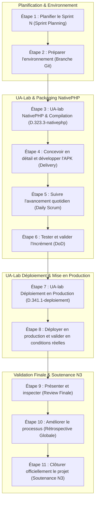

# Flux de Travail — Session S08 (Sprint 8 - 80h)

Ce document détaille le flux de travail opérationnel de la **Session S08 : Portabilité NativePHP, Recette Globale, Déploiement en Production & Soutenance N3** pour le projet de formation N3.

Il applique directement les étapes des Phases 2 et 3 du [Flux de Travail Générique](../flux-travail-generique.md) en alternant l'acquisition des compétences dans les UA-labs et leur application immédiate sur le projet d'imitation jusqu'à la clôture officielle du projet.

---

## 1. Fiche d'Identification de la Session

- **Code de Session :** S08
- **Intitulé du Sprint :** Portabilité NativePHP, Recette Globale, Déploiement en Production & Soutenance N3
- **Durée Ferme (Timebox) :** 80 heures (10 jours ouvrés)
- **Positionnement :** Sprint final de delivery multiplateforme, de déploiement en production et de soutenance de certification N3

---

## 2. Objectif d'Apprentissage Global

Préparer la branche Git et actualiser la documentation projet ; packager une application Laravel complète sous forme de binaire installable natif sur mobile (Android) et poste de travail (Desktop) grâce à la technologie **NativePHP** (runtime PHP embarqué, APIs natives de notifications et stockage local déconnecté SQLite) ; conduire la recette globale de bout en bout et le **déploiement en production** de la solution logicielle sur serveur distant (Étape 24 du flux générique) ; et soutenir avec succès l'ensemble de la démarche d'ingénierie devant un jury professionnel officiel pour valider la qualification professionnelle N3.

---

## 3. Prérequis Bloquants de Lancement

Pour démarrer la session :
- **Validation du Sprint 7 :** Application mobile Android sous Kotlin et Jetpack Compose validée par le Product Owner (Groupe 1), rétrospective S7 actant le besoin de convergence multiplateforme, et environnement de déploiement distant accessible.
- **Rôles Opérationnels :** Product Owner porté par le Groupe 1, Scrum Master, Développeurs et Jury Professionnel d'examen.

---

## 4. Cadre Tri-Projets et Organisation Temporelle (80h / 10 jours)

- **Jours 1 à 7 : Projet d'Imitation (*Blog des Lauréats*)**
  - Réalisation guidée pas-à-pas en classe active.
  - Alternance directe entre l'assimilation d'un UA-lab et l'exécution de l'étape de réalisation correspondante (packaging NativePHP, recette globale, déploiement distant).
- **Jour 8 : Projet Technique (*Portfolio Développeur*)**
  - **Codage technique pur en totale autonomie**.
  - L'apprenant réalise uniquement le packaging autonome de son portfolio sous NativePHP et la compilation du binaire installable avec notifications locales.
  - Aucune étape de planification ni de conception n'est demandée sur cette journée.
  - Épreuve sommative de **Live Coding (40 min chrono sans assistance — 65% de la note)**.
- **Jours 9 et 10 : Projet Fil Rouge & Soutenance Officielle**
  - **Présentation du dossier d'ingénierie complet et démonstration des Skills agentiques** créés tout au long des 800h dans `.agent/skills/`.
  - Soutenance officielle devant le jury professionnel et délibération de certification N3.

---

## 5. Épreuve de Live Coding (40 min chrono sans assistance — 65% de la note)

- **Contexte :** À partir du projet NativePHP fourni (`dossier-depart/`), implémenter en 40 minutes un service de notifications natives déclenchées lors d'un événement métier avec persistance locale dans SQLite.
- **Consignes opérationnelles :**
  - Coder la classe de service `app/Services/NativeAlertService.php`.
  - Déclencher une notification native au système d'exploitation via la façade de NativePHP : `Notification::title('Nouveau message')->message('Contenu reçu')->send()`.
  - Enregistrer l'historique de l'alerte dans la base locale SQLite intégrée de NativePHP.
  - Compiler ou tester le bon fonctionnement de l'alerte sur l'environnement d'exécution natif.
- **Critères d'évaluation :** Utilisation propre des façades NativePHP, gestion de la persistance SQLite déconnectée, code propre PSR-12.

---

## 6. Déroulement Chronologique Intercalé du Sprint 8

---

### Étape 1 : Planifier le Sprint N (Sprint Planning — Piste Delivery) (Étape Générique 15)
- **Entrées :** Product Backlog final et retours de la Review 7.
- **Activités de réalisation :**
  - Définir le Sprint Goal S8 : "Packager l'application Blog des Lauréats sous forme de binaire installable natif avec NativePHP, exécuter la recette globale et déployer la solution en production sur serveur distant".
  - Sélectionner les User Stories : "Packaging multiplateforme NativePHP" et "Recette globale et déploiement en production".
  - Décomposer les User Stories en tâches techniques élémentaires (1 à 4 heures).
  - Valider l'engagement d'équipe sur le Sprint Backlog S8.
- **Sortie principale :** Document du Sprint Backlog S8 ordonné (`scrum/sprint-backlog-s8.md`).

### Étape 2 : Préparer l'environnement de sprint (Branche Git et README.md) (Étape Générique 16)
- **Entrées :** Sprint Backlog S8 validé et branche `main`.
- **Activités de réalisation :**
  - Créer et basculer sur la branche Git du sprint : `git checkout -b sprint-8`.
  - Actualiser le fichier `README.md` avec le Sprint Goal final, les jalons de déploiement et la date de la soutenance officielle.
- **Sortie principale :** Fichier `README.md` actualisé sur la branche `sprint-8`.

### Étape 3 : UA-lab : Portabilité NativePHP : architecture embarquée, compilation APK, APIs natives et tests (Domaine D.323.3-nativephp)
- **Objectif d'apprentissage :** Maîtriser le packaging natif d'une application Laravel avec runtime embarqué, APIs locales et tests de parité avant la compilation finale (un seul lab consolidant tout le domaine NativePHP du sprint).
- **Notions de base à apprendre :**
  - Architecture de NativePHP : pont de communication natif, serveur PHP embarqué indépendant, paramétrage de `config/nativephp.php`.
  - Chaîne de compilation native et génération du binaire installable APK pour Android.
  - Utilisation des APIs système natives : façade `Notification`, barres de menu système, dialogues d'ouverture.
  - Persistance locale déconnectée sous SQLite embarqué.
  - Stratégie de tests croisés multiplateformes : parité des fonctionnalités entre Web, Mobile et Desktop.
- **Sortie :** Guide de portabilité et de packaging natif NativePHP (`tutoriels/nativephp/guide-nativephp-complet.md`).

### Étape 4 : Concevoir en détail et développer (Piste Delivery) (Étape Générique 17)
- **Entrées :** Code source Laravel 13, configuration NativePHP et compétences acquises à l'Étape 3.
- **Activités de réalisation :**
  - *Projet d'Imitation :* Packager le Blog des Lauréats sous NativePHP, configurer les alertes natives et compiler le binaire APK installable release.
  - *Projet Technique (Codage pur - Jour 8) :* Coder `NativeAlertService` avec persistance SQLite locale sur son portfolio (Live Coding 40 min).
  - *Projet Fil Rouge (Jours 9-10) :* Créer le Skill `.agent/skills/nativephp-builder/` pour automatiser la configuration et la compilation NativePHP.
- **Sortie principale :** Binaire applicatif natif compilé (`build/nativephp/app-release.apk`).

### Étape 5 : Suivre l'avancement quotidien (Daily Scrum — Delivery & Discovery) (Étape Générique 20)
- **Entrées :** Tableau Kanban et tâches du Sprint 8.
- **Activités de réalisation :**
  - Animer la réunion quotidienne debout de 15 minutes.
  - Partager le travail réalisé sur le packaging binaire, la recette et la préparation du déploiement.
  - Lever immédiatement les points de blocage.
- **Sortie principale :** Journal de suivi journalier des tâches (`issues/issues-sprint-8.md`).

### Étape 6 : Tester et valider l'Incrément (Piste Delivery — DoD) (Étape Générique 21)
- **Entrées :** Binaire APK compilé et critères formels de la Definition of Done.
- **Activités de réalisation :**
  - Contrôler le respect des 7 critères formels de la DoD sur la version compilée :
    - Installation et exécution réussies sur poste de travail et smartphone réel.
    - Fonctionnement vérifié des notifications natives du système d'exploitation.
    - Synchronisation et persistance des données sans anomalie.
- **Sortie principale :** Rapport formel de validation de la Definition of Done multiplateforme (`docs/qualite/rapport-dod-sprint-8.md`).

### Étape 7 : UA-lab : Déploiement en production d'une solution Laravel / MySQL et recette globale (Domaine D.341.1-deploiement)
- **Objectif d'apprentissage :** Assimiler les techniques de mise en production sur serveur distant, migration MySQL de production et sécurisation immédiatement avant le déploiement réel.
- **Notions de base à apprendre :**
  - Variables d'environnement `.env` de production et sécurisation des clés secrètes.
  - Optimisation des performances : mise en cache des configurations (`config:cache`), des routes (`route:cache`) et des vues (`view:cache`).
  - Exécution des migrations de base de données sur le serveur MySQL distant.
  - Configuration des certificats SSL/TLS et sécurisation des en-têtes HTTP.
  - Protocole de recette globale de bout en bout et tests de bon fonctionnement en ligne (*smoke tests*).
- **Sortie :** Guide de déploiement en production et protocole de recette globale (`tutoriels/deploiement/guide-mise-en-production.md`).

### Étape 8 : Déployer en production et valider en conditions réelles (Étape Générique 24)
- **Entrées :** Solution logicielle validée, serveur de production et compétences acquises à l'Étape 7.
- **Activités de réalisation :**
  - Déployer l'application sur le serveur de production distant.
  - Exécuter les migrations MySQL de production et charger les données initiales de référence.
  - Conduire l'ensemble des tests de recette en conditions réelles et valider le bon fonctionnement de tous les parcours utilisateurs.
- **Sortie principale :** Procès-verbal de recette et de validation du déploiement en production (`docs/deploiement/pv-recette-production.md`).

### Étape 9 : Présenter et inspecter (Sprint Review N — Double Validation Delivery & Discovery) (Étape Générique 22)
- **Entrées :** Solution déployée en production et binaire natif compilé.
- **Activités de réalisation :**
  - Démontrer la solution globale multiplateforme (Web en production, Mobile natif et Desktop) devant le Product Owner (Groupe 1) et les parties prenantes.
  - Valider formellement la conformité de l'ensemble des User Stories du projet.
- **Sortie principale :** Procès-verbal de la Review finale (`sprints/pv-review-finale.md`).

### Étape 10 : Améliorer le processus (Sprint Retrospective N — Amélioration continue) (Étape Générique 23)
- **Entrées :** Déroulement du Sprint 8 et historique complet du projet.
- **Activités de réalisation :**
  - Conduire la rétrospective globale d'équipe sur l'ensemble des 800 heures de formation (S0 à S8).
  - Dresser le bilan réflexif de l'apprentissage de l'agilité, du TDD, de l'IA et de l'architecture découplée.
  - Capitaliser sur les meilleures pratiques d'ingénierie logicielle pour les futurs projets professionnels.
- **Sortie principale :** Bilan rétrospectif global de fin de formation N3 (`scrum/retrospective-globale-n3.md`).

### Étape 11 : Clôturer officiellement le projet (Étape Générique 25)
- **Entrées :** Procès-verbaux de recette, bilans de sprints, dossier d'ingénierie complet et Skills agentiques développés.
- **Activités de réalisation :**
  - Présenter et soutenir la démarche complète d'ingénierie logicielle et les compétences acquises devant le jury professionnel officiel.
  - Répondre aux questions techniques et méthodologiques du jury.
  - Recevoir la délibération officielle de certification professionnelle N3.
- **Sortie principale :** Procès-verbal officiel de délibération et de certification N3 (`docs/certification/pv-deliberation-n3.md`).
