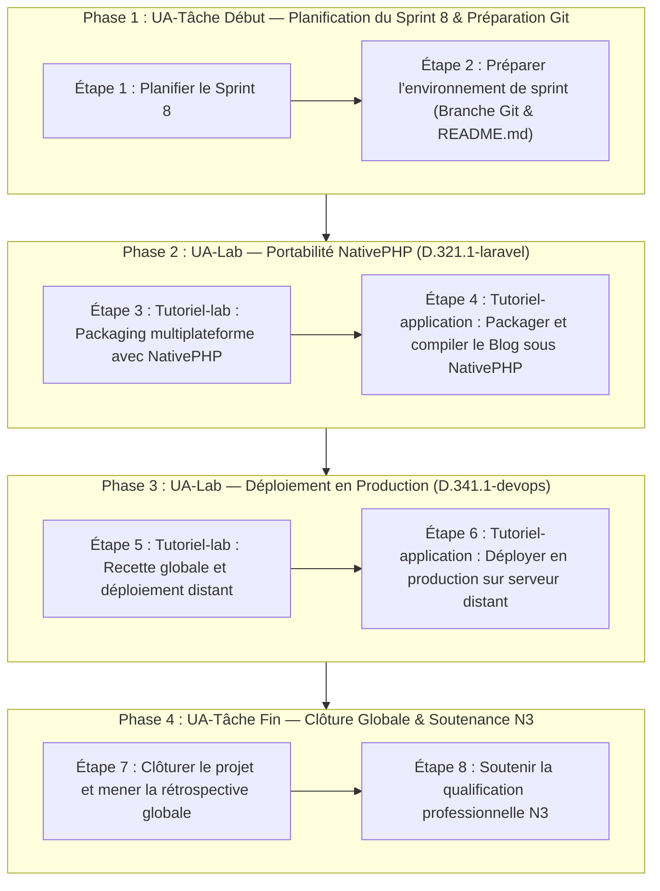

# Flux de Travail Opérationnel — Session S08 : Portabilité NativePHP, Déploiement & Soutenance N3

Ce document définit le flux de travail de la **Session S08** (Sprint 8) pour le niveau N3.
Il est structuré en **4 phases typées** (2 unités d'apprentissage **UA-Lab** et 2 blocs d'ingénierie opérationnelle et de clôture **UA-Tâche**), totalisant **8 étapes de travail**.

---

## 1. Fiche d'Identification de la Session S08

- **Identifiant :** Session S08 (Sprint 8)
- **Titre :** Portabilité NativePHP, Recette Globale, Déploiement en Production & Soutenance N3
- **Durée indicative :** 80 heures (10 jours ouvrés) — *fournie à titre indicatif pour le concepteur et les formateurs*
- **Positionnement :** Sprint final de delivery multiplateforme, de déploiement en production et de soutenance de certification N3
- **Domaines de compétences mobilisés :**
  - Portabilité applicative avec NativePHP et stockage SQLite (`D.321.1-laravel`)
  - Recette globale, intégration continue et déploiement en production (`D.341.1-devops`)
  - Soutenance officielle d'ingénierie logicielle et valorisation professionnelle
- **Objectif global d'apprentissage :**
  - Préparer la branche Git `sprint-8` et actualiser la documentation projet.
  - Packager une application Laravel complète sous forme de binaire installable natif (Desktop et Android) grâce à **NativePHP** (runtime PHP embarqué, APIs natives de notifications et stockage local déconnecté SQLite).
  - Conduire la recette globale de bout en bout et réaliser le **déploiement en production** de la solution logicielle sur serveur distant sécurisé (Étape 24 du flux générique).
  - Clôturer formellement le projet par la rétrospective globale capitalisant sur les 8 sprints (Étape 25 du flux générique).
  - Soutenir avec succès l'ensemble de la démarche d'ingénierie devant le jury professionnel officiel pour valider la qualification professionnelle N3.

---

## 2. Organisation dans le Cadre Tri-Projets

- **Jours 1 à 7 : Projet d'Imitation (*Blog des Lauréats*)**
  - Réalisation guidée pas-à-pas du packaging NativePHP, de la recette de bout en bout et du déploiement en production.
  - Alternance immédiate : chaque atelier théorique est mis en œuvre sur le Blog.
- **Jour 8 : Projet Technique (*Portfolio Développeur*)**
  - **Codage technique pur en totale autonomie (sans conception ni planification)**.
  - L'apprenant package de manière autonome son portfolio sous NativePHP et compile le binaire installable avec notifications locales.
  - **Épreuve sommative de Live Coding (40 min chrono sans assistance — 65% de la note finale du module)**.
- **Jours 9 et 10 : Projet Fil Rouge & Soutenance Officielle**
  - **Démonstration de l'ensemble des Skills agentiques** créés tout au long des 800h de formation dans `.agent/skills/`.
  - Soutenance officielle devant le jury professionnel et délibération de certification N3.

---

## 3. Épreuve de Live Coding (40 min chrono sans assistance — 65% de la note)

- **Contexte :** À partir du projet NativePHP starter fourni (`dossier-depart/`), implémenter en 40 minutes un service de notifications natives système déclenchées lors d'un événement métier avec persistance locale dans SQLite.
- **Consignes opérationnelles :**
  - Configurer le pilote SQLite dans `.env` et exécuter les migrations locales.
  - Utiliser la façade `Native\Laravel\Facades\Notification` pour déclencher une notification système native avec titre et message personnalisé.
  - Compiler et exécuter l'application en mode développement natif avec `php artisan native:serve`.
- **Critères d'évaluation :** Déclenchement effectif de la notification système, fonctionnement hors-ligne sous SQLite, code propre PSR-12.

---

## 4. Déroulement des 4 Phases de la Session S08

---

### Phase 1 : UA-Tâche Début — Planification du Sprint 8 et Préparation Git
*Cette phase opérationnelle initialise le dernier sprint sans apport théorique.*

- **Étape 1 : Planifier le Sprint 8**
  - Correspondance flux générique : Étape Générique 15 (Planifier le Sprint N).
  - Entrées : Product Backlog actualisé, retours de la Review 7 et jalons de certification.
  - Travail d'application sur le Blog : Définir le Sprint Goal S8 ("Assurer la portabilité multiplateforme du Blog sous NativePHP, valider la recette globale, déployer en production sur serveur distant et réussir la soutenance professionnelle N3"), décomposer les tâches et valider le Sprint Backlog S8.
  - Sortie (1 seul livrable) : `sprints/sprint-8.md`.
- **Étape 2 : Préparer l'environnement de sprint (Branche Git et README.md)**
  - Correspondance flux générique : Étape Générique 16 (Préparer l'environnement de sprint).
  - Entrées : Sprint Backlog S8 validé et branche `main`.
  - Travail d'application sur le Blog : Créer la branche Git `sprint-8` et actualiser le fichier `README.md` avec les dates de soutenance et l'URL de production.
  - Sortie (1 seul livrable) : `README.md`.

---

### Phase 2 : UA-Lab — Portabilité Multiplateforme avec NativePHP (Domaine D.321.1-laravel)
*Cette phase introduit le packaging natif d'applications PHP/Laravel avec alternance directe apprentissage et application.*

- **Étape 3 : Tutoriel-lab : Packaging multiplateforme et binaire autonome avec NativePHP**
  - Entrées : Documentation officielle NativePHP.
  - Notions de base à apprendre :
    - Architecture NativePHP : runtime PHP compilé, intégration Electron (Desktop) et moteur Android embarqué.
    - Configuration du stockage déconnecté SQLite pour l'utilisation locale autonome.
    - APIs natives : notifications système, gestion des fenêtres et barres de menus.
    - Compilation de binaires installables avec `php artisan native:build`.
  - Sorties de l'atelier d'apprentissage (2 livrables) :
    - Guide explicatif détaillé : `tutoriels/laravel/nativephp/nativephp-packaging/nativephp-packaging.md`.
    - Support de présentation au format Marp Markdown : `tutoriels/laravel/nativephp/nativephp-packaging/presentation-nativephp-packaging.md`.
- **Étape 4 : Tutoriel-application : Packager et compiler le Blog sous NativePHP**
  - Correspondance flux générique : Étape Générique 17 (Concevoir en détail et développer).
  - Entrées : Code source complet du Blog des Lauréats et guide NativePHP.
  - Travail d'application sur le Blog :
    - *Projet d'Imitation :* Packager le Blog des Lauréats sous NativePHP, implémenter les notifications natives lors de nouveaux articles et compiler le binaire autonome.
    - *Projet Technique (Codage pur - Jour 8) :* Packager son portfolio personnel sous NativePHP avec notifications natives et stockage SQLite (Épreuve de Live Coding de 40 min).
    - *Projet Fil Rouge (Jours 9-10) :* Créer le Skill `.agent/skills/nativephp-packager/` pour automatiser la configuration et la compilation multiplateforme.
  - Sortie (1 seul livrable) : `src/config/nativephp.php`.

---

### Phase 3 : UA-Lab — Recette Globale et Déploiement en Production (Domaine D.341.1-devops)
*Cette phase introduit la mise en ligne industrielle avec alternance directe apprentissage et application.*

- **Étape 5 : Tutoriel-lab : Recette globale et protocoles de déploiement distant en production**
  - Entrées : Protocoles DevOps de mise en production.
  - Notions de base à apprendre :
    - Élaboration d'un cahier de recette fonctionnelle et technique de bout en bout (E2E).
    - Préparation de l'environnement de production : variables d'environnement sécurisées, optimisation du cache (`config:cache`, `route:cache`, `view:cache`).
    - Procédures de migration de base de données en production avec zéro interruption de service (*Zero-Downtime Deployment*).
    - Configuration HTTPS, certificats SSL et surveillance des logs applicatifs.
  - Sorties de l'atelier d'apprentissage (2 livrables) :
    - Guide explicatif détaillé : `tutoriels/devops/recette-deploiement/recette-deploiement-prod/recette-deploiement-prod.md`.
    - Support de présentation au format Marp Markdown : `tutoriels/devops/recette-deploiement/recette-deploiement-prod/presentation-recette-deploiement-prod.md`.
- **Étape 6 : Tutoriel-application : Déployer et valider la solution en production**
  - Correspondance flux générique : Étape Générique 24 (Déployer en production et valider en conditions réelles).
  - Entrées : Application packagée, cahier de recette et serveur de production.
  - Travail d'application sur le Blog : Exécuter la recette complète sur l'environnement de staging, déployer le Blog des Lauréats sur le serveur distant de production, exécuter les migrations MySQL et vérifier la disponibilité en ligne.
  - Sortie (1 seul livrable) : `docs/deploiement/rapport-mise-en-production.md`.

---

### Phase 4 : UA-Tâche Fin — Clôture Globale du Projet et Soutenance Officielle N3
*Cette phase opérationnelle finale conclut l'ensemble de la formation par la capitalisation réflexive et la soutenance de certification devant le jury professionnel.*

- **Étape 7 : Clôturer le projet et mener la rétrospective globale**
  - Correspondance flux générique : Étape Générique 25 (Clôturer officiellement le projet).
  - Entrées : Historique des 8 sprints, métriques agiles et rapport de production.
  - Travail d'application sur le Blog : Rédiger le bilan global d'ingénierie logicielle capitalisant sur les 800h de travail, mesurer la vélocité acquise, archiver les artéfacts et finaliser la documentation finale du dépôt.
  - Sortie (1 seul livrable) : `scrum/bilan-projet-global.md`.
- **Étape 8 : Soutenir la qualification professionnelle N3**
  - Entrées : Bilan projet global, portfolio technique, application déployée et Skills agentiques créés dans `.agent/skills/`.
  - Travail d'application sur le Blog : Présenter la démarche d'ingénierie, démontrer les applications (Web, Mobile et NativePHP) et les Skills d'assistance IA devant le jury officiel, et valider l'examen professionnel N3.
  - Sortie (1 seul livrable) : `docs/certification/pv-soutenance-n3.md`.
