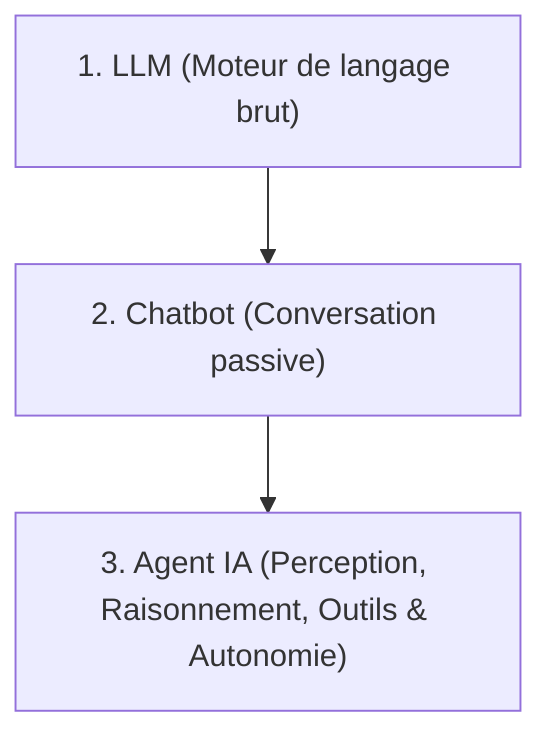
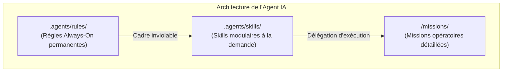

# Tutoriel 2 : Architecture d'un Agent IA et Règles Always-On

> **Unité d'apprentissage** : UA.325.11 — Initialisation de l'Agent IA & Architecture des Skills  
> **Compétence** : `c-325` — Concevoir des Agents IA et développer des Skills  
> **Domaine** : `ia` — Ingénierie de prompt et agents IA  
> **Établissement** : Solicode Tanger  
> **Encadrant** : ESSARRAJ Fouad  

---

## 1. Différence entre LLM, Chatbot et Agent IA

Pour concevoir un environnement de développement assisté par IA, il est indispensable de maîtriser les trois paliers d'autonomie :

- **Le LLM** : Modèle neuronal entraîné sur de vastes corpus textuels. Il prédit statistiquement les séquences de mots sans mémoire persistante ni capacité d'interagir avec l'extérieur.
- **Le Chatbot** : Application conversationnelle superposée au LLM. Il conserve l'historique d'un échange mais demeure passif : il ne peut pas modifier un fichier de code ni exécuter de tests.
- **L'Agent IA de développement** : Entité logicielle autonome dotée d'outils et d'un ancrage dans l'espace de travail. Il perçoit l'arborescence, planifie des tâches, modifie chirurgicalement le code et exécute des commandes système.

---

## 2. Environnement de Développement Augmenté

L'agent IA s'intègre nativement dans l'environnement de développement (IDE) :
- **Perception contextuelle** : L'agent a accès aux fichiers du projet via des chemins relatifs.
- **Cycle Perception $\rightarrow$ Décision $\rightarrow$ Action** :
  1. *Perception* : Lecture de la demande du concepteur et audit des fichiers existants.
  2. *Décision* : Établissement d'un plan d'intervention décomposé en micro-tâches.
  3. *Action* : Utilisation des outils dédiés (édition de code, exécution de scripts, contrôles qualité).

### Outils manipulés par l'agent
- **Outil CLI (`run_command`)** : Exécuter des commandes système (compilation, tests, vérification de statut Git).
- **Outils d'inspection (`read_file`, `list_dir`)** : Lire précisément le code et explorer les répertoires.
- **Outils de modification (`write_file`, `edit_file`)** : Créer ou modifier des fichiers de manière ciblée.

---

## 3. Architecture d'un Agent : Rules Always-On vs Skills Modulaires

L'architecture logicielle d'un agent sépare les contraintes universelles des compétences métier :

### 3.1. Les Règles Always-On (`.agents/rules/`)
- **Définition** : Directives chargées de façon permanente dans le contexte de l'agent à chaque tour.
- **Usage** : Imposer les règles universelles et non négociables du projet :
  - Langue française niveau A1 direct et vocabulaire professionnel de développeur.
  - Zéro tableau Markdown (remplacés obligatoirement par des listes à puces `- `).
  - Portabilité absolue par des liens relatifs exclusifs (`./`, `../`).
  - Un fichier `README.md` obligatoire par dossier et sous-dossier.
  - Interdiction de travailler sur `main` (travail exclusif sur branche `sprint[N]`).
  - **Garde-fou inviolable** : *Interdiction formelle de commit et push par l'Agent IA* (réservé exclusivement au concepteur).

### 3.2. Les Skills Modulaires (`.agents/skills/`)
- **Définition** : Compétences expertes chargées dynamiquement selon le travail demandé par le concepteur.
- **Avantage** : Préserve la fenêtre de contexte de l'agent en évitant d'injecter des instructions inutiles à chaque tour.
- **Découvrabilité** : Découverte native par l'en-tête YAML frontmatter (`name` et `description`).
- **Compacité** : Plafond strict $\le 75$ lignes par fichier `SKILL.md`.

---

## 4. Principes Cardinaux d'Ingénierie Logicielle Appliqués à l'IA

- **SSOT (Single Source of Truth)** : Chaque convention est définie à un endroit unique (ex : les règles de formatage sont dans `regles-generales.md`, jamais réécrites dans les skills).
- **DRY (Don't Repeat Yourself)** : Les compétences métier s'appuient sur le socle des règles Always-On sans les dupliquer.
- **Gouvernance Humaine** : L'Agent IA prépare, structure et vérifie ; seul le développeur humain valide, commit et push sur le dépôt distant.

---

## 5. Conclusion du Tutoriel

L'architecture combinant règles Always-On et skills modulaires garantit un agent prévisible, modulaire et parfaitement intégré dans les processus d'ingénierie logicielle du projet Blog des lauréats.
