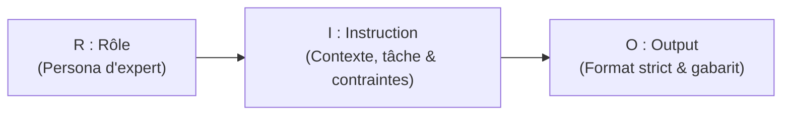

# Tutoriel 1 : Prompt Engineering & Méthode RIO

> **Unité d'apprentissage** : UA.325.11 — Initialisation de l'Agent IA & Architecture des Skills  
> **Compétence** : `c-325` — Concevoir des Agents IA et développer des Skills  
> **Domaine** : `ia` — Ingénierie de prompt et agents IA  
> **Établissement** : Solicode Tanger  
> **Encadrant** : ESSARRAJ Fouad  

---

## 1. Introduction au Prompt Engineering

Le **Prompt Engineering** est une discipline d'ingénierie logicielle consistant à concevoir, calibrer et optimiser les instructions fournies à un modèle de langage (LLM). Son but est d'obtenir des comportements prévisibles, des analyses fiables et du code source directement exploitable en environnement de production.

Dans un flux de développement assisté par IA, un prompt informel conduit à des approximations et des régressions. À l'inverse, un prompt structuré agit comme un contrat d'interface rigoureux.

---

## 2. La Méthode Directrice RIO

La méthode **RIO** découpe toute consigne technique en trois dimensions complémentaires :

### 2.1. R — Rôle (Persona)
- **Définition** : Attribue à l'agent une identité professionnelle précise, un domaine d'expertise et un niveau d'exigence.
- **Rôle technique** : Calibre le vocabulaire, la rigueur d'analyse et les choix d'architecture.
- **Exemple Solicode** :
  > « Tu es un architecte logiciel senior expert en Laravel 12 et en gouvernance d'agents autonomes. »

### 2.2. I — Instruction (Contexte & Tâche)
- **Définition** : Exprime l'action à réaliser avec des verbes précis, le contexte métier et les dépendances.
- **Contraintes négatives (Garde-fous)** : Énoncer explicitement ce que l'agent ne doit **PAS** faire.
- **Exemple Solicode** :
  > « Conçois la consultation d'un article selon une architecture 2 couches (Contrôleur -> Service). N'inclus aucun traitement métier direct dans le contrôleur. »

### 2.3. O — Output (Format attendu)
- **Définition** : Impose la structure de restitution, la langue et les contraintes de forme.
- **Exigences Solicode** :
  - Français simple (niveau A1) avec vocabulaire technique professionnel.
  - Zéro tableau Markdown (listes à puces `- ` exclusives).
  - Portabilité totale via 100% de liens relatifs (`./`, `../`).
  - Plafond strict de compacité ($\le 75$ lignes pour les skills).

---

## 3. Les Prompt Engineering Patterns Fondamentaux

Pour résoudre des problèmes complexes de développement Web, plusieurs patterns de prompt sont couramment appliqués :

- **Persona Pattern** : Cadrer l'expertise technique selon le domaine (ex: développeur backend Laravel, auditeur de sécurité).
- **Template / Format Pattern** : Fournir la structure exacte ou le squelette du fichier à générer.
- **Constraint Pattern** : Définir des limites strictes (ex: interdiction de commit, zéro tableau Markdown).
- **Chain-of-Thought & Step-by-Step** : Forcer le modèle à décomposer son raisonnement en étapes séquentielles avant d'éditer les fichiers.
- **Few-Shot Pattern** : Donner un ou plusieurs exemples concrets de référence pour ancrer la conformité de la réponse.
- **Reflective Pattern** : Demander à l'agent d'auditer son travail et d'émettre un plan interactif avant d'appliquer les modifications.

---

## 4. Démarche d'Amélioration Progressive d'une Demande

L'optimisation d'un prompt suit un cycle itératif d'ingénierie :
1. **Émission initiale** : Exprimer le besoin métier brut.
2. **Diagnostic** : Identifier les imprécisions, le manque de contexte ou l'absence de contraintes.
3. **Restructuration RIO** : Intégrer le rôle d'expert, clarifier les verbes d'action et fixer le gabarit de sortie.
4. **Vérification** : Tester le comportement de l'agent et ajuster les garde-fous.

---

## 5. Conclusion du Tutoriel

La maîtrise de la méthode RIO et des patterns d'ingénierie de prompt constitue le socle indispensable pour piloter efficacement un Agent IA de développement et concevoir des instructions robustes pour le projet Blog des lauréats.
