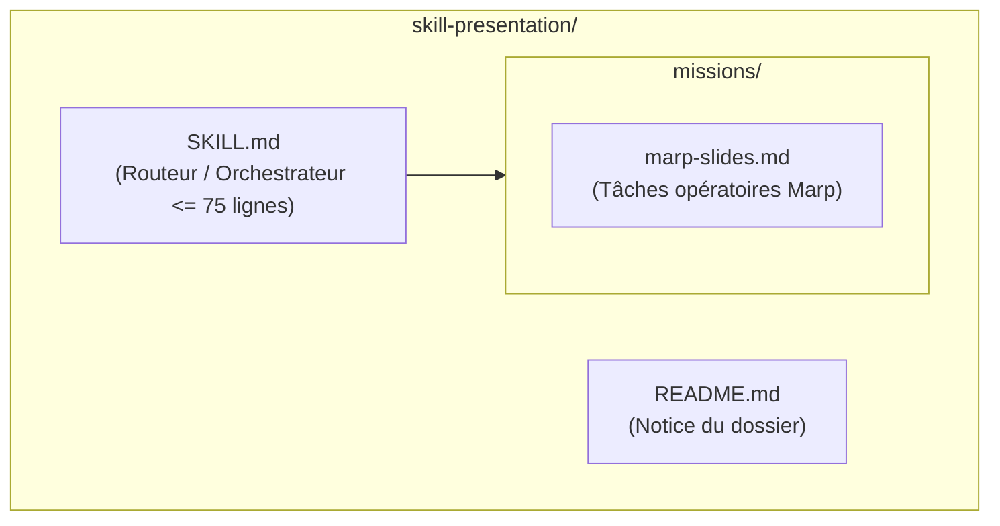

# Tutoriel 3 (Atelier) : Conception d'un Skill Agentique — Exemple `skill-presentation`

> **Unité d'apprentissage** : UA.325.11 — Initialisation de l'Agent IA & Architecture des Skills  
> **Compétence** : `c-325` — Concevoir des Agents IA et développer des Skills  
> **Domaine** : `ia` — Ingénierie de prompt et agents IA  
> **Établissement** : Solicode Tanger  
> **Encadrant** : ESSARRAJ Fouad  

---

## 1. Objectifs de l'Atelier Pratique

Cet atelier met en pratique la conception d'un skill modulaire complet pour un Agent IA :
- Comprendre le cycle de vie et la structure d'un skill agentique.
- Appliquer la structure canonique normalisée fixée dans `skills-dev`.
- Expérimenter le découpage modulaire en déléguant des tâches opératoires à une mission spécialisée dans `missions/`.
- Vérifier la découvrabilité native par le frontmatter YAML.

---

## 2. Anatomie d'un Skill Modulaire

Un skill professionnel s'organise selon une hiérarchie claire :



### 2.1. Le Fichier Orchestrateur (`SKILL.md`)
- **Frontmatter YAML** : Définit le nom unique (`name: skill-presentation`) et une description orientée action. C'est ce bloc que l'Agent lit pour savoir quand activer le skill.
- **Section 1 : Mission** : Résume en 1 ou 2 phrases le périmètre de la compétence.
- **Section 2 : Déclenchement** : Énonce précisément quand l'activer (travail demandé par le concepteur) et quand ne pas l'activer.
- **Section 3 : Missions disponibles** : Liste les missions spécialisées du sous-dossier `missions/`.
- **Règle de compacité** : Plafond strict $\le 75$ lignes.

### 2.2. Les Missions Spécialisées (`missions/`)
- Contiennent les étapes opératoires détaillées, les commandes CLI spécifiques et les gabarits de livrables.
- Permettent au fichier `SKILL.md` de rester épuré sans saturer la fenêtre de contexte de l'agent.

---

## 3. Mise en Œuvre Pratique du Skill `skill-presentation`

### 3.1. Code du fichier `SKILL.md`
Le fichier `SKILL.md` implanté dans l'atelier :
```markdown
---
name: skill-presentation
description: >-
  Génère des présentations orales et diaporamas pédagogiques.
  Délègue la conception à ses missions spécialisées dans missions/.
---

# Skill Présentation : /skill-presentation

## 1. Mission
Orchestrer la création de présentations de diapositives pour la soutenance de projet et les restitutions d'apprentissage.

## 2. Déclenchement
- **Quand l'activer** :
  - L'apprenant demande la création d'un diaporama de présentation ou d'une soutenance orale.
- **Quand NE PAS l'activer** :
  - Rédaction de documentations textuelles standards (utiliser les skills de documentation).

## 3. Missions disponibles
L'agent identifie le format demandé et exécute la mission correspondante située dans `missions/` :
- `missions/marp-slides.md` : Générer un diaporama au format Marp Markdown avec page de garde normalisée Solicode.
```

### 3.2. Code de la mission `missions/marp-slides.md`
La mission spécialisée dans la création de diapositives Marp :
- En-tête Marp obligatoire (`marp: true`, theme default, paginate: true).
- Page de garde normalisée Solicode (`<!-- _class: lead -->`, Apprenant, Encadrant ESSARRAJ Fouad, Établissement Solicode Tanger, Domaine, Compétence).
- Respect absolu de la règle du zéro tableau Markdown (listes à puces `- ` exclusives).
- Diapositive de conclusion obligatoire.

---

## 4. Comparaison avec les Skills du Projet

L'architecture expérimentée dans cet atelier est identique à celle déployée sur le projet d'imitation Blog des lauréats :
- **Skill `skills-dev`** : Méta-gouvernance des skills et garant de la compacité ($\le 75$ lignes).
- **Skill `gestion-depot`** : Orchestrateur compact (24 lignes) déléguant à deux missions :
  - `missions/init-depot.md` (initialisation Git, contrôle de branche, publication GitHub CLI).
  - `missions/init-projet.md` (README.md racine, dossiers racine `src/`, `presentations/`, `rapport/`).

---

## 5. Conclusion de l'Atelier

La conception du skill `skill-presentation` démontre la puissance du découpage modulaire :
- Clarté du rôle de l'agent.
- Économie de tokens et compacité préservée.
- Réutilisabilité des missions pour tout type de présentation.
