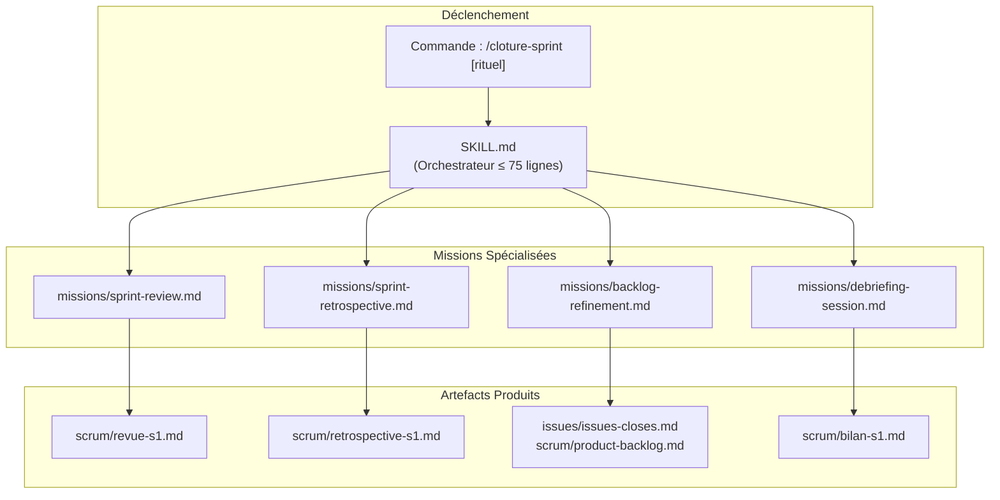

# Compte-Rendu d'Atelier : Conception du Skill Modulaire `cloture-sprint`

## 1. Objectifs & Compétences Mobilisées
- **Compétence principale :** `C.325` — Concevoir, outiller et faire évoluer un Agent IA autonome pour le développement logiciel.
- **Compétence associée :** `C.351` — Gouverner les rituels agiles et les cérémonies de sprint Scrum.
- **Objectif opérationnel :** Remplacer une suite de 4 prompts isolés par un skill unifié, découvrable et actionnable par l'Agent IA via la commande conventionnelle `/cloture-sprint`.

## 2. Architecture Technique du Skill
Le skill s'organise selon le patron d'architecture modulaire d'Antigravity :
- **Orchestrateur racine (`SKILL.md`) :** Définit les métadonnées, les triggers sémantiques, les gardes-fous et cartographie les commandes vers les missions spécialisées.
- **Dossier des missions (`missions/`) :** Contient les 4 sous-fichiers opérationnels régissant chaque cérémonie sans surcharge de contexte.
- **Documentation opérationnelle (`doc/how-to-use.md`) :** Guide pratique pour les développeurs et Scrum Masters.

## 3. Comparaison Didactique : Prompts Isolés vs Skill Modulaire
- **Limites des prompts isolés (`*.prompt.md`) :** Fichiers passifs dispersés dans l'arborescence, nécessitant des copier-coller manuels, sans formalisation des conditions d'activation ni contrôle de contexte.
- **Avantages du Skill Modulaire (`cloture-sprint`) :**
  - Activation native par l'agent via le mot-clé `/cloture-sprint`.
  - Isolation contextuelle : chaque rituel ne charge que la mission nécessaire.
  - Réutilisabilité directe sur l'ensemble des sprints futurs (Sprint 2, Sprint 3, etc.).
  - Respect strict des standards de sortie (zéro tableau Markdown, traçabilité des livrables).

## 4. Bilan d'Expérimentation
Le skill a été déployé sous `.agents/skills/cloture-sprint/` et testé avec succès sur les artefacts du Sprint 1 du *Blog des Lauréats*.
